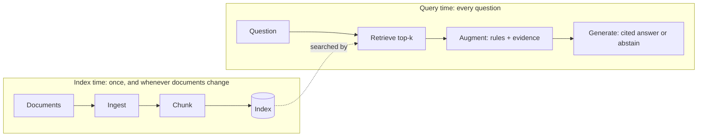
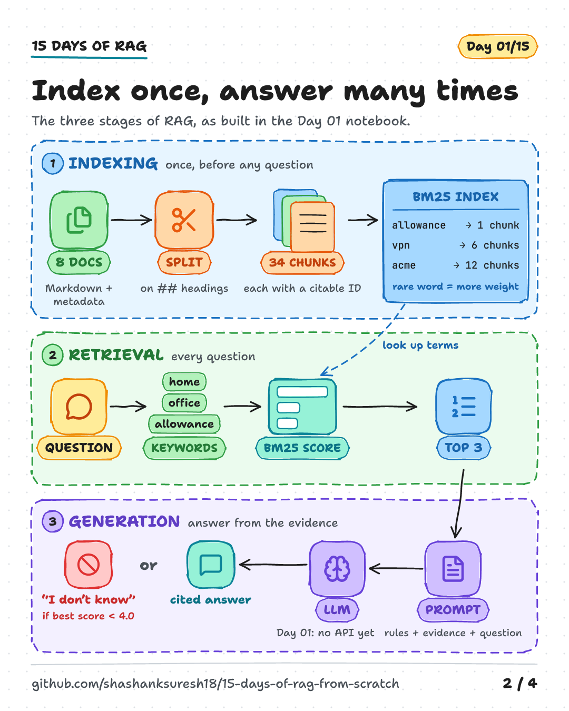
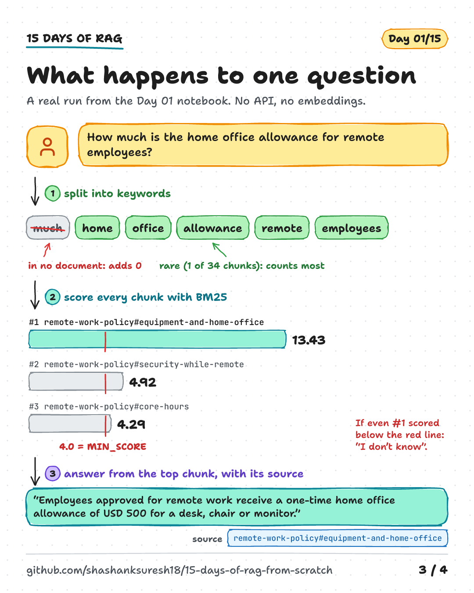

# Day 01 — RAG Foundations

**What RAG is, how it works, and when to use it**

| | |
|---|---|
| **Series** | 15 Days of Modern, Enterprise-Relevant RAG from Scratch · Day 01/15 |
| **Level** | Beginner (comfortable reading Python) |
| **Time** | ~40 min reading · ~20 min running the notebook and exercises |
| **Cost** | Free. No API key, no internet access, no paid services |
| **Code** | [`notebooks/day_01_rag_foundations.ipynb`](../../notebooks/day_01_rag_foundations.ipynb) — Python standard library only |
| **Visuals** | [`assets/day-01/`](../../assets/day-01/) |
| **Verified** | Notebook executed top to bottom on 2026-10-13 with Python 3.11, 3.12, 3.13 and 3.14 on Linux. Windows and macOS not yet tested. |

---

## Learning objectives

By the end of today you will be able to:

1. Explain Retrieval-Augmented Generation (RAG) in one sentence, and say why it exists.
2. Contrast a closed-book model answer with a grounded, cited RAG answer.
3. Name the two phases (index time and query time) and the four core stages: ingestion, indexing, retrieval and generation.
4. Build and read a tiny keyword retriever that shows its evidence, its scores and its reasons.
5. Recognise three failure types you will meet again in every RAG system, and decide when RAG is the wrong tool.

## Prerequisites

- Basic Python: functions, lists, dictionaries, classes.
- Python 3.11 or newer, Git, and a way to run Jupyter notebooks (JupyterLab, VS Code or similar).
- No machine-learning background is needed today.

## Key terms

| Term | Meaning |
|---|---|
| **LLM** (large language model) | A model trained on large amounts of text to predict and generate text. Its built-in knowledge is frozen at training time. |
| **RAG** (Retrieval-Augmented Generation) | A pattern: retrieve relevant evidence from a collection of documents, then have a generator answer *from that evidence*. |
| **Grounding** | Tying an answer to specific, inspectable sources rather than to the model's memory. |
| **Corpus** | The collection of documents a system can search. Today: 8 synthetic policy files. |
| **Ingestion** | Loading raw sources into clean records with IDs and metadata. |
| **Chunk** | A retrievable piece of a document, such as one section. |
| **Index** | A data structure that makes search fast. An **inverted index** maps each term to the chunks that contain it. |
| **Retrieval** | Finding the chunks most relevant to a question, usually the **top-k** (here, k = 3). |
| **BM25** | A classic keyword-ranking function that rewards rare, matching terms. Today's retriever. |
| **Embedding** | A vector representation of text that captures meaning beyond exact words. Not used today; arrives on Day 04. |
| **Citation** | A pointer from an answer to the chunk that supports it, e.g. `[remote-work-policy#core-hours]`. |
| **Abstention** | Deliberately answering "I don't know" when the evidence is too weak. |
| **Hallucination** | A fluent, confident answer that is not supported by sources or facts. |
| **Prompt injection** | Text — typed by a user or hidden in a retrieved document — that tries to override a model's instructions. |

---

## 1. What RAG is, and why it matters

**RAG retrieves relevant evidence first, then generates an answer from that evidence.**

The term comes from a 2020 paper by Lewis et al., which paired a neural retriever over Wikipedia with a text generator ([arXiv:2005.11401](https://arxiv.org/abs/2005.11401)). Today "RAG" describes the broader pattern, whatever retriever or model you use.

A language model on its own has three limitations that matter in real organisations:

- **It doesn't know your data.** Internal policies, contracts, tickets and runbooks were never in its training set.
- **Its knowledge is frozen.** A policy updated yesterday is invisible to it.
- **It can't show its sources.** Even a correct answer is hard to verify or audit.

RAG addresses all three without retraining the model:

| Need | How RAG helps |
|---|---|
| Private knowledge | Search your own documents at question time. |
| Freshness | Update the index when a document changes; no retraining required. |
| Traceability | Every answer can cite the chunk it came from. |
| Access control (later) | Retrieval can be restricted to documents the user is allowed to see. **This must be enforced in the retrieval/data layer, never by prompt instructions** (Day 14). |

RAG is not magic. It moves the hard part from "the model must know" to "the system must *find*" — and finding the right evidence is a search problem with its own failure modes, which is why this series starts with retrieval.

## 2. Closed-book answers vs grounded RAG answers

Take a question from today's corpus: *"How much is the home office allowance for remote employees?"* Acme Corp is fictional, so no model was ever trained on its policies.

| | Closed-book (model alone) | Grounded (RAG) |
|---|---|---|
| **What the model sees** | Only the question | The question **plus** retrieved evidence and rules |
| **Where knowledge comes from** | Training data (frozen) | Your documents (current as of the last index update) |
| **Private data** | Unknown to the model | Available if indexed and permitted |
| **Citations** | None, or invented | Real chunk IDs you can open and check |
| **Typical failure** | Confident guess (hallucination) | Wrong or missing evidence retrieved |
| **What to do when unsure** | Depends on the model | Designed in: abstain when evidence is weak |
| **Updating knowledge** | Retrain or fine-tune | Re-index the changed document |

The Day 01 notebook prints both prompts side by side (section 6). The grounded version is about 200 words: rules, three evidence chunks with IDs and review dates, and the question.

> **Grounded does not mean guaranteed correct.** A RAG system can retrieve the wrong passage, miss the right one or misread good evidence. You'll see all three below. Grounding makes errors *visible and debuggable*; it does not remove them.

## 3. The RAG architecture

Every RAG system, from this notebook to a large enterprise deployment, has two phases.





- **Index time** prepares documents so they can be searched quickly. It runs before questions arrive, and again whenever documents are added, changed or deleted.
- **Query time** runs for every question: retrieve evidence, assemble it into a prompt, generate an answer.

The split matters for engineering: index-time work can be slow and batched; query-time work sits directly in front of a user's latency budget.

## 4. The four stages

### 4.1 Ingestion — turn files into trustworthy records

**What it does:** reads sources (Markdown, HTML, PDFs, tickets, databases) and produces clean text plus metadata.

**Day 01:** reads 8 Markdown files and parses a small header in each:

```
---
title: Remote Work Policy
owner: People Team
last_reviewed: 2026-03-02
---
```

Each document gets a **stable ID** from its file name (`remote-work-policy`) and keeps its **source path**. These travel with every chunk, so a citation can always be traced back to a file, an owner and a review date.

**What goes wrong in practice:** broken PDF/table extraction, missing or wrong metadata, duplicate documents, and stale versions that never get removed. → **Day 02.**

### 4.2 Indexing — chunk, then make searchable

**Chunking** splits documents into retrievable pieces. Day 01 splits on `##` headings, giving **34 chunks** of about 27 words each, with IDs such as `remote-work-policy#core-hours`. Good chunks are small enough to be precise and large enough to make sense alone. → **Day 03.**

**Indexing** builds a structure for fast search. Day 01 builds an **inverted index** (term → chunks containing it) and precomputes the statistics BM25 needs. Production systems may add vector indexes, hybrid indexes and metadata filters. → **Days 04–05.**

A practical detail: Day 01 indexes each chunk's **document title and section heading together with its text**, because headings often name the topic even when the body doesn't repeat it.

### 4.3 Retrieval — find the evidence

**What it does:** scores chunks against the question and returns the best `k`.

**Day 01:** uses **BM25**. In plain English, a chunk scores higher when:

- it contains the question's **rare** terms (inverse document frequency, IDF);
- it contains them **repeatedly**, with diminishing returns (controlled by `k1`);
- it is **not unusually long** (length normalisation, controlled by `b`).

The notebook uses `k1 = 1.2` and `b = 0.75`, the documented defaults of Apache Lucene's [`BM25Similarity`](https://lucene.apache.org/core/10_4_0/core/org/apache/lucene/search/similarities/BM25Similarity.html), and the same always-positive IDF formula.

Two rules for reading scores:

1. **A BM25 score is not a probability.** It only ranks chunks for one query within one corpus.
2. **Relevance is not the same as answerability.** A chunk can match many words and still not answer the question.

### 4.4 Generation — answer from the evidence, or don't answer

**What it does:** combines instructions, evidence and the question (*augmentation*), then produces an answer with citations.

**Day 01 does not call an LLM.** It uses an honest stand-in:

- an **extractive answerer** that copies the single evidence sentence that best covers the question's terms, with its chunk ID;
- an **abstention rule**: if the best retrieval score is below `MIN_SCORE = 4.0`, or no evidence sentence contains a question term, answer *"I don't know based on the indexed documents."*;
- a **grounded prompt builder** that shows exactly what an LLM would receive.

The prompt keeps instructions separate from evidence, marks the evidence as *data, not instructions*, attaches source IDs and dates, and includes an explicit "I don't know" path. These choices *reduce* risk; they do not make a system secure. OWASP lists prompt injection as the top risk for LLM applications and notes that RAG does not fully mitigate it ([OWASP LLM01:2025](https://genai.owasp.org/llmrisk/llm01-prompt-injection/)). → **Day 06** adds a real model; **Day 14** covers security.

---

## 5. Walk-through with real output

> **Tested output.** Everything in this section was produced by executing the notebook on 2026-10-13 (Python 3.13, Linux). Your output should match exactly, because the code is deterministic and the corpus is fixed.

**Question:** *How much is the home office allowance for remote employees?*

The retriever's top 3:

| Rank | Chunk | BM25 score | Matched terms (contribution) |
|---|---|---|---|
| 1 | `remote-work-policy#equipment-and-home-office` | **13.43** | home 3.65, allowance 3.65, office 2.67, remote 2.14, employees 1.32 |
| 2 | `remote-work-policy#security-while-remote` | 4.92 | remote 2.57, office 2.34 |
| 3 | `remote-work-policy#core-hours` | 4.29 | remote 2.57, employees 1.71 |

Why #1 wins, term by term:

```text
[remote-work-policy#equipment-and-home-office]  length 40 tokens (average 24.0)

term        count here  chunks with term    IDF  contribution
much                 0                 0   4.25          0.00
home                 2                 1   3.15          3.65
office               2                 3   2.30          2.67
allowance            2                 1   3.15          3.65
remote               2                 5   1.85          2.14
employees            1                 6   1.68          1.32
total                                                   13.43
```

"home" and "allowance" each appear in only 1 of 34 chunks, so they carry the most weight; "employees" appears in 6, so it carries less. "much" never appears in the corpus, so it adds nothing.

The grounded answer:

```text
Question: How much is the home office allowance for remote employees?
Answer:   Employees approved for remote work receive a one-time home office allowance of USD 500 for a desk, chair or monitor. [remote-work-policy#equipment-and-home-office]
Why:      best score 13.43 >= MIN_SCORE 4.0
          evidence #1: 13.43  [remote-work-policy#equipment-and-home-office]
          evidence #2:  4.92  [remote-work-policy#security-while-remote]
          evidence #3:  4.29  [remote-work-policy#core-hours]
```



## 6. Where the baseline fails — on purpose

A baseline is only useful if you know its limits. These are real runs from the notebook (section 7).

| Question | What happened | Failure type | What helps later |
|---|---|---|---|
| *What is the capital of France?* | No keyword matches the corpus → **abstains** | Correct behaviour: out of scope | Keep this behaviour as the system grows |
| *How much time off do new dads get?* | Best score 3.15 < 4.0 → **abstains**, although the answer is in `parental-leave-policy#leave-entitlement` | **Vocabulary mismatch**: the question shares no keywords with the answer chunk | Embeddings (Day 04), hybrid search (Day 08), query rewriting (Day 10) |
| *What is Google's remote work policy?* | "remote work policy" scores 5.57 ≥ 4.0 → returns an Acme sentence as if it answered | **Relevant ≠ answers the question** | A reader that checks the evidence (Day 06), evaluation sets (Days 07, 12) |

The vocabulary-mismatch case, in full:

```text
Question:    How much time off do new dads get?
Query terms: ['much', 'time', 'off', 'new', 'dads', 'get']

#1  score  3.15  [security-incident-reporting#what-not-to-do]
    matched: off 3.15
#2  score  2.89  [new-starter-it-checklist#your-first-day]
    matched: new 2.89
#3  score  2.76  [remote-work-policy#purpose]
    matched: time 2.76
```

The top hit matched "off" from *"do not turn it off"* in the security policy. Keyword search matches **words, not meaning**. The abstention threshold turned what would have been a confidently wrong answer into "I don't know" — the safer failure. Lower `MIN_SCORE` to 3.0 (notebook exercise 1) and you will see the wrong answer appear.

**Three lessons to carry through the series:**

1. **Retrieval is the ceiling.** If the right chunk is never retrieved, no model can use it.
2. **A score threshold catches weak matches, not wrong-but-relevant ones.** Case C needs a reader that judges whether evidence answers the question, plus test questions designed to catch it.
3. **"I don't know" is a feature.** Measure and protect it, just like accuracy.

`MIN_SCORE = 4.0` was chosen by looking at scores for a handful of questions on this corpus. That is tuning on your demo questions: fine for learning, misleading in production. Day 07 replaces it with a labelled evaluation set.

## 7. When to use RAG — and when not to

RAG is a strong default for **question answering over a large, changing or private body of text**, especially when users need citations or different users may see different documents. It is not always the right tool.

| Situation | Often a better first choice | Why |
|---|---|---|
| A handful of short, stable documents | Put them directly in the prompt (long-context prompting) | Simpler; no retrieval to get wrong. Watch cost, latency and the fact that models may use information in the middle of long inputs less reliably ([Liu et al., 2023](https://arxiv.org/abs/2307.03172)). Also gives no per-user filtering. |
| Users want to *find documents*, not get answers | Ordinary search with good ranking and filters | Users can scan results themselves; no generation risk. |
| Exact facts in structured systems ("open tickets for customer X") | SQL, an API call or a tool | Structured queries are precise and auditable. |
| You need a different *style or behaviour*, not new facts | Prompting, or fine-tuning | RAG adds knowledge, not skills. |
| Calculations or actions | Tools / function calling | Retrieval doesn't compute or act. |

In practice these combine: many production assistants use retrieval for documents, tools for live data, and prompting for behaviour. Cloud platforms describe both a "classic" single-query RAG pipeline and newer "agentic" retrieval that plans multiple sub-queries ([Microsoft Azure AI Search, RAG overview](https://learn.microsoft.com/en-us/azure/search/retrieval-augmented-generation-overview)). This series builds the classic pipeline first, measures it, and only adds complexity when evaluation shows a benefit.

## 8. Real-world enterprise use cases

| Use case | Typical corpus | What matters most |
|---|---|---|
| **Internal knowledge assistant** (HR, IT, finance policies) | Handbooks, policies, FAQs | Freshness ("which version?"), citations to the official source, confident abstention |
| **Customer-support copilot** | Help-centre articles, past tickets, product docs | Matching customers' wording to official terminology (vocabulary mismatch!), latency |
| **Engineering and operations** | Runbooks, architecture docs, incident reviews | Exact identifiers (error codes, service names), where keyword search is strong |
| **Legal, compliance and procurement** | Contracts, regulations, internal controls | Precise citations, document versions, strict access control, audit trails |
| **Sales and account teams** | Product sheets, pricing rules, case studies | Preventing outdated or unapproved claims; per-region or per-customer visibility |
| **Regulated domains** (healthcare, finance, public sector) | Guidelines, procedures, records | Permissions, PII handling, retention, human review of answers |

The same three questions recur in every row: *Is the evidence current? Is the user allowed to see it? Can we prove where the answer came from?* That is why this series carries IDs and metadata from Day 01, and treats security as a design input rather than a late retrofit.

Managed platforms expose the same building blocks you're learning here. For example, Amazon Bedrock Knowledge Bases offers a retrieve-only operation and a retrieve-and-generate operation that returns citations to source chunks ([AWS documentation](https://docs.aws.amazon.com/bedrock/latest/userguide/kb-how-retrieval.html)). Understanding the mechanics lets you evaluate any such platform on its merits.

## 9. Core trade-offs

| Decision | Smaller / stricter | Larger / looser |
|---|---|---|
| **Chunk size** | Precise matches and citations; may lose surrounding context | More context per hit; more noise and longer prompts |
| **Top-k** | Cheaper, shorter prompts; may miss the answer (see parental-leave exercise) | Better recall; more irrelevant text competing for attention, more cost |
| **Abstention threshold** | More "I don't know", including on answerable questions | More answers, including confidently wrong ones |
| **Keyword (BM25) vs semantic retrieval** | Exact terms, IDs and codes; transparent scoring; no model needed | Handles paraphrases and synonyms; less transparent, needs an embedding model |
| **Extractive vs generated answers** | Can't invent text; can't combine or rephrase | Fluent, can synthesise across chunks; can misread or invent |

There is no universally right setting. Each later day measures these choices on the same questions instead of assuming one is better.

---

## 10. Setup, step by step

**Requirements:** Python 3.11+ (3.10 reached end-of-life on 2026-10-01 per the [Python release status page](https://devguide.python.org/versions/)), Git, and about 200 MB of disk for the virtual environment.

```bash
# 1. Clone and enter the repository
git clone https://github.com/shashanksuresh18/15-days-of-rag-from-scratch.git
cd 15-days-of-rag-from-scratch

# 2. Create and activate a virtual environment
python3 -m venv .venv
source .venv/bin/activate            # macOS / Linux
# .venv\Scripts\Activate.ps1         # Windows PowerShell

# 3. Install the tested dependencies
python -m pip install -r requirements.txt

# 4. Open the notebook
jupyter lab notebooks/day_01_rag_foundations.ipynb
#    then: Kernel -> Restart Kernel and Run All Cells

# 5. (Optional) Run the automated checks
python -m pytest
```

On Windows, use `py -3.11 -m venv .venv` if `python3` isn't available. If PowerShell blocks the activation script, see the [Python `venv` documentation](https://docs.python.org/3/library/venv.html) for execution-policy guidance.

**Configuration:** none. `.env.example` exists for later days; Day 01 needs no environment variables or keys.

## 11. Code walkthrough

The notebook is organised to mirror the architecture:

| Notebook section | Concept | Key code |
|---|---|---|
| 1. Ingest | Stable IDs, metadata, provenance | `parse_front_matter`, `load_documents` |
| 2. Chunk | Citable units | `split_into_sections` → `Chunk(chunk_id="doc#section")` |
| 3. Index | Tokenization, inverted index, BM25 | `tokenize`, `BM25Index` |
| 4. Retrieve | Ranked, explainable evidence | `index.search`, `show_results`, `explain` |
| 5. Generate (API-free) | Cited extractive answer, abstention | `answer_question` |
| 6. Prompt | What an LLM would receive | `build_grounded_prompt` |
| 7. Failures | Three failure types | live examples |
| 8. Sanity checks | Deterministic regression tests | `assert` statements |

The heart of BM25 is a single method:

```python
def term_score(self, term: str, i: int) -> float:
    tf = self.term_counts[i].get(term, 0)
    if tf == 0:
        return 0.0
    length_norm = 1 - self.b + self.b * self.lengths[i] / self.avg_length
    return self.idf(term) * tf * (self.k1 + 1) / (tf + self.k1 * length_norm)
```

And grounding comes down to two early exits before any answer is produced:

```python
min_score = MIN_SCORE if min_score is None else min_score
results = index.search(question, k=k)
if not results:
    return GroundedAnswer(question, None, None, [], "no indexed chunk shares a term with the question")
if results[0].score < min_score:
    return GroundedAnswer(question, None, None, results,
                          f"best score {results[0].score:.2f} is below MIN_SCORE {min_score}")
```

## 12. Expected output and what was tested

| Item | Status |
|---|---|
| Notebook runs top to bottom in a fresh kernel | **Tested** on Python 3.11, 3.12, 3.13, 3.14 (Linux), from both the repo root and `notebooks/` |
| Outputs in sections 5 and 6 of this guide | **Tested**: copied from the executed notebook |
| `python -m pytest` (3 tests) | **Tested**: passes on the same four Python versions |
| Windows and macOS | **Not tested yet.** The CI workflow in `.github/workflows/tests.yml` runs both once the repo is on GitHub |
| GitHub rendering of the Mermaid diagram and math | **Not verified** until pushed to GitHub |
| Pasting prompts into a chatbot (optional experiment) | **Not tested**: depends on the tool you use |

## 13. Common errors and mistakes

### Setup errors

| Symptom | Cause | Fix |
|---|---|---|
| `FileNotFoundError: Could not find data/sample/acme-handbook` | Jupyter was started outside the repository | Start Jupyter from inside the cloned repo, or open the notebook from there |
| `AssertionError: This series needs Python 3.11 or newer.` | Old interpreter or wrong kernel | Select the `.venv` kernel; check with `python --version` |
| `pip install` fails resolving `ipykernel==7.4.0` | Python 3.10 or older | Install Python 3.11+ and recreate `.venv` |
| Kernel shows a different Python than your venv | A user-level `python3` kernel spec points elsewhere | Run `jupyter kernelspec list` and choose the environment's kernel |
| `Kernel is running over TCP without encryption` warning | Printed by recent ipykernel when a kernel starts locally | Harmless for local work on your own machine. Never expose a Jupyter server to a network without authentication |
| Sanity check fails after you edit a document | The checks expect the original corpus | Expected — read the assertion, then update it deliberately |

### Conceptual mistakes (the expensive ones)

1. **Judging RAG by the model.** Most bad answers start with bad retrieval. Inspect the evidence before changing the prompt or the model.
2. **Shipping answers without citations.** Without source IDs, nobody can verify, debug or audit an answer.
3. **Skipping the simple baseline.** If you never measured BM25, you can't prove embeddings, reranking or agents helped.
4. **Trusting a threshold to catch every bad answer.** It only catches weak matches (failure B), not relevant-but-wrong ones (failure C).
5. **Tuning on your demo questions.** Settings chosen by eyeballing a few queries rarely generalise. Use a held-out labelled set (Day 07).
6. **Using prompt instructions as security.** "Only show finance data to finance staff" in a prompt is not access control. Filter documents by the user's permissions *before* retrieval results reach the model (Day 14).
7. **Treating retrieved text as trusted.** Documents can contain instructions written by anyone who can edit them. Treat them as untrusted input.
8. **Ignoring freshness.** An index that isn't updated when policies change confidently serves outdated answers. Keep review dates and plan updates and deletions (Days 02 and 05).

## 14. Privacy, licensing and security notes

- **Data:** the Acme corpus is synthetic and was written for this repository. Email addresses use the reserved `.example` domain. See [`data/sample/README.md`](../../data/sample/README.md).
- **Your own data:** don't paste confidential documents into AI tools your organisation hasn't approved, including for the optional closed-book vs open-book experiment.
- **Permissions:** today's code has none. Every user sees every chunk. That is acceptable for a public synthetic corpus and **unacceptable** for real internal documents.
- **Status:** this is a teaching baseline, not a production system.

## 15. Key takeaways

1. **RAG = retrieve evidence, then answer from it.** Retrieval quality sets the ceiling for answer quality.
2. **Make evidence visible.** Stable IDs, scores, matched terms and metadata turn a black box into a system you can debug and audit.
3. **Design for "I don't know" — and know its limits.** Abstention catches weak evidence; catching relevant-but-wrong evidence needs a reader that checks the evidence, and evaluation.

## 16. Exercise

**Find the threshold trade-off yourself (15 minutes).**

1. In the notebook, ask `"My account is locked, what now?"`. It abstains, even though the corpus has an *Account lockout* section. Use `tokenize()` on the question and on the section text to explain why.
2. Change `MIN_SCORE` to `3.0`, restart the kernel and run all cells. Which question starts getting answered correctly? Which one starts getting answered *wrongly*? Which sanity check fails, and what is it protecting?
3. Write two sentences: what would you need in order to choose `MIN_SCORE` responsibly? (Hint: Day 07.)

The notebook's section 9 has four more exercises, covering top-k, tokenization, adding a document and a preview of prompt injection.

---

## References

All links checked on **2026-10-13**. Version-specific pages may change; re-check before relying on details.

- Lewis, P. et al. (2020). *Retrieval-Augmented Generation for Knowledge-Intensive NLP Tasks.* [arXiv:2005.11401](https://arxiv.org/abs/2005.11401)
- Manning, C. D., Raghavan, P. and Schütze, H. (2008). *Introduction to Information Retrieval.* Cambridge University Press. [Free online edition](https://nlp.stanford.edu/IR-book/) — chapters 1–2 (inverted index) and 6 (term weighting).
- Apache Lucene 10.4.0, [`BM25Similarity` API documentation](https://lucene.apache.org/core/10_4_0/core/org/apache/lucene/search/similarities/BM25Similarity.html) — default `k1 = 1.2`, `b = 0.75`, IDF formula.
- Liu, N. F. et al. (2023). *Lost in the Middle: How Language Models Use Long Contexts.* [arXiv:2307.03172](https://arxiv.org/abs/2307.03172)
- OWASP GenAI Security Project, [LLM01:2025 Prompt Injection](https://genai.owasp.org/llmrisk/llm01-prompt-injection/)
- Microsoft Learn, [Retrieval-augmented generation (RAG) in Azure AI Search](https://learn.microsoft.com/en-us/azure/search/retrieval-augmented-generation-overview) (page updated 2026-08-04) — classic vs agentic retrieval, security trimming.
- AWS, [Retrieving information from data sources using Amazon Bedrock Knowledge Bases](https://docs.aws.amazon.com/bedrock/latest/userguide/kb-how-retrieval.html)
- Python Developer's Guide, [Status of Python versions](https://devguide.python.org/versions/)

## Next: Day 02 — Ingestion, parsing and metadata

Real documents arrive as PDFs, HTML and tables; they change, get deleted and have owners and permissions. Day 02 builds a reproducible ingestion pipeline with stable IDs and provenance, and shows where PDF and table extraction goes wrong.
