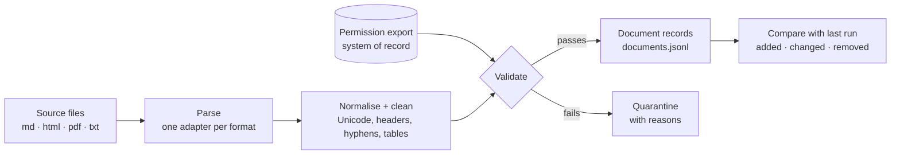
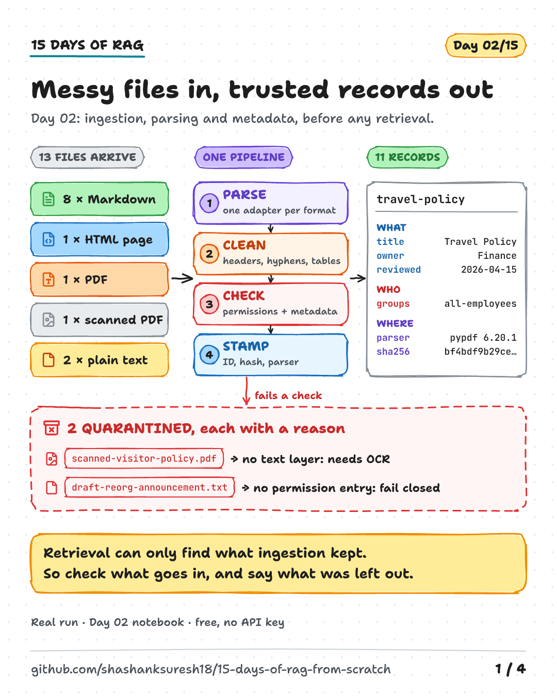
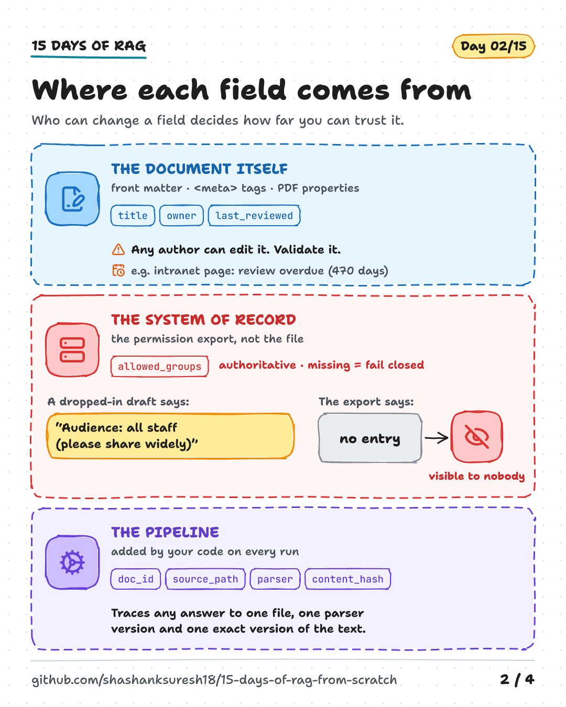
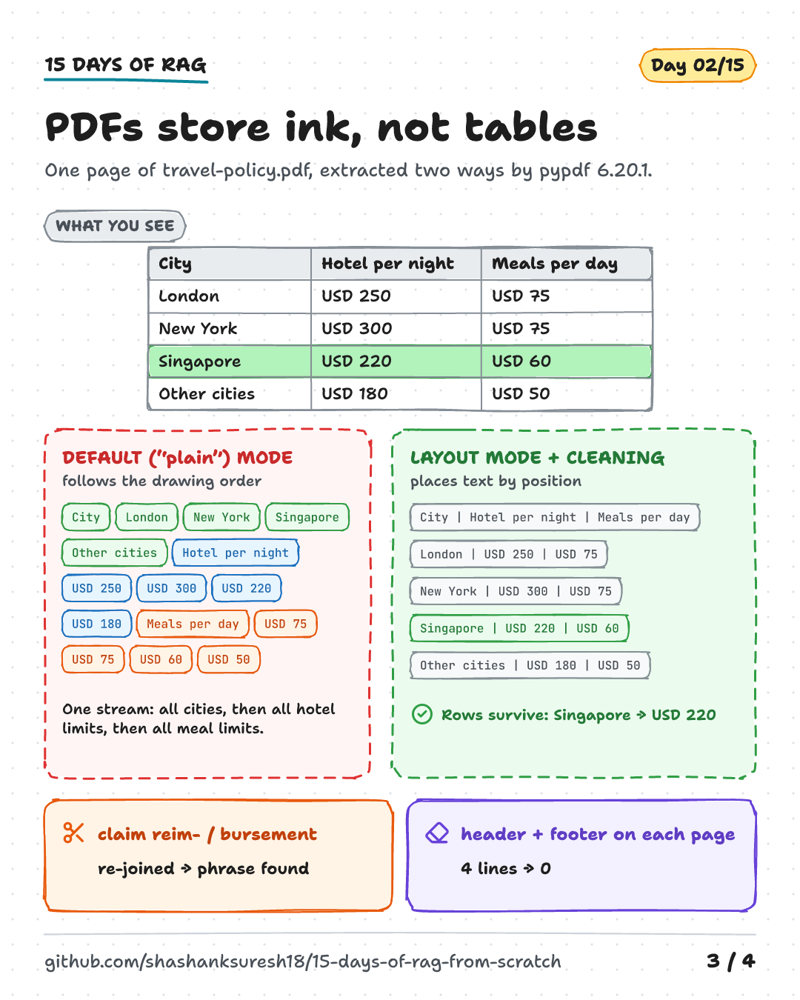
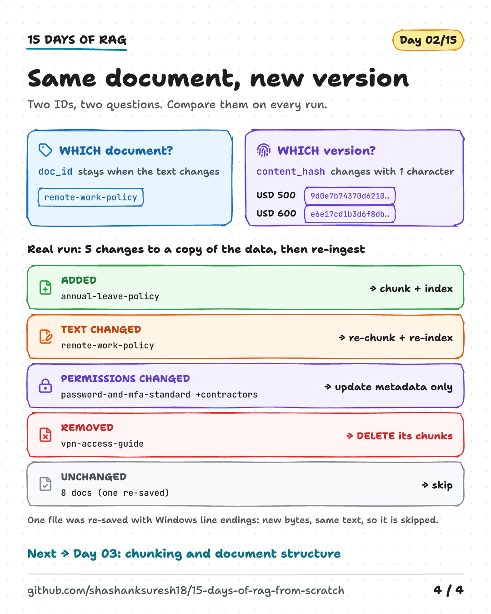

# Day 02 — Ingestion, Parsing and Metadata

**Messy files in, trustworthy records out**

| | |
|---|---|
| **Series** | 15 Days of Modern, Enterprise-Relevant RAG from Scratch · Day 02/15 |
| **Level** | Beginner to intermediate (comfortable reading Python; Day 01 helps but isn't required) |
| **Time** | ~45 min reading · ~25 min running the notebook and exercises |
| **Cost** | Free. No API key, no internet access at run time, no paid services |
| **Code** | [`notebooks/day_02_ingestion_and_metadata.ipynb`](../../notebooks/day_02_ingestion_and_metadata.ipynb) — standard library plus [`pypdf`](https://pypdf.readthedocs.io/) |
| **Visuals** | [`assets/day-02/`](../../assets/day-02/) |
| **Verified** | Notebook executed top to bottom on 2026-10-13 on Linux with Python 3.11, 3.12, 3.13 and 3.14 (pypdf 6.20.1), from both the repo root and `notebooks/`. CI runs the same tests on Linux, Windows and macOS on every push. |

---

## Learning objectives

By the end of today you will be able to:

1. Explain what an ingestion pipeline does and why retrieval quality depends on it.
2. Parse Markdown, HTML, PDF and plain text into **one record schema** with normalised text.
3. Separate **descriptive**, **access** and **provenance** metadata, and say where each should come from.
4. Recognise common PDF extraction failures (tables, running headers and footers, hyphenation, scanned pages) and measure whether your cleaning fixes them.
5. Use stable **document IDs** and **content hashes** to detect added, changed, re-permissioned and deleted documents.

## Prerequisites

- Basic Python: functions, dataclasses, dictionaries, regular expressions at a reading level.
- Python 3.11 or newer and the repository's `requirements.txt` (setup in section 10).
- Day 01's idea of chunks with IDs like `remote-work-policy#core-hours` is useful context.

## Key terms

| Term | Meaning |
|---|---|
| **Ingestion** | Turning raw source files into clean, validated records that later stages can trust. |
| **Parser / adapter** | Code that reads one format (Markdown, HTML, PDF…) and returns text plus metadata. |
| **Normalisation** | Making text from different tools comparable: one Unicode form, one line ending, tidy spaces. |
| **Boilerplate** | Repeated page furniture: navigation, cookie banners, footers, scripts. |
| **Running header/footer** | Text a PDF repeats on every page, such as a document name or "Page 1 of 2". |
| **Text layer** | The machine-readable characters in a PDF. Scanned PDFs often have none, only images. |
| **OCR** (optical character recognition) | Software that reads text from images. Needed when there is no text layer. |
| **Descriptive metadata** | Facts *about* a document: title, owner, last review date. |
| **Access metadata** | Who may read a document, e.g. `allowed_groups`. |
| **Provenance** | Where a record came from: source path, format, parser and version, content hash. |
| **System of record** | The authoritative system for a fact. For permissions: the document management system, not the file. |
| **Fail closed** | When information needed for a security decision is missing, deny access by default. |
| **Content hash** | A fingerprint (here SHA-256) of a document's text. Same text, same hash; one character changed, a different hash. |
| **Quarantine** | Holding a file out of the index, with a recorded reason, until someone fixes it. |
| **JSON Lines (JSONL)** | A file with one JSON object per line. Easy to stream, append and diff. |

---

## 1. Why ingestion decides what RAG can answer

Day 01 ended with a rule: **if retrieval misses the evidence, nothing downstream can recover it.** Ingestion comes one step earlier. If the evidence never makes it into the index, or arrives scrambled, retrieval has nothing to find.

Real knowledge bases are messy. In one folder you will typically find Markdown or wiki pages, intranet HTML with menus and cookie banners, PDFs exported from word processors, scanned paper documents, and files someone dropped in without asking. Each format stores text and metadata differently, and each fails differently.

The ingestion pipeline's job is to turn all of that into **one kind of record** with:

- clean text in a consistent convention (today: plain text with `## ` section headings);
- metadata a reader, a filter and an auditor can rely on;
- a stable identity and a version, so the index can be kept current;
- an explicit list of what was **not** ingested, and why.

That record is a contract. Chunking (Day 03), indexing (Days 04–05), citations (Day 06) and permissions (Day 14) all depend on it.

## 2. The architecture





Two design choices matter more than any library:

1. **Permissions enter from the side**, from a separate system of record, never from the files themselves.
2. **Validation has two exits.** Files that fail are quarantined with reasons, not silently dropped and not indexed anyway.

## 3. One record for every format

The notebook's `Document` record has three groups of metadata. *Where a field comes from decides how far you can trust it.*

| Group | Fields | Comes from | Trust |
|---|---|---|---|
| **Descriptive** | `title`, `owner`, `last_reviewed` | the document itself: front matter, HTML `<meta>` tags, PDF document properties | Helpful, but any author can edit it, and it is often missing or stale. Validate it. |
| **Access** | `allowed_groups` | the system of record (here, `data/sample/access-control.json`) | Authoritative. **Never** read from the document's own text. |
| **Provenance** | `doc_id`, `source_path`, `source_format`, `parser`, `content_hash` | added by the pipeline | Traces any answer to one file, one parser version and one exact version of the text. |



Why keep `parser` (for example `pypdf 6.20.1 (layout mode)`)? Because extraction quality changes when libraries change. When you upgrade a parser, provenance tells you which records to re-process and lets you compare old and new output.

Managed platforms follow the same pattern. Amazon Bedrock Knowledge Bases, for example, reads optional per-file metadata from a sidecar file named `<file name>.metadata.json` stored next to the source file (maximum 10 KB) and can use those attributes to filter results ([AWS documentation](https://docs.aws.amazon.com/bedrock/latest/userguide/s3-data-source-connector.html)). Azure AI Search's security-trimming pattern stores allowed group IDs in a filterable field on each document and applies a filter on every query ([Microsoft Learn](https://learn.microsoft.com/en-us/azure/search/search-security-trimming-for-azure-search)). Either way, the metadata has to be captured at ingestion time.

## 4. Parsing, format by format

All four adapters return the same intermediate result (title, owner, review date, body text, parser name) and aim for the same body convention. The sample corpus is in `data/sample/acme-handbook/`: the eight Day 01 Markdown policies plus five new files, all synthetic.

### 4.1 Markdown — front matter

Unchanged from Day 01: a `---` block of `key: value` lines, then the body. The eight Markdown documents keep their Day 01 IDs, so Day 01's citations still resolve. A sanity check in the notebook enforces that.

### 4.2 HTML — keep the content, drop the furniture

`it-software-requests.html` is a typical intranet page: a header with navigation, a cookie banner, the actual content in `<main>`, a footer and some scripts. The adapter, built on Python's standard [`html.parser`](https://docs.python.org/3/library/html.parser.html):

- keeps only text inside `<main>`, and skips `<script>`, `<style>`, `<nav>`, `<header>`, `<footer>` and similar tags;
- turns `<h2>` into `## ` headings, list items into `1. ` / `- ` lines, and **each table row into `cell | cell | cell`**;
- prefers the page's `<h1>` as the title, because `<title>` often carries a site suffix ("Software requests | Acme Intranet");
- records everything it dropped, so you can check that the rule didn't remove real content.

HTML *tells* you what is a heading, a list or a table. That is why the table survives intact:

```text
Request type | Who approves | Typical time
Paid licence | Your manager | 3 business days
```

**Caveat:** "keep `<main>`" is a heuristic. A page without `<main>` produces an empty body, which the validator quarantines rather than indexing an empty record. Sites built with different templates need their own rules, or a dedicated content-extraction library.

### 4.3 PDF — extraction is reconstruction

A PDF is a set of drawing instructions: *put these glyphs at these coordinates*. The pypdf documentation puts it plainly: PDFs are designed for the visual result, so paragraphs, headings and tables are not labelled, and extractors must reconstruct them ([pypdf: Extract Text](https://pypdf.readthedocs.io/en/stable/user/extract-text.html)).

`travel-policy.pdf` was generated by [`scripts/data/make_sample_pdfs.py`](../../scripts/data/make_sample_pdfs.py) (standard library only, so every byte is explainable) with three common quirks built in on purpose. pypdf's default (`"plain"`) extraction of page 1 shows all three (tested output, abridged):

```text
Acme Corp  |  Travel Policy  |  Internal
Acme Corp - internal use only - Page 1 of 2
Travel Policy
1. Purpose
This policy explains how Acme employees book business travel and claim reim-
bursement for travel costs. It applies to all employees, and to contractors who
...
City
London
New York
Singapore
Other cities
Hotel per night
USD 250
USD 300
USD 220
...
```

1. **Running header and footer.** Both appear at the top, because the generator drew them first. They would pollute every chunk.
2. **Hyphenation.** "reim-" and "bursement" are two non-words; the phrase *claim reimbursement* can't be found.
3. **The table lost its rows.** The cells were drawn one column at a time, so the text is in column order. Which number belongs to Singapore? The text no longer says.

pypdf's **layout mode** (`extraction_mode="layout"`) positions text by its coordinates, which keeps each table row on one line. The adapter then cleans the lines in four steps:

| Step | Rule | Undoes |
|---|---|---|
| Drop running lines | remove lines found on **every** page once digits are masked (`Page 1 of 2` → `Page # of #`) | header and footer |
| Rebuild table rows | split a line on gaps of 3+ spaces and join the cells with ` | ` | lost rows |
| Rebuild headings | a short numbered line (`1. Purpose`) becomes `## Purpose` | lost structure |
| Re-join lines | undo end-of-line hyphenation; join the wrapped lines of a paragraph | hyphenation, hard wraps |

The result for the table section (tested output):

```text
## Daily limits by city
Hotel and meal costs are reimbursed up to the daily limits below. Limits are per person and include taxes. Use the Other cities row for any city not listed.
City | Hotel per night | Meals per day
London | USD 250 | USD 75
New York | USD 300 | USD 75
Singapore | USD 220 | USD 60
Other cities | USD 180 | USD 50
```



**These rules are heuristics tuned to one clean sample.** De-hyphenation will wrongly join a real hyphenated compound split at a line end ("well-" / "known"). The 3-space rule fails on tables with wrapped or merged cells, and on multi-column page layouts. Treat them as a starting point you measure, not a solution you trust.

### 4.4 Scanned PDF — detect it, don't index it

`scanned-visitor-policy.pdf` looks like a policy and its document properties even say *Visitor Policy*, but the page is a single image. pypdf returns **0 characters**: it is not OCR software, and its documentation suggests an OCR engine such as Tesseract for such files. The adapter reports "1 page, 1 image, 0 characters of text", and the validator quarantines the file with the reason *"scanned? run OCR first"*.

OCR would add a text layer, but it also adds new risks: misread digits ("USD 220" read as "USD 270") look perfectly plausible. OCR output deserves sanity checks and, for important numbers, human review.

### 4.5 Plain text — no metadata slots at all

A `.txt` file has nowhere to put an owner or a date. The adapter guesses the title from the first line, and the validator records *missing owner* and *missing last_reviewed* as warnings.

### 4.6 Normalisation

Before hashing and validation, every body goes through the same normaliser: Unicode **NFKC** (folds look-alike characters, e.g. the ligature `fi` → `fi` and a no-break space → a space), one line ending (`\n`), single spaces, at most one blank line. NFKC also turns `²` into `2`, which is fine for policies but not for every domain; the gentler NFC form keeps such characters ([Unicode Standard Annex #15](https://unicode.org/reports/tr15/)). Choose once, apply everywhere, and record the choice, because the content hash depends on it.

## 5. Identity and version

A RAG system must answer two different questions about every document:

| Question | Identifier | Today | Must stay the same when… |
|---|---|---|---|
| *Which document is this?* | `doc_id` | the file name without extension, e.g. `travel-policy` | the text is edited, so the index can **update** the document rather than duplicate it |
| *Which version is this?* | `content_hash` | SHA-256 of the normalised body | nothing changed; it **must** change when the text changes |

From the notebook (tested output):

```text
9d0e7b74370d6210…  Employees receive a home office allowance of USD 500.
9d0e7b74370d6210…  (same text, same hash: deterministic)
e6e17cd1b3d6f8db…  Employees receive a home office allowance of USD 600.  <- one character changed
```

Common mistakes:

- **A random UUID per run.** Nothing is stable; every run looks like a brand-new corpus.
- **The content hash as the ID.** Every edit looks like a new document, and the old version is never deleted.
- **File modification time as the version.** Copying, syncing or a fresh `git clone` gives files new modification times without changing their content.
- **File names as IDs, then renaming files.** A rename looks like one deletion plus one addition, and old citations break. Real connectors should prefer the source system's own item ID, which survives renames. Today's file-name IDs are readable and reproducible only because the sample files never move.

## 6. Validation and permissions: fail closed

The validator sorts findings into two kinds:

| Kind | Effect | Today's rules |
|---|---|---|
| **Problem** | file is **quarantined** with reasons | no extractable text; no title; **no entry in the permission export**; an entry with no groups; a duplicate `doc_id` |
| **Warning** | recorded on the document; still indexed | missing owner; missing or unreadable review date; review older than 365 days |

Two rules carry most of the security weight:

1. **Permissions come from the system of record, never from the document.** `draft-reorg-announcement.txt` says *"Audience: all staff (please share widely)"*. Anyone who can edit a file can write that. The permission export has no entry for it, so the pipeline ignores the claim.
2. **Fail closed.** A file with no permission entry is visible to *nobody* until someone fixes the entry. Defaulting to "everyone" is how drafts and confidential files leak. OWASP's guidance on vector and embedding weaknesses in LLM applications likewise calls for permission-aware retrieval and for validating data before it enters the knowledge base ([OWASP LLM08:2025](https://genai.owasp.org/llmrisk/llm082025-vector-and-embedding-weaknesses/)).

Dates are validated strictly: `04/05/2026` could be 4 May or 5 April, so an unreadable date is recorded as missing with a warning, never guessed. Review age is measured from a fixed `SNAPSHOT_DATE` (the date of the sample export), so results don't change with your computer's clock.

> **Access metadata is not access control.** Recording `allowed_groups` protects nothing on its own. The filter must run on **every** query, *before* any text reaches a prompt, using groups from a trusted identity provider. Microsoft's documentation of the security-trimming pattern makes the same point: the service only matches strings, and the application must apply the filter to every query. Day 05 adds metadata filters to an index; Day 14 enforces permissions end to end.

## 7. Walk-through with real output

> **Tested output.** Everything in this section was produced by executing the notebook on 2026-10-13 (Python 3.13, Linux, pypdf 6.20.1). The code is deterministic and the sample data is fixed, so your output should match, apart from the Python version line.

```text
13 files -> 11 documents + 2 quarantined

doc_id                       fmt  sections words  allowed_groups        warnings
data-retention-policy        md          4   113  all-employees         -
expense-reimbursement-policy md          5   138  all-employees         -
it-software-requests         html        3   145  all-employees         review overdue: last reviewed 470 days before the snapshot
manager-pay-review-guide     txt         0    68  managers, people-team missing owner; missing last_reviewed
new-starter-it-checklist     md          4    92  all-employees         -
parental-leave-policy        md          4   118  all-employees         -
password-and-mfa-standard    md          4   127  all-employees         -
remote-work-policy           md          5   184  all-employees         -
security-incident-reporting  md          4   141  all-employees         -
travel-policy                pdf         5   223  all-employees         -
vpn-access-guide             md          4   131  all-employees         -

QUARANTINED (not indexed: fix at the source, then re-run)
  data/sample/acme-handbook/draft-reorg-announcement.txt
      - no entry in the permission export: fail closed (visible to nobody)
  data/sample/acme-handbook/scanned-visitor-policy.pdf
      - no extractable text (1 page, 1 image, 0 characters of text): scanned? run OCR first
```

One complete record (body omitted here; it is printed in the notebook):

```json
{
  "doc_id": "travel-policy",
  "title": "Travel Policy",
  "owner": "Finance",
  "last_reviewed": "2026-04-15",
  "allowed_groups": ["all-employees"],
  "source_path": "data/sample/acme-handbook/travel-policy.pdf",
  "source_format": "pdf",
  "parser": "pypdf 6.20.1 (layout mode)",
  "content_hash": "bf4bdf9b29cecca37f3f45b565a210bcda1f096d2a6be1fe5ca44d2ae7a90484",
  "warnings": []
}
```

The records are also written to `outputs/day-02/documents.jsonl` (one JSON object per line) and the quarantine list to `outputs/day-02/quarantine.json`. `outputs/` is git-ignored.

**Did the cleaning matter?** Each step is measured against the raw extraction:

```text
check                                              raw  ingested
PDF   phrase 'claim reimbursement' is findable   False      True
PDF   header/footer lines in the text                4         0
PDF   'Singapore' and 'USD 220' on one line      False      True
HTML  cookie-banner text present                  True     False
HTML  words of text                                202       145
```

The "raw" HTML word count includes every text node (including CSS and JavaScript), so about 28% of the page's text was boilerplate. And with pypdf's default mode, the *same* cleaning code produces one long line, `... City London New York Singapore Other cities Hotel per night USD 250 USD 300 USD 220 ...`, from which no chunker, retriever or language model can recover the rows.

**Who can see what?** A preview of permission filtering:

```text
['all-employees'] -> 10 documents
['all-employees', 'managers'] -> 11 documents
```

## 8. Freshness: added, changed, re-permissioned, removed

An index is only as current as its last ingestion. Re-processing everything every night is wasteful, and **missing a deletion is dangerous**: a retired policy keeps answering questions. Comparing each run's fingerprints with the previous run's tells you what to do. The notebook fingerprints each document twice: `content_hash` for the text, and a hash of title, owner, date and groups for the metadata.

| Change | Detected by | What the index must do (Day 05) |
|---|---|---|
| **added** | new `doc_id` | chunk and index it |
| **content changed** | same `doc_id`, new `content_hash` | re-chunk and re-index (the expensive path) |
| **metadata changed** | same text, different metadata | update metadata in place; **permission changes must propagate quickly** |
| **removed** | `doc_id` gone | **delete** its chunks |
| **unchanged** | same fingerprints | skip |

The notebook copies the sample data to a temporary folder, makes five changes (edit a policy, delete one, add one, grant contractors access to another, re-save a file with Windows line endings) and re-ingests. Tested output:

```text
before: 11 documents | after: 11 documents | still quarantined: 2

added            annual-leave-policy         -> chunk and index it
content changed  remote-work-policy          -> re-chunk and re-index
metadata changed password-and-mfa-standard   -> update metadata in place, no re-chunking
removed          vpn-access-guide            -> delete its chunks from the index
unchanged        8 documents                 -> skip

expense-reimbursement-policy re-saved with CRLF: file bytes changed = True, classified as unchanged
```

The last line is the reason to hash **normalised text** rather than raw bytes: the file changed on disk, its content didn't, and nothing needs re-indexing.



## 9. Core trade-offs

| Decision | Simpler / cheaper | Richer / safer |
|---|---|---|
| **PDF extraction** | Default text extraction: fast, but loses tables and reading order | Layout mode, table-aware tools or layout models: better structure, slower, more dependencies |
| **Tables** | Extract from the PDF | Ingest the structured source (spreadsheet, HTML, database) the PDF was made from |
| **Scanned documents** | Skip and report | OCR, with checks on numbers and human review where it matters |
| **Document IDs** | File names: readable, break on rename | Source-system item IDs: survive renames, need a connector |
| **Change detection** | Re-ingest everything every run | Fingerprints per document: process only what changed, catch deletions |
| **Missing permissions** | Default to visible (convenient, leaks) | **Fail closed** (safe, needs an owner to fix entries) |
| **Normalisation** | NFKC: folds more look-alikes | NFC: preserves symbols such as `²` |

### Choosing a parsing library

Today's notebook uses pypdf because it is pure Python, BSD-licensed and has no required dependencies on Python 3.11+, so it installs the same way on every operating system ([PyPI](https://pypi.org/project/pypdf/), checked 2026-10-13). It is not the only option, and none is best for every document:

| Tool | Strength | Consider |
|---|---|---|
| [pypdf](https://pypi.org/project/pypdf/) | Pure Python, simple, layout mode | No table detection, no OCR |
| [pdfplumber](https://pypi.org/project/pdfplumber/) (built on pdfminer.six) | Character positions, table finding and extraction | Slower; MIT licence |
| [PyMuPDF](https://pypi.org/project/PyMuPDF/) | Fast, rich features | Dual licence: GNU AGPL v3 or a commercial licence from Artifex. Check before using in a product |
| [Docling](https://pypi.org/project/docling/) | Layout, reading order and table structure for PDF, DOCX, HTML and images, with OCR | Heavier, model-based; MIT licence |
| [Unstructured](https://pypi.org/project/unstructured/) | Pre-processing many document types for LLM pipelines | Many optional dependencies; Apache-2.0 licence |
| Cloud document-intelligence services | OCR, forms, tables at scale | Cost, data-residency and privacy review; vendor lock-in |

Whatever you choose, keep the `parser` field in provenance and re-run the measurement table from section 7 on *your* documents.

---

## 10. Setup, step by step

**Requirements:** Python 3.11+, Git, and about 200 MB of disk for the virtual environment. Day 02 adds one package, `pypdf==6.20.1`, to `requirements.txt`.

```bash
# 1. Clone (or update) the repository
git clone https://github.com/shashanksuresh18/15-days-of-rag-from-scratch.git
cd 15-days-of-rag-from-scratch
# already cloned for Day 01?  git pull

# 2. Create and activate a virtual environment
python3 -m venv .venv
source .venv/bin/activate            # macOS / Linux
# .venv\Scripts\Activate.ps1         # Windows PowerShell

# 3. Install the tested dependencies (re-run this if you set up for Day 01: pypdf is new)
python -m pip install -r requirements.txt

# 4. Open the notebook
jupyter lab notebooks/day_02_ingestion_and_metadata.ipynb
#    then: Kernel -> Restart Kernel and Run All Cells

# 5. (Optional) Run the automated checks
python -m pytest
```

**Configuration:** none. No environment variables, no keys. The notebook writes its output to `outputs/day-02/`, which Git ignores.

**Optional, for maintainers:** `python scripts/data/make_sample_pdfs.py --check` confirms the sample PDFs match their generator byte for byte (a test does this too).

## 11. Code walkthrough

| Notebook section | Concept | Key code |
|---|---|---|
| 1. Inventory | What arrived | `list_files` |
| 2. Contract | One schema, three metadata groups | `Document`, `Quarantined`, `Parsed` |
| 3. Parse | One adapter per format; normalisation | `normalise`, `parse_markdown`, `PageTextParser`, `parse_pdf`, `parse_text` |
| 4. Identity and version | Stable IDs vs content hashes | `make_doc_id`, `sha256` |
| 5. Validate | Problems vs warnings; fail closed | `load_permissions`, `check_review_date`, `validate` |
| 6. Pipeline | Tie it together; write JSONL | `ingest` |
| 7. Measure | Did each cleaning step help? | before/after checks |
| 8. Freshness | Classify changes between runs | `fingerprint`, `diff_runs` |
| 9. Sanity checks | Deterministic regression tests | `assert` statements |

The heart of the pipeline is short. For every file:

```python
parsed = adapter(path)                                   # format-specific
parsed.body = space_headings(normalise(parsed.body))     # same convention for every format
groups = permissions.get(path.relative_to(corpus_dir.parent).as_posix())   # system of record
problems, warnings, last_reviewed = validate(parsed, groups)
if problems:
    quarantined.append(Quarantined(source_path, tuple(problems)))
    continue
documents.append(Document(doc_id=make_doc_id(path), ..., content_hash=sha256(parsed.body), ...))
```

And the PDF running-line rule fits in three lines:

```python
def mask(line): return re.sub(r"\d+", "#", " ".join(line.split()))
on_every_page = set.intersection(*({mask(line) for line in page} for page in pages))
cleaned = [[line for line in page if mask(line) not in on_every_page] for page in pages]
```

## 12. Expected output and what was tested

| Item | Status |
|---|---|
| Notebook runs top to bottom in a fresh kernel | **Tested** on Linux with Python 3.11, 3.12, 3.13 and 3.14 (pypdf 6.20.1), from both the repo root and `notebooks/`, on 2026-10-13 |
| Outputs quoted in sections 4, 5, 7 and 8 of this guide | **Tested**: copied from the executed notebook |
| `python -m pytest` (Day 01 + Day 02 notebooks, sample-data checks: 8 tests) | **Tested**: passes on the Linux setups above; Day 01's tests still pass with the new files in the corpus folder |
| Sample PDFs reproducible from `scripts/data/make_sample_pdfs.py` | **Tested**: byte-identical (also a pytest test) |
| Windows and macOS | **Runs in CI** (`.github/workflows/tests.yml`, Linux/Windows/macOS × Python 3.11 and 3.14) on every push. Check the run is green before relying on it |
| GitHub rendering of the Mermaid diagram | **Not checked yet** |
| OCR on the scanned PDF (exercise 6) | **Not tested**: optional, needs software outside `requirements.txt` |

## 13. Common errors and mistakes

### Setup errors

| Symptom | Cause | Fix |
|---|---|---|
| `ModuleNotFoundError: No module named 'pypdf'` | Environment set up for Day 01 before pypdf was added | `python -m pip install -r requirements.txt` again, then restart the kernel |
| `FileNotFoundError: Could not find data/sample/acme-handbook` | Jupyter started outside the repository | Start Jupyter from inside the cloned repo |
| Sanity checks fail with different file counts | Extra files in `data/sample/acme-handbook/` (e.g. your own test files) | Remove them, or update the checks deliberately. Hidden files such as `.DS_Store` are skipped automatically |
| `test_sample_pdfs_match_their_generator` fails after a fresh clone | Line endings inside a PDF were converted (by Git settings or an editor) | Check that `.gitattributes` contains `*.pdf binary`, delete the two sample PDFs, then restore them with `git checkout -- data/sample/acme-handbook/` |
| A warning from zmq about the Windows event loop when running `pytest` | Harmless; see Day 01 | Ignore it; the tests still pass |

### Conceptual mistakes (the expensive ones)

1. **Trusting extraction without looking.** Print what your parser produces for a few real documents, especially tables, before building anything on top.
2. **Indexing boilerplate.** Navigation, cookie banners and footers repeat on every page and match many queries. Remove them, and keep a record of what you removed.
3. **Reading permissions from the document.** Front matter or a line of text saying "public" is not a permission. Use the system of record.
4. **Failing open.** Missing permission data must mean *nobody*, not *everybody*.
5. **Silently dropping files.** A file that fails ingestion should be visible in a report with a reason; otherwise "the answer isn't in the docs" may really mean "the doc never got in".
6. **Unstable or wrong IDs.** Random IDs, content-hash IDs and renamed files all break updates, deletions and citations.
7. **Forgetting deletions.** An index that only ever adds keeps serving retired policies.
8. **Guessing ambiguous values.** Dates like `04/05/2026` and OCR'd numbers should be flagged, not guessed.

## 14. Privacy, licensing and security notes

- **Data:** all sample files, including both PDFs and the permission export, are synthetic and written for this repository. Email addresses use the reserved `.example` domain. See [`data/sample/README.md`](../../data/sample/README.md).
- **Untrusted input:** treat every ingested file as untrusted data. Today's pipeline already refuses to take permissions from file contents. Malicious instructions hidden in documents (prompt injection) are covered on Day 14.
- **Sensitive content:** real ingestion pipelines often add PII (personally identifiable information) and secret scanning before indexing. That is out of scope today and is noted for Day 14.
- **Library licences:** pypdf is BSD-3-Clause. If you swap in another parser, check its licence (see the table in section 9).
- **Status:** this is a teaching pipeline, not a production system: no connectors, no OCR, no retries or monitoring, file-name IDs.

## 15. Key takeaways

1. **Ingestion is a contract.** Every format becomes one record: normalised text plus descriptive, access and provenance metadata. Everything later depends on it.
2. **Extraction is reconstruction, so measure it.** PDFs store positions, not structure. Check tables, headers and footers, hyphenation and scanned pages, and prove your cleaning helps.
3. **Fail closed and keep fingerprints.** No permission entry or no text means quarantine with a reason. Stable IDs plus content hashes tell you what to add, update or delete on every run.

## 16. Exercise

**Break the table, then defend it (15 minutes).**

1. In the notebook, set `PDF_MODE = "plain"`, restart the kernel and run all cells. Print `by_id["travel-policy"].body`. Which sanity checks fail?
2. Imagine a user asks *"What is the hotel limit per night in Singapore?"* and the retriever returns the plain-mode chunk. Write down what the chunk contains and why any answer would be a guess.
3. Set `PDF_MODE` back to `"layout"`. Add one sanity check of your own that would catch a broken table in a *new* PDF without knowing its exact values. (Hint: rows with the same number of ` | ` separators.)

The notebook's section 10 has five more exercises: renaming a file, an ambiguous date, switching off a cleaning step, granting access to the draft, and OCR.

---

## References

All links checked on **2026-10-13**. Version-specific pages change; re-check before relying on details.

- pypdf documentation, [Extract Text from a PDF](https://pypdf.readthedocs.io/en/stable/user/extract-text.html) (stable docs for 6.20.1) — layout mode, why extraction is hard, scanned PDFs and OCR.
- pypdf on [PyPI](https://pypi.org/project/pypdf/) — version 6.20.1 (released 2026-10-12), BSD-3-Clause.
- Python documentation: [`html.parser`](https://docs.python.org/3/library/html.parser.html), [`unicodedata.normalize`](https://docs.python.org/3/library/unicodedata.html#unicodedata.normalize), [`hashlib`](https://docs.python.org/3/library/hashlib.html).
- Unicode Standard Annex #15, [Unicode Normalization Forms](https://unicode.org/reports/tr15/).
- AWS, [Connect to Amazon S3 for your knowledge base](https://docs.aws.amazon.com/bedrock/latest/userguide/s3-data-source-connector.html) — `.metadata.json` sidecar files for document metadata.
- Microsoft Learn, [Security filters for trimming results in Azure AI Search](https://learn.microsoft.com/en-us/azure/search/search-security-trimming-for-azure-search) (updated 2026-08-24).
- OWASP GenAI Security Project, [LLM08:2025 Vector and Embedding Weaknesses](https://genai.owasp.org/llmrisk/llm082025-vector-and-embedding-weaknesses/).
- Library pages for the alternatives in section 9: [pdfplumber](https://pypi.org/project/pdfplumber/) (0.11.10, MIT), [PyMuPDF](https://pypi.org/project/PyMuPDF/) (AGPL v3 or commercial), [Docling](https://pypi.org/project/docling/) (MIT), [Unstructured](https://pypi.org/project/unstructured/) (Apache-2.0); [Tesseract OCR](https://github.com/tesseract-ocr/tesseract).

## Next: Day 03 — Chunking and document structure

Today's records have `## ` headings and table rows whatever their source format. Day 03 compares ways of splitting them into retrievable chunks (fixed size, token-based and section-based) on real questions, and shows what happens to tables and headings at chunk boundaries.
