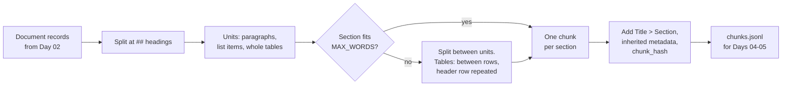
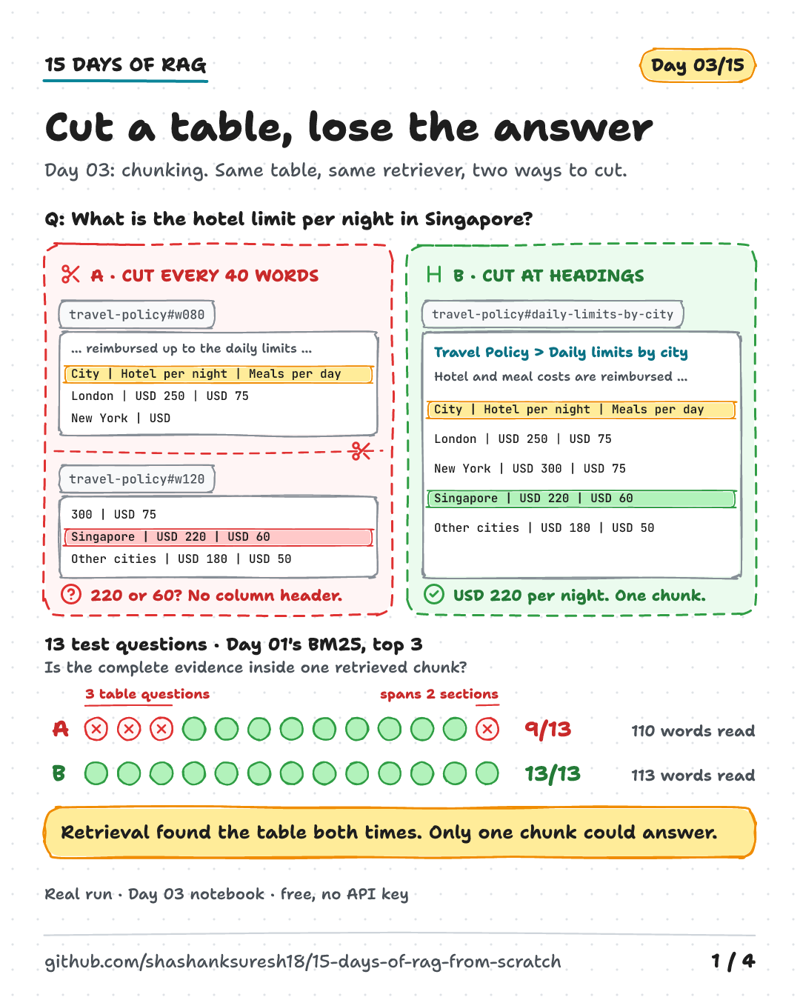
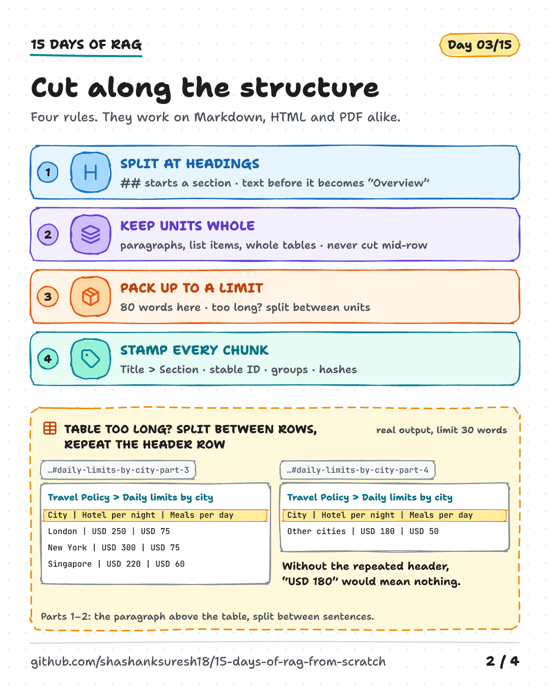
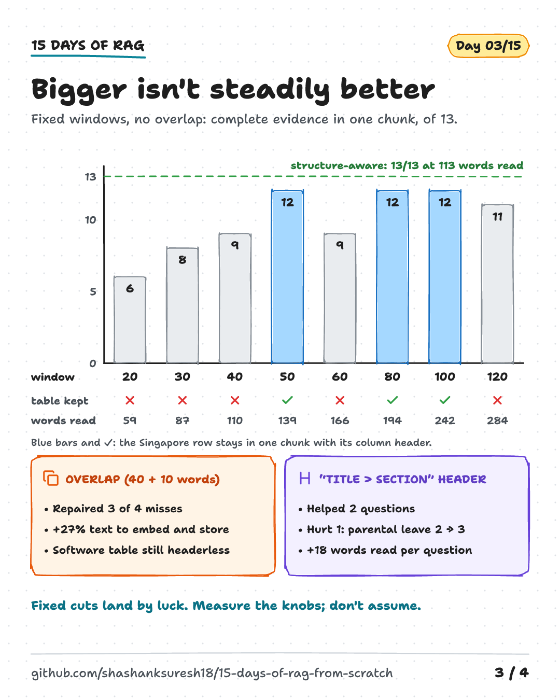
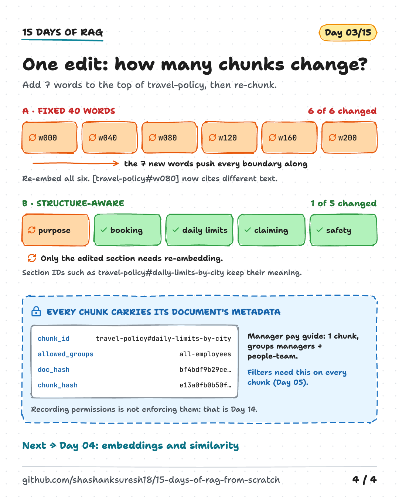

# Day 03 — Chunking and Document Structure

**Where you cut decides what retrieval can find**

| | |
|---|---|
| **Series** | 15 Days of Modern, Enterprise-Relevant RAG from Scratch · Day 03/15 |
| **Level** | Beginner to intermediate (comfortable reading Python; Days 01–02 help but aren't required) |
| **Time** | ~40 min reading · ~25 min running the notebook and exercises |
| **Cost** | Free. No API key, no internet access at run time, no paid services |
| **Code** | [`notebooks/day_03_chunking_and_structure.ipynb`](../../notebooks/day_03_chunking_and_structure.ipynb) — standard library, plus the shared code in [`src/rag_from_scratch/`](../../src/rag_from_scratch/) |
| **Visuals** | [`assets/day-03/`](../../assets/day-03/) |
| **Verified** | Notebook executed top to bottom on 2026-10-15 on Linux with Python 3.11, 3.12, 3.13 and 3.14, from both the repo root and `notebooks/`. CI runs the same tests on Linux, Windows and macOS on every push. |

---

## Learning objectives

By the end of today you will be able to:

1. Explain why a retriever returns chunks, and what makes a chunk good: it answers on its own, says where it came from, has a sensible size, keeps its document's metadata and has a stable ID.
2. Implement **fixed-size** chunking and **structure-aware** chunking, and show exactly where each one cuts.
3. Keep tables usable: never cut inside a row, and repeat the header row when a table has to be split.
4. Compare chunking methods on real questions with a simple, explicit evidence check, and read the results honestly.
5. Measure what **overlap**, **chunk size** and **context headers** really change, instead of assuming.

## Prerequisites

- Basic Python: functions, dataclasses, lists, regular expressions at a reading level.
- Python 3.11 or newer and the repository's `requirements.txt` (setup in section 9). Nothing new to install today.
- Useful context: Day 01's BM25 retriever and Day 02's `Document` records. Today imports both.

## Key terms

| Term | Meaning |
|---|---|
| **Chunk** | A piece of a document that is indexed, retrieved and shown on its own. The unit a RAG system actually works with. |
| **Chunking** | Splitting documents into chunks. Also called splitting or segmentation. |
| **Fixed-size chunking** | Cutting every *N* words, tokens or characters, whatever the text says at that point. |
| **Overlap** | Repeating the last part of one chunk at the start of the next, so a cut fact appears whole in at least one of them. |
| **Structure-aware chunking** | Cutting at boundaries the document already has: headings, paragraphs, list items, table rows. Sometimes called document-aware or layout-aware chunking. |
| **Unit** | Today's word for a piece that must never be cut: a paragraph, a list item, or a whole table. |
| **Context header** | A short line at the top of a chunk that says where it came from, here `Title > Section`. |
| **Token** | The unit a language or embedding model counts. Roughly ¾ of an English word on average, but it depends on the tokenizer. |
| **Chunk ID** | A stable, citable name for a chunk, e.g. `travel-policy#daily-limits-by-city`. |
| **Chunk hash** | A fingerprint of a chunk's text. If it hasn't changed, the chunk doesn't need re-embedding. |

---

## 1. Why chunking decides what RAG can answer

A retriever never returns a document; it returns a **chunk**. That chunk is what a user sees as evidence, what a language model reads (Day 06), what a citation points to, what a permission filter checks (Days 05 and 14), and what gets re-embedded when something changes. Get the cut wrong and every one of those suffers.

Day 01 ended with *"if retrieval misses the evidence, nothing downstream can recover it"*. Chunking adds a sharper version: **retrieval can find the right place and still return a piece that can't answer the question.** Today's main example is a table from the travel policy, rebuilt row by row on Day 02:

```text
City | Hotel per night | Meals per day
London | USD 250 | USD 75
New York | USD 300 | USD 75
Singapore | USD 220 | USD 60
Other cities | USD 180 | USD 50
```

Cut it between the header row and the Singapore row, and a chunk containing `Singapore | USD 220 | USD 60` no longer says which number is the hotel limit.

## 2. The architecture





The input is Day 02's output: 11 `Document` records whose bodies all follow one convention, whatever the source format. `## ` starts a section and a table row is one line with cells joined by ` | `. That convention is what makes structure-aware chunking possible.

## 3. Two ways to cut

### 3.1 Method A: fixed-size windows

The simplest chunker counts words and cuts every `WINDOW_WORDS` (40 today). It needs no knowledge of the document, works on any text and produces predictable sizes, which is why it is a common default. The notebook's version slices the original text, so line breaks survive inside a window:

```python
spans = [m.span() for m in WORD.finditer(doc.body)]       # (start, end) of every word
for first in range(0, len(spans), size - overlap):
    window = spans[first:first + size]
    text = doc.body[window[0][0]:window[-1][1]]
    chunks.append(make_chunk(doc, f"{doc.doc_id}#w{first:03d}", None, text))
```

Why 40? The 44 sections in the corpus are 13–68 words long (median 29), so 40-word windows give about the same number of chunks (42) as cutting by section (44). That makes the comparison fair on size. Our documents are tiny; with real handbooks you would use hundreds of tokens, but what matters is the size of a chunk *relative to* the structure it cuts through.

A boundary map of the travel policy shows every line and the window(s) holding it (tested output; ✂ = the line was cut in two):

```text
w000         ## Purpose
w000         This policy explains how Acme employees book business travel and claim reimburs...
w000         ## Booking travel
w000 ✂ w040  Book flights, trains and hotels through the travel portal at least 14 days befo...
w040         ## Daily limits by city
w040 ✂ w080  Hotel and meal costs are reimbursed up to the daily limits below. Limits are pe...
w080         City | Hotel per night | Meals per day
w080         London | USD 250 | USD 75
w080 ✂ w120  New York | USD 300 | USD 75
w120         Singapore | USD 220 | USD 60
w120         Other cities | USD 180 | USD 50
w120         ## Claiming travel costs
w120 ✂ w160  Claim travel costs in the expense system, as described in the Expense Reimburse...
w160         ## Safety while travelling
w160 ✂ w200  Register every international trip in the travel portal, so the Security Team ca...
```

The Singapore row lands in `w120`, which begins with `300 | USD 75` (the tail of the New York row) and has no column header. Is the hotel limit 220 or 60? The chunk can't say.

### 3.2 Method B: structure-aware chunks

The second chunker uses the structure Day 02 kept:

1. **Split at headings.** One section is the starting unit, as on Day 01. Text before the first heading becomes an `Overview` section, so nothing is dropped.
2. **Never cut inside a unit.** A paragraph or list item is a unit; a run of table rows is one unit.
3. **Pack units up to `MAX_WORDS`** (80 today). Too-long sections are split *between* units; a too-long table between rows, with **the header row repeated in every piece**; a too-long paragraph between sentences.
4. **Add a context header**, `Title > Section`, so the chunk says where it came from.

The heart of the table rule:

```python
if is_table_row(unit[0]):                     # a table: between rows, header repeated in every piece
    header, pieces = unit[0], [[unit[0]]]
    for row in unit[1:]:
        if len(pieces[-1]) > 1 and count_words("\n".join(pieces[-1] + [row])) > room:
            pieces.append([header])
        pieces[-1].append(row)
```

IDs come from the heading, exactly as on Day 01 (`travel-policy#daily-limits-by-city`); a split section gets `-part-1`, `-part-2` and so on. One assumption to keep in mind: the first row of a table is its header. That holds for both tables here, but not for every table you'll meet.

The same section as one chunk (tested output):

```text
[travel-policy#daily-limits-by-city]  64 words
    Travel Policy > Daily limits by city
    Hotel and meal costs are reimbursed up to the daily limits below. Limits are per person and include taxes. Use the Other cities row for any city not listed.
    City | Hotel per night | Meals per day
    London | USD 250 | USD 75
    New York | USD 300 | USD 75
    Singapore | USD 220 | USD 60
    Other cities | USD 180 | USD 50
```



### 3.3 When a section is too long

No section here exceeds 80 words, so the notebook forces a split with `max_words=30` to show the rules at work. The daily-limits section becomes four pieces (tested output, abridged):

```text
[travel-policy#daily-limits-by-city-part-3]  29 words
    Travel Policy > Daily limits by city
    City | Hotel per night | Meals per day
    London | USD 250 | USD 75
    New York | USD 300 | USD 75
    Singapore | USD 220 | USD 60

[travel-policy#daily-limits-by-city-part-4]  19 words
    Travel Policy > Daily limits by city
    City | Hotel per night | Meals per day
    Other cities | USD 180 | USD 50
```

Part 4 repeats the header, so `USD 180` still means *hotel per night*. Part 2 (*"Use the Other cities row for any city not listed."*) shows the limit of any splitter: it refers to a table that now lives in other pieces. Smaller chunks are not automatically more self-contained, which is one reason to keep the size limit generous.

## 4. Measuring the difference

> **Tested output.** Everything quoted in sections 4–6 was produced by executing the notebook on 2026-10-15 (Python 3.13, Linux). The code is deterministic and the sample data is fixed, so your output should match, apart from the Python version line.

### 4.1 What each method does to the documents

```text
                     chunks   words per chunk  indexed  lines cut  table rows cut off
                             min  median  max    words     in two   from their header
A. fixed 40 words        42     3     40   40     1418         29            7 of 8
B. structure-aware       44    18     34   74     1557          0            0 of 8
```

Similar counts and sizes, very different cuts. In the software table the window boundary falls right after the header row, so all four rows lose their column names. The structure-aware chunks index more words in total only because each repeats its short context header.

### 4.2 Does it change what retrieval returns?

Structure is only worth keeping if it changes results. The notebook asks 13 questions. Each comes with its **evidence**: the strings one chunk must contain to answer it *on its own*. For the Singapore question that is the row **and** the column header, because `USD 220` without `Hotel per night` is ambiguous. Both methods use the same retriever (Day 01's BM25, top 3); only the chunks differ.

```text
question                                                A   B   probes
What is the hotel limit per night in Singapore?         -   1   PDF table: row + column header
What is the daily meal limit in New York?               -   1   PDF table: row + column header
Who approves admin rights?                              -   1   HTML table: row + column header
How long is parental leave?                             1   3   Day 01: answer was at rank 3
How many failed sign-in attempts lock my account?       1   1   one sentence
How long are application logs kept?                     1   1   one sentence
How much is the home office allowance?                  1   1   one sentence
How long do I have to claim the home office allowance?  2   1   second sentence of a section
Can I use my personal computer for work?                1   1   last sentence of a section
Can I install software from the internet myself?        1   1   text before the first heading
What training must new starters complete?               1   1   topic word only in the heading
What happens after I report a security incident?        1   1   topic words only in the heading
How soon must I report a lost laptop?                   -   3   evidence spread over two sections

A. fixed 40 words       9/13 in one chunk | 11/13 across top 3 |   110 words read per question
B. structure-aware     13/13 in one chunk | 13/13 across top 3 |   113 words read per question
```

Numbers are the rank of the first retrieved chunk that holds the complete evidence; `-` means none of the top 3 does. "Words read" is the total size of the top 3 chunks: what a generator would have to read on Day 06.

**How to read this honestly.** The questions were written to probe specific failure modes (tables, sentence positions, text before the first heading, heading-only vocabulary, evidence across sections), so the totals tell you *which failures each method has*, not how accurate either would be on your documents. Thirteen questions on eleven short documents is a diagnostic, not a benchmark. Day 07 builds a labelled evaluation set, starting from these.

What the table shows:

- **Three of A's four misses are table questions**: the row and its header landed in different chunks.
- **B is not better everywhere.** For *"How long is parental leave?"* A's first window happens to hold the eligibility rule and the entitlement together and ranks first; B's answer is at rank 3 (section 5.3 explains why).
- **The lost-laptop question is B's weak spot.** The answer ("within one hour") is in *How to report*, but the words *lost laptop* appear in other sections, so the answer comes third. A doesn't return it at all. Evidence that spans sections needs bigger units, retrieval of the surrounding section (Day 11), or a generator that reads several chunks together (Day 06).

For the Singapore question itself, A's top chunk has the column headers but stops in the middle of the New York row; the Singapore row is in its rank-3 chunk. A model would have to stitch two fragments together and trust that the columns still line up. B's top chunk is the whole table.

## 5. The knobs: overlap, size and headers

Three common pieces of advice, each measured on the same 13 questions.



### 5.1 Overlap

```text
A. fixed 40 words          9/13 in one chunk | 11/13 across top 3 |   110 words read per question
A+ with 10-word overlap   12/13 in one chunk | 12/13 across top 3 |   112 words read per question

Overlap indexes 49 chunks instead of 42: 27% more words to embed and store.
  repaired       What is the hotel limit per night in Singapore?
  repaired       What is the daily meal limit in New York?
  still missing  Who approves admin rights?
  repaired       How soon must I report a lost laptop?
```

Overlap repaired three of four misses, for 27% more text to embed and store and neighbouring chunks that repeat each other. The software table is still cut off from its header: from the header row to the admin-rights row is 37 words, and none of the shifted windows holds both. Overlap only rescues a fact when the fact *and the context it needs* fit inside the shared part.

### 5.2 Window size

```text
 window overlap  chunks  complete in one chunk  words read   Singapore row with its header?
     20       0      76                  6/13          59   no
     30       0      52                  8/13          87   no
     40       0      42                  9/13         110   no
     50       0      34                 12/13         139   yes
     60       0      30                  9/13         166   no
     80       0      23                 12/13         194   yes
     80      20      24                 13/13         213   yes
    100       0      21                 12/13         242   yes
    100      25      22                 13/13         238   yes
    120       0      18                 11/13         284   no
    120      30      18                 13/13         291   yes

B. structure-aware (up to 80 words): 13/13, 113 words read
```

(Abridged; the notebook prints every size with and without 25% overlap.)

- **Bigger is not steadily better.** 50 words keeps the Singapore row with its header, 60 cuts them apart again, 80 and 100 keep them, 120 cuts them again. The result depends on where boundaries happen to land, so any edit to a document can change it.
- **Completeness bought with size is paid for in reading.** Large overlapping windows also reach 13/13, but hand the next step about twice as many words per question (213–291 versus 113), most of them about something else. More words cost more tokens and time, and give a language model more irrelevant text to be distracted by.

### 5.3 Context headers

```text
B without headers     12/13 in one chunk | 12/13 across top 3 |    95 words read per question
B with headers        13/13 in one chunk | 13/13 across top 3 |   113 words read per question

  rank 2 -> 3   How long is parental leave?  (Day 01: answer was at rank 3)
  rank 2 -> 1   Can I install software from the internet myself?  (text before the first heading)
  rank - -> 1   What happens after I report a security incident?  (topic words only in the heading)
```

Headers help when a question's key words appear only in a heading or title: the *After you report* section never uses the words "report" or "incident" (it says "reported" and "Incidents", and BM25 here has no stemming). They also hurt: every parental-leave chunk now starts with "Parental Leave Policy", so BM25 finds the sections harder to tell apart. Net: two questions better, one worse, about 18 more words read per question.

We keep the headers, because a chunk that says where it comes from is easier for a reader, a citation and a model to use. But the retrieval effect is measured and mixed. Embedding models (Day 04) respond to headers differently from BM25, so we'll measure again there.

**Watch out for splitters that strip headings.** LangChain's `MarkdownHeaderTextSplitter`, for example, removes the heading lines from chunk text by default and stores them as metadata (`strip_headers=True`). Metadata that never reaches the text you index or embed can't help retrieval; that is exactly the "without headers" row above.

## 6. Chunks are the unit of permission, citation and update

Every chunk carries what it needs to be filtered, cited, dated and updated without looking up its document (tested output):

```json
{
  "chunk_id": "travel-policy#daily-limits-by-city",
  "doc_id": "travel-policy",
  "section": "Daily limits by city",
  "title": "Travel Policy",
  "allowed_groups": ["all-employees"],
  "source_path": "data/sample/acme-handbook/travel-policy.pdf",
  "last_reviewed": "2026-04-15",
  "doc_hash": "bf4bdf9b29cecca37f3f45b565a210bcda1f096d2a6be1fe5ca44d2ae7a90484",
  "chunk_hash": "e13a0fb0b50f3a0e13d6b7d61e6813fd6159faf7dd67958b6fccee0450a9e086"
}
```

- **Permissions travel with every chunk.** Retrieval returns chunks, so a permission filter can only work if each chunk knows who may see it. The restricted manager guide becomes one chunk with `allowed_groups ('managers', 'people-team')`: `['all-employees']` can see 43 of 44 chunks, managers all 44. Day 05 filters on this field; Day 14 enforces it. Recording it is not enforcing it.
- **Stable IDs make updates cheap.** The notebook adds one 7-word sentence to the travel policy's first section and re-chunks:

```text
A. fixed 40 words    6 of 6 chunks changed: w000, w040, w080, w120, w160, w200
B. structure-aware   1 of 5 chunks changed: purpose
```

Every fixed window shifts, so all six chunks need new embeddings and a citation such as `[travel-policy#w080]` now points to different text. With section chunks, only the edited section changes. Re-chunking is cheap; re-embedding (Day 04) and re-indexing (Day 05) are not, so comparing `chunk_hash` values is how an update job finds the minimum work.

- **Continuity.** The 34 section IDs of the eight Markdown policies are exactly Day 01's chunk IDs (`remote-work-policy#core-hours` and so on), so Day 01's citations still resolve. A sanity check enforces it.



## 7. Core trade-offs

| Decision | Simpler / cheaper | Richer / safer |
|---|---|---|
| **Where to cut** | Fixed size: no parsing, predictable sizes, cuts anywhere | Structure-aware: needs clean structure from ingestion, keeps units whole |
| **Overlap** | None: no duplication, blind cuts lose context | Some: rescues short facts at boundaries, duplicates text, can return the same passage twice |
| **Chunk size** | Small: specific, cheap to read, loses context | Large: more context, more noise and cost per retrieved chunk |
| **Tables** | Treat rows as text | Keep whole, or split between rows with the header repeated |
| **Context header** | None: shortest chunks | `Title > Section`: self-describing chunks, a few words each, mixed effect on BM25 ranking |
| **IDs** | Position-based (`#w080`): shift on every edit | Heading-based (`#daily-limits-by-city`): survive edits elsewhere, break if a heading is renamed or duplicated |
| **Evidence across sections** | One chunk per section | Merge small sections, or retrieve the surrounding section after a hit (Day 11) |

### Choosing a chunker

You don't have to write your own. These tools implement the same ideas; what they do by default is what matters. Checked on 2026-10-15:

| Tool or platform | What it offers | Check |
|---|---|---|
| [LangChain text splitters](https://docs.langchain.com/oss/python/integrations/splitters/markdown_header_metadata_splitter) (`langchain-text-splitters`) | `MarkdownHeaderTextSplitter` splits on headings and stores them as metadata; the docs suggest a size-limiting splitter such as `RecursiveCharacterTextSplitter` inside each section | Headings are stripped from the text by default |
| [Unstructured](https://docs.unstructured.io/api-reference/workflow/nodes/chunker/chunker-chunk-by-title) `chunk_by_title` | Starts a new chunk at each title, combines small sections, hard and soft size limits | Tables get their own chunk by default (`isolate_table`) |
| [Docling](https://docling-project.github.io/docling/_generated/examples/hybrid_chunking/) `HybridChunker` | Structure-based chunks refined with your embedding model's tokenizer, merges small neighbours, `contextualize()` adds heading context | `repeat_table_header` repeats the header row in each piece of a split table |
| [Amazon Bedrock Knowledge Bases](https://docs.aws.amazon.com/bedrock/latest/userguide/kb-chunking.html) | Default chunks of about 300 tokens that keep sentences whole; fixed-size, hierarchical (retrieve small child chunks, return their larger parent), semantic and no chunking | Semantic chunking uses a foundation model, at extra cost |
| [Azure AI Search](https://learn.microsoft.com/en-us/azure/search/vector-search-how-to-chunk-documents) | Guidance suggests starting around 512 tokens with 25% overlap, describes heading-based chunking for Markdown and HTML, and appending the document title to chunks from the middle of a document | Starting points, to be tuned on your data |
| LLM-written context, e.g. Anthropic's [contextual retrieval](https://www.anthropic.com/news/contextual-retrieval) (2024) | A model writes a short document-specific context for each chunk, added before embedding and BM25 indexing | A model call per chunk at indexing time |

Whichever you use, run the two checks from section 4.1 (lines cut, table rows cut off from their header) and an evidence test like section 4.2 on *your* documents.

### Words versus tokens

Today counts words so the notebook needs no tokenizer. Models count **tokens**, and their limits are in tokens. OpenAI's rule of thumb for English is about ¾ of a word per token, so 100 tokens ≈ 75 words ([OpenAI Help Center](https://help.openai.com/en/articles/4936856-what-are-tokens-and-how-to-count-them)), but other languages, code, numbers and tables tokenize differently. In a real pipeline, measure chunk size with the tokenizer of the embedding model you will use (Docling's `HybridChunker` does this) and keep well under its input limit.

## 8. A design decision: shared code moves to `src/`

Day 03 needs Day 02's ingestion pipeline and Day 01's BM25 retriever. Copying them into the notebook would add roughly 350 lines that have nothing to do with chunking, and Days 04–06 would copy them again. So, from today:

- **[`src/rag_from_scratch/`](../../src/rag_from_scratch/)** holds code that a *later* day reuses: `ingest.py` (Day 02's pipeline) and `bm25.py` (Day 01's retriever, taking any `{id: text}` mapping so each lesson decides what text is indexed).
- **The teaching notebooks stay self-contained.** Day 01 and Day 02 still show and explain every line; they are unchanged. Code moves to `src/` on its first reuse, not before, so today's chunkers stay in the Day 03 notebook until Day 04 needs them.
- **The copies can't drift.** [`tests/test_shared_code.py`](../../tests/test_shared_code.py) executes the Day 01 and Day 02 notebooks' own code and checks that the package returns identical records, scores and rankings.
- **Nothing to install.** The notebook adds `src/` to Python's import path for the session (`sys.path.insert`), and `pytest.ini` does the same for the tests. A packaged project would use `pip install -e .`; for a teaching repository the explicit path keeps setup to one `requirements.txt`.

## 9. Setup, step by step

**Requirements:** Python 3.11+, Git, and about 200 MB of disk for the virtual environment. No new packages today.

```bash
# 1. Clone (or update) the repository
git clone https://github.com/shashanksuresh18/15-days-of-rag-from-scratch.git
cd 15-days-of-rag-from-scratch
# already cloned?  git pull

# 2. Create and activate a virtual environment
python3 -m venv .venv
source .venv/bin/activate            # macOS / Linux
# .venv\Scripts\Activate.ps1         # Windows PowerShell

# 3. Install the tested dependencies (unchanged since Day 02)
python -m pip install -r requirements.txt

# 4. Open the notebook
jupyter lab notebooks/day_03_chunking_and_structure.ipynb
#    then: Kernel -> Restart Kernel and Run All Cells

# 5. (Optional) Run the automated checks
python -m pytest
```

**Configuration:** none. No environment variables, no keys. The notebook writes `outputs/day-03/chunks.jsonl`, which Git ignores.

## 10. Code walkthrough

| Notebook section | Concept | Key code |
|---|---|---|
| 0. Setup | Import shared code from `src/` | `find_repo_root`, `sys.path.insert` |
| 1. Input | Day 02's records, sections and tables | `ingest`, `count_words`, `split_sections` |
| 2. Yardstick | Five properties of a good chunk | (text) |
| 3. Method A | Fixed-size windows; where they cut | `Chunk`, `fixed_size_chunks`, `boundary_map` |
| 4. Method B | Units, packing, table splitting, context header | `to_units`, `split_unit`, `pack`, `section_chunks` |
| 5. Side by side | Lines cut, table rows cut off | `structure_report` |
| 6. Retrieval | 13 questions with evidence strings | `Probe`, `evaluate`, `show_hits` |
| 7. Knobs | Overlap, size sweep, header ablation | `fixed_size_chunks(..., overlap=)`, `section_chunks(..., context_header=False)` |
| 8. Metadata and updates | Inherited metadata, stable IDs, chunk hashes | `make_chunk`, `changed_chunks` |
| 9. Sanity checks | Deterministic regression tests | `assert` statements |

## 11. Expected output and what was tested

| Item | Status |
|---|---|
| Notebook runs top to bottom in a fresh kernel | **Tested** on Linux with Python 3.11, 3.12, 3.13 and 3.14 on 2026-10-15, from both the repo root and `notebooks/` |
| Outputs quoted in sections 3–6 of this guide | **Tested**: copied from the executed notebook |
| `python -m pytest` (Days 01–03 notebooks, shared-code equivalence, sample data) | **Tested**: passes on the Linux setups above; Days 01 and 02 are unchanged |
| `src/rag_from_scratch` matches the Day 01 and Day 02 notebooks | **Tested** by `tests/test_shared_code.py`; also checked that a deliberately changed copy fails it |
| Windows and macOS | **Runs in CI** (Linux/Windows/macOS × Python 3.11 and 3.14) on every push. Check the run is green before relying on it |
| Token counts (exercise 5) | **Not tested**: optional, needs a tokenizer outside `requirements.txt` |

## 12. Common errors and mistakes

### Setup errors

| Symptom | Cause | Fix |
|---|---|---|
| `FileNotFoundError: Could not find src/rag_from_scratch` | Jupyter started outside the repository, or an old clone from before Day 03 | Start Jupyter inside the repo; `git pull` |
| `ModuleNotFoundError: No module named 'rag_from_scratch'` in your own script | `src/` is not on the import path outside the notebook and tests | Run from the repo root with `PYTHONPATH=src` (PowerShell: `$env:PYTHONPATH="src"`), or copy the notebook's two setup lines |
| `ModuleNotFoundError: No module named 'pypdf'` | Environment created for Day 01 | `python -m pip install -r requirements.txt` again, restart the kernel |
| Sanity checks fail with different counts | Extra files in `data/sample/acme-handbook/`, or changed settings | Remove the files, or update the checks deliberately |

### Conceptual mistakes (the expensive ones)

1. **Choosing a chunk size without looking at the chunks.** Print a boundary map for a few real documents, especially their tables, before tuning anything.
2. **Cutting tables like prose.** A row without its header is a list of numbers. Keep tables whole or repeat the header row.
3. **Treating overlap as a fix.** It patches some boundaries, moves others, and costs storage and prompt space.
4. **Judging chunkers by retrieval rank alone.** Ask whether the retrieved chunk *answers on its own*. A top-ranked fragment can still be useless.
5. **Dropping text before the first heading** (introductions, summaries). Today's `Overview` rule keeps it.
6. **Losing metadata at the chunk level.** If chunks don't carry `allowed_groups`, permission filtering is impossible later.
7. **Position-based IDs.** They change on every edit, so everything gets re-embedded and old citations point to the wrong text.
8. **Trusting one tidy evaluation.** Thirteen hand-picked questions show failure modes; they don't prove a method is best for your corpus.

## 13. Privacy, licensing and security notes

- **Data:** the sample corpus is synthetic (see [`data/sample/README.md`](../../data/sample/README.md)). Chunks are written to `outputs/day-03/`, which Git ignores.
- **Permissions:** chunks inherit `allowed_groups` from Day 02's permission export. Today nothing filters on it: the comparison indexes every chunk, including the restricted manager guide. Filtering arrives on Day 05 and enforcement on Day 14. Never rely on a chunk's *text* to decide who may read it.
- **Untrusted input:** chunk text is copied from documents, so it can contain instructions aimed at a model (prompt injection). Context headers make chunks easier to use; they don't make them safe. Day 14 covers defences.
- **Licences:** no new dependencies today. The tools in section 7 have their own licences; check them before adopting one.
- **Status:** a teaching implementation. No token counting, no multi-level heading paths (only `## ` sections), and a first-row-is-header assumption for tables.

## 14. Key takeaways

1. **Cut along the structure.** Split at headings, never inside a sentence or a table row, and repeat a table's header row when it has to be split. On today's 13 questions that kept the complete evidence in one chunk every time, at about the same size as 40-word windows, which managed 9.
2. **Overlap and size are patches for blind cuts.** They fix some boundaries, break or miss others, and cost storage and prompt space. Measure them on your documents.
3. **A chunk is the unit of retrieval, citation, permission and update.** Give it a context header, its document's metadata and an ID that survives edits elsewhere in the document.

## 15. Exercise

**Find the cut, then fix it (15 minutes).**

1. In the notebook, set `WINDOW_WORDS = 50` and rerun. The Singapore row now shares a window with its header. Print `boundary_map(travel, fixed_size_chunks(travel))` and find where the boundaries fall.
2. Simulate a policy update. Add this 28-word note to the *Purpose* section, the way section 8 adds its sentence:
   ```python
   NOTE = ("This version replaces the 2025 policy. Ask the Finance team if you are unsure which rules "
           "apply to a trip that was booked before this version was published.")
   updated = replace(travel, body=travel.body.replace("## Purpose\n", f"## Purpose\n{NOTE}\n"))
   ```
   Print `boundary_map(updated, fixed_size_chunks(updated, 50))`. Is the table still whole? Try 40 and 60 as well. What does that tell you about tuning a window size on today's documents?
3. Run `changed_chunks(section_chunks(travel), section_chunks(updated))`. Which chunk IDs and texts changed?

The notebook's section 10 has four more exercises: breaking the table rule, writing your own heading-only question, merging small sections, and counting tokens.

---

## References

All links checked on **2026-10-15**. Product documentation changes; re-check before relying on details.

- Amazon Bedrock User Guide, [How content chunking works for knowledge bases](https://docs.aws.amazon.com/bedrock/latest/userguide/kb-chunking.html) — default, fixed-size, hierarchical, semantic and no chunking.
- Microsoft Learn, [Chunk large documents for vector search solutions in Azure AI Search](https://learn.microsoft.com/en-us/azure/search/vector-search-how-to-chunk-documents) (last updated 2026-07-02) — starting sizes and overlap, fixed versus variable-size chunking, titles on mid-document chunks.
- Docling, [Hybrid chunking example](https://docling-project.github.io/docling/_generated/examples/hybrid_chunking/) — tokenizer-aware chunking, `contextualize()`, `repeat_table_header`.
- Unstructured, [Chunk by title](https://docs.unstructured.io/api-reference/workflow/nodes/chunker/chunker-chunk-by-title) — section boundaries, size limits, `isolate_table`.
- LangChain, [Split markdown by headers](https://docs.langchain.com/oss/python/integrations/splitters/markdown_header_metadata_splitter) — `MarkdownHeaderTextSplitter`, `strip_headers`.
- Anthropic, [Introducing Contextual Retrieval](https://www.anthropic.com/news/contextual-retrieval) (2024-09-19) — model-written context added to each chunk before embedding and BM25 indexing.
- OpenAI Help Center, [What are tokens and how to count them?](https://help.openai.com/en/articles/4936856-what-are-tokens-and-how-to-count-them) — rule of thumb for tokens per English word.
- Earlier days: [Day 01 lesson](../day-01/LEARN.md) (BM25, chunk IDs), [Day 02 lesson](../day-02/LEARN.md) (ingestion, metadata, table extraction).

## Next: Day 04 — Embeddings, lexical matching and similarity

Today's chunks become the input for dense retrieval. Day 04 compares embedding search with today's BM25 on the same questions, including Day 01's *"How much time off do new dads get?"*, which no keyword can bridge, and measures again whether context headers help.
