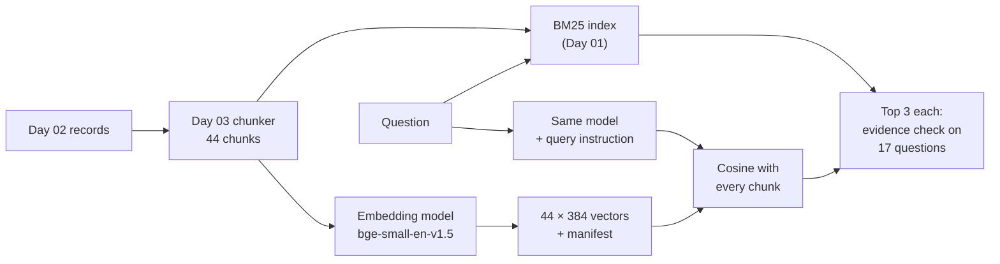
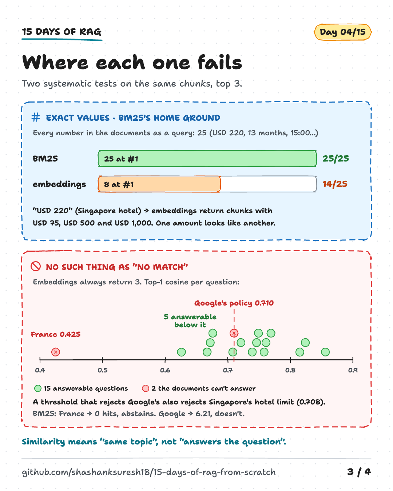
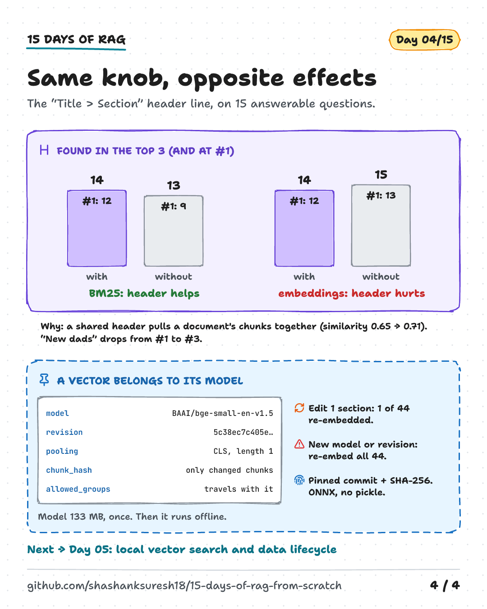

# Day 04 — Embeddings, Lexical Matching and Similarity

**Two ways to decide that a chunk matches a question**

| | |
|---|---|
| **Series** | 15 Days of Modern, Enterprise-Relevant RAG from Scratch · Day 04/15 |
| **Level** | Beginner to intermediate (comfortable reading Python; Days 01–03 help but aren't required) |
| **Time** | ~45 min reading · ~25 min running the notebook and exercises |
| **Cost** | Free. No API key, no paid services. One-time download of a 133 MB model; after that, no internet needed |
| **Code** | [`notebooks/day_04_embeddings_and_similarity.ipynb`](../../notebooks/day_04_embeddings_and_similarity.ipynb) — `numpy`, `onnxruntime`, `tokenizers`, `huggingface-hub`, plus the shared code in [`src/rag_from_scratch/`](../../src/rag_from_scratch/) |
| **Visuals** | [`assets/day-04/`](../../assets/day-04/) |
| **Verified** | Notebook executed top to bottom on 2026-10-16 on Linux with Python 3.11, 3.12, 3.13 and 3.14, from both the repo root and `notebooks/`. The model's first download from Hugging Face was **not** run in that environment (see section 13). CI runs the same tests, including the download, on Linux, Windows and macOS on every push. |

---

## Learning objectives

By the end of today you will be able to:

1. Explain what an embedding is and run a small embedding model yourself: tokens → one vector per token → pooling → normalisation.
2. Explain cosine similarity, dot product and Euclidean distance, when they rank results identically, and why scores from different models can't be compared.
3. Compare keyword (BM25) and embedding (dense) retrieval on the same chunks and questions, and say *which kinds* of question each one fails.
4. Pin and verify a model like any other dependency: an exact revision, a SHA-256 per file, a safe file format.
5. Decide what to store next to every vector so that document updates and model changes don't silently break retrieval.

## Prerequisites

- Basic Python: functions, dataclasses, lists. A first look at NumPy arrays helps (the notebook explains each operation).
- Python 3.11 or newer and the repository's `requirements.txt` (setup in section 11). Day 04 adds four packages (about 51 MB to download).
- Useful context: Day 01's BM25 retriever and Day 03's structure-aware chunks. Today imports both.

## Key terms

| Term | Meaning |
|---|---|
| **Embedding** | A fixed-length list of numbers (a vector) that a model computes for a text, so that texts with similar meaning get vectors pointing in similar directions. |
| **Embedding model** | The neural network that computes embeddings. Today: `BAAI/bge-small-en-v1.5`, 384 numbers per text. |
| **Lexical (sparse) retrieval** | Matching on the words themselves, e.g. BM25. "Sparse" because a text is represented by the few words it contains out of a large vocabulary. |
| **Dense retrieval** | Matching on embeddings. "Dense" because every number in the vector is used. Also called semantic or vector search. |
| **Token** | The unit a model reads, from a fixed vocabulary. Unknown words are split into known pieces (`dads` → `dad` + `##s`). |
| **Pooling** | Combining the model's one-vector-per-token output into one vector per text: the first token's vector (`[CLS]` pooling) or the average (mean pooling). |
| **Normalisation** | Scaling a vector to length 1. Then cosine similarity and dot product give the same number. |
| **Cosine similarity** | The cosine of the angle between two vectors; 1 = same direction. The usual similarity for text embeddings. |
| **Attention mask** | A list of 1s and 0s telling the model which tokens are real and which are padding added to make a batch rectangular. |
| **Query instruction** | A fixed text some models want in front of search queries (not in front of documents), because they were trained that way. |
| **Model revision** | An exact commit of a model repository. Pinning it means the files can't change under you. |

---

## 1. Why a second kind of retrieval

Day 01's BM25 retriever scores a chunk by the question words it contains, weighted by how rare each word is. It is fast, explainable and surprisingly hard to beat. But it can only see *words*. Day 01 recorded the case that shows the limit:

> **"How much time off do new dads get?"**

The parental leave policy answers it: *"Primary caregivers receive 16 weeks of fully paid leave. Secondary caregivers receive 6 weeks of fully paid leave."* The question and the answer share no useful word. "dads", "time" and "off" appear nowhere in that chunk, so BM25 ranks other chunks first.

An **embedding model** has learned from large amounts of text that *dad*, *parent* and *caregiver*, or *time off* and *leave*, are used in similar contexts. It maps texts to vectors so that such texts end up close together. Retrieval then becomes geometry: find the chunk vectors closest to the question vector.

That is not "understanding", and it fails in its own ways. Today measures both retrievers on the same chunks and questions, so you can see the trade-off instead of taking either side on faith.

## 2. The architecture




Both retrievers get exactly the same 44 chunks: Day 03's structure-aware chunks, rebuilt by the shared chunker in `src/rag_from_scratch/chunking.py` (a test proves it returns what the Day 03 notebook returns). Only the matching changes.

## 3. Choosing an embedding model

There are hundreds of embedding models, local and hosted. Five questions narrow the choice for a real project:

| Question | Why it matters | Today's answer |
|---|---|---|
| **Licence** | Can you use it commercially, ship it, fine-tune it? | MIT |
| **Where does it run?** | A hosted API sends every document and question to a third party; a local model keeps them on your machine but needs CPU/GPU and memory | Local, CPU only |
| **Size and speed** | Bigger models are often more accurate but slower and costlier to run on millions of chunks | 33 M parameters, 133 MB file |
| **Language and domain** | A model trained on English web text may do poorly on other languages, code or legal text | English, general domain |
| **Input limit and dimensions** | Longer chunks get cut off; more dimensions cost more storage | 512 tokens; 384 numbers |

**Why `BAAI/bge-small-en-v1.5`.** It is small enough for a laptop, has a permissive licence, is widely used as a baseline, and its official repository publishes an **ONNX** file. ONNX is a portable model format: the `onnxruntime` library runs it without PyTorch, which keeps today's install small. It was released in September 2023; newer and stronger models exist. To compare current options on public benchmarks, see the [MTEB leaderboard](https://huggingface.co/spaces/mteb/leaderboard). But a leaderboard measures *other people's* data. The only reliable test is your own questions on your own documents, which is what Day 07 sets up.

**Alternatives you could swap in.** Only `MODEL`, the few lines that load it and `embed()` know which model is used. Replace those, keep the rest:

- *Another local model:* most sentence-embedding models on Hugging Face publish ONNX files or can be exported to ONNX. Check its pooling method, normalisation, query/document prefixes and maximum input length on its model card.
- *A hosted API* (most cloud and model providers offer one): no model to run, usually stronger models, but every chunk and every question leaves your machine, you pay per token, and the provider can retire a model version. Check the data-processing terms before sending internal documents.
- *The same model through a library:* [`sentence-transformers`](https://sbert.net) (needs PyTorch) or [`fastembed`](https://github.com/qdrant/fastembed) (ONNX) hide the steps below behind one call. Convenient, once you know what they do.

**What it costs to install** (measured on Linux x86_64 with Python 3.13 on 2026-10-16): `numpy`, `onnxruntime`, `tokenizers` and `huggingface-hub` with their dependencies are about **51 MB** to download and about **180 MB** installed, mostly `onnxruntime` (68 MB) and `numpy` (70 MB). The model adds **133 MB**, downloaded once into `models/`. Wheel sizes differ a little by operating system. No PyTorch, no GPU.

## 4. From text to vector

Four steps happen inside an embedding model. The notebook runs each one by hand once (section 3), then wraps them in a single function.

### 4.1 Tokens

The model doesn't read words. It reads **tokens** from a fixed vocabulary of 30,522 entries, and splits a word it doesn't know whole into known pieces. Compare with what BM25 sees (tested output):

```text
model tokens: ['[CLS]', 'how', 'much', 'time', 'off', 'do', 'new', 'dad', '##s', 'get', '?', '[SEP]']
token IDs:    [101, 2129, 2172, 2051, 2125, 2079, 2047, 3611, 2015, 2131, 1029, 102]
BM25 terms:   ['much', 'time', 'off', 'new', 'dads', 'get']
```

BM25 drops stop words and keeps whole words. The model keeps everything, adds `[CLS]` and `[SEP]` markers, and splits "dads" into `dad` + `##s`. Nothing here knows that a dad can be a caregiver: that knowledge is in the model's weights.

Tokens are also the unit of the model's **input limit**: 512 tokens for this model. Longer texts are cut off silently, which is one more reason Day 03 kept chunks short (the longest is 74 words).

### 4.2 One vector per token

The model (a 12-layer transformer) reads all tokens at once and returns one 384-number vector **per token**. Each vector is informed by the whole text, which is how "leave" next to "parental" can end up somewhere different from "leave" next to "the building".

### 4.3 Pooling

Retrieval needs one vector per text. This model was trained to use the first token's vector, `[CLS]`, as the vector for the whole text; other models average all token vectors (*mean pooling*). Using the wrong pooling doesn't raise an error; it quietly makes results worse. Always check the model card.

### 4.4 Normalisation, and the attention mask

Each vector is divided by its length so that all vectors have length 1. When texts are embedded in batches, shorter texts are padded to the length of the longest one, and the **attention mask** tells the model to ignore the padding. In the notebook, the question gets 71 padding tokens when it is batched with a longer chunk. With the mask, its vector is identical to the one computed alone; without the mask, the model reads the padding as text and the vector changes (cosine 0.70 with the correct one). Libraries handle this for you, but it is the first thing to check when results change with the batch size.

The whole function:

```python
def embed(texts: list[str], batch_size: int = 16) -> np.ndarray:
    # text -> tokens -> model -> [CLS] vector -> length 1. One row per text, 384 columns.
    rows = []
    for start in range(0, len(texts), batch_size):
        token_vectors = run_model(model_inputs(tokenizer.encode_batch(texts[start:start + batch_size])))
        cls = token_vectors[:, 0, :]
        rows.append(cls / np.linalg.norm(cls, axis=1, keepdims=True))
    return np.vstack(rows).astype(np.float32)
```

## 5. Similarity: cosine, dot product and distance

| Measure | Formula | Higher means |
|---|---|---|
| **Dot product** | a · b = Σ aᵢbᵢ | more similar |
| **Cosine similarity** | (a · b) / (‖a‖ ‖b‖) | more similar (−1 to 1) |
| **Euclidean distance** | ‖a − b‖ | *less* similar |

For vectors of length 1, cosine = dot product and distance² = 2 − 2 × cosine, so all three produce **the same ranking**. So for normalised embeddings, the choice of metric in a vector database doesn't change the results; the "cosine vs dot product" question only matters for vectors that aren't normalised.

Three caveats that matter in practice:

1. **Unnormalised vectors change the answer.** The dot product rewards long vectors; cosine ignores length. Some models are trained for the dot product and put information in the length. Use the measure the model was trained with.
2. **Scores are not percentages.** In the notebook, *"How much time off do new dads get?"* and *"Secondary caregivers receive 6 weeks of fully paid leave."* score 0.62, the highest pair in a small table. But nine pairs of sentences about unrelated things still score between 0.30 and 0.50, never near 0. A cosine of 0.5 means nothing on its own. The model card says the same: what matters is the order of the scores, not their absolute value, and a threshold has to be chosen on your own data.
3. **Never compare vectors from different models**, or from different versions of the same model. They live in different spaces, and the comparison returns plausible-looking numbers with no error (section 9).

## 6. Results: BM25 vs embeddings on 17 questions

Both retrievers get Day 03's 44 chunks and return their top 3. The evidence check is Day 03's: a retrieved chunk counts only if it contains **all** the evidence strings, so it can answer on its own. The questions: Day 03's 13, plus four from Day 01's list of failures (two answerable in different words, two out of scope). Tested output:

```text
question                                                 BM25  embeddings   probes
What is the hotel limit per night in Singapore?             1           1   PDF table: row + column header
What is the daily meal limit in New York?                   1           1   PDF table: row + column header
Who approves admin rights?                                  1           1   HTML table: row + column header
How long is parental leave?                                 3           2   Day 01: answer was at rank 3
How many failed sign-in attempts lock my account?           1           1   one sentence
How long are application logs kept?                         1           1   one sentence
How much is the home office allowance?                      1           1   one sentence
How long do I have to claim the home office allowance?      1           1   second sentence of a section
Can I use my personal computer for work?                    1           1   last sentence of a section
Can I install software from the internet myself?            1           1   text before the first heading
What training must new starters complete?                   1           1   topic word only in the heading
What happens after I report a security incident?            1           1   topic words only in the heading
How soon must I report a lost laptop?                       3           -   evidence spread over two sections
How much time off do new dads get?                          -           3   Day 01: different words
My account is locked, what now?                             1           1   Day 01: locked vs locks
What is Google's remote work policy?                   (6.21)      (0.71)   Day 01: out of scope, on-topic words
What is the capital of France?                         0 hits      (0.42)   Day 01: out of scope

BM25        14/15 answerable questions found in the top 3, 12 at rank 1
embeddings  14/15 answerable questions found in the top 3, 12 at rank 1
found by at least one of the two: 15/15
```

**A tie, but not the same 14.** BM25 misses *"new dads"*. Embeddings miss *"lost laptop"*: the answer is in a *How to report* section that never mentions laptops, and the question's vector is closer to the sections that do. Because the misses don't overlap, every answerable question is in at least one of the two top-3 lists. That is the argument for **hybrid search** (Day 08), which has to keep that advantage while returning a single ranking.

Read the counts as "which kinds of failure each retriever has", not as accuracy: the questions were written to probe failures, the corpus is 11 short synthetic documents, and the two retrievers tie on a set this small. Day 07 builds a labelled evaluation set.

## 7. Where each one fails

### 7.1 Different words for the same thing (BM25's blind spot)

For *"new dads"*, BM25's top 3 each share exactly one word with the question: "off" (*"do not turn it off"*), "time" (*"full-time"*) and "new" (*"a new password"*). Embeddings return three chunks of the parental leave policy, with the answer at rank 3. Better, not solved: the model connected *dads* with *parental leave*, but ranked *Returning to work* above the section with the leave lengths. Other fixes for BM25: synonym lists, stemming, or rewriting the question (Day 10).

### 7.2 No such thing as "no match" (the embeddings' blind spot)

BM25 returns nothing when no chunk shares a word with the question, which is how Day 01 abstained on *"What is the capital of France?"*. An embedding search **always** returns a top 3, because every chunk has some similarity with every question. To abstain, it needs a **score threshold**. The notebook checks whether one exists (tested output):

```text
embeddings, top-1 cosine similarity (3 decimals: some scores are close)
  15 answerable questions: 0.626 0.667 0.672 0.676 0.708 0.721 0.739 0.746 0.749 0.758 0.761 0.769 0.815 0.824 0.856
  2 out of scope:          0.425 (What is the capital of France?)   0.710 (What is Google's remote work policy?)

A threshold above 0.710 rejects both out-of-scope questions, and also 5 of the 15 answerable ones:
   0.626  What training must new starters complete?
   0.667  Can I use my personal computer for work?
   0.672  Who approves admin rights?
   0.676  How soon must I report a lost laptop?
   0.708  What is the hotel limit per night in Singapore?
```

A threshold near 0.5 would catch *France*. Nothing catches *Google's remote work policy*: it is about a topic the documents cover, just not about this company, so it scores like a real question. BM25 has the same problem (it scores the question 6.21, above Day 01's threshold of 4.0). **A similarity score measures "same topic", not "answers the question".** Catching this needs a step that reads the evidence (Day 06) and test questions like it (Days 07 and 12).



### 7.3 Exact values and identifiers (BM25's home ground)

To avoid hand-picking examples, the notebook uses **every** number in the documents (with its unit: `USD 220`, `13 months`, `15:00`, `1 April`; a check confirms none is missed) and every email address, URL and chat channel as a query. A hit counts only if the chunk contains the whole string (`USD 25` must not count inside `USD 250`). Tested output:

```text
                BM25                    embeddings
25 values       25/25 (25 at rank 1)    14/25 (8 at rank 1)
 5 identifiers  5/5 (5 at rank 1)       5/5 (4 at rank 1)
```

For `USD 220` the embeddings return three chunks with *other* dollar amounts (USD 75, USD 500, USD 1,000) and not the travel table: to this model, one amount looks much like another. The identifiers came out nearly even, but each address here appears in one short chunk of a tiny corpus. On larger collections, dense retrievers have been shown to struggle with questions about rare entities such as uncommon names ([Sciavolino et al., 2021](https://arxiv.org/abs/2109.08535)), and BM25 is a robust baseline across many retrieval tasks ([Thakur et al., 2021](https://arxiv.org/abs/2104.08663)). That is why keyword search is still part of most production search stacks.

## 8. The knobs re-measured: headers and the query instruction

Day 03 measured the `Title > Section` header line with BM25 (it helped two questions and hurt one) and promised to re-measure with embeddings. The model card adds a second knob: a query instruction, which it calls optional for this version. Tested output, 15 answerable questions:

```text
                                           found in top 3  at rank 1
BM25, with headers                                  14/15         12
BM25, no headers                                    13/15          9
embeddings, with headers                            14/15         12
embeddings, no headers                              15/15         13
embeddings, with headers, no instruction            14/15         12
embeddings, no headers, no instruction              15/15         12
```

**The same knob moves the two retrievers in opposite directions.** Headers help BM25, because they add topic words a section's text leaves out. They hurt the embeddings here: without headers the dense retriever finds all 15, and *"new dads"* moves from rank 3 to rank 1.

A measurement suggests why. With headers, chunks of the **same** document are more similar to each other (average cosine 0.71 instead of 0.65), while chunks of different documents are unchanged (0.52). Every parental leave chunk starts with "Parental Leave Policy", so the vectors say more about *which document* and less about *which section*. Day 03 saw the same effect in BM25 on the parental leave question.

The query instruction made a small difference: one more question at rank 1 without headers, none with them. We keep it, as the model card recommends.

**What we do with this.** One question out of 15 is a hint, not a verdict, so the chunks keep their headers for now: BM25 needs them, and readers and citations benefit. The lasting lesson is that **the text a retriever indexes doesn't have to be the text a reader sees**. Day 08 can give each retriever its own text, and Day 07's labelled questions will show whether the difference holds up.



## 9. Cost, storage and what to store with every vector

Measured on the machine that produced the saved outputs (a 2-vCPU Linux cloud VM; your numbers will differ):

| | Build the index (44 chunks) | Per question | Storage |
|---|---|---|---|
| BM25 | about 1 ms | about 0.02 ms | an inverted index of the words |
| Embeddings | about 1.4 s | about 12 ms | 44 × 384 float32 = 67,584 bytes, plus a 133 MB model |

Per question, the embedding retriever was hundreds of times slower, because every question goes through the model first. Both are instant for one person; at millions of chunks and many users, the difference becomes hardware cost. Vectors grow linearly: 1.5 GB per million chunks for this model, before any index, more for models with more dimensions. Hosted embedding APIs swap the hardware cost for a per-token price and a network round trip.

**Pin the model like a dependency.** The notebook asks for an exact commit of the model repository (`5c38ec7c…`), not "main", checks every file's SHA-256 before loading it, and uses only data formats (ONNX and `tokenizer.json`). It refuses to continue if a hash differs.

**Store the model with the vector.** A vector means something only next to the model that produced it. The notebook writes `outputs/day-04/chunk_vectors.npy` plus a manifest with the model name, revision, pooling, normalisation, query instruction, and for every chunk its `chunk_id`, `chunk_hash` and `allowed_groups`. Then:

- a **document edit** re-embeds only chunks whose `chunk_hash` changed: after Day 03's one-sentence edit to the travel policy, the cache keyed on (model revision, chunk hash) sends **1 of 44** chunks through the model (tested output: `first run: 44 chunks embedded; after the edit: 1 of 44 re-embedded`);
- a **model change** (new model or new revision) re-embeds *everything*, and old and new vectors must never be mixed in one index. Plan for it: nothing warns you when vectors from two models are mixed, and with millions of chunks re-embedding is a real cost.

## 10. Core trade-offs

| | BM25 (lexical, sparse) | Embeddings (dense) |
|---|---|---|
| Matches | Shared words, weighted by rarity | Similar meaning, learned from data |
| Strong at | Exact values, codes, names, rare terms; explaining *why* a chunk matched | Synonyms and paraphrases (*dads* ↔ *caregivers*); questions in users' own words |
| Weak at | Different words for the same thing; no stemming here (*locked* vs *locks*) | Exact values (14 of 25 here); always returns *something*; harder to explain |
| "Nothing relevant" | Can return 0 hits | Needs a threshold, which didn't separate our out-of-scope questions |
| Cost | Tiny index, microseconds per query, no model | A model to host or pay for; milliseconds per query on a CPU; vectors to store |
| Changes | New words in the corpus just work | Model change = re-embed everything |
| Privacy | Runs anywhere | Local model: same. Hosted API: your text leaves your network |

### When to use which

- **Start with BM25** as a baseline. It is cheap, explainable and often hard to beat, especially for documents full of codes, product names and numbers.
- **Add embeddings** when users ask in their own words and your evaluation set shows vocabulary-gap failures. Measure on your own questions, not a leaderboard.
- **Plan for both.** Their failures were different here, which is the case for hybrid search (Day 08). Keep both indexes and measure the combination.
- **Don't rely on a similarity threshold** to say "I don't know". Use it, at most, to drop clearly unrelated results, and test it on questions you didn't tune it on.

## 11. Setup, step by step

```bash
# 1. Clone (or update) the repository
git clone https://github.com/shashanksuresh18/15-days-of-rag-from-scratch.git
cd 15-days-of-rag-from-scratch          # already cloned?  git pull

# 2. Create and activate a virtual environment (Python 3.11+)
python -m venv .venv
source .venv/bin/activate               # Windows PowerShell: .venv\Scripts\Activate.ps1

# 3. Install the tested dependencies (Day 04 adds numpy, onnxruntime, tokenizers, huggingface-hub)
python -m pip install -r requirements.txt

# 4. Open the notebook; the first run downloads the model (133 MB) into models/
jupyter lab notebooks/day_04_embeddings_and_similarity.ipynb
#    then: Kernel -> Restart Kernel and Run All Cells

# 5. (Optional) Run the automated checks
python -m pytest
```

**Platform notes**

- **Intel Macs:** `onnxruntime` publishes macOS wheels for Apple silicon (arm64) only, so `pip install` fails on Intel Macs. Use Linux, Windows, a container or a cloud notebook. Apple silicon Macs, Windows (x64 and arm64) and Linux (x86_64 and aarch64) are covered.
- **Behind a corporate proxy:** `huggingface_hub` uses the `HTTPS_PROXY` environment variable and your operating system's certificate store. If `huggingface.co` is blocked, set `HF_ENDPOINT` to your organisation's mirror, or download `tokenizer.json` and `onnx/model.onnx` from the model's *Files* page at the pinned revision and save them where the error message says. The SHA-256 check still applies.
- **Disk:** about 0.5 GB for the virtual environment and the model together.

## 12. Code walkthrough

| Notebook section | What it shows | Key code |
|---|---|---|
| 0. Setup | Imports the new packages and the shared code (Day 01's BM25, Day 02's ingestion, Day 03's chunker and questions) | `from rag_from_scratch.chunking import section_chunks` |
| 1. Input | Rebuilds Day 03's 44 chunks with the shared chunker | `section_chunks(d)` |
| 2. Get the model | Pinned revision, download once, SHA-256 check | `model_file()`, `hf_hub_download(..., revision=...)` |
| 3. Text to vector | Tokens, model output, `[CLS]` pooling, normalisation, padding and the attention mask | `model_inputs()`, `run_model()`, `embed()` |
| 4. Similarity | Cosine = dot product for unit vectors; unnormalised vectors disagree; scores are relative | `vectors @ vectors.T` |
| 5. Dense retrieval | Embed chunks once; one matrix multiplication per question | `dense_search()` |
| 6. Head to head | 17 questions, same evidence check as Day 03 | `evaluate()`, `summary()` |
| 7. Failures | Vocabulary gap, threshold, exact values | `holds_whole()`, `LOOKUPS` |
| 8. Knobs | Headers and query instruction, per retriever; within-document similarity | `VARIANTS`, `mean_similarity()` |
| 9. Cost and storage | Timing, re-embedding cache keyed on (revision, chunk hash), vectors + manifest for Day 05 | `embed_chunks()` |
| 10. Sanity checks | Ranks, counts and rounded values asserted, never exact floats | `close()` |

`dense_search()` is the whole dense retriever:

```python
def dense_search(question: str, vectors: np.ndarray | None = None, k: int = TOP_K,
                 instruction: str = QUERY_INSTRUCTION) -> list[Match]:
    vectors = chunk_vectors if vectors is None else vectors
    scores = vectors @ embed_query(question, instruction)      # cosine similarity with every chunk
    best = np.argsort(-scores, kind="stable")[:k]
    return [Match(rank, float(scores[i]), chunk_ids[i]) for rank, i in enumerate(best, start=1)]
```

This is **exact** (brute-force) search: every chunk is scored for every question. That is fine for 44 chunks, or even tens of thousands. Vector databases use *approximate* indexes to stay fast at millions of vectors, trading a little recall for speed (Day 05).

## 13. Expected output and what was tested

**Tested** on 2026-10-16:

- The notebook executed top to bottom in a fresh kernel, and `python -m pytest` passed, on Linux (x86_64) with Python 3.11, 3.12, 3.13 and 3.14, from both the repository root and `notebooks/` (each kernel confirmed to run the intended Python version). The saved outputs come from the Python 3.13 run.
- `tests/test_shared_code.py` checks that the new `src/rag_from_scratch/chunking.py` and `probes.py` return exactly what the Day 03 notebook returns, including made-up edge cases the sample corpus doesn't exercise. Deliberately changing a rule in the copy makes the test fail.
- With the model files present, the notebook makes **no network connections** (checked by running it with networking disabled).
- The pinned model files were checked against the SHA-256 values Hugging Face publishes for revision `5c38ec7c…`.

**Not tested here:** the first download from Hugging Face. The test environment couldn't reach huggingface.co, so the model files were placed from a copy whose SHA-256 matched the published values. The download code path (`hf_hub_download`) and its error message for a blocked network were exercised; a successful download was not. GitHub Actions runs it on Linux, Windows and macOS on the first push. Windows and macOS were not tested locally.

**Expected differences on your machine:** timings; scores in the last decimal places (CPUs differ). The sanity checks compare ranks, counts and rounded values, so they should pass everywhere. If one fails, please open an issue with your OS, CPU and Python version.

## 14. Common errors and mistakes

### Setup errors

| Symptom | Cause | Fix |
|---|---|---|
| `ImportError: Day 04 needs numpy, onnxruntime, tokenizers and huggingface-hub` | Requirements installed before Day 04 | `git pull`, then `python -m pip install -r requirements.txt` |
| `No matching distribution found for onnxruntime==...` | Intel Mac, or Python older than 3.11 | See platform notes; check `python --version` |
| `No matching distribution found for numpy==2.4.6` | Python 3.10 or older | Use Python 3.11+ |
| `RuntimeError: Could not download tokenizer.json (0.7 MB) from BAAI/bge-small-en-v1.5: ...` | No internet, a proxy, or Hugging Face blocked | Set `HTTPS_PROXY`, or `HF_ENDPOINT` to a mirror, or download manually to the path in the message |
| `ValueError: ... has SHA-256 ..., expected ...` | Truncated download, wrong mirror, or a changed file | Delete the file and run again; if it repeats, don't use that mirror |

### Conceptual mistakes (the expensive ones)

- **Treating cosine scores as probabilities.** A score of 0.7 doesn't mean "70% relevant", and a threshold that works for one model is meaningless for another.
- **Assuming embeddings make keyword search obsolete.** On our exact-value lookups BM25 found 25 of 25 at rank 1, embeddings 14 of 25. Keep a keyword index.
- **Mixing vectors from two models or revisions** in one index. Nothing crashes; results just get worse.
- **Wrong pooling or missing prefixes.** Each model card specifies pooling, normalisation and any query/document prefix. Ignoring them silently lowers quality.
- **Re-embedding everything on every change.** Key the cache on (model revision, chunk hash).
- **Thinking vectors are anonymous.** Text can be largely reconstructed from embeddings (section 15). Protect them like the documents.

## 15. Privacy, licensing and security notes

- **Local by design.** Today's model runs on your machine: chunk text and questions never leave it. The first run contacts huggingface.co to download the two files (and `huggingface_hub` also fetches a small list it uses to describe the client in its User-Agent header). After that the notebook doesn't call the library, so it makes no network requests. A hosted embedding API receives every document you index and every question users ask, so check data-processing terms, retention and region before using one with internal documents.
- **Embeddings are not anonymisation.** [Morris et al. (2023)](https://arxiv.org/abs/2310.06816) reconstructed most short inputs exactly from their embeddings. Store vectors with the same access controls as the source text, and keep `allowed_groups` next to every vector (the manifest does). Day 05 filters on it; Day 14 enforces it.
- **Model files are supply chain.** Pin a revision, verify hashes, and prefer data-only formats (ONNX, safetensors) over pickle-based files, which can run code when loaded ([Hugging Face: pickle scanning](https://huggingface.co/docs/hub/security-pickle)).
- **Licences.** The model is MIT-licensed ([model card](https://huggingface.co/BAAI/bge-small-en-v1.5)). `numpy` is BSD-3-Clause, `onnxruntime` MIT, `tokenizers` and `huggingface-hub` Apache-2.0. The model is downloaded at run time, not redistributed in this repository. The sample documents are synthetic.
- **Retrieved text is untrusted input.** Nothing changes today, but from Day 06 retrieved chunks go into a prompt. Day 14 tests a malicious document.

## 16. Key takeaways

1. **Keyword and embedding retrieval fail differently.** BM25 can't bridge *dads* and *caregivers*; embeddings struggle with exact values and can't say "no match". On 15 answerable questions they tied at 14, with different misses, and together covered all 15.
2. **A similarity score ranks; it doesn't decide.** Unrelated sentences scored 0.30–0.50, and an unanswerable but on-topic question scored above five answerable ones. Check relevance some other way.
3. **A vector belongs to its model.** Pin the model (revision + SHA-256), use its pooling, normalisation and query instruction, store the model and revision with every vector, and re-measure knobs such as context headers per retriever.

## 17. Exercise

**Find a failure of your own, then fix it without breaking anything.**

1. Write five questions about the sample documents in your own words *before* running anything: two you expect BM25 to miss, two you expect embeddings to miss, one neither can answer. Add them as `Probe`s with evidence strings.
2. Run section 6 with them. Which predictions were right? For each surprise, use `show_hits()` and explain it.
3. Try **one** fix for one failure: a synonym line added to a chunk's indexed text for BM25, removing headers for the embeddings, or (exercise 4 in the notebook) a threshold. Rerun the full table. Did the fix break any question that worked before?

That last check is the habit Day 07 turns into an evaluation set: every change is measured on *all* the questions, not just the one it was meant to fix.

The notebook's section 11 has five shorter exercises (vocabulary gaps, wrong pooling, mixed queries, an honest threshold, swapping the model).

## References

All links checked on 2026-10-16.

- BAAI, [`bge-small-en-v1.5` model card](https://huggingface.co/BAAI/bge-small-en-v1.5): licence, `[CLS]` pooling, normalisation, query instruction, similarity distribution. Pinned revision `5c38ec7c405ec4b44b94cc5a9bb96e735b38267a` (last modified 2024-02-22).
- Xiao et al., [C-Pack: Packed Resources For General Chinese Embeddings](https://arxiv.org/abs/2309.07597) (2023), the paper cited by the BGE model card.
- Thakur et al., [BEIR: A Heterogenous Benchmark for Zero-shot Evaluation of Information Retrieval Models](https://arxiv.org/abs/2104.08663) (2021): BM25 as a robust zero-shot baseline.
- Sciavolino et al., [Simple Entity-Centric Questions Challenge Dense Retrievers](https://arxiv.org/abs/2109.08535) (2021): dense retrievers do much worse than sparse methods on simple questions about rare entities.
- Morris et al., [Text Embeddings Reveal (Almost) As Much As Text](https://arxiv.org/abs/2310.06816) (2023): reconstructing text from embeddings.
- [MTEB leaderboard](https://huggingface.co/spaces/mteb/leaderboard): public benchmark results for embedding models.
- [ONNX Runtime installation](https://onnxruntime.ai/docs/install/) and the [`onnxruntime` files on PyPI](https://pypi.org/project/onnxruntime/#files) (macOS wheels are arm64 only).
- [Hugging Face Tokenizers documentation](https://huggingface.co/docs/tokenizers).
- Hugging Face, [Pickle scanning](https://huggingface.co/docs/hub/security-pickle): why pickle-based model files are risky.

## Next: Day 05 — Local vector search and the data lifecycle

Today's vectors and manifest go into a local vector index with metadata filters, persistence, updates and deletes. And a warning in advance: a metadata filter that hides restricted chunks is not the same as access control.
