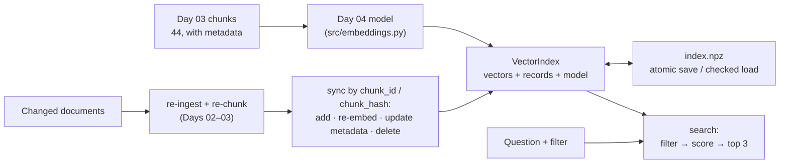
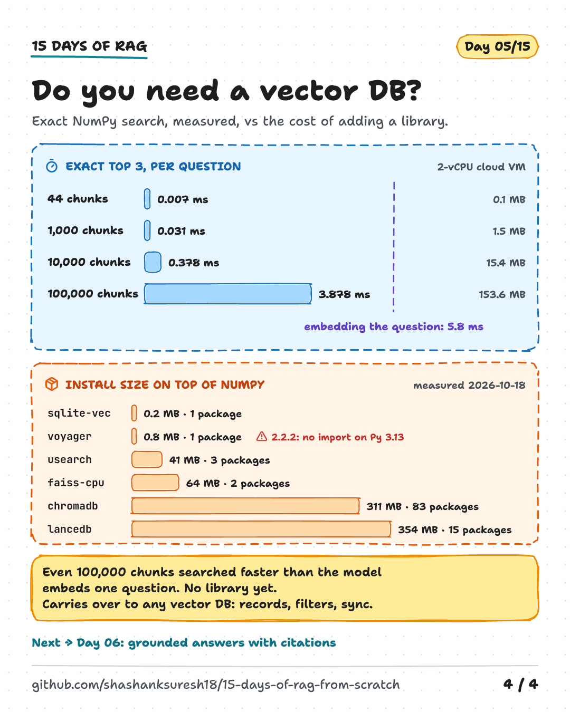

# Day 05 — Local Vector Search and the Data Lifecycle

**An index you can filter, save, update and delete from, and why its permission filter isn't access control**

| | |
|---|---|
| **Series** | 15 Days of Modern, Enterprise-Relevant RAG from Scratch · Day 05/15 |
| **Level** | Beginner to intermediate (comfortable reading Python; Days 02–04 help but aren't required) |
| **Time** | ~40 min reading · ~20 min running the notebook and exercises |
| **Cost** | Free. No API key, no paid services, **no new packages**. Uses Day 04's model (133 MB, downloaded once if it isn't already in `models/`) |
| **Code** | [`notebooks/day_05_vector_search_and_lifecycle.ipynb`](../../notebooks/day_05_vector_search_and_lifecycle.ipynb) — NumPy plus the shared code in [`src/rag_from_scratch/`](../../src/rag_from_scratch/), which gains Day 04's embedding model today |
| **Visuals** | [`assets/day-05/`](../../assets/day-05/) |
| **Verified** | Notebook executed top to bottom on 2026-10-18 on Linux with Python 3.11, 3.12, 3.13 and 3.14, from both the repo root and `notebooks/`; since verified on Windows 11 (Python 3.11.9) and in GitHub Actions on Linux, Windows and macOS. CI runs the same tests on every push. Details in section 13. |

---

## Learning objectives

By the end of today you will be able to:

1. Explain what a vector index stores (vectors, records, the model) and build an exact one in about 70 lines of Python and NumPy.
2. Use metadata filters for scope, freshness and permissions, and explain why **pre-filtering** and **post-filtering** return different results.
3. Save an index safely: one file, an atomic swap, no pickle, and a refusal to load it with the wrong model.
4. Keep an index in step with changing documents by `chunk_id` and `chunk_hash`: add, re-embed, update metadata without re-embedding, and **delete**.
5. Explain why a permission filter is not access control on its own, and name what has to surround it.

## Prerequisites

- Basic Python: functions, dataclasses, dictionaries. NumPy's `@` (matrix product) and boolean indexing are explained where they appear.
- Python 3.11 or newer and the repository's `requirements.txt` (setup in section 11). Nothing new to install if you ran Day 04.
- Useful context: Day 02's `allowed_groups` and change detection, Day 03's `chunk_id` and `chunk_hash`, Day 04's embeddings. Today imports all three.

## Key terms

| Term | Meaning |
|---|---|
| **Vector index** | A data structure that stores vectors with an ID and metadata, and returns the vectors most similar to a query vector. A vector database is a server built around one. |
| **Exact (flat) index** | Scores the query against every stored vector. Always returns the true top k. What Day 04 did and what today builds. |
| **Approximate nearest neighbour (ANN)** | An index that avoids scoring every vector, for example with an **HNSW** graph. Much faster at millions of vectors; returns *most* of the true top k. |
| **Record** (or payload) | Everything stored next to a vector: ID, text, metadata. |
| **Upsert** | Insert a record, or replace it if its ID already exists. |
| **Metadata filter** | A condition on records (`doc_id = ...`, `last_reviewed ≥ ...`, groups overlap) that restricts which ones a search may return. |
| **Pre-filter / post-filter** | Apply the filter before ranking (rank only matching records) or after it (rank everything, then drop non-matching results from the top k). |
| **Security trimming** | Using a permission filter so that each user's search only returns what they may read. |
| **System of record** | The system that holds the authoritative version of something: here, `access-control.json` for permissions. The index only holds a copy. |
| **Atomic write** | A save that either completes fully or leaves the old file untouched; never a half-written file. |
| **Sync** | Making the index match the current documents: add, re-embed, update metadata, delete. |
| **Orphaned chunk** | A chunk still in the index after its source text was deleted or renamed. |

---

## 1. Why an index needs more than search

Day 04 already did vector search: embed 44 chunks, embed the question, score every chunk, keep the top 3. For a notebook that runs once, that is enough. For documents that people rely on, three questions come up immediately:

- **Which chunks may this search return?** Only this department's documents, only current policies, only what this user is allowed to read.
- **What happens when the program restarts?** Re-embedding every chunk on every start costs time (and money with a hosted model).
- **What happens when the documents change?** Policies are edited, retired, renamed and re-permissioned. An index that doesn't follow is wrong in ways that look perfectly normal.

Today answers all three with plain NumPy, then shows what still goes wrong. The headline result: on the same index, **one missing argument returns the managers-only pay guide to an employee as the top result**, and a retired policy keeps answering questions if the update code never deletes.

## 2. The architecture




Same 44 chunks, same model, same pinned revision as Day 04. Day 04's model code now lives in [`src/rag_from_scratch/embeddings.py`](../../src/rag_from_scratch/embeddings.py) as an `Embedder` class; a test checks that it returns exactly the vectors, file checks and error messages of the Day 04 notebook.

## 3. What a vector index stores

Strip away the product names and every vector index keeps three things:

| Part | Here | Why |
|---|---|---|
| **Vectors** | a 44 × 384 `float32` matrix | what the search scores |
| **Records** | one `Chunk` per row: `chunk_id` (the primary key), text, title, `allowed_groups`, `last_reviewed`, `source_path`, `doc_hash`, `chunk_hash` | what you filter on, show, cite, and compare during updates |
| **The model** | `BAAI/bge-small-en-v1.5` @ `5c38ec7c405e…`, 384 dimensions | a query vector from any other model is meaningless against these vectors |

The notebook's `VectorIndex` has four operations: `upsert` (insert or replace by `chunk_id`), `update_metadata` (new record, same vector), `delete`, and `search`. The search is the same maths as Day 04, with an optional filter:

```python
def search(self, query_vector: np.ndarray, k: int = TOP_K, where: dict | None = None,
           filter_mode: str = "pre") -> list[Result]:
    # Exact search: score every candidate row, keep the best k. A filter (section 3) runs before
    # the ranking ("pre") or on the ranked top k ("post").
    if filter_mode == "pre":
        rows = np.array([i for i, r in enumerate(self.records) if where is None or matches(r, where)],
                        dtype=np.int64)
        scores = self.vectors[rows] @ query_vector
        picked = [(rows[j], scores[j]) for j in top_k(scores, k)]
    elif filter_mode == "post":
        scores = self.vectors @ query_vector
        picked = [(i, scores[i]) for i in top_k(scores, k) if where is None or matches(self.records[i], where)]
    else:
        raise ValueError(f"filter_mode must be 'pre' or 'post', not {filter_mode!r}")
    return [Result(rank, float(score), self.records[i].chunk_id, self.records[i])
            for rank, (i, score) in enumerate(picked, start=1)]
```

The notebook checks that the index returns exactly Day 04's top 3 for all 13 of Day 03's questions, and the same three parental leave chunks (0.72, 0.67, 0.66) for *"How much time off do new dads get?"*.

## 4. Metadata filters: scope, freshness, permissions

A filter restricts the search to records whose metadata satisfies a condition. Because Days 02 and 03 kept metadata on every chunk, three useful filters come for free:

| Filter | Condition in the notebook | Chunks that pass (of 44) |
|---|---|---|
| Scope: one document | `{"doc_id": "remote-work-policy"}` | 5 |
| Freshness: reviewed in the last year | `{"last_reviewed": {"gte": "2025-10-13"}}` | 39 |
| Permissions: an employee | `{"allowed_groups": {"any": ["all-employees"]}}` | 43 |
| Permissions: a manager | `{"allowed_groups": {"any": ["all-employees", "managers"]}}` | 44 |

Vector databases express filters the same way: small declarative conditions evaluated inside the database, close to the data. The notebook's `matches()` supports three kinds (equality, "any of", "at least") in 20 lines, and raises an error for a misspelled field instead of silently matching nothing.

**A filter is a hard rule, not a preference.** The freshness filter hides two documents: the software-requests page (last reviewed 2025-06-30, flagged as overdue on Day 02) and the manager guide, which has **no review date at all**, so `{"gte": ...}` treats it as failing. For *"Who approves admin rights?"* the only chunk that answers is in the hidden software-requests page, so the filtered search returns three chunks that don't answer. That may be the right policy (don't answer from an overdue document) or a silent loss of a correct answer. Decide it deliberately, tell users when something was filtered out, and remember that **missing metadata decides what is retrievable**.

## 5. Pre-filter or post-filter?

There are two places to apply a filter. **Pre-filter:** keep only the matching records, then rank them. **Post-filter:** rank everything, take the top k, then drop the ones that don't match. Tested output:

```text
When do pay rises take effect?   [filter: permissions: an employee]
  no filter
    #1 0.70  [manager-pay-review-guide#overview]   <- only managers, people-team
    #2 0.59  [expense-reimbursement-policy#approval-and-payment]
    #3 0.58  [parental-leave-policy#returning-to-work]
  post-filter: 2 of 3 results
    #1 0.59  [expense-reimbursement-policy#approval-and-payment]
    #2 0.58  [parental-leave-policy#returning-to-work]
  pre-filter: 3 of 3 results
    #1 0.59  [expense-reimbursement-policy#approval-and-payment]
    #2 0.58  [parental-leave-policy#returning-to-work]
    #3 0.57  [expense-reimbursement-policy#submitting-a-claim]

How do I connect to the VPN?   [filter: scope: one document]
  no filter
    #1 0.80  [vpn-access-guide#troubleshooting]
    #2 0.76  [vpn-access-guide#connecting]
    #3 0.74  [vpn-access-guide#when-to-use-the-vpn]
  post-filter: 0 of 3 results
    (no results)
  pre-filter: 3 of 3 results
    #1 0.71  [remote-work-policy#security-while-remote]
    #2 0.51  [remote-work-policy#core-hours]
    #3 0.51  [remote-work-policy#purpose]
```

Post-filtering returned **2 of 3** results for the permission filter (the restricted chunk took a top-3 place and was then removed) and **0 of 3** for the document scope (the whole top 3 came from the VPN guide), although the remote work policy has a chunk about working securely with the VPN. In general, **post-filtering returns fewer than k results, possibly none, whenever the filter is selective.** Fetching more than k before filtering ("over-fetching") shrinks the problem but can't remove it.

With an exact index, pre-filtering costs nothing extra: it scores fewer rows. With an approximate index it is harder, because the index structure was built for all vectors. That is why vector databases document their filter modes. Azure AI Search, for example, offers pre-filtering (its recommended default for indexes created since late 2023) and post-filtering modes, and warns that post-filtering can return fewer than k results and miss matches when filters are selective ([vector query filters](https://learn.microsoft.com/en-us/azure/search/vector-search-filters), page updated 2026-04-27). Check the mode of whatever store you use, and test it with a selective filter.


## 6. Saving and loading safely

An in-memory index has to be rebuilt (re-embedded) on every start, so it is saved. Three rules:

1. **One file, swapped in atomically.** `save_index()` writes the complete index to `index.npz.tmp` in the same folder, flushes it to disk, then calls `os.replace()`. Python documents that rename as atomic on POSIX systems ([`os.replace`](https://docs.python.org/3/library/os.html#os.replace)): anyone loading the index gets the old version or the new one. The temporary file must be on the same file system, hence the same folder. Vectors and records live in the same file, so they can't get out of step.
2. **No pickle.** `.npz` is a zip of NumPy arrays: the vectors as `float32`, the records and a manifest as UTF-8 JSON bytes. `np.load(..., allow_pickle=False)` refuses object arrays, because loading pickled data can execute arbitrary code ([`numpy.load`](https://numpy.org/doc/stable/reference/generated/numpy.load.html)).
3. **The model travels with the vectors.** The manifest records model, revision, dimensions and format version; `load_index()` refuses a mismatch.

The whole index is one file of 99,192 bytes (67,584 bytes of vectors and about 31 KB of records). Why bother with the temporary file? The notebook makes a save fail halfway (a realistic bug: one record's groups stored as a Python `set`, which JSON can't encode). Tested output:

```text
naive save: the save failed (Object of type set is not JSON serializable)
  the file on disk is broken: EOFError: No data left in file

atomic save: the save failed (Object of type set is not JSON serializable)
  the file on disk still loads: 44 chunks
```

Opening a file for writing empties it at once, so the naive save destroyed the good index before failing. And loading with a different model revision:

```text
refused: index.npz was built with BAAI/bge-small-en-v1.5 @ 5c38ec7c405e, but the queries come from BAAI/bge-small-en-v1.5 @ 0123456789ab. Vectors from different models can't be compared: rebuild the index.
```

Without that check the index would load, every search would return plausible-looking scores, and nothing would warn you that the ranking can't be trusted.

## 7. The data lifecycle: sync, don't just upsert

Documents change after indexing. Day 02 detected changes per document; Day 03 gave every chunk a stable `chunk_id` and a `chunk_hash`; Day 04 showed that a vector only needs recomputing when its text changes. `sync()` combines them. For every chunk the documents produce *now*, compared with the index by `chunk_id`:

| Situation | Action | Runs the model? |
|---|---|---|
| `chunk_id` not in the index | **add** | yes |
| same `chunk_id`, different `chunk_hash` | **re-embed** and replace | yes |
| same text, different metadata (permissions, dates, document version) | **update metadata**, keep the vector | no |
| identical | nothing | no |
| in the index, but in no document any more | **delete** | no |

The notebook applies Day 02's five changes to a temporary copy of the sample data (an edited policy, a retired one, a new one, a permission change, a file re-saved with Windows line endings) plus a sixth, a renamed heading, then re-ingests, re-chunks and syncs the saved index. Tested output:

```text
add               2  annual-leave-policy#entitlement, security-incident-reporting#mistakes-to-avoid
re-embed          1  remote-work-policy#equipment-and-home-office
update metadata  11  password-and-mfa-standard (4), remote-work-policy (4), security-incident-reporting (3)
delete            5  security-incident-reporting#what-not-to-do, vpn-access-guide (4)
unchanged        27

metadata updates by field: {'allowed_groups': 4, 'doc_hash': 7}
texts sent through the model: 3 (a rebuild would embed all 41)
index: 44 chunks before, 41 after
```

Read it line by line: the renamed heading changed a `chunk_id` (IDs come from headings), so it shows up as one **add** plus one **delete**; the price edit re-embeds one section; the permission change and the new document version touch 11 records **without the model**; the line-ending change is correctly **unchanged** (Day 02 normalises text before hashing).


### 7.1 The step everyone forgets: deletes

Many pipelines only insert and replace. Here is the same update without the delete step (tested output, shortened to the first question):

```text
upsert only: 46 chunks | full sync: 41 chunks | the documents: 41 chunks

How do I connect to the VPN?
  upsert only
    #1 0.80  [vpn-access-guide#troubleshooting]   <- no longer in any document
    #2 0.76  [vpn-access-guide#connecting]   <- no longer in any document
    #3 0.74  [vpn-access-guide#when-to-use-the-vpn]   <- no longer in any document
  full sync
    #1 0.71  [remote-work-policy#security-while-remote]
    #2 0.58  [new-starter-it-checklist#your-first-day]
    #3 0.57  [password-and-mfa-standard#multi-factor-authentication]
```

The retired VPN guide fills the whole top 3: a user would be sent to a procedure the company withdrew. The renamed section also appears twice (old and new) for incident questions. **None of this raises an error.** The results look normal.

### 7.2 Two safety properties

- **Sync equals rebuild.** The synced index has the same IDs, the same records, the same vectors (largest difference 0.0) and the same top 3 for Day 03's questions as an index rebuilt from scratch, for 3 embeddings instead of 41. Test this property in any incremental pipeline: incremental code is where stale data hides.
- **A sync that would delete everything is refused.** `sync()` takes the *complete* list of current chunks, which is what makes deletes possible, and dangerous: an ingest that fails and returns nothing would empty the index. The guard refuses to delete more than half the index unless told otherwise:

```text
empty chunk list: refusing to delete 44 of 44 chunks. Is the new chunk list incomplete (a failed or partial ingest)? Raise max_delete_fraction if this is intended.
```

**Deleting from the index is not deleting the data.** Old index files live on in backups, an embedding cache keyed on chunk hash may still hold the vector, and logs may contain retrieved text. A real erasure request has to reach all of them (Day 14).

## 8. A metadata filter is not access control

The permission filter worked in section 4. It's tempting to call that access control. On its own it isn't: a filter only decides *which rows to return for the filter values it is given*. Tested output for the managers-only question:

```text
When do pay rises take effect?
  employee, filter applied
    #1 0.59  [expense-reimbursement-policy#approval-and-payment]
    #2 0.58  [parental-leave-policy#returning-to-work]
    #3 0.57  [expense-reimbursement-policy#submitting-a-claim]
  manager, filter applied
    #1 0.70  [manager-pay-review-guide#overview]   <- only managers, people-team
    #2 0.59  [expense-reimbursement-policy#approval-and-payment]
    #3 0.58  [parental-leave-policy#returning-to-work]
  1. the filter is forgotten (where=None)
    #1 0.70  [manager-pay-review-guide#overview]   <- only managers, people-team
    #2 0.59  [expense-reimbursement-policy#approval-and-payment]
    #3 0.58  [parental-leave-policy#returning-to-work]
  2. an employee's request says groups = managers
    #1 0.70  [manager-pay-review-guide#overview]   <- only managers, people-team
    #2 0.59  [expense-reimbursement-policy#approval-and-payment]
    #3 0.58  [parental-leave-policy#returning-to-work]
```

Four ways it fails:

1. **The filter is optional.** It's a parameter. Any code path that leaves it out (a debug endpoint, an evaluation script, a "similar documents" widget) returns the restricted chunk at #1.
2. **The filter trusts its input.** The index can't tell a manager from an employee whose request *says* "managers": the two calls are identical. Microsoft's guide to security filters in Azure AI Search makes the same point: the identity in the filter is only a string, and the application has to supply the right one ([security filters](https://learn.microsoft.com/en-us/azure/search/search-security-trimming-for-azure-search), updated 2026-08-24).
3. **The filter checks yesterday's permissions.** The index holds a copy of each document's permissions from the last sync. In the notebook, the travel policy becomes managers-only in the system of record; until the next sync, an employee still gets its hotel limits as the top result:

   ```text
   What is the hotel limit per night in Singapore?   [employee, filter applied]
     the permission changed, the index hasn't been synced yet
       #1 0.71  [travel-policy#daily-limits-by-city]
       #2 0.53  [expense-reimbursement-policy#meals]
       #3 0.53  [travel-policy#booking-travel]
     sync: 5 records updated, 0 texts embedded
       #1 0.53  [expense-reimbursement-policy#meals]
       #2 0.49  [expense-reimbursement-policy#travel]
       #3 0.48  [remote-work-policy#equipment-and-home-office]
   ```

   The sync is cheap (no text changed, nothing re-embedded), so permission changes deserve their own, frequent sync. Managed services have the same property: Azure AI Search's built-in document-level permissions (in preview) check the permission metadata stored in the index, and source changes only take effect after they are synced ([document-level access overview](https://learn.microsoft.com/en-us/azure/search/search-document-level-access-overview), updated 2026-09-17).
4. **The index file holds everything.** Reading `index.npz` directly needs no filter: all 44 chunk texts are there, including the managers-only one, next to vectors that can be partly turned back into text (Day 04). Protect the index like the documents: file permissions, encryption at rest, access to the host.

### 8.1 What turns a filter into a control

The filter stays; what changes is who controls its input and whether it can be skipped. The notebook's minimal sketch:

```python
def retrieve_for(user_id: str, question: str, k: int = TOP_K) -> list[Result]:
    # The only search function the application exposes. `user_id` comes from the verified login, never from
    # the request body.
    #   - the groups come from the directory, not from the caller
    #   - the permission filter is always applied: there is no parameter to turn it off
    #   - an unknown user has no groups and gets nothing; a chunk without groups matches nobody (fail closed)
    groups = DIRECTORY.get(user_id, set())
    if not groups:
        return []
    return index.search(embedder.embed_query(question), k, where=groups_filter(groups))
```

Alice (employee) doesn't get the pay guide, Maria (manager) does, an unknown user gets nothing, and when Maria leaves the managers group in the directory she loses access on her next question, with no index change. Group membership is looked up per request (always fresh); document permissions are copied into the index (fresh only after a sync). Both matter.

This is a sketch, not a security design. A real system also authenticates the user, keeps tenants apart, logs who retrieved what, re-checks permissions on the final results before they reach a prompt, and tests all of it with hostile inputs. That is Day 14.

## 9. Do you need a vector database?

Vector databases and libraries add approximate indexes such as HNSW ([Malkov & Yashunin, 2016](https://arxiv.org/abs/1603.09320)), which return most of the true top k without scoring every vector. The cost: a dependency, an index to build and tune, and results that are no longer guaranteed exact. Exact search does the same work whatever the vectors contain, so the notebook measures it with random vectors at sizes the corpus doesn't reach. Measured on a 2-vCPU Linux cloud VM, the machine that produced the saved outputs; ranges over five runs (your numbers will differ):

| Chunks | Vectors in memory | Exact top 3, per question |
|---|---|---|
| 44 | 0.1 MB | about 0.01 ms |
| 1,000 | 1.5 MB | 0.03–0.06 ms |
| 10,000 | 15.4 MB | 0.35–0.38 ms |
| 100,000 | 153.6 MB | 3.9–6.6 ms |
| for comparison: embedding one question with the model | | 5.7–8.5 ms |

Exact search grows linearly. Even at 100,000 chunks it took less time than embedding the question, in every run. A million chunks would need 1.5 GB of vectors and, at the same rate, tens of milliseconds per question (extrapolated, not measured): roughly where an approximate index starts to earn its place.

**Local options, if you need one.** Checked on 2026-10-18; install size measured on Linux x86_64 with Python 3.13, in a fresh virtual environment, on top of NumPy:

| Package (version) | Licence | What it adds | Installed size, packages added |
|---|---|---|---|
| `sqlite-vec` (0.1.9) | MIT or Apache-2.0 | Vector search inside SQLite: one file, SQL, transactions, metadata columns. Pre-v1: its README warns of breaking changes. Loaded as a SQLite extension, which some Python builds don't support ([`sqlite3` docs](https://docs.python.org/3/library/sqlite3.html#sqlite3.Connection.enable_load_extension)) | +0.2 MB, 1 |
| `voyager` (2.2.2) | Apache-2.0 | HNSW index. When checked, the 2.2.2 Linux wheel for Python 3.12+ didn't import on Python 3.13 (its compiled file is named for 3.12 only) | +0.8 MB, 1 |
| `usearch` (2.26.4) | Apache-2.0 | HNSW index | +41 MB, 3 |
| `faiss-cpu` (1.15.1) | MIT | Exact and approximate indexes (IVF, HNSW, quantisation) | +64 MB, 2 |
| `chromadb` (1.5.9) | Apache-2.0 | A vector database: persistence, metadata filters, client/server | +311 MB, 83 |
| `lancedb` (0.40.0) | Apache-2.0 | An embedded vector database on the Lance columnar format | +354 MB, 15 |

`hnswlib` (0.8.0) and `annoy` (1.17.3) publish no wheels on PyPI, so installing them needs a C++ compiler, which most Windows machines don't have. All the packages above publish wheels for Python 3.11–3.14 on Linux, Windows and macOS (arm64).

**Decision for this series: no vector library yet.** At 44 chunks a library would add a dependency, an index build and approximate results, and save no measurable time. The one small HNSW library didn't even import on Python 3.13 when we checked, a reminder that every dependency is something that can break. What carries over to any vector database is everything else in this lesson: the records, the filters and their modes, the sync logic, the atomic save, and the access-control questions.



## 10. Core trade-offs

| Choice | Option A | Option B | Today |
|---|---|---|---|
| Index type | **Exact**: always the true top k, cost grows linearly | **Approximate (ANN)**: much faster at millions, misses some results, needs tuning | Exact |
| Filter placement | **Pre-filter**: always k results if k exist; harder in ANN indexes | **Post-filter**: cheap; fewer than k (even 0) with selective filters | Pre (default) |
| Storage | **One file, rewritten on each save**: simple, atomic, fine to ~100k chunks | **A database**: writes only changed rows, transactions, concurrent readers | One `.npz` file |
| Updates | **Rebuild everything**: simple, always consistent, re-embeds all | **Incremental sync**: re-embeds only changed text; must handle deletes and be tested against a rebuild | Sync, tested against a rebuild |
| Permission freshness | **Copy permissions into the index**: fast filters; stale until the next sync | **Check the system of record at query time**: always fresh; slower and one more dependency per query | Copy, with a cheap metadata-only sync |

### When to use what

- **Start exact.** Below about 100,000 chunks, exact search in NumPy is likely faster than embedding the question. Measure on your hardware.
- **Add an ANN index or a vector database** when measured latency or memory requires it, or when you need what a database brings (concurrent writers, replication, a server). Test its filter mode with selective filters, and compare its results with exact search on your own questions.
- **Always sync with deletes,** and test that a sync equals a rebuild.
- **Never treat a filter as access control** unless its input comes from verified identity, it can't be skipped, and permissions are synced quickly.

## 11. Setup, step by step

```bash
# 1. Clone (or update) the repository
git clone https://github.com/shashanksuresh18/15-days-of-rag-from-scratch.git
cd 15-days-of-rag-from-scratch          # already cloned?  git pull

# 2. Create and activate a virtual environment (Python 3.11+)
python -m venv .venv
source .venv/bin/activate               # Windows PowerShell: .venv\Scripts\Activate.ps1

# 3. Install the tested dependencies (Day 05 adds none)
python -m pip install -r requirements.txt

# 4. Open the notebook; if Day 04's model isn't in models/ yet, the first run downloads it (133 MB)
jupyter lab notebooks/day_05_vector_search_and_lifecycle.ipynb
#    then: Kernel -> Restart Kernel and Run All Cells

# 5. (Optional) Run the automated checks
python -m pytest
```

Platform notes are Day 04's: `onnxruntime` has no wheels for Intel Macs; behind a proxy set `HTTPS_PROXY`, or `HF_ENDPOINT` for a Hugging Face mirror (see [Day 04, section 11](../day-04/LEARN.md#11-setup-step-by-step)). The notebook writes `outputs/day-05/index.npz` (about 100 KB, git-ignored) and changes nothing in `data/sample/`: every change scenario runs on a temporary copy.

## 12. Code walkthrough

| Notebook section | What it shows | Key code |
|---|---|---|
| 0. Setup | Shared code, including the new `embeddings` module | `from rag_from_scratch.embeddings import Embedder` |
| 1. Input | Day 03's 44 chunks, embedded with Day 04's model (hash-checked) | `Embedder(REPO_ROOT)`, `embed()` |
| 2. The index | Vectors + records + model; upsert, update metadata, delete, exact search | `VectorIndex`, `top_k()` |
| 3. Filters | Scope, freshness, permissions; pre- vs post-filter | `matches()`, `search(..., where=..., filter_mode=...)` |
| 4. Persistence | Atomic save, safe load, a failed save, a model mismatch | `save_index()`, `load_index()` |
| 5. Lifecycle | Sync plan from Day 02's changes plus a rename; upsert-only vs sync; sync = rebuild; delete guard | `plan_sync()`, `sync()`, `corpus_after()` |
| 6. Not access control | Four failures; a sketch of enforcement | `groups_filter()`, `retrieve_for()` |
| 7. Scale | Exact search time from 44 to 100,000 vectors vs embedding a question | `median_ms()` |
| 8. Sanity checks | Every number quoted here, asserted | `close()` |

The sync is the part most worth reading slowly:

```python
def sync(index: VectorIndex, current: list[Chunk], embed, max_delete_fraction: float = 0.5) -> dict[str, list[str]]:
    # Make the index match `current`, the COMPLETE list of chunks the documents produce now.
    plan = plan_sync(index, current)
    if len(index) and len(plan["delete"]) > max_delete_fraction * len(index):
        raise RuntimeError(f"refusing to delete {len(plan['delete'])} of {len(index)} chunks. Is the new chunk list "
                           "incomplete (a failed or partial ingest)? Raise max_delete_fraction if this is intended.")
    by_id = {c.chunk_id: c for c in current}
    to_embed = [by_id[i] for i in plan["add"] + plan["re-embed"]]
    if to_embed:                                       # the only step that runs the model
        index.upsert(to_embed, embed([c.text for c in to_embed]))
    for chunk_id in plan["update metadata"]:
        index.update_metadata(by_id[chunk_id])
    index.delete(plan["delete"])
    return plan
```

## 13. Expected output and what was tested

**Tested** on 2026-10-18:

- The notebook executed top to bottom in a fresh kernel, and `python -m pytest` passed, on Linux (x86_64) with Python 3.11, 3.12, 3.13 and 3.14, from both the repository root and `notebooks/` (each kernel confirmed to run the intended Python version). The saved outputs come from the Python 3.13 run.
- `tests/test_shared_code.py` checks that the new `src/rag_from_scratch/embeddings.py` returns exactly the Day 04 notebook's vectors (all 44 chunks with and without headers, questions with and without the instruction, edge cases including a text over 512 tokens and several batch sizes), and the same file checks and error messages. Seven deliberate changes to the copy (pooling, normalisation, attention mask, query instruction, truncation, an error message, a skipped hash check) each make a test fail.
- The notebook's sanity checks were themselves tested: eight deliberate bugs (skipped deletes, missing dates passing the freshness filter, saving in place, post-filter as default, no delete guard, ignored metadata changes, no model check, "any" treated as "all") each make the notebook fail.
- With the model files present, the notebook makes no network connections.

**In the test environment** Hugging Face wasn't reachable, so the model files came from a copy whose SHA-256 values match the published ones. The download itself is Day 04's code path, which has run successfully on Windows 11 (Python 3.11.9) and in CI on Linux, Windows and macOS. CI runs today's notebook on all three on every push.

**Verified after publication (2026-10-19 and 2026-10-20):** on Windows 11 with Python 3.11.9, `pytest` passed (31 passed, 1 skipped: the slide test without Pillow); with the network pointed at a dead address, the Day 05 notebook test and the shared-code tests passed too (17 passed), so no network is needed once the model is on disk. In GitHub Actions on Linux, Windows and macOS with Python 3.11 and 3.14: run [39261318687](https://github.com/shashanksuresh18/15-days-of-rag-from-scratch/actions/runs/39261318687) on the `day-05` branch (6 of 6 jobs passed) and run [39430351485](https://github.com/shashanksuresh18/15-days-of-rag-from-scratch/actions/runs/39430351485) on `main` both succeeded.

**Expected differences on your machine:** timings (section 9), and scores in the last decimal places. The sanity checks compare IDs, counts and ranks exactly and scores with a tolerance, so they should pass everywhere. If one fails, please open an issue with your OS, CPU and Python version.

## 14. Common errors and mistakes

### Setup and runtime errors

| Symptom | Cause | Fix |
|---|---|---|
| `ImportError: Day 05 uses Day 04's packages ...` | Requirements installed before Day 04 | `git pull`, then `python -m pip install -r requirements.txt` |
| `RuntimeError: Could not download tokenizer.json ...` | First run without Day 04's model, offline or behind a proxy | See Day 04, section 11: `HTTPS_PROXY`, `HF_ENDPOINT`, or a manual download |
| `ValueError: index.npz was built with ... rebuild the index` | The index file came from another model or revision | Delete `outputs/day-05/index.npz` and rerun; never mix models |
| `PermissionError` from `os.replace` (Windows) | Another program has `index.npz` open (an unclosed `np.load`, an antivirus scan, a file preview) | Use `with np.load(...)`, close other programs, retry |
| `RuntimeError: refusing to delete 44 of 44 chunks` | `sync()` received an empty or partial chunk list | Fix the ingest; pass `max_delete_fraction=1.0` only for an intended wipe |
| `AttributeError` from `matches()` | A misspelled metadata field in a filter | Check the field name; failing loudly is deliberate |

### Conceptual mistakes (the expensive ones)

- **Treating a permission filter as access control.** Section 8: optional, trusts its input, can be stale, and doesn't protect the file.
- **Post-filtering with a selective filter.** Fewer than k results, sometimes none; users see "no answer" when the answer exists.
- **Upsert-only pipelines.** Retired and renamed content keeps being retrieved, with no error anywhere.
- **Syncing against a partial list.** If "missing means deleted", a failed ingest deletes the index. Guard it.
- **Overwriting the index in place.** A failed save destroys the last good copy.
- **Loading pickles or unchecked files.** Use `allow_pickle=False` and validate the manifest.
- **Adding a vector database first.** Measure exact search on your data size; add complexity when a number asks for it.

## 15. Privacy, licensing and security notes

- **The index is a copy of your documents.** It holds every chunk's text and its vectors. Store it with the same permissions as the sources, encrypt it at rest where the sources are encrypted, and include it (and its backups) in retention and deletion processes.
- **Permissions belong to the system of record.** `allowed_groups` comes from `access-control.json` (Day 02), never from document text, and is copied into the index only to filter efficiently. Sync permission changes quickly; Day 14 enforces them before generation and tests a malicious document.
- **Untrusted files.** `allow_pickle=False` keeps a tampered `.npz` from running code. It doesn't stop a tampered file from containing wrong records: protect the folder it lives in.
- **Licences.** No new dependencies today (NumPy is BSD-3-Clause; Day 04's packages and model are unchanged). The library table in section 9 lists each candidate's licence as published on PyPI on 2026-10-18. The sample documents are synthetic.

## 16. Key takeaways

1. **A vector index is vectors + records + the model,** and the lifecycle is part of retrieval: save atomically, refuse a mismatched model, sync by `chunk_id` and `chunk_hash` (3 of 41 texts re-embedded, identical to a rebuild), and never skip deletes.
2. **Filters are hard rules, and placement matters.** Post-filtering returned 2 of 3 and 0 of 3 results where pre-filtering returned 3; a freshness filter hid the only answer; missing metadata decides what is retrievable.
3. **A filter is a tool for access control, not access control.** It needs identity-derived input, a code path that can't skip it, fresh permissions and a protected index file.

## 17. Exercise

**Make the retired-document bug impossible to reintroduce.**

1. Write a test (in the notebook or in `tests/`) that builds an index from the current sample data, applies `corpus_after(day02_changes)`, syncs, and asserts that **no** search result for five questions of your choice comes from a chunk that no document contains any more. Include *"How do I connect to the VPN?"*.
2. Break `sync()` by removing the delete step. Does your test fail? If not, which question would have caught it?
3. Extend the test to the permission case: restrict a document in a `corpus_after()` change, sync, and assert that an employee's `retrieve_for()` never returns it.

That test is the start of what Days 07 and 12 build: checks that keep a fixed failure fixed.

The notebook's section 9 has five shorter exercises (over-fetching, renames, a permission-only sync, a new filter operator, porting the index to a library).

## References

All links checked on 2026-10-18.

- Microsoft, [Vector query filters in Azure AI Search](https://learn.microsoft.com/en-us/azure/search/vector-search-filters) (updated 2026-04-27): pre-, post- and strict post-filter modes and their trade-offs.
- Microsoft, [Security filters for trimming results in Azure AI Search](https://learn.microsoft.com/en-us/azure/search/search-security-trimming-for-azure-search) (updated 2026-08-24): the group-filter pattern; the identity is a string the application supplies.
- Microsoft, [Document-level access control in Azure AI Search](https://learn.microsoft.com/en-us/azure/search/search-document-level-access-overview) (updated 2026-09-17): built-in permission features (preview) and how source permission changes reach the index.
- Python documentation, [`os.replace`](https://docs.python.org/3/library/os.html#os.replace): atomic rename on POSIX; may fail across file systems.
- NumPy documentation, [`numpy.load`](https://numpy.org/doc/stable/reference/generated/numpy.load.html): `allow_pickle` defaults to `False`; loading pickled data can execute arbitrary code.
- Python documentation, [`sqlite3.Connection.enable_load_extension`](https://docs.python.org/3/library/sqlite3.html#sqlite3.Connection.enable_load_extension): loadable extensions aren't built in by default on every platform.
- Malkov & Yashunin, [Efficient and robust approximate nearest neighbor search using Hierarchical Navigable Small World graphs](https://arxiv.org/abs/1603.09320) (2016): the HNSW index used by many vector databases.
- Package pages on PyPI, checked 2026-10-18: [sqlite-vec](https://pypi.org/project/sqlite-vec/), [voyager](https://pypi.org/project/voyager/), [usearch](https://pypi.org/project/usearch/), [faiss-cpu](https://pypi.org/project/faiss-cpu/), [chromadb](https://pypi.org/project/chromadb/), [lancedb](https://pypi.org/project/lancedb/), [hnswlib](https://pypi.org/project/hnswlib/), [annoy](https://pypi.org/project/annoy/); and the [sqlite-vec README](https://github.com/asg017/sqlite-vec) (pre-v1 notice).

## Next: Day 06 — The first end-to-end grounded RAG

The index retrieves; next, a model answers from what it retrieved, cites the `chunk_id`s it used, and says "I don't know" when the evidence isn't there. Day 06 also draws the line between the instructions in a prompt and the untrusted text retrieved into it.
