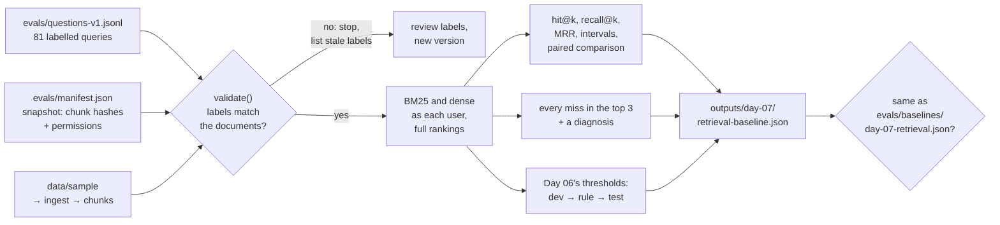

# Day 07 — An Evaluation Baseline

**Label a small set of questions, measure both retrievers on it, record every error, and measure the thresholds you chose by eye**

| | |
|---|---|
| **Series** | 15 Days of Modern, Enterprise-Relevant RAG from Scratch · Day 07/15 |
| **Level** | Beginner to intermediate (comfortable reading Python; Days 04–06 help but aren't required) |
| **Time** | ~40 min reading · ~20 min running the notebook and exercises |
| **Cost** | Free: no API key, no paid services, **no new packages** |
| **Code** | [`notebooks/day_07_evaluation_baseline.ipynb`](../../notebooks/day_07_evaluation_baseline.ipynb) — Python's standard library plus the shared code in [`src/rag_from_scratch/`](../../src/rag_from_scratch/), which gains Day 06's answering pipeline today |
| **Data** | [`evals/`](../../evals/): 81 labelled queries, the snapshot they belong to, and the accepted baseline |
| **Visuals** | [`assets/day-07/`](../../assets/day-07/) |
| **Verified** | Notebook executed top to bottom on 2026-10-22 on Linux with Python 3.11, 3.12, 3.13 and 3.14, from both the repo root and `notebooks/`. CI runs the same tests on Linux, Windows and macOS on every push (section 14). |

---

## Learning objectives

By the end of today you will be able to:

1. Write a labelled query: who asks, the evidence that answers it, and the chunk ids that hold it, derived from the evidence rather than typed by hand.
2. Tie labels to a snapshot of the documents and their permissions, and detect when a document change makes labels stale.
3. Compute hit rate@k, recall@k and MRR for two retrievers on the same queries, and say what each one measures and misses.
4. Read small-sample results honestly: counts, intervals, and paired comparisons instead of single percentages.
5. Keep an error log in which every miss has a diagnosis, and turn the categories into a plan.
6. Choose thresholds with a rule written down in advance, on a dev split, and report them on a held-out test split.
7. Save a baseline and compare every later run with it, without mistaking CPU rounding for a regression.

## Prerequisites

- Basic Python: dataclasses, dictionaries, list comprehensions.
- Day 04's two retrievers (BM25 and embeddings) and Day 06's pipeline (gate, reader, citation check). Section 2 recaps what you need.
- About 600 MB of disk space if you haven't run Day 04 yet (its model is downloaded once).

## Key terms

| Term | Meaning here |
|---|---|
| **Labelled query** | A question (or a pasted value) plus its ground truth: who asks, the evidence, and which chunks contain it |
| **Evidence** | The exact strings a chunk must contain to answer the question on its own |
| **Label** (`answer_chunks`) | The chunks the asking user may read that contain all of the evidence |
| **Restricted chunk** | A chunk that holds the evidence but the asking user may not read |
| **Snapshot** | The version of the documents (every chunk's text hash and permissions) the labels were written against |
| **Dev / test split** | Questions you may tune on / questions you only report on. Test questions are written before any system sees them |
| **Hit rate@k** | The share of queries with at least one labelled chunk in the top k |
| **Recall@k** | The share of a query's labelled chunks in the top k, averaged over queries |
| **MRR@k** | Mean reciprocal rank: the average of 1 / rank of the first labelled chunk (0 if not in the top k) |
| **Baseline** | A saved, accepted run that every later change is compared with |
| **Near tie** | Two scores so close that another CPU's rounding could swap them |

---

## 1. Why measure before improving

Six days in, every judgement in this series came from looking at examples: "BM25 misses the new-dads question", "0.60 leaves room below the lowest answerable score". That works for building understanding. It doesn't work for deciding whether a change helps, because:

- **Examples are chosen.** We remember the questions that made a point. A change that fixes those and breaks three others looks like progress.
- **Small effects need counting.** On 31 questions, one more hit is 3 percentage points. Without the list of which question moved and why, a number is noise.
- **Thresholds chosen by eye fit the questions you looked at.** Day 06 chose its reader threshold from the answerable side of 15 questions. Whether it holds on questions it hasn't seen is an empirical question.

Days 08–11 will each propose an improvement (hybrid search, reranking, query rewriting, wider retrieval). The roadmap's rule is that each one is measured against a baseline on the same questions and the same documents. Today builds that baseline, **before** any of them.

## 2. The architecture



Two files are inputs and are versioned with the code: the questions and the manifest. One file is the **accepted baseline**, also committed. Every run writes its own results to `outputs/` (git-ignored) and compares them with the accepted file. Nothing in a run ever writes into `evals/` (a test checks this).

## 3. The labelled set

Each line of [`evals/questions-v1.jsonl`](../../evals/questions-v1.jsonl) is one labelled query. Three of the 81, as the notebook prints them:

```text
d03-01 | alice | question | dev | day03-probe
  question:          What is the hotel limit per night in Singapore?
  evidence:          "Singapore | USD 220", "Hotel per night"
  answer_chunks:     travel-policy#daily-limits-by-city
  restricted_chunks: -
  facts:             "220"
  note:              Day 03: PDF table: row + column header

d06-02 | alice | question | dev | day06-check
  question:          When do pay rises take effect?
  evidence:          "take effect from 1 April"
  answer_chunks:     -
  restricted_chunks: manager-pay-review-guide#overview
  facts:             -
  note:              Day 06: the answer is in a managers-only guide alice may not read
```

The fields that matter:

- **`user`** — who asks. Since Day 05 retrieval is permission-aware, the right answer depends on the asker. `d06-02` is alice's version of the pay question: the evidence exists, but only in a chunk she may not read, so for her the correct retrieval result is *nothing relevant*, and the correct pipeline behaviour is to abstain.
- **`evidence`** — written by hand: the exact strings a chunk must contain to answer the question alone (Day 03's probes work the same way).
- **`answer_chunks`** — the label. **It isn't typed by hand.** It was derived from the evidence on today's documents (every chunk the user may read that contains all the evidence, as whole words: Day 04's rule, so "USD 25" doesn't match "USD 250"), then frozen in the file. Deriving labels from evidence makes them reproducible and checkable; freezing them makes a document change visible (section 4).
- **`facts`** — strings a correct *answer* contains. Today uses them only for the end-to-end check in section 9; Day 12 builds on them.
- **`split`**, **`origin`**, **`tags`**, **`note`** — where the query came from, whether we may tune on it, and any labelling decision worth recording.

### Where the 81 queries come from

```text
81 labelled queries in evals/questions-v1.jsonl (version 1, sha256 56d356f9cf8e...)

                              dev  test  total
questions, answerable          16    15     31
questions, not answerable       8    12     20
lookups                        30     0     30
```

| Origin | Queries | Why they're in |
|---|---|---|
| Day 03's probes | 13 | each tests one way chunking can fail: table rows, words only in headings, evidence over two sections |
| Day 01's failures | 4 | vocabulary mismatch (new dads), no stemming (locked), two out-of-scope questions |
| Day 06's check list | 7 | the pay question for maria and for alice, and five unanswerable questions |
| Day 04's lookups | 30 | an exact amount, time, address or link typed as the query; asked by maria, who reads all 44 chunks, so the numbers are comparable with Day 04's |
| **New today** | 27 | 15 answerable and 12 unanswerable questions, phrased the way people ask (wine for alcohol, work from home for remote work), including two that only maria can answer and five "near-topic" questions the documents don't answer |

The roadmap asked for Day 01's failure questions and Day 02's table question (Singapore, which is also a Day 03 probe); the rest grew from the later days.

### Dev and test

The first 54 queries were **seen while Days 01–06 were built**. Day 06 chose its thresholds by eye on some of them. They are the **dev** split: we may tune on them. Today's 27 are the **test** split. They were written, with their evidence and facts, **before any retriever was run on them**, and they are never used to choose anything. Otherwise every number we report would be partly a measurement of how well we fitted the questions.

This only works if you keep the rule: the moment a test question influences a decision, it is a dev question, and you need new test questions. The manifest states the rule for each split.

### What isn't labelled

Unanswerable questions have no `answer_chunks`, so they don't count in retrieval metrics (there is nothing to find). They are what section 9 measures: whether the pipeline refuses them. Lookups are all answerable but aren't natural questions, so they are reported separately and kept out of the threshold analysis.

## 4. Labels belong to a snapshot

A label such as "the answer is in `password-and-mfa-standard#passwords`" is true for one version of the documents. So [`evals/manifest.json`](../../evals/manifest.json) records the snapshot: every chunk's text hash and allowed groups, plus a fingerprint of the whole. Before measuring anything, the notebook's `validate()` compares today's chunks with the snapshot and derives every label again from its evidence:

```text
documents now: 44 chunks, snapshot 3f8344d00b8b... | labels written on snapshot 3f8344d00b8b...
label problems: 0
```

To see what it catches, the notebook makes two ordinary changes on a temporary copy of the data (Day 05's `corpus_after`): the password policy raises its minimum from 14 to 16 characters, and the retention policy becomes managers-only.

```text
the same labels after two document changes: 17 problems
  chunk data-retention-policy#deletion-requests: permissions changed
  chunk data-retention-policy#legal-holds: permissions changed
  chunk data-retention-policy#purpose: permissions changed
  chunk data-retention-policy#retention-periods: permissions changed
  chunk password-and-mfa-standard#passwords: text changed
  d03-06: labelled ['data-retention-policy#retention-periods'], the evidence is now in []
  d03-06: restricted [], now ['data-retention-policy#retention-periods']
  d04-v05: no chunk holds its evidence any more
  d04-v05: labelled ['password-and-mfa-standard#passwords'], the evidence is now in []
```

(The list continues with four more of alice's questions.) The text change breaks the two labels that quoted the old rule. The permission change is quieter and bigger: four of alice's questions now have their evidence only in chunks she can't read, so they turn from "answerable" into "restricted". **Permissions are part of the ground truth.** A metric computed on stale labels is wrong without looking wrong, so the notebook stops, and so does `tests/test_evals.py`. Nothing fixes labels automatically: a person decides whether "16 characters" still answers "how long must my password be?" (section 8).

## 5. Metrics that need labels

For one answerable query with labelled chunks `L` and a ranking:

| Metric | Per query | Averaged over queries | Answers |
|---|---|---|---|
| **hit@k** | 1 if any chunk of `L` is in the top k, else 0 | hit rate@k | Did the generator get to see an answer? |
| **recall@k** | share of `L` in the top k | recall@k | Did it see *all* the needed passages? |
| **reciprocal rank@k** | 1 / rank of the first chunk of `L`, 0 if not in the top k | MRR@k | How high was the first answer? |

The code is four short functions:

```python
def first_relevant(ranked, relevant) -> int | None:
    # The rank of the first labelled chunk, or None if the retriever never returns one
    return next((rank for rank, (cid, _) in enumerate(ranked, start=1) if cid in relevant), None)


def hit(ranked, relevant, k: int) -> bool:          # hit rate@k is the average of this over queries
    rank = first_relevant(ranked, relevant)
    return rank is not None and rank <= k
```

Two worked examples from the notebook: Day 01's parental-leave question (one labelled chunk) and the lookup "USD 75", which appears in two chunks.

```text
d04-v25  "USD 75" (maria); labelled: expense-reimbursement-policy#meals, travel-policy#daily-limits-by-city
  BM25   top 3: *travel-policy#daily-limits-by-city, *expense-reimbursement-policy#meals, expense-reimbursement-policy#approval-and-payment
         first relevant at rank 1: hit@1 1, hit@3 1, recall@3 1.00, reciprocal rank 1.00
  dense  top 3: *expense-reimbursement-policy#meals, expense-reimbursement-policy#approval-and-payment, expense-reimbursement-policy#travel
         first relevant at rank 1: hit@1 1, hit@3 1, recall@3 0.50, reciprocal rank 1.00
```

With one labelled chunk, recall@k equals hit@k. They differ when a question needs several passages, which is when recall is the honest number. MRR rewards putting the answer *first*, which matters when a generator reads only the top result or a person scans a list.

**What none of these measure:** whether the pipeline should have answered at all. A retriever always returns three chunks; MRR gives no credit for recognising "I don't know" (NIST's TREC QA track notes this property of the measure). Abstention needs its own measurement (section 9).

**Why they need labels.** The similarity score a retriever reports looks like a quality measure and isn't one: section 9 shows an unanswerable question ("How long are emails kept?") scoring higher than 12 of the 31 answerable ones. Managed services make the same distinction: Amazon Bedrock's retrieval evaluation offers a *context relevance* metric judged by a model without ground truth, and a *context coverage* metric that requires ground truth.

## 6. Results: two retrievers on 81 queries

BM25 (Day 01's code) has no metadata filter, so each user gets an index of the chunks they may read: 43 for alice, 44 for maria, which is filtering *before* the ranking. Dense retrieval is Day 06's `retrieve()`. Both index each chunk's text with its `Title > Section` header, the same as on Days 04–06.

```text
                    n  hit@1  hit@3  hit@5 hit@10  recall@3  MRR@10   hit@3 rate, 95% interval
questions, BM25    31     24     29     29     30      0.94    0.85   94% (79% to 98%)
questions, dense   31     26     29     31     31      0.94    0.90   94% (79% to 98%)
lookups, BM25      30     30     30     30     30      1.00    1.00   100% (89% to 100%)
lookups, dense     30     12     19     26     29      0.62    0.56   63% (46% to 78%)
```

- **On questions, the two are level**: 29 of 31 with the answer in the top 3 each. Dense puts it first a little more often and finds every answer by rank 5. On the test split alone (15 new questions), both have 14 of 15 in the top 3.
- **On lookups, they aren't**: BM25 finds all 30 at rank 1; dense finds 19 in the top 3. These are exactly Day 04's numbers (14 of 25 values, 8 at rank 1; all 5 identifiers), which checks the new harness against an old result.
- **The intervals are wide.** A 95% interval of 79% to 98% means: with a different sample of 31 similar questions, a hit rate anywhere in that range would be unsurprising. The notebook uses the Wilson score interval, which behaves well for small samples (Brown, Cai & DasGupta, 2001). With intervals this wide, a single percentage per retriever can't rank them.

Compare them **pair by pair** on the same queries instead:

```text
questions (31), relevant chunk in the top 3: both 28 | only BM25 1 | only dense 1 | neither 1 | sign test p = 1
    only BM25   d03-13 (How soon must I report a lost laptop?)
    only dense  d01-01 (How much time off do new dads get?)
    neither     d07-a08 (Will Acme pay for wine with a business dinner?)
```

The two retrievers disagree on two questions, one each way. The **sign test** asks: if neither were better, how surprising would this split of disagreements be? With one each way, not at all (p = 1). On lookups BM25 wins all 11 disagreements; if the two were equally good, that would happen about once in a thousand tries (p ≈ 0.001). Note also that 30 of 31 questions are found by at least one retriever: the argument for combining them, which Day 08 tests.

## 7. Every error, with a reason

An **error** is an answerable query whose labelled chunk isn't in the top 3, the chunks Day 06's reader reads. Each one was diagnosed by hand after reading the ranking and the chunks. The four on questions:

```text
other section  dense     d03-13   at rank 4       How soon must I report a lost laptop?
                                                  'within one hour' is under How to report, which never mentions a laptop
vocabulary     BM25      d01-01   never returned  How much time off do new dads get?
                                                  no word in common with the answer: dads, time off vs caregivers, leave
vocabulary     BM25      d07-a08  at rank 6       Will Acme pay for wine with a business dinner?
                                                  wine vs alcohol, pay for vs reimbursed
```

plus the dense retriever on the wine question (*broader chunk*: the expense policy's Scope, about business expenses and meals in general, outranks the Meals rule) and 11 dense misses on bare values (*exact value*).

```text
exact value: 11 | vocabulary: 2 | other section: 1 | broader chunk: 1
```

| Category | Misses | What it means | A later day that will test a fix |
|---|---|---|---|
| exact value | 11 (dense, lookups) | a bare number's vector doesn't single out the chunk holding it | Day 08: hybrid search keeps BM25's exact matching |
| vocabulary | 2 (BM25) | the question's words aren't the document's words | Day 08 (dense finds new dads); Day 10: query rewriting |
| other section | 1 (dense) | the answer sits in a section that never mentions the topic | Day 11: retrieving the surrounding section |
| broader chunk | 1 (dense) | a general chunk outranks the specific one | Day 09: reranking |

"Will test", not "will fix": each technique gets measured on these 81 queries and may not help. The notebook pins the diagnoses: if the set of misses ever changes, the check fails, so a new error can't slip in unexplained and a fixed one can't stay listed.

**Check the label before blaming the retriever.** Day 03's lost-laptop probe labels only `security-incident-reporting#how-to-report` ("within one hour"). The travel policy also says to report a lost laptop "straight away": related, but not an answer to *how soon*, so it isn't labelled. Such decisions go in the `note` field, where the next person can disagree with them.

## 8. Versioning: questions, labels and baselines

Treat `evals/` like code: every change is a reviewed commit with a reason.

- **Adding questions.** Write the question, the user, the evidence, the facts and a note. Derive the labels with `validate()` (the notebook's exercise 1 shows how), never by looking at what a retriever returned. Save the result as a **new version** (`questions-v2.jsonl`), keep `v1` so old baselines stay reproducible, and update the manifest (version, file hash, counts). Comparisons across versions are refused: the notebook's `compare()` checks the dataset fingerprint first.
- **When documents change.** `validate()` and `tests/test_evals.py` fail and list the stale labels. Review each one (does the new text still answer the question?), re-derive, record the new snapshot in the manifest, and bump the version.
- **Test questions are spent once.** If a test question has influenced a decision, move it to dev and write new test questions.
- **Accepting a new baseline.** Run the notebook, read the list of changes it prints against the accepted file, and only if every change is intended, copy `outputs/day-07/retrieval-baseline.json` to `evals/baselines/` and commit it with a message that says why. A test checks the committed baseline is consistent with the labels and with itself.
- **Near ties.** The baseline records, for each ranking, how far the first labelled chunk's score is from its neighbours. If a rank moves where that gap was under 0.001, the comparison lists it as a near tie (CPU rounding), not as a change. In this run the closest call is 0.0001 (dense, the lost-laptop question at rank 4 vs 5); runs on one machine differ by about 0.0000001.

## 9. Day 06's thresholds, measured

Day 06's pipeline refuses to answer in three places, each set by eye: the **gate** (`MIN_RETRIEVAL_SCORE = 0.50`: best retrieval score below it → abstain without calling a generator), the **names rule** (a name in the question that no source mentions → abstain), and the **reader** (`MIN_SENTENCE_SCORE = 0.60`: best sentence below it → abstain). With 51 labelled questions (31 answerable, 20 not), each can be measured.

### 9.1 What the gate sees

```text
score        dev: 16 ● and 8 ○         test: 15 ● and 12 ○
0.86 to 0.88                           ●●
0.84 to 0.86 ●                         
0.82 to 0.84 ●                         ●
0.80 to 0.82 ●                         
0.78 to 0.80                           ●●●
0.76 to 0.78 ●●                        ●
0.74 to 0.76 ●●●                       ●
0.72 to 0.74 ●●                        ●●○
0.70 to 0.72 ●●○                       ●●○○
0.68 to 0.70                           ●○
0.66 to 0.68 ●●●                       ●●○
```

(● answerable, ○ not; the plot continues down to 0.42.) Unanswerable questions spread from 0.42 to 0.73, **right into the answerable range**. A similarity score says how *close* a chunk is to the question, not whether it *answers* it. No gate can separate the two groups; what a gate can do is drop questions that are clearly off-topic.

### 9.2 Choosing the gate with a rule

The rule, written down before looking at the test split: **the highest value, in steps of 0.01, that refuses no answerable dev question.** Refusing an answerable question is the mistake we least want for a policy assistant; another product might weigh the two mistakes differently, and should write its rule down too.

```text
gate    dev: answerable kept  not answerable refused   test: answerable kept  not answerable refused
0.50                16 of 16                  1 of 8                15 of 15                 0 of 12  <- Day 06
0.55                16 of 16                  1 of 8                15 of 15                 1 of 12
0.60                16 of 16                  6 of 8                15 of 15                 4 of 12
0.62                16 of 16                  6 of 8                15 of 15                 6 of 12  <- measured
0.65                15 of 16                  7 of 8                15 of 15                 7 of 12
0.70                12 of 16                  7 of 8                12 of 15                 9 of 12
0.75                 6 of 16                  8 of 8                 8 of 15                12 of 12
```

**Day 06's gate at 0.50 was safe and nearly useless**: it refused 1 of 20 unanswerable questions. The measured gate, **0.62**, keeps every answerable question in both splits and refuses **6 of 12 unanswerable test questions**, a split it wasn't chosen on. It is set by a single question, the weakest answerable one ("What training must new starters complete?", at 0.626); one new question below it would move the gate. That is how it should be, and why the set has to keep growing.

### 9.3 The names rule: perfect on dev, wrong on test

```text
dev: refuses 4 of 8 unanswerable questions (Google, France, CEO, Wi-Fi) and 0 of 16 answerable ones
test: refuses 0 of 12 unanswerable questions (none) and 2 of 15 answerable ones
    d07-a01 "What is the hotel limit per night in Tokyo?": no source mentions Tokyo
    d07-a11 "My laptop might have a virus. Should I switch it off?": no source mentions Should
```

"Tokyo" isn't in any source, yet the travel policy answers the question ("Use the Other cities row for any city not listed"). "Should" is the first word of the question's *second* sentence: the rule skips only the question's first word, so any capitalised word after a full stop counts as a name. Neither failure could appear on the dev questions, which are single sentences naming only things the documents don't cover. **A rule can be 100% right on the questions that inspired it.** That is what a held-out split is for.

### 9.4 The reader's threshold

With the measured gate in front, no unanswerable dev question reaches the reader at all, so the dev split can only say how low the threshold must stay to keep every answer. The same rule gives **0.63** (the weakest answerable dev question's best sentence scores 0.639). On the test split it refuses one more unanswerable question than 0.60 (the company phone) and nothing answerable.

### 9.5 End to end

The whole Day 06 pipeline with each pair of settings, graded the simple way Day 06 did: *correct* if the answer contains the labelled facts, *refused* if the user sees no answer (abstained, or blocked by the citation check):

```text
settings (gate / reader)  split  answerable: correct / wrong / refused   not answerable: refused / answered
Day 06 (0.50 / 0.60)      dev    14 / 2 / 0  (of 16)                     6 / 2  (of 8)
Day 06 (0.50 / 0.60)      test   12 / 1 / 2  (of 15)                     5 / 7  (of 12)
measured (0.62 / 0.63)    dev    14 / 2 / 0  (of 16)                     8 / 0  (of 8)
measured (0.62 / 0.63)    test   12 / 1 / 2  (of 15)                     7 / 5  (of 12)
```

On dev the measured settings refuse everything unanswerable, but that is where they were tuned. On **test**: still 12 of 15 answerable questions correct, and 7 of 12 unanswerable ones refused instead of 5, with no answerable question lost. Five unanswerable test questions still get a cited, on-topic, wrong answer (annual leave gets the parental-leave entitlement); their scores are as high as answerable questions' scores. Separating them takes something that reads the question and the passage together: a reranker (Day 09) or a language model, measured (Day 12).

**Day 07 doesn't change Day 06's defaults.** `answering.py` keeps 0.50 and 0.60, so Day 06's notebook and the module still agree. The measured values (0.62 and 0.63) are recorded in the baseline file, for later days to adopt and re-measure.

**And a real model?** Day 06's one live run with `gpt-6-luna` (2026-10-20, eight questions, about USD 0.0005) abstained on alice's pay question and the meeting-room question, two that the API-free reader answers wrongly. Eight questions aren't a measurement; Day 12 runs models on this labelled set.

## 10. Known failures, recorded

The test split found problems that are now written down rather than fixed today, because fixing them changes Day 06's code (which `answering.py` mirrors) and each fix should itself be measured:

| Failure | Where | Effect | Candidate fix (to be measured) |
|---|---|---|---|
| Names rule treats the first word of a second sentence as a name | `unknown_names()` | "Should" refuses an answerable question | skip the first word of every sentence (notebook exercise 5) |
| Names rule refuses names the documents cover by a general rule | `unknown_names()` | "Tokyo" refused although "Other cities" applies | probably not fixable by a rule; a model judges this (Day 12) |
| The checker splits a copied list number ("3.") into its own sentence | `split_claims()` | a reply copying a numbered step is blocked as uncited | treat a leading list number as part of the sentence |
| Similar-but-wrong answers pass every check | reader + checker | 5 of 12 unanswerable test questions answered | reranking (Day 09), answer evaluation (Day 12) |
| The wine question's answer isn't in the top 3 | retrieval | answered wrongly with any thresholds | hybrid (Day 08), reranking (Day 09) |

The checker bug failed closed (that answer was wrong anyway), but a *correct* copied step would be blocked too.

## 11. Core trade-offs

| Choice | Option A | Option B | Today |
|---|---|---|---|
| Labels | **Derived from evidence strings**: reproducible, checkable on every run; misses answers phrased differently from the evidence | **Chunk ids typed by hand**: flexible; drifts silently when documents change | Evidence, with ids frozen in the file |
| Judging relevance | **Ground-truth labels**: exact and cheap to rerun; costs a person's time once per question | **A model as judge** (no labels): scales to thousands of questions; needs its own validation | Labels (Day 12 adds judged answers) |
| Metric | **hit rate@k**: what the generator saw | **MRR**: how high the answer was; **recall@k**: all passages found | All three, plus counts |
| Comparing systems | **One rate each**: simple; misleading on small samples | **Paired, per query**: shows which questions moved and why | Paired, with the sign test |
| Thresholds | **Chosen by eye**: fast; fits the examples you looked at | **A written rule on dev, reported on test**: honest; needs labelled unanswerable questions | The rule |
| Set size | **Small (81)**: one person can label and read every error | **Large**: tighter intervals; needs labelling help and sampling | Small, growing by versions |

### When to use what

- **Always** keep a labelled set from the first working pipeline on, with the user each question is asked as, tied to a snapshot.
- **Use hit rate@k** for the question "did the generator get the evidence?"; add **MRR** when ranking order matters and **recall@k** when questions need several passages.
- **Report counts and intervals**, and compare systems per query. Don't announce a 3-point gain on 31 questions.
- **Keep a test split you never tune on**, and replace it once it has been used to decide something.
- **Grow the set from real failures**: every bug report or confusing answer is a candidate labelled question.

## 12. Setup, step by step

```bash
# 1. Clone (or update) the repository
git clone https://github.com/shashanksuresh18/15-days-of-rag-from-scratch.git
cd 15-days-of-rag-from-scratch          # or: git pull

# 2. Create and activate a virtual environment (Python 3.11+)
python -m venv .venv
source .venv/bin/activate               # Windows PowerShell: .venv\Scripts\Activate.ps1

# 3. Install the tested dependencies (Day 07 adds none)
python -m pip install -r requirements.txt

# 4. Open the notebook; if Day 04's model isn't in models/ yet, the first run downloads it (133 MB)
jupyter lab notebooks/day_07_evaluation_baseline.ipynb
#    then: Kernel -> Restart Kernel and Run All Cells (about 15 seconds)

# 5. (Optional) Run the automated checks: one test file per process uses the least memory
python -m pytest tests/test_evals.py               # the labels, in a few seconds, no model
python -m pytest tests/test_day_07_notebook.py
python -m pytest                                    # everything
```

No environment variables, no API keys. The notebook runs offline once the model is in `models/`.

## 13. Code walkthrough

| Section | What the code does |
|---|---|
| 1. The labelled set | `Query` dataclass, `load_queries()`, composition table, three example rows |
| 1.1 Snapshot | `holds()` (whole-word evidence match), `snapshot()`, `fingerprint()`, `validate()`; the two-change demo with `corpus_after()` |
| 2. Retrievers | the index built from the snapshot's chunks with Day 05's `sync()`; `Pipeline.retrieve()` for dense; one `BM25Index` per user; full rankings for all 81 queries |
| 3. Metrics | `first_relevant()`, `hit()`, `recall()`, `reciprocal_rank()`, `wilson()`, `measure()`; the paired comparison and `sign_test()` |
| 4. Errors | `DIAGNOSES`, the miss list and the check that they match; one error inspected in detail |
| 5. Thresholds | `Signals` per question (best retrieval score, unknown names, best sentence); the gate and reader sweeps with the dev rule; the end-to-end comparison with `Pipeline(min_retrieval_score=...)` and `ExtractiveReader(min_score=...)` |
| 6. Baseline | the baseline dictionary, `tie_margin()`, `compare()`, written to `outputs/day-07/` and compared with `evals/baselines/` |
| 7. Sanity checks | every number quoted here, pinned |

The threshold sweeps reuse one set of per-question signals instead of rerunning the pipeline for every value, because the gate and the reader only compare a score with a threshold:

```python
def gate_counts(threshold: float, split: str) -> tuple[int, int, int, int]:
    part = [q for q in natural if q.split == split]
    return (sum(q.answerable and signal[q.id].top_score >= threshold for q in part), sum(q.answerable for q in part),
            sum(not q.answerable and signal[q.id].top_score < threshold for q in part), sum(not q.answerable for q in part))
```

**New in `src/rag_from_scratch/`:** `answering.py`, Day 06's pipeline: `Source`, `Context`, `assemble`, `Reply`, `answer_units`, `unknown_names`, `ExtractiveReader`, `Claim`, `Check`, `split_claims`, `check_citations`, `GeneratorError`, `RagAnswer`, `Pipeline` (`retrieve` and `answer`), `cited_sources`, `FixedReply` and `grade`. One change in shape: the notebook's global index, embedder, directory and thresholds became arguments with Day 06's values as defaults, so today can vary the thresholds without editing anything. Day 06's prompt and its `ChatModel` client stay in the Day 06 notebook until a later day needs them.

**`tests/test_shared_code.py`** gains a Day 06 class that runs the Day 06 notebook's own code and compares: retrieval for 33 questions, four users (alice, maria, an unknown user and an empty name), four values of k, both indexes (including the poisoned one) and another directory; contexts under six budgets; every answer unit of every chunk; the reader under four threshold settings and exactly on its threshold; the citation check on 21 replies; whole answers with the reader, hand-written replies, a failing generator, three other gates, a gate exactly on a score, and a store that skips the permission filter; and the grade on mixed-case answers. It is also lighter: one class per day, each day's notebook and model released when its tests finish (section 14 has the measurements).

## 14. Expected output and what was tested

**Tested** on 2026-10-22:

- The notebook executed top to bottom in a fresh kernel, and `python -m pytest` passed, on Linux (x86_64) with Python 3.11, 3.12 and 3.14 (56 passed, and the slide test skipped without Pillow) and 3.13 (63 passed, with Pillow), from both the repository root and `notebooks/`, each kernel confirmed to run the intended Python version. The saved outputs come from the Python 3.13 run. The same counts came from a fresh clone of the public repository with today's changes applied.
- With the model present, the notebook makes no network connections (checked by blocking every connection and DNS lookup while it ran).
- The notebook's sanity checks were themselves tested: fifteen deliberate bugs (dense retrieval without the permission filter, one BM25 index for everyone, `<` instead of `<=` in hit@k, recall looking one rank deeper, MRR without its cutoff, ranks counted from 0, evidence matched as substrings, labels that ignore permissions, a snapshot check that ignores permissions, errors counted in the top 5, the gate rounded up, a blocked answer counted as an answer, a one-sided sign test, an edited baseline, a wrong interval formula) each make the notebook fail; a near tie moved in the baseline (a positive control) does not.
- `tests/test_shared_code.py` checks `answering.py` against the Day 06 notebook: fifteen deliberate changes to the module each make a test fail. Two of them were caught only after adding tests: `<=` instead of `<` in the reader threshold (no real score falls exactly on 0.60, so the test now sets the threshold to an observed score) and a case-sensitive `grade()` (every check-list fact happens to match case, so the test now grades mixed-case answers). Five drifts in the earlier modules (BM25, chunking, embeddings, index filters, the sync guard) are still caught after the restructuring.
- **Memory**, measured on Linux with Python 3.13 (peak resident memory of the pytest process): `tests/test_shared_code.py` alone went from 1,459 MB before today to 724 MB, although it gained the Day 06 class; the whole suite in one process went from 1,632 MB (49 tests) to 766 MB (63 tests). The largest notebook kernel is about 645 MB in both. One file per pytest process remains the lightest way to run the suite on a machine short of memory.
- How close the pinned results are to a tie: the smallest gap between a labelled chunk and its neighbour is 0.0001 (dense, lost laptop, rank 4 vs 5; the check accepts either), then 0.0008 (dense, `people-team@acme.example` at rank 2). The closest score to a threshold is 0.0006 (the Wi-Fi question above the measured gate; the sick-days question above 0.60). Recomputing every score with one thread, with float64 dot products, and with each chunk embedded alone changed scores by at most 0.0000001 here; Day 06 pinned an order with a 0.001 gap that held on Linux, Windows and macOS.

**In the test environment** Hugging Face wasn't reachable, so the model files came from a copy whose SHA-256 values match the published ones; the download itself is Day 04's code path, verified on Windows 11 and in CI. CI runs today's notebook on Linux, Windows and macOS with Python 3.11 and 3.14 on every push.

**Expected differences on your machine:** timings, and scores in the last decimal places. If a rank moves where the gap was under 0.001, section 6 lists it as a near tie, not a change. If a sanity check fails, please open an issue with your OS, CPU and Python version.

## 15. Common errors and mistakes

### Setup and runtime errors

| Symptom | Cause | Fix |
|---|---|---|
| `ImportError: Day 07 uses Day 04's packages ...` | Requirements installed before Day 04 | `git pull`, then `python -m pip install -r requirements.txt` |
| `AssertionError: The labels don't match the documents ...` | `data/sample/` or `access-control.json` changed since the labels were written | Read the listed problems; review those labels (section 8). Don't edit the manifest to silence it |
| `questions-v1.jsonl changed but the manifest didn't` | The questions file was edited | Record the change as a new version (section 8) |
| Section 6 lists changes after you edited code | Your change moved rankings | Intended? Accept a new baseline deliberately. Not intended? You found a regression |
| A rank listed as a "near tie" | CPU rounding swapped two almost equal scores | Nothing to do; it isn't a change |
| The whole test suite runs out of memory | Several notebooks' models in one process | Run one test file per `pytest` process |

### Conceptual mistakes (the expensive ones)

- **Labelling by looking at the retriever's output.** The label then agrees with the system you are testing. Write evidence from the documents, derive the ids.
- **Tuning on the test split.** Every number you report becomes optimistic. Tune on dev, report on test, replace test questions once used.
- **Ignoring who asks.** Without the user, permission-dependent questions get the wrong ground truth, and a leak looks like a hit.
- **Reading a similarity score as a quality score.** An unanswerable question scored higher than 12 of 31 answerable ones.
- **Celebrating a 3-point gain on 31 questions.** Ask which question moved, and why.
- **Silently "fixing" stale labels.** A label change is a ground-truth change: review it, version it.
- **Treating rounding as a regression** (or a regression as rounding). Record near ties explicitly; everything else must match.

## 16. Privacy, licensing and security notes

- **Evaluation data is data.** These 81 questions are synthetic. A real labelled set is often built from user questions and can contain personal or confidential information: apply the same access rules and retention as to the documents, and don't put it in a public repository.
- **Permissions in the ground truth.** Labels per user make permission leaks visible: both retrievers are checked to never return a restricted chunk in anyone's top 10, and `tests/test_evals.py` checks the committed baseline's top 3. That is a regression check, not access control (Day 05).
- **No model calls.** Today runs locally; nothing leaves your machine.
- **Licences.** No new dependencies. The questions, labels and baseline are part of this repository (MIT). The model is Day 04's (MIT, downloaded at run time).

## 17. Key takeaways

1. **Measure before you improve.** 81 labelled queries, each with who asks and the evidence that answers it, tied to a snapshot of the documents and their permissions. Both retrievers find the answer in the top 3 for 29 of 31 questions; on lookups BM25 finds 30 of 30 and dense 19.
2. **Every miss gets a reason.** Fifteen errors, four categories, each pointing at a technique a later day will test: exact values and vocabulary (hybrid search), a broader chunk (reranking), an answer in the next section (wider retrieval).
3. **Choose thresholds with a rule, report them on questions you didn't tune on.** The measured gate refuses 6 of 12 unanswerable test questions instead of none; the names rule, perfect on dev, wrongly refused 2 of 15 answerable test questions.

## 18. Exercise

**Grow the set by one real failure.**

1. Run Day 06's pipeline on a question of your own until you find one it answers wrongly or refuses wrongly.
2. Write it as a labelled query: user, evidence, facts and a note saying what went wrong. Derive its labels with `validate()`.
3. Decide which split it belongs in, and explain why in one sentence. (Hint: you found it by trying the system.)
4. Which category from section 7 would it fall into if retrieval missed it? Which later day would you expect to help, and how would you know?

The notebook's section 8 has five shorter exercises (labelling your own questions, a stale permission, changing a retriever and reading the comparison, another threshold rule, fixing the names rule).

## References

All links checked on 2026-10-22.

- Manning, Raghavan & Schütze, [Introduction to Information Retrieval, chapter 8: evaluation of ranked retrieval results](https://nlp.stanford.edu/IR-book/html/htmledition/evaluation-of-ranked-retrieval-results-1.html): precision and recall over the top k, test collections and relevance judgments.
- NIST, [TREC question answering collections](https://trec.nist.gov/data/qa.html): the QA track's runs were evaluated with mean reciprocal rank; and the [TREC-8 QA track slide on reciprocal rank](https://trec.nist.gov/presentations/TREC8/removed/tsld051.htm): its properties, including no credit for recognising that no answer exists.
- Brown, Cai & DasGupta, [Interval Estimation for a Binomial Proportion](https://repository.upenn.edu/handle/20.500.14332/47517), *Statistical Science* (2001): the standard (Wald) interval behaves erratically; the Wilson interval is recommended for small samples.
- Amazon Bedrock, [metrics for RAG evaluations](https://docs.aws.amazon.com/bedrock/latest/userguide/knowledge-base-eval-llm-results.html): retrieve-only jobs report context relevance (no ground truth) and context coverage (requires ground truth); and the [RAG evaluation overview](https://docs.aws.amazon.com/bedrock/latest/userguide/evaluation-kb.html).

## Next: Day 08 — Hybrid search and rank fusion

Today's errors split cleanly: dense retrieval misses exact values, BM25 misses paraphrases, and 30 of 31 questions are found by at least one of them. Day 08 combines the two with Reciprocal Rank Fusion and measures the result on these same 81 queries, against `evals/baselines/day-07-retrieval.json`.
