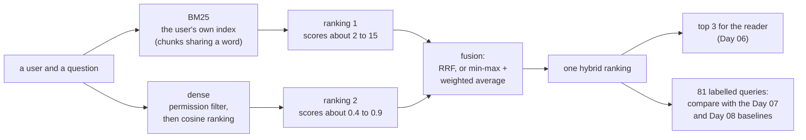

# Day 08 — Hybrid Search and Rank Fusion

**Combine a keyword retriever and an embedding retriever into one ranking, and measure what the combination gains and loses, query by query**

| | |
|---|---|
| **Series** | 15 Days of Modern, Enterprise-Relevant RAG from Scratch · Day 08/15 |
| **Level** | Beginner to intermediate (comfortable reading Python; Days 04 and 07 help but aren't required) |
| **Time** | ~40 min reading · ~20 min running the notebook and exercises |
| **Cost** | Free: no API key, no paid services, **no new packages** |
| **Code** | [`notebooks/day_08_hybrid_search_and_fusion.ipynb`](../../notebooks/day_08_hybrid_search_and_fusion.ipynb) — Python's standard library plus the shared code in [`src/rag_from_scratch/`](../../src/rag_from_scratch/), which gains Day 07's evaluation harness today |
| **Data** | [`evals/`](../../evals/): Day 07's 81 labelled queries and snapshot, unchanged, and today's accepted baseline, [`evals/baselines/day-08-retrieval.json`](../../evals/baselines/day-08-retrieval.json) |
| **Visuals** | [`assets/day-08/`](../../assets/day-08/) |
| **Verified** | Notebook executed top to bottom on 2026-10-23 on Linux with Python 3.11, 3.12, 3.13 and 3.14, from both the repo root and `notebooks/`. CI runs the same tests on Linux, Windows and macOS on every push (section 16). |

---

## Learning objectives

By the end of today you will be able to:

1. Explain why BM25 scores and cosine similarities can't simply be added, and show what happens when they are.
2. Implement Reciprocal Rank Fusion (RRF) from scratch, with a deterministic tie-break, and say what its constant k does.
3. Measure lexical, dense and hybrid retrieval on the same labelled queries, and compare them query by query with a paired test.
4. Name the two things RRF throws away, and recognise the queries where that costs you.
5. Build a score-based fusion (min-max normalisation and a weighted average), choose its weight with a rule on the dev split, and report it on the test split.
6. Decide with evidence whether two retrievers should index the same text, and keep permissions intact through the fusion.

## Prerequisites

- Basic Python: dictionaries, sorting with a key, list comprehensions.
- Day 04's two retrievers (BM25 and embeddings) and Day 07's labelled set and metrics (hit@k, MRR, the sign test). Section 1 recaps what you need.
- About 600 MB of disk space if you haven't run Day 04 yet (its model is downloaded once).

## Key terms

| Term | Meaning here |
|---|---|
| **Lexical retrieval** | Ranking by shared words. Here: Day 01's BM25, which only returns chunks that share at least one word with the query |
| **Dense retrieval** | Ranking by embedding similarity. Here: Day 04's model and Day 05's index, which rank every chunk the user may read |
| **Hybrid search** | Running both and merging the two rankings into one |
| **Rank fusion** | Merging rankings using positions only, ignoring the scores |
| **RRF** | Reciprocal Rank Fusion: each ranking adds 1 / (k + rank) to every chunk it returns |
| **k (RRF)** | A constant that flattens RRF's curve; 60 in the original paper. Not the "k" of top-k |
| **Min-max normalisation** | Rescaling one retriever's scores for one query so its best chunk gets 1 and its worst 0 |
| **Weighted (score) fusion** | α × normalised dense score + (1 − α) × normalised BM25 score, also called a convex combination |
| **Rank window** | How many results from each retriever go into the fusion (here: all of them) |
| **Near tie** | Two scores so close that another CPU's rounding could swap them (Day 07) |

---

## 1. Why combine two retrievers

Day 07 measured BM25 and dense retrieval on 81 labelled queries and found something more useful than a winner:

- **Their totals are equal, their misses aren't.** Each finds the answer in the top 3 for 29 of 31 questions, but BM25 never finds "new dads" (the policy says *caregivers*) and dense misses the lost laptop. 30 of 31 are found by at least one.
- **Dense retrieval misses exact values.** On 30 lookups (a value such as "USD 220" typed as the query) BM25 finds all 30 at rank 1, dense only 19 in the top 3.

That pattern, two retrievers with *different* blind spots, is the case for hybrid search. It isn't automatic: merging two rankings can also lose what one of them had. Today measures both sides on Day 07's queries, users and document snapshot, so every number can be compared with Day 07's accepted baseline, question by question.

## 2. The architecture



Both inputs are already filtered by permissions before they are ranked (Days 05 and 07), so the fusion only ever sees chunks the user may read (section 10 shows what happens if one isn't). The notebook first checks that BM25 and dense still reproduce Day 07's accepted baseline exactly; every difference after that comes from the fusion.

```text
BM25 and dense against evals/baselines/day-07-retrieval.json: no changes (81 queries x 2 retrievers: every rank, top 3, best score and metric)
```

## 3. Why you can't just add the scores

Here are both rankings for the question both retrievers missed on Day 07:

```text
d07-a08: Will Acme pay for wine with a business dinner? (alice; labelled: expense-reimbursement-policy#meals)
  BM25
    #1  6.636  expense-reimbursement-policy#scope
    #2  3.760  travel-policy#purpose
    #3  3.312  parental-leave-policy#returning-to-work
    #4  3.010  data-retention-policy#deletion-requests
    #5  2.776  it-software-requests#approval-times
  dense
    #1  0.686  expense-reimbursement-policy#scope
    #2  0.656  travel-policy#purpose
    #3  0.607  remote-work-policy#purpose
    #4  0.600  expense-reimbursement-policy#meals   <- the answer
    #5  0.555  vpn-access-guide#installing-the-client
```

Over all 81 queries:

```text
best score of each query: BM25 1.71 to 15.28 | dense 0.42 to 0.88
chunks returned per query: BM25 0 to 24 (only chunks sharing a word with the query; 2 queries get none) | dense: every chunk the user may read
raw sum: top 3 identical to BM25's (same chunks, same order) for 62 of the 71 queries where BM25 returns at least 3 chunks
```

BM25 scores depend on the query: how many words match and how rare they are. Cosine similarities live in a narrow band. Added together, the bigger numbers win: **the raw sum is BM25 with dense retrieval as a tie-breaker.** It has BM25's exact counts on lookups and BM25's two misses on questions (section 5). The two scales also differ in *shape*: BM25 returns only some chunks, dense ranks all of them, so "no score" and "a low score" mean different things in each list.

There are two ways out: combine **positions** instead of scores (RRF), or put the scores on a **common scale** before combining them (section 7).

## 4. Reciprocal Rank Fusion, from scratch

RRF, from Cormack, Clarke and Büttcher (SIGIR 2009), gives each chunk, in every ranking that returns it, a score of 1 / (k + rank), and adds them up:

```python
def rrf(lists, k: int = RRF_K) -> list[tuple[str, float]]:
    # Reciprocal Rank Fusion: every list adds 1 / (k + rank) to each chunk it returns. Only positions are used, so the
    # retrievers' scales never meet. Ties (a chunk at ranks (a, b) and another at (b, a)) are broken by chunk id.
    fused = {}
    for ranked in lists:
        for rank, (cid, _) in enumerate(ranked, start=1):
            fused[cid] = fused.get(cid, 0.0) + 1 / (k + rank)
    return sorted(fused.items(), key=lambda kv: (-kv[1], kv[0]))
```

Nothing else: no normalisation, no weights, no labels needed. The constant k makes the curve flat: rank 1 is worth 1/61 ≈ 0.0164 and rank 10 is worth 1/70 ≈ 0.0143. So a chunk that **both** lists rank in their top 10 (at least 2/70 ≈ 0.029) beats a chunk that only one list ranks first. The paper fixed k = 60 in a pilot and kept it; this lesson takes 60 from the paper rather than tuning it.

The wine question, worked through:

```text
d07-a08: Will Acme pay for wine with a business dinner?
RRF    score  chunk                                                       BM25         dense
#1    0.0328  expense-reimbursement-policy#scope                    #1 -> 1/61    #1 -> 1/61
#2    0.0323  travel-policy#purpose                                 #2 -> 1/62    #2 -> 1/62
#3    0.0308  expense-reimbursement-policy#meals                    #6 -> 1/66    #4 -> 1/64   <- the answer
#4    0.0299  vpn-access-guide#installing-the-client                #9 -> 1/69    #5 -> 1/65
#5    0.0297  data-retention-policy#deletion-requests               #4 -> 1/64   #11 -> 1/71
```

Neither retriever puts the Meals chunk first, but both put it fairly high (6th and 4th), and that **agreement** lifts it into the top 3, a hit where both retrievers missed.

**Ties are common.** With two lists, a chunk at ranks (2, 5) and another at (5, 2) get exactly the same score. The notebook breaks ties by chunk id, like Day 01's BM25, so every machine produces the same order, and it checks that no tie decides whether a labelled chunk is in the top 3:

```text
exact ties in an RRF top 4: 9 queries | ties that decide whether a labelled chunk is in the top 3: 0
```

### 4.1 Does k matter?

```text
                          questions (31)   lookups (30)
                           @1  @3   MRR   @1  @3   MRR
RRF, k = 1                 26  29  0.89    22  30  0.87
RRF, k = 5                 26  30  0.90    21  30  0.84
RRF, k = 20                26  30  0.90    20  30  0.82
RRF, k = 60                26  30  0.90    20  30  0.82   <- the paper's value, used throughout
RRF, k = 100               26  30  0.90    20  30  0.82
RRF, k = 1000              26  30  0.90    20  30  0.82
RRF, k = 60, top 10 each   26  30  0.90    20  30  0.82
```

For two lists, hardly. As k grows, RRF orders chunks by the *sum* of their two ranks; as k shrinks, by their *better* rank. Between the extremes the order rarely changes: from k = 20 to 1000 nothing moves here. Fusing only each retriever's top 10 (Elasticsearch's default window for its RRF retriever is 10) gives the same counts as fusing everything. Bruch, Gai and Ingber found RRF sensitive to its parameters on other datasets, so don't take this flatness for granted on yours; measure it, as here.

## 5. Results: lexical, dense and hybrid on 81 queries

Day 07's metrics, the same 81 queries, plus the raw sum and RRF:

```text
                       n  hit@1  hit@3  hit@5 hit@10  recall@3  MRR@10   hit@3 rate, 95% interval
questions, BM25       31     24     29     29     30      0.94    0.85   94% (79% to 98%)
questions, dense      31     26     29     31     31      0.94    0.90   94% (79% to 98%)
questions, raw sum    31     26     29     29     30      0.94    0.88   94% (79% to 98%)
questions, RRF        31     26     30     30     30      0.97    0.90   97% (84% to 99%)
lookups, BM25         30     30     30     30     30      1.00    1.00   100% (89% to 100%)
lookups, dense        30     12     19     26     29      0.62    0.56   63% (46% to 78%)
lookups, raw sum      30     30     30     30     30      1.00    1.00   100% (89% to 100%)
lookups, RRF          30     20     30     30     30      1.00    0.82   100% (89% to 100%)
```

In the top 3, RRF is never behind the better retriever: 30 of 31 questions, 30 of 30 lookups. Two numbers go the other way: BM25 alone puts all 30 lookups **first**, RRF only 20; and RRF's 30 of 31 questions isn't Day 07's 30 of 31 "found by at least one". The intervals overlap almost completely, so, as on Day 07, compare **pair by pair**:

```text
RRF vs dense, questions (31), labelled chunk in the top 3: both 28 | only RRF 2 | only dense 1 | neither 0 | sign test p = 1
    only RRF       d03-13 (How soon must I report a lost laptop?), d07-a08 (Will Acme pay for wine with a business dinner?)
    only dense     d01-01 (How much time off do new dads get?)
RRF vs dense, lookups (30), labelled chunk in the top 3: both 19 | only RRF 11 | only dense 0 | neither 0 | sign test p = 0.00098
    only RRF       d04-v06, d04-v07, d04-v10, d04-v11, d04-v12, d04-v14, d04-v17, d04-v18, d04-v20, d04-v21, d04-v24

RRF vs BM25, lookups (30), labelled chunk first: both 20 | only RRF 0 | only BM25 10 | neither 0 | sign test p = 0.002
```

- **Against dense on lookups, a clear win**: 11 answers found that dense misses, none lost (p ≈ 0.001). That fixes Day 07's largest error category.
- **On questions, too few disagreements to tell**: RRF gains the lost laptop and wine over dense but **loses new dads**; against BM25 it gains wine. One or two queries each way: p = 1.
- **Against BM25 on lookups at rank 1, a clear loss**: 10 answers BM25 puts first that RRF doesn't (p ≈ 0.002). In the top 3 they are level, so Day 06's reader of three chunks still sees them; a user who reads only the first result doesn't.

## 6. What RRF throws away

Both losses come from the same design choice: RRF uses only positions.

**Agreement wins, even over a first place.** For "new dads", BM25 returns 12 chunks (anything containing *time*, *off* or *new*), none of them about parental leave:

```text
d01-01: How much time off do new dads get?
RRF    score  chunk                                                       BM25         dense
#1    0.0303  remote-work-policy#core-hours                         #6 -> 1/66    #6 -> 1/66
#2    0.0299  new-starter-it-checklist#training                     #4 -> 1/64   #10 -> 1/70
#3    0.0291  remote-work-policy#purpose                            #2 -> 1/62   #17 -> 1/77
   ... the 12 chunks BM25 returns fill RRF's ranks 1 to 12, including BM25's #1, which dense ranks #39. Then dense's top 3:
#13   0.0164  parental-leave-policy#returning-to-work             not returned    #1 -> 1/61
#14   0.0161  parental-leave-policy#who-is-eligible               not returned    #2 -> 1/62
#15   0.0159  parental-leave-policy#leave-entitlement             not returned    #3 -> 1/63   <- the answer
```

Each of BM25's 12 chunks gets two votes, and two small votes beat one large one. Dense's own top 3, the three parental-leave chunks, get one vote each and come 13th to 15th. RRF assumes that a chunk only one retriever finds is less likely to be relevant. On a vocabulary mismatch, where only one retriever *can* find it, that assumption is exactly wrong.

**Confidence is ignored.** For the lookup "15 minutes", BM25's first chunk scores more than twice its second (6.28 vs 3.03); dense ranks the answer 19th. RRF sees only the positions 1 and 19, and ranks the answer 2nd. The size of BM25's lead, the strongest evidence in the query, never reaches the fusion. The same happens to 10 of the 30 lookups.

## 7. A score-based fusion, and whether it earns its place

The alternative keeps the scores but puts them on one scale first:

```python
def min_max(ranked) -> dict[str, float]:
    # One retriever's scores for one query, rescaled to 0..1: its best chunk 1, its worst 0
    if not ranked:
        return {}
    hi, lo = max(s for _, s in ranked), min(s for _, s in ranked)
    return {cid: (s - lo) / (hi - lo) if hi > lo else 1.0 for cid, s in ranked}


def weighted(lexical, dense, alpha: float) -> list[tuple[str, float]]:
    # alpha * dense + (1 - alpha) * BM25, both rescaled to 0..1 first. A chunk BM25 didn't return gets 0 from BM25.
    lex, den = min_max(lexical), min_max(dense)
    fused = {cid: alpha * den.get(cid, 0.0) + (1 - alpha) * lex.get(cid, 0.0) for cid in {*lex, *den}}
    return sorted(fused.items(), key=lambda kv: (-kv[1], kv[0]))
```

Min-max keeps the *shape* of each ranking: BM25's big lead on "15 minutes" survives as a big gap. This is the same family as Weaviate's default hybrid fusion (`relativeScoreFusion`, min-max within each search) and Elasticsearch's `linear` retriever with the `minmax` normaliser. It costs one thing RRF doesn't need: **a weight α, which has to be chosen on labelled data.**

**The rule:** the α, in steps of 0.1, that puts a labelled chunk in the top 3 for the most **dev** queries (the 16 answerable dev questions and the 30 lookups); ties go to the higher dev MRR@10, then to the α closest to 0.5. It uses dev queries only, and the sweep scores nothing else.

**It wasn't pre-registered.** While this lesson was being built, exploratory runs had already printed results for every weight from 0 to 1 on both splits, test included, before the rule was written into the notebook. Nothing was picked from the test columns, but they had been seen, so the test-split comparison in section 7.1 is a check, not clean held-out evidence. Day 07's threshold rule had the same flaw, caught by a reader's question (Day 07 LEARN.md, section 9.2). The fix for Day 09 onwards: commit the rule before any run, exploratory ones included, scores the test split.

```text
alpha  dev questions (16)    lookups (30)    all dev (46)
             @1  @3   MRR    @1  @3   MRR        @3   MRR
0.0           13  15  0.85          30  30  1.00        45  0.95  (BM25 alone)
0.1           13  15  0.85          30  30  1.00        45  0.95
0.2           13  15  0.85          30  30  1.00        45  0.95
0.3           13  15  0.85          30  30  1.00        45  0.95
0.4           13  15  0.86          30  30  1.00        45  0.95
0.5           13  15  0.87          30  30  1.00        45  0.96
0.6           13  15  0.89          30  30  1.00        45  0.96
0.7           13  16  0.89          30  30  1.00        46  0.96  <- the rule's choice
0.8           13  16  0.89          26  29  0.91        45  0.90
0.9           13  15  0.88          18  25  0.72        40  0.77
1.0           13  15  0.88          12  19  0.56        34  0.67  (dense alone)
```

Two regions: for every α up to 0.7, all 30 lookups stay at rank 1 (BM25's lead survives the averaging); from 0.7, all 16 dev questions are in the top 3. Only α = 0.7 has both, so the rule picks it. (Weaviate's documentation gives 0.75 as its default α. A coincidence of the same shape, not evidence.)

### 7.1 On both splits

```text
                       n  hit@1  hit@3  hit@5 hit@10  recall@3  MRR@10   hit@3 rate, 95% interval
questions, BM25       31     24     29     29     30      0.94    0.85   94% (79% to 98%)
questions, dense      31     26     29     31     31      0.94    0.90   94% (79% to 98%)
questions, RRF        31     26     30     30     30      0.97    0.90   97% (84% to 99%)
questions, weighted   31     27     31     31     31      1.00    0.92   100% (89% to 100%)
lookups, BM25         30     30     30     30     30      1.00    1.00   100% (89% to 100%)
lookups, dense        30     12     19     26     29      0.62    0.56   63% (46% to 78%)
lookups, RRF          30     20     30     30     30      1.00    0.82   100% (89% to 100%)
lookups, weighted     30     30     30     30     30      1.00    1.00   100% (89% to 100%)

answerable questions, dev (16): BM25 13/15 | dense 13/15 | RRF 13/15 | weighted 13/16   (first / in the top 3)
answerable questions, test (15): BM25 11/14 | dense 13/14 | RRF 13/15 | weighted 14/15   (first / in the top 3)
```

The weighted fusion has **no miss in the top 3** (31 of 31 questions, 30 of 30 lookups) and puts every lookup first, like BM25 alone. Against RRF it gains new dads in the top 3 and 10 lookups at rank 1 (p ≈ 0.002 for those); against dense alone it gains the lost laptop and wine (p = 0.5).

How much of that is earned? Be precise about which numbers are clean:

- **The lookups and 16 of the questions are dev queries**, and α was chosen on them, so those counts are optimistic by construction. The lookup advantage, though, holds for every α from 0 to 0.7: it is a property of score fusion, not of the tuning.
- **On the 15 test questions**, which the rule doesn't use (but whose results had been seen while exploring), the weighted fusion and RRF both have 15 of 15 in the top 3, and 14 vs 13 first. On test alone the two can't be told apart, and even this tie is a check, not a clean held-out result.

### 7.2 Decision

For this corpus, **the weighted fusion (α = 0.7) is the hybrid later days build on**: it avoids both of RRF's measured losses and loses nothing measured. **RRF stays in the baseline as the parameter-free alternative.** It needs no labels, no normalisation and no re-tuning when the documents change, which is why search engines offer it for hybrid queries: Azure AI Search ranks hybrid results with RRF, and Elasticsearch has an RRF retriever next to its linear one (Weaviate's default, by contrast, is a min-max fusion). If you have no labelled queries, start with RRF. Bruch, Gai and Ingber, comparing the two on public benchmarks, found the tuned convex combination ahead of RRF and needing only a small set of labelled examples to tune; our result points the same way, on far less data.

## 8. Every remaining miss

Day 07's 15 misses, traced through both fusions:

```text
category       query    missed by    BM25  dense   RRF  weighted   question or lookup
broader chunk  d07-a08  dense           6      4     3         3   Will Acme pay for wine with a business dinner?
exact value    d04-v06  dense           1      4     1         1   14 days
exact value    d04-v07  dense           1     19     2         1   15 minutes
```

(the table continues with Day 07's other nine exact values, then:)

```text
other section  d03-13   dense           3      4     2         3   How soon must I report a lost laptop?
vocabulary     d01-01   BM25            -      3    15         3   How much time off do new dads get?
vocabulary     d07-a08  BM25            6      4     3         3   Will Acme pay for wine with a business dinner?

misses after fusion:
  RRF      d01-01   one retriever only  How much time off do new dads get?
                                      BM25 never returns it: one vote (dense's #3) against two for each of the 12 chunks BM25 does return
  weighted: 0 misses
```

All 11 exact-value misses are fixed by both fusions, and so are the lost laptop (*other section*) and wine (*vocabulary* for BM25, *broader chunk* for dense). The one miss left is RRF's on new dads, with a new category: **one retriever only**. As on Day 07, the notebook asserts that the set of misses equals the set of diagnoses, so a new miss can't slip in unexplained.

**"No miss in the top 3" is not "nothing left to fix".** Wine only just makes it (rank 3, with the expense policy's Scope still first), and the first place matters for any reader that trusts the top result. And Day 07's other finding is untouched: five unanswerable test questions still get a cited, on-topic, wrong answer from Day 06's pipeline, because their best chunks score as high as real answers. Better retrieval can't fix that; something that reads the question and the passage together might. That is Day 09.

## 9. Should both retrievers index the same text?

Every chunk starts with a `Title > Section` header line (Day 03). Day 04 found, on 15 questions, that the header helps BM25 and hurts embeddings. With two retrievers, each could index its own version of the text. Measured on 81 queries (α stays at 0.7, not re-tuned):

```text
                                          questions (31)   lookups (30)
                                           @1  @3   MRR   @1  @3   MRR
BM25, header                               24  29  0.85    30  30  1.00
BM25, no header                            22  28  0.81    30  30  1.00
dense, header                              26  29  0.90    12  19  0.56
dense, no header                           27  31  0.92    12  19  0.57
RRF: BM25 header, dense header             26  30  0.90    20  30  0.82   <- today
RRF: BM25 header, dense no header          26  30  0.90    19  29  0.79
RRF: BM25 no header, dense header          25  29  0.87    20  30  0.82
RRF: BM25 no header, dense no header       25  29  0.88    19  29  0.79
weighted: BM25 header, dense header        27  31  0.92    30  30  1.00   <- today
weighted: BM25 header, dense no header     28  31  0.95    30  30  1.00
weighted: BM25 no header, dense header     26  31  0.90    30  30  1.00
weighted: BM25 no header, dense no header  27  30  0.92    30  30  1.00
```

- **Alone, Day 04's direction holds on 81 queries.** Without the header, dense finds all 31 questions in the top 3 (29 with it); BM25 puts fewer answers first (22 vs 24) and loses one from its top 3.
- **None of these differences is significant.** The biggest is two questions one way and none the other (p = 0.5).
- **Fused, the choice hardly matters.** No combination puts more answers in the top 3 than today's single text. The best alternative, the weighted fusion with headerless vectors, puts one more question first; the same vectors cost RRF a lookup.

**Decision: keep one text for both retrievers.** A second text means a second embedding pass, a second thing to keep in sync (Day 05) and a second explanation for every result, for one question at rank 1. If the labelled set grows and the dense advantage holds, revisit it with the new numbers. The general lesson from Day 04 stands: the text a retriever indexes doesn't have to be the text a reader sees, and the choice can differ per retriever. Here, it doesn't have to.

## 10. Permissions survive fusion only if every retriever filters

A hybrid has two retrievers, so it has **two places where the permission filter must be applied**. Both of today's inputs filter before ranking, so nothing a user may not read can enter a fused list. The notebook checks this for every query, every retriever and both fusions, in the top 10, then shows what happens if one retriever doesn't filter: a single, shared BM25 index instead of one per user.

```text
restricted chunks in any top 10 (all 5 retrievers, 81 queries): 0

with a shared, unfiltered BM25 index (dense still filtered):
  RRF: 8 queries (alice) get a chunk the asker may not read into the fused ranking; best rank 4, in the top 10 for 4, in the top 3 for 0
  weighted: 8 queries (alice) get a chunk the asker may not read into the fused ranking; best rank 22, in the top 10 for 0, in the top 3 for 0
```

The managers-only pay guide enters 8 of alice's fused rankings. With RRF it reaches her top 10 for four of them, once at rank 4, one place below what Day 06's reader reads. It misses her top 3 only because the filtered dense list never votes for it: **luck of the fusion, not a defence.** A deeper context, a longer result page or another weight would show it. Apply the filter in every retriever, before fusion, and keep Day 06's re-check after it (it raises an error before anything is sent to a generator). If a search engine runs both queries for you, check that its security filter applies to the keyword part and the vector part of the hybrid query alike.

## 11. What the second retriever costs

Hybrid search runs both retrievers on every query. Measured in the notebook on the 2-vCPU test machine (medians over 81 queries × 3 rounds; timings vary by machine, so the notebook only asserts that fusion is cheaper than embedding): embedding the question and searching took about 10 ms; BM25's full ranking and either fusion each took a few hundredths of a millisecond. **The second retriever is cheap next to the embedding model, and the fusion is cheaper still**, at least on 44 chunks. At a larger scale BM25 needs an inverted index on disk, the fusion needs each retriever's top N rather than a full ranking, and the two retrievers can run in parallel, so latency becomes the slower of the two plus the fusion. Day 13 measures the whole pipeline.

## 12. The baseline later days compare against

The run is written to `outputs/day-08/retrieval-baseline.json` in Day 07's format, now with four retrievers: BM25 and dense (unchanged from Day 07), RRF, and the weighted fusion. The reviewed copy is committed as [`evals/baselines/day-08-retrieval.json`](../../evals/baselines/day-08-retrieval.json), and every run is compared with it using Day 07's `compare()`, now shared in `src/`:

```text
this run: outputs/day-08/retrieval-baseline.json (81 queries x 4 retrievers, 16 errors)
compared with evals/baselines/day-08-retrieval.json: no changes (81 queries x 4 retrievers and their metrics)
closest calls in this run: d03-13 RRF (0.0001), d03-13 dense (0.0001), d04-i03 dense (0.0008), d04-v10 RRF (0.0009), d04-v10 dense (0.0009), d07-a03 weighted (0.0016), d04-v21 RRF (0.0017), d04-v21 dense (0.0017)
```

One detail is new: **how close an RRF rank is to a tie.** RRF scores are made of ranks, so CPU rounding can only move an RRF rank by swapping two near-equal scores in one of its *inputs*. The baseline records, for RRF, the smallest input gap whose swap would move the labelled chunk: for the lost laptop, dense's 0.0001 near tie would move RRF's rank from 2 to 3. `compare()` then reports such a move as a near tie, not a change. The weighted fusion's margin is its own score gap (closest call 0.0016), like BM25's and dense's.

`tests/test_evals.py` checks the committed file without running a model: its metrics follow from its ranks, its errors are exactly its misses, no restricted chunk is in any top 3, and its BM25 and dense entries are Day 07's, unchanged. Its `thresholds` entry says they weren't re-measured: today changes retrieval only, and Day 06's pipeline still retrieves with dense alone until a later day switches it, measured.

## 13. Core trade-offs

| Choice | Option A | Option B | Today |
|---|---|---|---|
| Combining scores | **Raw sum**: one line; the larger scale wins (here: BM25) | **Normalise first**: comparable scales; a choice of normalisation | Never raw |
| Fusion | **RRF**: positions only, no weight, no labels, robust to scale; ignores confidence and penalises single-retriever finds | **Weighted (min-max)**: keeps confidence; needs a weight tuned on labels, and re-checking when documents or models change | Weighted for this corpus; RRF kept as the label-free alternative |
| Rank window | **Full rankings**: nothing lost; fine at 44 chunks | **Top N each** (Elasticsearch's default is 10): cheaper; min-max depends on N | Full; top 10 gives the same RRF counts |
| Indexed text | **One text for both**: one pipeline | **One text per retriever**: each gets what suits it; two things to sync | One (section 9) |
| Hybrid at all | **One retriever**: simpler, half the moving parts | **Two**: covers exact values and paraphrases; doubles the permission surface | Two: the lookups alone justify it here |

### When to use what

- **Use hybrid search** when your queries include exact strings (codes, amounts, names, error messages) *and* paraphrases. If they are all one kind, measure first: one retriever may do.
- **Start with RRF** when you have no labelled queries. It has no knob that needs tuning and can't be thrown off by a score scale.
- **Move to a weighted fusion** when you have labelled queries and can see RRF's two losses on them (first places on exact values, finds by one retriever only). Choose the weight with a written rule on dev, commit it before any run scores the test split, report on test, and re-measure when the corpus or a model changes.
- **Never add raw scores** from different retrievers.
- **Filter permissions in every retriever**, before fusion, and test it as a regression.

## 14. Setup, step by step

```bash
# 1. Clone (or update) the repository
git clone https://github.com/shashanksuresh18/15-days-of-rag-from-scratch.git
cd 15-days-of-rag-from-scratch          # or: git pull

# 2. Create and activate a virtual environment (Python 3.11+)
python -m venv .venv
source .venv/bin/activate               # Windows PowerShell: .venv\Scripts\Activate.ps1

# 3. Install the tested dependencies (Day 08 adds none)
python -m pip install -r requirements.txt

# 4. Open the notebook; if Day 04's model isn't in models/ yet, the first run downloads it (133 MB)
jupyter lab notebooks/day_08_hybrid_search_and_fusion.ipynb
#    then: Kernel -> Restart Kernel and Run All Cells (about 15 seconds)

# 5. (Optional) Run the automated checks: one test file per process uses the least memory
python -m pytest tests/test_evals.py               # the labels and both baselines, in a few seconds, no model
python -m pytest tests/test_day_08_notebook.py
python -m pytest tests/test_shared_code.py         # the shared modules against the notebooks they came from
```

No environment variables, no API keys. The notebook runs offline once the model is in `models/`.

## 15. Code walkthrough

| Section | What the code does |
|---|---|
| 1. Same inputs | `load_queries()` and `validate()` from the shared harness; Day 07's two retrievers rebuilt; `entry()` and `metrics_of()` write Day 07's format; `compare()` against Day 07's accepted baseline |
| 2. Score mismatch | the two score ranges, `raw_sum()`, and how often its top 3 is BM25's |
| 3. RRF | `rrf()`; `explain_rrf()` prints each chunk's two ranks and contributions; ties counted; k and window sweep |
| 4. Results | `table()` with intervals; `show_paired()`: both / only A / only B / neither, with the sign test, in the top 3 and at rank 1 |
| 4.1 Losses | the new-dads ranking and the "15 minutes" lookup, explained |
| 5. Weighted fusion | `min_max()`, `weighted()`; the α sweep on dev; the rule; both splits; paired comparisons |
| 6. Misses | Day 07's diagnoses plus RRF's; the assert that misses equal diagnoses; Day 07's misses traced through both fusions |
| 7. Indexed text | `body()` strips the header; a second BM25 per user and a second vector index; the 2 × 2 table, alone and fused |
| 8. Permissions | no restricted chunk in any top 10; the shared, unfiltered BM25 demonstration |
| 9. Cost | `timed()`: median and 95th percentile per step |
| 10. Baseline | `rrf_margin()`; the baseline dictionary; written to `outputs/day-08/`, compared with `evals/baselines/day-08-retrieval.json` |
| 11. Sanity checks | every number quoted here, pinned |

**New in `src/rag_from_scratch/`:** `evaluation.py`, Day 07's harness: `Query`, `load_queries`, `holds`, `snapshot`, `fingerprint`, `validate`, `first_relevant`, `hit`, `recall`, `reciprocal_rank`, `wilson`, `measure`, `sign_test`, `top_score`, `tie_margin`, `compare`, and the constants `TOP_K`, `MAX_K`, `K_VALUES` and `TIE`. One change in shape: the notebook's `measure()`, `tie_margin()` and `top_score()` read a global dictionary of rankings by retriever name; the module's take the ranking itself, so any retriever can be measured without globals. `rrf()` and `weighted()` stay in today's notebook until a later day reuses them.

**`tests/test_shared_code.py`** gains a Day 07 class that runs the Day 07 notebook's own code and compares: the 81 loaded queries (and a file with a blank line); the evidence rule on every query and chunk and on edge cases ("USD 25" in "USD 250", "USD 25,000", "USD 25.50", "14 days" in "114 days"); the snapshot and fingerprint; `validate()` on the real labels, on the two-edit demo (the same 17 problems), on seven broken queries, another directory and a missing chunk; every metric for every query, both retrievers and k from 0 to 12; `measure()` on four selections; the Wilson interval for every count up to 39 queries; the sign test for every pair of counts up to 15; every margin and best score; and `compare()` on 13 baselines edited in different ways against three references and two tolerances, plus its boundaries: a score change exactly equal to the tolerance, and a rank move where the recorded margin is exactly the near-tie threshold or just above it. Still one class per day, each releasing its notebook when done.

## 16. Expected output and what was tested

**Tested** on 2026-10-23:

- The notebook executed top to bottom in a fresh kernel, and `python -m pytest` passed, on Linux (x86_64) with Python 3.11, 3.12 and 3.14 (64 passed, and the slide test skipped without Pillow) and 3.13 (72 passed, with Pillow), from both the repository root and `notebooks/`, each kernel confirmed to run the intended Python version. The saved outputs come from the Python 3.13 run. The same counts came from a fresh clone of the public repository with today's changes applied.
- With the model present, the notebook makes no network connections: with the download address pointed at a dead endpoint, an audit hook logging every Python connection and DNS lookup in the test and kernel processes recorded none while the notebook test ran (the same hook did record a lookup made inside a kernel, as a positive control).
- The notebook's sanity checks were themselves tested: 17 of 18 deliberate bugs make the notebook fail (BM25 shared by all users, dense without the permission filter, RRF ranks counted from 0, RRF with k = 6, RRF on scores instead of ranks, ties broken the other way, min-max dividing by the best score only, a chunk BM25 didn't return counted as 0.5, α weighting BM25 instead of dense, α chosen on the test split, RRF's margin taken from its own scores, the baseline's top 3 off by one, the paired comparison in the top 5, the headerless text keeping its header, a raw sum that averages, a miss without a diagnosis, a fused window of 5). One mutation survives, and can't be caught on this data: the α rule's tie-breaks (higher MRR, then closest to 0.5) never come into play, because α = 0.7 is the only weight with 46 dev queries in the top 3. Moving a near tie in the accepted baseline (a positive control) is reported as a near tie, not a change.
- `tests/test_shared_code.py` checks `evaluation.py` against the Day 07 notebook: 19 deliberate changes to the module each make a test fail (the evidence rule, label and snapshot checks, every metric, the interval, a one-sided sign test, the margin, the rounding, and five ways of weakening `compare()`). Three of them were caught only after the tests were extended: the evidence rule without its left word boundary ("14 days" inside "114 days" is in no real chunk), and `compare()` with `>=` instead of `>` at the score tolerance, or with a looser near-tie threshold (no real score sits exactly on either boundary, so the test now builds cases that do).
- **Memory:** the peak resident memory of the process running `tests/test_shared_code.py` was 715 MB (Linux, Python 3.13), against Day 07's 724 MB for the same file before the Day 07 class was added: each class releases its notebook when its tests finish, so the extra class doesn't raise the peak.
- How close the results are to a tie: the smallest gaps are Day 07's (dense, lost laptop, 0.0001) and carry into RRF (its rank 2 or 3; the check accepts either); the weighted fusion's closest call is 0.0016.

**In the test environment** Hugging Face wasn't reachable, so the model files came from a copy whose SHA-256 values match the published ones; the download itself is Day 04's code path, verified on Windows 11 and in CI. CI runs today's notebook on Linux, Windows and macOS with Python 3.11 and 3.14 on every push.

**Expected differences on your machine:** timings, and scores in the last decimal places. If a rank moves where the baseline recorded a near tie, section 10 lists it as a near tie, not a change. If a sanity check fails, please open an issue with your OS, CPU and Python version.

## 17. Common errors and mistakes

### Setup and runtime errors

| Symptom | Cause | Fix |
|---|---|---|
| `ImportError: Day 08 uses Day 04's packages ...` | Requirements installed before Day 04 | `git pull`, then `python -m pip install -r requirements.txt` |
| `AssertionError: The labels don't match the documents ...` | `data/sample/` changed since the labels were written | Run the Day 07 notebook, review the listed labels (Day 07 LEARN.md, section 8) |
| Section 1 lists changes against Day 07's baseline | BM25 or dense changed (code, model or data) | Undo it, or record the change: every later number depends on these inputs |
| Section 10 lists changes against Day 08's baseline | Your change moved a fused ranking | Intended? Accept a new baseline in a reviewed commit. Not intended? You found a regression |
| A rank listed as a "near tie" | CPU rounding swapped two almost equal scores | Nothing to do |

### Conceptual mistakes (the expensive ones)

- **Adding raw scores from different retrievers.** The larger scale wins; you have built the louder retriever with a tie-breaker.
- **Assuming hybrid can only help.** RRF lost a question dense had and 10 first places BM25 had. Compare per query.
- **Tuning the fusion weight on the questions you report.** Choose it with a rule on dev; report on test; say which numbers are in-sample.
- **Looking at the test split before the rule is committed.** Nothing has to be tuned on it for the damage to be done: once its results are seen, the held-out comparison is a check, not proof. This lesson did it (section 7); commit the rule first.
- **Reading RRF scores as relevance.** They are about 0.03 for almost every query and say nothing about whether a chunk answers anything; don't put a threshold on them.
- **Filtering only one retriever.** A leak that happens to rank low is still a leak.
- **Changing two things at once.** Today kept the labels, snapshot and both retrievers fixed and checked they reproduce Day 07, so every difference is the fusion's.

## 18. Privacy, licensing and security notes

- **Permissions:** both retrievers filter by the user's groups before ranking, and the notebook checks that no restricted chunk appears in any top 10 for any retriever. That is a regression check, not access control (Day 05): the groups must come from verified identity, and every retriever must apply them.
- **No model calls.** Today runs locally; nothing leaves your machine.
- **Licences.** No new dependencies. The questions, labels and baselines are part of this repository (MIT). The model is Day 04's (MIT, downloaded at run time).

## 19. Key takeaways

1. **Never add raw scores; fuse positions or normalised scores.** The raw sum was BM25 with a tie-breaker (62 of 71 top 3s identical). RRF needs no tuning and fixed all 11 of dense's exact-value misses.
2. **Fusion has losses too; find them per query.** RRF dropped "new dads" from dense's rank 3 to 15 (agreement beats a single find) and pushed 10 lookups off first place (confidence ignored).
3. **A tuned weighted fusion avoided both losses here**, with α chosen by a rule on dev (not pre-registered: test results had been seen while exploring); on the 15 test questions it ties with RRF. Keep RRF when you have no labels, and filter permissions in every retriever.

## 20. Exercise

**Make RRF lose on purpose, then decide what you'd ship.**

1. Write two new labelled questions (Day 07's exercise 1 shows how): one whose answer shares no word with the question (so BM25 can't find it) and one that is an exact code or amount (so dense may not).
2. Where does each retriever rank them? Where do RRF and the weighted fusion rank them?
3. Predict, before running, which of section 6's two mechanisms will hurt RRF on each. Were you right?
4. If you had only these two queries and no others, which fusion would you choose, and what would you need to see before trusting that choice?

The notebook's section 12 has five shorter exercises (weighted RRF, z-score normalisation, a shorter window, re-tuning with headerless vectors, feeding the hybrid to Day 06's reader).

## References

All links checked on 2026-10-23.

- Cormack, Clarke & Büttcher, [Reciprocal Rank Fusion outperforms Condorcet and individual rank learning methods](https://cormack.uwaterloo.ca/cormacksigir09-rrf.pdf), SIGIR 2009: the RRF formula; k = 60, fixed in a pilot investigation and not altered afterwards.
- Bruch, Gai & Ingber, [An Analysis of Fusion Functions for Hybrid Retrieval](https://arxiv.org/abs/2210.11934) (ACM, DOI 10.1145/3596512): a tuned convex combination outperformed RRF in and out of domain, was sample-efficient to tune, was largely insensitive to the choice of normalisation; RRF was sensitive to its parameters.
- Microsoft, [Relevance scoring in hybrid search using RRF](https://learn.microsoft.com/en-us/azure/search/hybrid-search-ranking) (Azure AI Search): 1/(rank + k) summed over the queries that ran, k = 60 reported to work best, optional weights for vector queries, and a score that is bounded by the number of fused queries.
- Elastic, [RRF retriever](https://www.elastic.co/docs/reference/elasticsearch/rest-apis/retrievers/rrf-retriever) (`rank_constant` default 60, `rank_window_size` default 10, optional per-retriever weights) and [linear retriever](https://www.elastic.co/docs/reference/elasticsearch/rest-apis/retrievers/linear-retriever) (weighted sum, `minmax` or `l2_norm` normaliser).
- Weaviate, [Hybrid search](https://docs.weaviate.io/weaviate/concepts/search/hybrid-search): `relativeScoreFusion` (min-max within each search, the default since v1.24) and `rankedFusion`; α = 0 is keyword only, 1 is vector only, server default 0.75.

## Next: Day 09 — Reranking and context selection

Today's weighted fusion puts a labelled chunk in the top 3 for every answerable query. What it can't do is tell whether a chunk *answers* the question: the five unanswerable test questions that Day 06's pipeline still answers wrongly have best chunks that score like real answers. Day 09 adds a reranker, a model that reads the question and each candidate together, and measures it on these same 81 queries against `evals/baselines/day-08-retrieval.json`: quality and latency.
