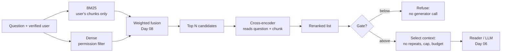

# Day 09 — Reranking and Context Selection

**Give the hybrid's candidates a second look with a cross-encoder, choose what goes into the context, and measure both against yesterday's baseline, with every rule committed before the test split was scored**

| | |
|---|---|
| **Series** | 15 Days of Modern, Enterprise-Relevant RAG from Scratch · Day 09/15 |
| **Level** | Beginner to intermediate (comfortable reading Python; Days 07 and 08 help but aren't required) |
| **Time** | ~45 min reading · ~20 min running the notebook and exercises |
| **Cost** | Free: no API key, no paid services, **no new packages**; one model download (91 MB, once) |
| **Code** | [`notebooks/day_09_reranking_and_context_selection.ipynb`](../../notebooks/day_09_reranking_and_context_selection.ipynb) — numpy, onnxruntime and tokenizers (installed on Day 04) plus the shared code in [`src/rag_from_scratch/`](../../src/rag_from_scratch/), which gains Day 08's fusion today |
| **Data** | [`evals/`](../../evals/): Day 07's 81 labelled queries and snapshot, unchanged; today's rules, committed first, in [`evals/preregistration/day-09.md`](../../evals/preregistration/day-09.md); today's accepted baseline, [`evals/baselines/day-09-retrieval.json`](../../evals/baselines/day-09-retrieval.json) |
| **Visuals** | [`assets/day-09/`](../../assets/day-09/) |
| **Verified** | Notebook executed top to bottom on 2026-10-28 on Linux with Python 3.11, 3.12, 3.13 and 3.14, from both the repo root and `notebooks/`. Since verified on Windows 11 and in CI on Linux, Windows and macOS, including the reranker's first real download (section 17). |

---

## Learning objectives

By the end of today you will be able to:

1. Explain the difference between a bi-encoder and a cross-encoder, and why a cross-encoder reranks a short list of candidates instead of searching the collection.
2. Run a small cross-encoder from its ONNX file, check it against its model card, and rerank a hybrid's top N.
3. Choose N with a rule on the dev split, **commit the rule before scoring the test split**, and say what a reused test split can still show.
4. Measure a reranker query by query against an accepted baseline, quality and latency, and diagnose every change it makes.
5. Test whether a relevance score can tell "close" from "answers", with the test written down in advance.
6. Select a context with deduplication, a source-diversity cap and a token budget, and know what each can and can't fix (including what a reranker does with a chunk that should never have been retrieved).

## Prerequisites

- Basic Python: dictionaries, sorting with a key, list comprehensions.
- Day 07's labelled set and metrics (hit@k, MRR, the sign test, near ties) and Day 08's two hybrids (RRF and the weighted fusion). Section 1 recaps what you need.
- About 100 MB of free disk space for today's model (91 MB, downloaded once), and about 600 MB more if you haven't run Day 04 yet (its packages and model).

## Key terms

| Term | Meaning here |
|---|---|
| **Candidate retrieval** | The first stage: fast retrievers (here: Day 08's hybrid) produce a ranked list from the whole collection |
| **Reranking** | The second stage: a slower, more careful model reorders the first stage's top N |
| **Bi-encoder** | A model that turns the question and each chunk into vectors **separately**, then compares them (Day 04's embedding model) |
| **Cross-encoder** | A model that reads the question and a chunk **together**, in one input, and outputs one relevance score |
| **Logit** | The cross-encoder's raw output: higher means more relevant; no fixed range, not a probability |
| **Rerank depth (N)** | How many of the first stage's candidates the reranker reads |
| **Gate** | A threshold below which the pipeline refuses before calling any generator (Day 06) |
| **Pre-registration** | Writing a rule (or a value) down and committing it before the data it will be judged on is scored |
| **Context selection** | Choosing which ranked chunks go to the generator: no repeats, a fair share per document, within a budget |
| **Token budget** | The most text the generator may receive, counted in the tokens of the model that reads it |

---

## 1. Why a second stage

Day 08's weighted fusion of BM25 and dense retrieval puts a labelled chunk in the top 3 for all 61 answerable queries in Day 07's labelled set. Two problems remain:

- **Order.** For four questions the answer is in the top 3 but not first. A user who reads the first result, or a context with room for one chunk, misses it.
- **"Close" isn't "answers".** Five unanswerable test questions still get a cited, wrong answer from Day 06's pipeline: "How much annual leave do I get?" retrieves the parental-leave entitlement, which is close without answering it. No threshold on cosine similarity separates them (Day 07, section 5.3).

Both retrievers score a chunk without reading it alongside the question. BM25 counts shared words; dense retrieval compares a vector of the question with a vector of the chunk, each made without seeing the other. A **cross-encoder** puts both texts through the model together, so every layer can relate "how long" to "16 weeks". The price is speed: one full model run per (question, chunk) pair, and nothing can be precomputed, so it can't search a collection. It **reranks** what the fast retrievers found.

That is the standard design, also in managed search services: Azure AI Search's semantic ranker reranks the top 50 results of a BM25, vector or hybrid query; Elasticsearch's `text_similarity_reranker` reranks the top 10 by default; Amazon Bedrock Knowledge Bases can apply a reranker model to retrieved chunks (references at the end).

## 2. The architecture



Everything left of the cross-encoder is Day 08's, unchanged and permission-filtered in every retriever. Today adds the reranker, a possible gate on its score, and an explicit selection step. Day 06's pipeline itself doesn't change today; the decisions in sections 7 and 10 say what a later day should switch on.

## 3. Rules first: what was committed, and what the test split can still show

On Days 07 and 08, exploratory runs printed test-split results before the rules for the gate and the fusion weight were written down, and both lessons had to say so. Today the order was reversed:

1. Exploration scripts dropped every test-split query right after loading the labels, so nothing they printed could come from it.
2. On dev only, they computed what each rule gives.
3. [`evals/preregistration/day-09.md`](../../evals/preregistration/day-09.md) was committed: the fixed settings, two rules and their values, the context-selection defaults, **everything that would be reported on the test split whatever it showed**, and what each decision needs. It is the first commit on today's branch.
4. Only then did anything score a test-split query. The notebook recomputes each rule on dev and stops if it doesn't give the committed value.

The commit's timestamp is local (the branch wasn't pushed yet), so it shows the order only as far as you trust the author. In a team, push the pre-registration or open a pull request with it, so a server witnesses the order.

**What the v1 test split can still show.** Before today's rules were written, its 27 questions and every earlier result on them were known, and the five "similar but wrong" questions were found on it by Day 07, so they are a known failure set, not a random sample. The split is still a fair check of today's two choices (rerank depth and gate), because those were fixed without it. It is not clean held-out evidence for the pipeline as a whole: the fusion weight under the reranker (α = 0.7) was chosen after test results had been seen. And because today used the split to make two decisions, its questions now count as used (`evals/README.md`, rule 4). A later decision that needs held-out evidence needs new test questions (`questions-v2`), written and committed before anything scores them.

## 4. The model: what, why, and its licence

| Candidate (checked on the Hugging Face pages, 2026-10-26) | Licence | ONNX file | Notes |
|---|---|---|---|
| **`cross-encoder/ms-marco-MiniLM-L6-v2`** (today's) | Apache-2.0 | 91 MB (an ONNX export by Xenova, 91 MB, is what's pinned) | 22.7M parameters, 6 layers; the same uncased BERT vocabulary as Day 04's model; the model card prints scores to check against |
| `mixedbread-ai/mxbai-rerank-xsmall-v1` | Apache-2.0 | 284 MB (87 MB quantized) | larger; a different tokenizer (another file to pin) |
| `jinaai/jina-reranker-v1-tiny-en` | Apache-2.0 | 132 MB | its PyTorch path needs the repository's own code |
| `BAAI/bge-reranker-base` | MIT | 1.1 GB | much larger |

These were compared on paper (licence, size, format), not measured. Today's choice is the smallest well-known one with a permissive licence, an ONNX file and a model card whose example scores can be checked. Hosted rerankers (Azure AI Search's semantic ranker, Amazon Bedrock's reranker models, and others) are the managed alternative: no model files to pin, but they bill per use and the question and chunks are sent to the provider.

**What's pinned.** `Xenova/ms-marco-MiniLM-L-6-v2` at commit `a09144355adeed5f58c8ed011d209bf8ee5a1fec`: `onnx/model.onnx` (90,992,115 bytes, SHA-256 `c623d0bc…`) and `tokenizer.json` (711,396 bytes, SHA-256 `d241a60d…`). That tokenizer is byte for byte Day 04's: both models use BERT's uncased vocabulary. The original repository now ships its own ONNX export as well (91,011,230 bytes, a different file); exercise 2 of the notebook swaps it in.

**Licence notes, honestly.** The model is Apache-2.0. The ONNX repository is a format conversion and states no licence of its own; Apache-2.0 applies to the weights it was converted from. The model was trained on **MS MARCO**, a dataset of real Bing questions whose terms say it is "intended for non-commercial research purposes only". Whether a dataset's terms bind a model trained on it is a legal question this lesson can't answer. It applies to many open rerankers, so ask before a commercial deployment. Nothing is redistributed here: the notebook downloads the files at run time.

## 5. A cross-encoder, from scratch

The question and the chunk go in as one sequence, with segment ids saying which is which:

```text
64 tokens in one input: 12 with segment 0 (the question), 52 with segment 1 (the chunk)
segment 0: [CLS] how much time off do new dad ##s get ? [SEP]
```

The model outputs one logit per pair. Scoring is a few lines on top of Day 04's tokenizer and ONNX code:

```python
def rerank_scores(question: str, texts: list[str], batch_size: int = 16) -> list[float]:
    # One number per (question, text) pair. The model reads the question and the chunk TOGETHER, in one input, and
    # outputs a single logit: higher means more relevant. It isn't a probability and has no fixed range.
    scores = []
    for start in range(0, len(texts), batch_size):
        encodings = pair_tokenizer.encode_batch([(question, text) for text in texts[start:start + batch_size]])
        inputs = {"input_ids": np.array([e.ids for e in encodings], dtype=np.int64),
                  "attention_mask": np.array([e.attention_mask for e in encodings], dtype=np.int64),
                  "token_type_ids": np.array([e.type_ids for e in encodings], dtype=np.int64)}
        scores.extend(float(s) for s in reranker.run(None, inputs)[0][:, 0])
    return scores
```

Before trusting it, check it against something published: the model card's own example. That catches a wrong file, a wrong tokenizer setting, or the two texts in the wrong order.

```text
model card example: 8.6071 and -4.3201 (the card prints 8.607138 and -4.320078)
one pair at a time vs six in a padded batch: largest difference 0.0e+00
```

For "How much time off do new dads get?", the two kinds of model disagree about the order:

```text
d01-01: How much time off do new dads get?
chunk                                                dense       weighted        cross-encoder
parental-leave-policy#returning-to-work          #1  0.721             #1          #3   -4.651
parental-leave-policy#who-is-eligible            #2  0.672             #2          #2   -4.217
parental-leave-policy#leave-entitlement          #3  0.665             #3          #1   -3.565   <- the answer
remote-work-policy#core-hours                    #6  0.560             #4          #5  -10.777
remote-work-policy#eligibility                   #4  0.631             #5          #4   -9.891
```

The bi-encoder's three parental-leave scores sit within 0.06 of each other; the cross-encoder puts the entitlement first. It still scores all three below zero, because "dads" never appears and "caregivers" does. Keep that in mind for section 10.

## 6. How many candidates? The rule, on dev

The reranker reads only the hybrid's top N; below N, the hybrid's own order is kept (so hit@5 and hit@10 stay defined). The pre-registered rule: *for each hybrid, the N in {3, 5, 10, 20, 44} that puts a labelled chunk in the top 3 for the most dev queries (16 answerable questions and 30 lookups); ties go to the higher dev MRR@10, then to the smaller N.*

```text
dev only (46)             N = 3           N = 5          N = 10          N = 20          N = 44
weighted            46 / 0.9855     45 / 0.9837     45 / 0.9837     45 / 0.9826     45 / 0.9826   -> N = 3
RRF                 45 / 0.9674     44 / 0.9620     44 / 0.9609     45 / 0.9826     45 / 0.9826   -> N = 20
(each cell: dev queries with a labelled chunk in the top 3 / dev MRR@10)
```

For the weighted fusion, **any depth beyond 3 loses a dev answer**: given more candidates, the reranker finds one it prefers to the lost-laptop answer (section 8 shows why). So N = 3, and the reranker can **only reorder the three chunks the reader already gets**: it can't add an answer to the top 3, or lose one. RRF's top 3 is weaker, and N = 20 is deep enough to reach answers RRF ranked far down.

## 7. Results on the same 81 queries

```text
                           n  hit@1  hit@3  hit@5 hit@10  recall@3  MRR@10   hit@3 rate, 95% interval
questions, BM25           31     24     29     29     30      0.94    0.85   94% (79% to 98%)
questions, dense          31     26     29     31     31      0.94    0.90   94% (79% to 98%)
questions, RRF            31     26     30     30     30      0.97    0.90   97% (84% to 99%)
questions, weighted       31     27     31     31     31      1.00    0.92   100% (89% to 100%)
questions, weighted+rerank 31     28     31     31     31      1.00    0.94   100% (89% to 100%)
questions, RRF+rerank     31     28     29     31     31      0.94    0.93   94% (79% to 98%)
lookups, BM25             30     30     30     30     30      1.00    1.00   100% (89% to 100%)
lookups, dense            30     12     19     26     29      0.62    0.56   63% (46% to 78%)
lookups, RRF              30     20     30     30     30      1.00    0.82   100% (89% to 100%)
lookups, weighted         30     30     30     30     30      1.00    1.00   100% (89% to 100%)
lookups, weighted+rerank  30     30     30     30     30      1.00    1.00   100% (89% to 100%)
lookups, RRF+rerank       30     30     30     30     30      1.00    1.00   100% (89% to 100%)
```

The first four rows are Day 08's, reproduced exactly (the notebook checks every rank, top 3 and metric against `evals/baselines/day-08-retrieval.json` first). Overall, reranking the weighted fusion puts one more question first (28 vs 27). Reranking RRF puts all 30 lookups first (RRF alone: 20), but finds one fewer question in the top 3.

Query by query, against the accepted Day 08 baseline, with dev and test apart (**the test split is the pre-registered comparison**):

```text
weighted+rerank vs weighted, dev questions (16), labelled chunk first: both 13 | only weighted+rerank 2 | only weighted 0 | neither 1 | sign test p = 0.5
    only weighted+rerank   d01-01, d03-04
weighted+rerank vs weighted, test questions (15), labelled chunk first: both 13 | only weighted+rerank 0 | only weighted 1 | neither 1 | sign test p = 1
    only weighted          d07-a02
```

```text
RRF+rerank vs RRF, lookups (30), labelled chunk first: both 20 | only RRF+rerank 9 | only RRF 0 | neither 0 | sign test p = 0.0039 | near ties set apart: d04-v10
```

```text
RRF+rerank vs RRF, dev questions (16), labelled chunk in the top 3: both 14 | only RRF+rerank 1 | only RRF 1 | neither 0 | sign test p = 1
    only RRF+rerank        d01-01
    only RRF               d03-13
RRF+rerank vs RRF, test questions (15), labelled chunk in the top 3: both 14 | only RRF+rerank 0 | only RRF 1 | neither 0 | sign test p = 1
    only RRF               d07-a08
```

- **Weighted, reranked:** two first places gained on dev, one lost on test ("Do I need a receipt for a USD 40 dinner?"). Neither split shows a difference the sign test can tell from luck.
- **RRF, reranked:** nine lookups get their first place back (p ≈ 0.004), plus a tenth set apart as a near tie (RRF ranks d04-v10 first or second depending on CPU rounding: Day 08, section 10). In the top 3 it gains new dads and loses the lost laptop and wine.

A difference is set apart as a near tie only when CPU rounding alone could explain it: one side recorded a gap under 0.001 **and** sits right at the cut-off (rank k or k + 1), where a single swap moves it across.

**Decision D1** (pre-registered): later days build on "weighted fusion, then rerank its top 3" only if, on the 15 test questions, it puts at least as many answers first as the weighted fusion alone (14) and keeps all 15 in the top 3. It puts 13 first: **not adopted.** The weighted fusion stays the default; the reranker stays an option. A single question decided it, which is why "not adopted" doesn't mean "worse": it means the evidence didn't clear a bar set in advance, for a step that adds 30 to 40 ms per query on this machine.

## 8. What moved, and why

Every move has a hand-written reason, and the notebook's `assert` fails if the set of moves changes. They fall into three groups. The last two are the cross-encoder's own limits.

**It reads the question and the chunk together.** "How long is parental leave?" meets "16 weeks"; "How far in advance do I have to book flights?" meets the booking rules; a bare value ("USD 220") meets the chunk that contains it. That last one undoes RRF's demotion of BM25's first place (Day 08, section 4.1).

**It scores each chunk alone.** "How soon must I report a lost laptop?" needs two sections of the incident policy: *What counts as an incident* (a lost laptop is one) and *How to report* ("within one hour"). The second never mentions a laptop:

```text
RRF+rerank       d03-13   dev   other section    How soon must I report a lost laptop?
                                                 the reranker scores each chunk alone: How to report (rank 5) holds 'within one hour' but never mentions a laptop; What counts as an incident does
```

No retriever or reranker in this pipeline can join two chunks; Day 11 retrieves surrounding sections.

**It doesn't reason.** A USD 40 dinner needs a receipt because 40 is more than 25 ("Attach an itemised receipt for every expense over USD 25"). Wine is alcohol ("Alcohol is not reimbursed"). Neither is a matter of matching words, and the reranker scores both answers below chunks that share more vocabulary with the question:

```text
RRF+rerank       d07-a08  test  vocabulary       Will Acme pay for wine with a business dinner?
                                                 the question says wine, the Meals chunk says Alcohol: the reranker ranks it 4th, behind Scope, the travel policy's Purpose and a chunk RRF had 9th
```

Day 08's 16 misses are unchanged, because its four retrievers are. The weighted fusion reranked has no miss; RRF reranked has the two above.

## 9. What the second look costs

```text
BM25 (full ranking)                    median     0.01 ms   p95     0.04 ms
dense (embed the question + search)    median    10.42 ms   p95    13.57 ms
weighted fusion                        median     0.02 ms   p95     0.03 ms
rerank 3 candidates                    median    31.64 ms   p95    53.44 ms
rerank 5 candidates                    median    54.80 ms   p95    70.34 ms
rerank 10 candidates                   median   107.92 ms   p95   161.53 ms
rerank 20 candidates                   median   235.18 ms   p95   263.72 ms
rerank 44 candidates                   median   492.95 ms   p95   554.63 ms
```

Measured on the 2-vCPU machine that ran the notebook, over 27 queries, with the model really called. (The notebook asserts only the shape, with wide margins: 44 candidates take more than twice as long as 3, and 20 more than twice as long as embedding one question.) Embedding the question, the expensive part of hybrid retrieval, takes about 10 ms. Reranking 3 candidates takes three to four times that, and 20 candidates more than twenty times. The cost grows with N, because each pair is a full model run; a bi-encoder embeds the chunks once, in advance. A GPU or a quantized model (the ONNX repository also has a 23 MB int8 version, not tested here) shrinks the numbers, but not the shape.

After N was committed, the notebook also ran every depth on every split. This is a description, not a choice:

```text
                    dev questions  test questions     lookups  model calls  median ms
                      (16) @1  @3     (15) @1  @3 (30) @1  @3
weighted                   13  16          14  15      30  30            0          -
  + rerank 3               15  16          13  15      30  30            3         32   <- the rule's choice
```

On the test split, deeper reranking of the weighted fusion is never better, and from N = 10 it also pushes wine out of the top 3. **More candidates means more chances to promote a wrong one, at a higher cost.** (The full table is in the notebook's section 5.1.)

## 10. Can a reranker tell "close" from "answers"?

Each question's best reranker score among the three chunks the reader would get:

```text
score         dev: 16 ● and 8 ○         test: 15 ● and 12 ○
 +9 to +10                             ●
 +8 to  +9   ●●●                       ●
 +7 to  +8   ●●                        ●
 +6 to  +7   ●●●                       ●●
 +5 to  +6                             ●●●
 +4 to  +5   ○                         ●●
 +3 to  +4   ●●                        ○
 +2 to  +3   ●●                        ●
 +1 to  +2   ●●                        
 +0 to  +1   ●                         ●
 -1 to  +0                             ○○○
 -2 to  -1                             ●●
 -3 to  -2                             ○
 -4 to  -3   ●                         
 -5 to  -4   ○                         
 -6 to  -5                             
 -7 to  -6                             
 -8 to  -7                             ●
 -9 to  -8   ○                         ○
-10 to  -9                             ○○○
-11 to -10   ○○                        ○○
-12 to -11   ○○○                       ○
```

The cross-encoder spreads the two groups further apart than cosine similarity did on Day 07 (most answerable questions above 0, most unanswerable ones below −8), but on the test split five unanswerable questions land among the answerable ones.

The gate rule, pre-registered and the same as Day 07's: *the highest value, in steps of 0.1, that refuses no answerable dev question.* New dads sets it at −3.6:

```text
                                        dev: answerable kept  not answerable refused  test: answerable kept  not answerable refused
Day 07: dense gate 0.62 + names rule                16 of 16                  8 of 8               13 of 15                 6 of 12
reranker gate -3.6                                  16 of 16                  7 of 8               14 of 15                 7 of 12
both (refuse if either does)                        16 of 16                  8 of 8               12 of 15                 7 of 12
```

And the five, by name:

```text
d07-u01  How much annual leave do I get?                              0.680     -2.93   parental-leave-policy#leave-entitlement
d07-u03  How long are emails kept?                                    0.726     -0.48   data-retention-policy#retention-periods
d07-u04  Can I work remotely from another country?                    0.708     -0.37   remote-work-policy#purpose
d07-u11  Who approves pay changes?                                    0.678     -0.62   expense-reimbursement-policy#approval-and-payment
d07-u12  How much does Acme pay for a home internet connection?       0.711     +3.15   remote-work-policy#equipment-and-home-office
```

(columns: dense top score, best reranker score, the reranker's first chunk)

**The reranker doesn't separate them.** It scores four of the five below zero, lower than most answerable questions, but the dev rule can't put the gate that high: new dads, an answerable dev question, scores −3.56. On test, the receipt question (answerable) scores −7.38, below all five, and home internet (unanswerable) scores +3.15, above 5 of the 15 answerable test questions. The home-office section is about what Acme pays for at home (a desk, a chair, a monitor), just not internet.

A cross-encoder trained on web search judges whether a passage is **about** the question; that is what it learned. Whether the passage **contains the answer** is a different judgement. On this corpus the two coincide for most questions and not for these five. Day 12 measures answers, not passages.

**Decision D2** (pre-registered): adopt the gate, on top of Day 07's measured gate and names rule, only if it refuses none of the 15 answerable test questions and at least one unanswerable question they let through. It refuses one answerable question (the receipt) and catches one (the company phone): **not adopted.**

**An observation that wasn't planned, so it decides nothing:** *instead of* Day 07's gate and names rule, the reranker gate kept more answerable test questions (14 vs 13) and refused more unanswerable ones (7 vs 6). Those are differences of one question, on a split now used three times. If it's worth pursuing, test it on new questions with the rule committed first.

## 11. Context selection: duplicates, diversity and the budget

After ranking comes **selection**: which chunks go to the generator. Day 06's `assemble()` took the top 3, skipped a chunk with the same text as an earlier one, and stopped at 300 words. Today's `select_context()` makes three questions explicit:

```python
def select_context(ranked, lookup, max_chunks: int = TOP_K, budget: int = MAX_CONTEXT_WORDS, count=count_words,
                   per_document: int | None = None, dedupe: bool = True) -> tuple[list[str], list[tuple[str, str]]]:
    # Walk the ranking best first and fill up to max_chunks slots. Skip a repeated text (the same chunk text, or the
    # same text under another title), a chunk from a document that already has per_document chunks, and a chunk
    # that would go over the budget. A skipped chunk frees its slot for the next one.
```

**The budget, in tokens.** A language model counts tokens, not words, and every tokenizer splits differently:

```text
tokens per chunk: 21 to 93 (median 44) | all 44 chunks: 1962 tokens, 1621 words: 1.21 tokens per word
Day 06's budget, 300 words, is about 363 of these tokens; a language model's own tokenizer gives other counts
```

Count with the tokenizer of the model that reads the context, and leave room for the instructions, the question and the answer.

**Diversity and smaller budgets**, on every answerable query (the default is Day 06's: 3 chunks, 300 words, no cap; on the real corpus it selects exactly the top 3):

```text
per document  budget       dev q (16) test q (15) lookups (30)  median tokens
no cap        64 tokens            12          12           22             60
no cap        128 tokens           15          15           30            121
no cap        256 tokens           16          15           30            135
no cap        300 words            16          15           30            135   <- Day 06's budget, today's default
```

```text
a cap of 2 per document loses: nothing
a cap of 1 per document loses: d03-13, d07-a02, d07-a08
```

A **per-document cap** is the simplest form of source diversity. On this labelled set every answer sits in one chunk, so a cap can only cost: a cap of 1 loses three answers, each ranked just below another chunk of its own document. A cap pays off for questions that need several documents ("compare the travel and expense meal limits"), and none of the 81 queries does. The pre-registration adopts a setting only if it gains on dev and loses nothing, so no cap. Tight budgets push the other way: at 64 tokens, 15 answers drop out.

**Duplicates, and a stale copy.** The real corpus has no repeated text, so the notebook makes a temporary copy (`data/sample/` is untouched) with two extra files: the remote-work policy saved again under another title, and an older version with a different home-office allowance that nobody deleted:

```text
How much is the home office allowance? (54 chunks now; the hybrid's top 6, reranked)
  #1  +6.901  remote-work-policy#equipment-and-home-office        USD 500
  #2  +6.864  remote-work-policy-2025#equipment-and-home-office   USD 400
  #3  +6.845  remote-work-policy-copy#equipment-and-home-office   USD 500
```

```text
context with dedupe: remote-work-policy#equipment-and-home-office, remote-work-policy-2025#equipment-and-home-office, expense-reimbursement-policy#approval-and-payment
  allowances in it: USD 400 and USD 500 | dropped: remote-work-policy-copy#equipment-and-home-office (repeated text)
```

Without dedupe, the same section fills all three slots. With it, the copy goes, because its text matches once the header is removed (Day 06's check, on the full text, would miss it: the titles differ). **The stale version stays**: it differs by one number, and that number is the problem. Deduplication saves budget. It can't tell which version is current. That belongs in the data lifecycle: retire the old version at the source (Day 05's sync and deletes); Day 14 covers freshness.

## 12. A reranker promotes what it is given

Every input here was permission-filtered before fusion; the notebook checks that no restricted chunk appears in any top 10 of any of the six retrievers. Then it repeats Day 08's mistake, one shared BM25 index without the filter, and adds the reranker:

```text
  d06-02   alice  When do pay rises take effect?                                    RRF #4 -> reranked #1
```

```text
  d07-u11  alice  Who approves pay changes?                                         RRF #6 -> reranked #1
```

On Day 08 the leaked managers-only guide ranked 4th at best, and a low rank looked almost harmless. **The reranker makes it alice's first result.** It is the most relevant chunk in the collection for both questions; it just isn't hers to read. A relevance model does its job on whatever it is given. Filter in every retriever before fusion, rerank only what passed, and keep Day 06's re-check before generation.

## 13. The baseline later days compare against

The run is written to `outputs/day-09/retrieval-baseline.json`, in Day 08's format with six retrievers: Day 08's four (their entries unchanged) and the two reranked hybrids. It also records the reranker's settings, the gate's rule, value and outcomes, and both decisions. The accepted copy, [`evals/baselines/day-09-retrieval.json`](../../evals/baselines/day-09-retrieval.json), was reviewed and committed. `tests/test_evals.py` checks that its inherited entries equal Day 08's and that its settings match the pre-registration.

A reranked ranking's **near-tie margin** has two parts: its own score gap (between reranker scores among the candidates, or between fused scores below them), and, if the labelled chunk sits right at the cut-off (the hybrid's rank N or N + 1), the hybrid's gap there, because a swap at that point decides whether the reranker reads the chunk at all. No reranked rank is near a tie: the closest calls (about 0.04) are the weighted fusion's own gaps at its cut-off.

## 14. Core trade-offs

| Choice | Option A | Option B | Today |
|---|---|---|---|
| Second stage | **None**: the hybrid's order; no extra latency | **Cross-encoder rerank**: reads question and chunk together; tens to hundreds of ms per query on a CPU | Measured, not adopted (D1); kept as an option |
| Rerank depth | **Shallow (N = top k)**: can only reorder; cheap; can't lose a top-k answer | **Deep (N = 20+)**: can rescue answers ranked far down; costs N model runs; more chances to promote a wrong chunk | Chosen per hybrid by a dev rule: 3 (weighted), 20 (RRF) |
| Local or hosted | **Local model**: no per-call cost, data stays; you pin, verify and run it | **Hosted reranker**: nothing to run; billed per use; questions and chunks leave your network | Local (API-free) |
| Relevance score as a gate | **No gate**: simpler | **Gate**: refuses before generation; one threshold for very different questions | Measured, not adopted (D2) |
| Deduplication | **Exact text**: cheap; misses copies under another title | **Normalised text** (here: without the header): catches retitled copies; neither catches a stale version | Normalised |
| Source diversity | **No cap**: best chunks win | **Per-document cap**: room for other sources; costs single-document answers | No cap (costs 3 answers at 1 per document here) |
| Budget | **Words**: easy to explain | **Tokens of the reading model**: what the model actually limits | Day 06's 300 words (≈ 363 tokens here), measured in both |

### When to use what

- **Start without a reranker** when the hybrid already finds the answers you have labels for. Measure the order problem (hit@1, MRR) before paying for a second stage.
- **Add one** when the right chunk is often in the top 10 to 50 but not the top 3 (here: RRF's demoted lookups and new dads), when you can afford the latency, and **after** you have labelled queries to choose N with.
- **Don't expect it to reason** (amounts, negations, "wine is alcohol") or to join two chunks. Those failures need different tools: query rewriting (Day 10), section-aware retrieval (Day 11), answer evaluation (Day 12).
- **Never rerank unfiltered candidates.** It turns a low-ranked leak into a first result.

## 15. Setup, step by step

```bash
# 1. Clone (or update) the repository
git clone https://github.com/shashanksuresh18/15-days-of-rag-from-scratch.git
cd 15-days-of-rag-from-scratch

# 2. Create and activate a virtual environment (Python 3.11+)
python -m venv .venv
source .venv/bin/activate              # Windows: .venv\Scripts\Activate.ps1

# 3. Install the tested dependencies (Day 09 adds none)
python -m pip install -r requirements.txt

# 4. Open the notebook; the first run downloads the reranker (91 MB) and, if needed, Day 04's model (133 MB)
jupyter lab notebooks/day_09_reranking_and_context_selection.ipynb
#    then: Kernel -> Restart Kernel and Run All Cells (about 1-2 minutes)

# 5. (Optional) Run the automated checks: one test file per process uses the least memory
python -m pytest tests/test_day_09_notebook.py
python -m pytest tests/test_evals.py
python -m pytest tests/test_shared_code.py
```

Behind a proxy, set `HTTPS_PROXY`; if huggingface.co is blocked, set `HF_ENDPOINT` to a mirror, or download the two files yourself into `models/ms-marco-MiniLM-L-6-v2/a09144355ade/` (the notebook checks their SHA-256 either way). No environment variables are needed otherwise.

## 16. Code walkthrough

| Section | What the code does |
|---|---|
| 0. Setup | imports; the pinned reranker (`RERANKER`: repository, commit, licence, SHA-256 and size per file); `PREREGISTERED` checked against `evals/preregistration/day-09.md` |
| 1. Same inputs | labels and snapshot validated; Day 08's four retrievers rebuilt (fusion from `rag_from_scratch.fusion`); `compare()` against Day 08's accepted baseline, top 3 lists included |
| 2. Cross-encoder | `reranker_file()` (download only if missing, SHA-256 always); one (question, chunk) input with its segments; `rerank_scores()`; the model card check; `explain()` puts dense, fused and reranked ranks side by side |
| 3. Rerank | `rerank()` (top N reordered, the rest in the hybrid's order, every pair scored once); the depth rule on dev, asserted against the pre-registration; `table()`; `show_paired()` against the baseline file, dev and test apart, near ties set apart |
| 4. Moves and misses | every rank change with a reason, asserted; Day 08's diagnoses plus the two new misses |
| 5. Cost | `timed()` with real model calls; every depth on every split |
| 6. Close vs answers | each question's best reranker score; the gate rule on dev, asserted; the gate table; the five by name |
| 7. Selection | `count_tokens()`; `select_context()`; the cap and budget grid; the duplicate and stale-copy demo on a temporary corpus |
| 8. Permissions | no restricted chunk in any top 10; the shared, unfiltered BM25 demonstration, reranked |
| 9. Decisions | D1 and D2, computed from the pre-registered criteria |
| 10. Baseline | `rerank_margin()`; the six-retriever baseline written to `outputs/day-09/`, compared with `evals/baselines/day-09-retrieval.json` |
| 11. Sanity checks | every number quoted here, pinned |

**New in `src/rag_from_scratch/`:** `fusion.py`, Day 08's fusion: `rrf()`, `min_max()`, `weighted()`, `rrf_margin()`, and the constants `RRF_K` (60) and `ALPHA` (0.7). One change in shape: the notebook's `rrf_margin(q)` read a global dictionary of rankings; the module's takes the two input rankings and the labelled chunks. The reranker stays in today's notebook until a later day reuses it.

**`tests/test_shared_code.py`** gains a Day 08 class that runs the Day 08 notebook's own code and compares: RRF for every query at six values of k, three windows, both input orders and one list alone, and on every pair of six made-up edge rankings (empty, one item, equal scores, negative scores, a repeated id, a tie); min-max on every ranking and on the edge rankings; the weighted fusion for every query at 13 weights, with the inputs swapped and with BM25 empty; and RRF's margin for every query (also against the accepted baseline file) and for labels the notebook never had. Still one class per day, each releasing its notebook when done.

## 17. Expected output and what was tested

**Tested** on 2026-10-28:

- The notebook executed top to bottom in a fresh kernel, and `python -m pytest` passed, on Linux (x86_64) with Python 3.11, 3.12, 3.13 and 3.14, from both the repository root and `notebooks/`, each kernel confirmed to run the intended Python version: 72 passed and 1 skipped on 3.11, 3.12 and 3.14 (the slide test, which needs Pillow), and 81 passed on 3.13 with Pillow, about 5 minutes per version. The saved outputs come from the Python 3.13 run. The same counts again from a fresh clone of the public repository with today's two commits applied.
- **Offline:** with `HF_ENDPOINT` pointed at a dead address and every Python-level network attempt logged (socket connections and DNS lookups, in pytest and in the notebook kernels), `tests/test_day_09_notebook.py` passed and made no attempt at all; a deliberate lookup inside a kernel was logged, so the log works.
- **Deliberate bugs:** 16 mutations of the notebook's code each stopped it at an assertion: the texts in the wrong order, segment ids zeroed and no attention mask (all three caught by the model card check in section 2), the text without its header, no reordering, ties going to the larger depth, the depth or gate rule computed on both splits, the gate rounded up, near ties counted too broadly, no deduplication without the header, the cap off by one, a lost tail below N, D1's criterion weakened, a margin across two scales, and dense retrieval without its permission filter. The unmodified code passed. 10 drifts of `fusion.py` (another k or α, ranks from 0, another tie-break, two min-max errors, a missing BM25 score worth 0.5, α on the wrong retriever, two margin errors) each failed a test in the Day 08 class of `tests/test_shared_code.py`; the unmodified module passed.
- **Memory:** `tests/test_shared_code.py`, now five day classes, peaked at 760 MB in one process on Linux (Day 08's file, four classes: 715 MB).
- **A failure, and what changed:** an earlier full run on Python 3.11 failed in this notebook's test while other test runs were using the machine's two CPUs at the same time. Its log wasn't kept, so the cause isn't certain. The one check that depends on load, the timing check, then compared the medians closely (3 < 20 < 44 candidates). It now asserts the shape with wide margins (44 candidates take more than twice as long as 3, and 20 more than twice as long as embedding the question), and every run since, one at a time, has passed. Timings on a shared machine are noisy: assert shapes, not values.
- The rules were committed before anything scored the test split (section 3): the pre-registration is the first commit on today's branch, and the notebook asserts that each rule reproduces its committed value.

**In the test environment** Hugging Face wasn't reachable, so both models' files came from copies whose SHA-256 values and sizes match the published ones: Day 04's from the same copy as Days 04–08, and the reranker's from a package that bundles Xenova's export at the pinned commit. The download itself is the same code path as Day 04's, verified on Windows 11 and in CI. CI runs today's notebook on Linux, Windows and macOS with Python 3.11 and 3.14 on every push, and caches both models.

**Verified after publication (2026-10-29; recorded on 2026-10-30):** on Windows 11 with Python 3.11.9 (a virtual environment on the Microsoft Store's Python), every test file passed when run one file per `pytest` process: 72 passed, 1 skipped (the slide test, without Pillow). The reranker was downloaded from Hugging Face for the first time on that machine: `onnx/model.onnx` 90,992,115 bytes and `tokenizer.json` 711,396 bytes, both SHA-256 values equal to the ones pinned in the notebook. With the network pointed at a dead address (`HF_ENDPOINT=http://127.0.0.1:9`), `tests/test_day_09_notebook.py` (3), `tests/test_evals.py` (5) and `tests/test_shared_code.py` (34) passed. The Day 09 notebook test is the slowest file on that PC: 456 s online, including the download, and 392 s offline (the Windows System event log shows no standby during either run). There is no Windows peak-memory figure this time: the helper measured the virtual environment's `python.exe`, which on Windows is a small launcher that starts the real interpreter as a child process. The notebook tests' logs also show ipykernel's notice "Kernel is running over TCP without encryption" (the kernel talks to the test over the local loopback; harmless). In GitHub Actions on Linux, Windows and macOS with Python 3.11 and 3.14, every job downloaded the reranker from Hugging Face and passed: run [40849326575](https://github.com/shashanksuresh18/15-days-of-rag-from-scratch/actions/runs/40849326575) on the `day-09` branch and run [40852996562](https://github.com/shashanksuresh18/15-days-of-rag-from-scratch/actions/runs/40852996562) on `main` both succeeded (6 of 6 jobs each). The notebook runs twice per job, which makes CI about twice as long as on Day 08 (about 14 minutes).

**Expected differences on your machine:** timings, and scores in the last decimal places. If a rank moves where the baseline recorded a near tie, section 10 of the notebook lists it as a near tie, not a change. If a sanity check fails, please open an issue with your OS, CPU and Python version.

## 18. Common errors and mistakes

### Setup and runtime errors

| Symptom | Cause | Fix |
|---|---|---|
| `RuntimeError: Could not download onnx/model.onnx (91.0 MB) ...` | No network, a proxy, or Hugging Face blocked | Set `HTTPS_PROXY` or `HF_ENDPOINT`, or download the file yourself to the path in the message |
| `ValueError: models/ms-marco-MiniLM-L-6-v2/... has SHA-256 ...` | A partial download or a different file | Delete it and run again; never load a file you can't verify |
| `AssertionError: the model card's example doesn't reproduce ...` (section 2) | The question and chunk swapped, the segment ids or attention mask left out, or a file that isn't the pinned one | Pairs are `(question, chunk)`; pass all three inputs; use the notebook's `pair_tokenizer` and `reranker_file()` |
| `AssertionError: the rule doesn't give the pre-registered depths` | The data, labels or code changed since the rules were committed | Find out why before going on: the test-split results aren't comparable any more |
| Section 1 lists changes against Day 08's baseline | One of Day 08's retrievers changed | Undo it, or record the change: every later number depends on these inputs |

### Conceptual mistakes (the expensive ones)

- **Assuming a reranker can only help.** Here it moved a correct first result to second, and deeper reranking pushed answers out of the top 3. Compare query by query.
- **Choosing the depth on what you'll report.** The depth and the gate are tuned settings: choose them on dev with a rule, commit the rule, then score the test split.
- **Treating a relevance score as an answer check.** A passage about the question scores high whether or not it answers it ("home internet" scores +3.15).
- **Using a reranker's score as a calibrated probability.** It's a logit with no fixed range; a sigmoid doesn't calibrate it for your data.
- **Deduplicating on the raw text only.** A copy under another title has a different header. And no deduplication fixes a stale version: retire it at the source.
- **Adding a diversity cap by default.** It costs every single-document answer; measure it on questions that need several documents.
- **Reranking unfiltered candidates.** A leak at rank 4 became rank 1.

## 19. Privacy, licensing and security notes

- **Permissions:** both retrievers filter by the user's groups before ranking; the reranker only ever reads chunks that passed. The notebook checks that no restricted chunk appears in any top 10, which is a regression check, not access control (Day 05): the groups must come from verified identity.
- **No API calls.** The reranker runs locally on onnxruntime; nothing leaves your machine. A hosted reranker would receive every question and every candidate chunk.
- **Licences.** No new dependencies. The model is Apache-2.0 (the ONNX conversion states no licence of its own); it was trained on MS MARCO, whose terms say non-commercial research (section 4); it is downloaded at run time, not redistributed. The questions, labels, baselines and the pre-registration are part of this repository (MIT).
- **Model files:** pinned to a commit, ONNX and JSON only (no pickles), SHA-256 checked on every run.

## 20. Key takeaways

1. **Rerank only after you've measured the order problem, and commit the depth first.** On this corpus the hybrid already finds every answer in its top 3; reranking those three gained two first places on dev and lost one on test, so the pre-registered criterion said no.
2. **A cross-encoder reads question and chunk together, which fixes some failures and has its own.** It undid RRF's demoted lookups and found "16 weeks" for "how long"; it scores each chunk alone (lost laptop) and doesn't reason ("USD 40" vs "over USD 25", "wine" vs "alcohol").
3. **Relevance isn't an answer check, and selection can't fix the data.** The reranker didn't separate the five "similar but wrong" questions; deduplication removed a retitled copy but not a stale version; and a reranker promoted a leaked chunk from rank 4 to rank 1.

## 21. Exercise

**Find where a reranker earns its place.**

1. Write three new labelled questions (Day 07's exercise 1 shows how) whose answer chunk is unlikely to be in the hybrid's top 3 but likely in its top 20: a paraphrase, a question that names a section by its content, and a question with an exact value.
2. Before running anything, write down a rule for N and a criterion for keeping the reranker, and commit them.
3. Run the hybrid alone and reranked at your N. Did your criterion say yes? Which of section 8's three mechanisms explains each move?
4. What would you need to see, and on how many questions, before reranking became the default?

The notebook's section 12 has five shorter exercises (the text without its header, the original repository's ONNX file, blending scores, a two-document question, and swapping the gate).

## References

Links checked on 2026-10-26 and 2026-10-28.

- [`cross-encoder/ms-marco-MiniLM-L6-v2`](https://huggingface.co/cross-encoder/ms-marco-MiniLM-L6-v2) model card (Apache-2.0; trained on MS MARCO passage ranking; 22.7M parameters; the card reports NDCG@10 74.30 on TREC DL 19 and MRR@10 39.01 on MS MARCO dev, which this lesson didn't reproduce) and [`Xenova/ms-marco-MiniLM-L-6-v2`](https://huggingface.co/Xenova/ms-marco-MiniLM-L-6-v2) (the ONNX export pinned here; base model as above; no licence field).
- [MS MARCO](https://microsoft.github.io/msmarco/): the datasets are "intended for non-commercial research purposes only".
- Nogueira & Cho, [Passage Re-ranking with BERT](https://arxiv.org/abs/1901.04085), 2019: BERT as a cross-encoder reranker topped the MS MARCO passage leaderboard, improving MRR@10 by about 27% (relative) over the previous best.
- Microsoft, [Semantic ranking in Azure AI Search](https://learn.microsoft.com/en-us/azure/search/semantic-search-overview) (last updated 2026-08-05): reranks the top 50 results of a BM25, RRF or hybrid query; `@search.rerankerScore` from 0 to 4; billed by usage; warns against overly granular thresholds.
- Elastic, [Text similarity re-ranker retriever](https://www.elastic.co/docs/reference/elasticsearch/rest-apis/retrievers/text-similarity-reranker-retriever): reranks the top `rank_window_size` documents (default 10) with a model; optional `min_score`.
- AWS, [Improve the relevance of query responses with a reranker model in Amazon Bedrock](https://docs.aws.amazon.com/bedrock/latest/userguide/rerank.html): reranker models reorder retrieved chunks, including in Knowledge Bases' `Retrieve` and `RetrieveAndGenerate`.

## Next: Day 10 — Query understanding and transformations

Two of today's failures are about the **question**, not the documents: "wine" never meets "alcohol", and "dads" never meets "caregivers". Day 07 recorded two more in Day 06's names rule ("Tokyo", and "Should" at the start of a second sentence). Day 10 tries one query transformation against a no-rewrite baseline on these same 81 queries, with the rule committed first, and shows when *not* to rewrite.
