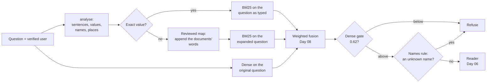

# Day 10 — Query Understanding and Transformations

**Read the question before you search with it, change it only where a recorded failure says so, and measure the change on questions nothing was tuned on**

| | |
|---|---|
| **Series** | 15 Days of Modern, Enterprise-Relevant RAG from Scratch · Day 10/15 |
| **Level** | Beginner to intermediate (comfortable reading Python; Days 07 to 09 help but aren't required) |
| **Time** | ~40 min reading · ~20 min running the notebook and exercises |
| **Cost** | Free: no API key, no paid services, **no new packages, no new model** (Day 04's embedding model and Day 09's reranker, downloaded once if you haven't run those days) |
| **Code** | [`notebooks/day_10_query_understanding_and_transformations.ipynb`](../../notebooks/day_10_query_understanding_and_transformations.ipynb) — standard-library Python for the analysis and the map, plus the shared code in [`src/rag_from_scratch/`](../../src/rag_from_scratch/), which gains Day 09's reranker and Day 07's `outcome()` today |
| **Data** | [`evals/`](../../evals/): Day 07's 81 labelled queries, unchanged; **41 new held-out questions** in [`evals/questions-v2.jsonl`](../../evals/questions-v2.jsonl); today's rules, committed first, in [`evals/preregistration/day-10.md`](../../evals/preregistration/day-10.md); today's accepted baselines, [`day-10-retrieval.json`](../../evals/baselines/day-10-retrieval.json) (v1) and [`day-10-retrieval-v2.json`](../../evals/baselines/day-10-retrieval-v2.json) (v2) |
| **Visuals** | [`assets/day-10/`](../../assets/day-10/) |
| **Verified** | Notebook executed top to bottom on 2026-10-29 and 2026-10-30 on Linux with Python 3.11, 3.12, 3.13 and 3.14, from both the repo root and `notebooks/`. CI runs the same tests on Linux, Windows and macOS on every push (section 18). |

---

## Learning objectives

By the end of today you will be able to:

1. Explain what **query understanding** (reading a question's parts) and a **query transformation** (changing what is searched for) are, and name the common transformations: expansion, rewriting, multi-query, decomposition, routing.
2. Analyse a question into sentences, values, names and places, and route exact values around any rewrite.
3. Build a **reviewed vocabulary map** in which every entry has a recorded reason, apply it as expansion (append, never replace), and choose where it goes with a rule on dev.
4. Write a small **held-out test set**, commit it with the rules before anything scores it, and say what a used test set can and can't show.
5. Show **when not to rewrite**, with evidence: a map matched word by word, an entry that is true and still hurts, exact values, unanswerable questions, and a rewrite that changes the meaning without changing a word the guard can see.
6. Treat a refusal rule as query analysis, fix it, and follow the questions it stops refusing to the next stage.

## Prerequisites

- Basic Python: regular expressions, dictionaries, list comprehensions.
- Day 07's labelled set and metrics (hit@k, MRR, the sign test, near ties) and Day 08's weighted fusion. Section 1 recaps what you need.
- About 700 MB of free disk space if you haven't run Days 04 and 09 yet (their packages and two models).

## Key terms

| Term | Meaning here |
|---|---|
| **Query understanding** | Reading the question's parts before searching: sentences, values, names, the kind of query |
| **Query transformation** | Changing what the retriever searches for: expanding, rewriting, splitting or routing the question |
| **Query expansion** | Adding terms to the question (here: the documents' word next to the asker's), keeping the original words |
| **Rewrite** | Replacing the question with another wording, often by a language model |
| **Vocabulary map** | A reviewed list that links the asker's words to the documents' words, each entry with a reason (a synonym list in search engines) |
| **Routing** | Choosing what happens to a query by its kind; here, an exact value is never expanded or rewritten |
| **Gazetteer** | A list of place names with their types (city, country) |
| **Names rule** | Day 06's refusal: abstain if the question names something no source mentions |
| **Held-out set** | Questions nothing was tuned on, used to check a decision; spent once it has decided |
| **Pre-registration** | Writing the rules, what will be reported and what each decision needs, and committing it before the held-out data is scored |

---

## 1. Why the question

Day 09 left the retriever in good shape on Day 07's labelled set: Day 08's weighted fusion of BM25 and dense retrieval had a labelled chunk in its top 3 for all 61 answerable queries. Four recorded failures were left, and all four start in the **question**:

| Query | What goes wrong | Where it was recorded |
|---|---|---|
| "How much time off do new dads get?" (d01-01, dev) | No word in common with the answer ("caregivers", "leave"): BM25 never returns it; the fusion has it 3rd | Day 01, Days 07–09 |
| "Will Acme pay for wine with a business dinner?" (d07-a08) | "wine" vs "Alcohol is not reimbursed": the fusion has it 3rd, behind the expense policy's Scope | Days 07–09 |
| "What is the hotel limit per night in Tokyo?" (d07-a01) | Day 06's names rule refuses: no source mentions Tokyo, although the travel policy says "Use the Other cities row for any city not listed" | Day 07 |
| "My laptop might have a virus. Should I switch it off?" (d07-a11) | The names rule takes "Should", the first word of the second sentence, for a name, and refuses | Day 07 |

Two are about **words** (the asker's vs the documents'), two about **how a question is read**. A search engine reads the words it is given, and nothing else. Query understanding is what the system does before that: notice which parts of the question are values that must not change, which are names, how many sentences there are, and what kind of query it is. A query transformation then changes what is searched for. Both can fix failures and both can cause them, so today measures each against a no-rewrite baseline.

## 2. The architecture



The permission filter is in every retriever, as before (it comes from the verified user, not from the question). Today adds `analyse()`, the routing and the map in front of BM25, and a new version of the names rule. Day 06's pipeline itself doesn't change today; section 13 says what the decisions recorded for later days.

## 3. Rules first, and a new test set

Day 09 used the v1 test split to make two decisions, so under `evals/README.md` rules 4 and 8 its questions now count as used: they can describe, but they can't give clean held-out evidence. Today's decisions needed new questions. The order of work:

1. **Exploration on the v1 dev split only.** The scripts loaded `questions-v1.jsonl` and dropped every test row before building anything (54 dev queries left).
2. **The rules were frozen** from the published diagnoses and the dev runs: the map, the routing, where the expansion goes, and the new names rule.
3. **Then the new test questions were written**: 41 of them, in an employee's everyday words, none a paraphrase of a v1 question, labelled by Day 07's evidence rule (no retriever involved).
4. [`evals/preregistration/day-10.md`](../../evals/preregistration/day-10.md) was committed **together with the new questions** as the branch's first commit: the rules and their dev values, **everything that would be reported whatever it showed**, and what each decision needs. Only then did anything score a held-out question. The notebook recomputes each rule on dev and stops if it gets another value.

The pre-registration also says what the author knew. Three of the map's eight entries were written from v1 test-split diagnoses (now used), so every v1 test number below is **in-sample**: a description of the questions the rules were aimed at. And the new questions were written by the same author after the rules were frozen, so the author knew the map while writing them. By reading, before any code ran on them: one of the 41 contains a phrase from the map; four name a place; three have two sentences. Write that kind of note before the results, not after.

**`questions-v2.jsonl`** = v1's 81 queries, text and labels unchanged (the 27 used test questions moved to dev; their notes say so) + the 41 new test questions (29 answerable, 12 not). It has its own manifest, `manifest-v2.json`, on the same document snapshot, so the Day 07–09 notebooks keep using v1 and its manifest unchanged.

## 4. Query understanding: what is in the question

`analyse()` reads a question into four parts:

| Part | How | Why it matters |
|---|---|---|
| **Sentences** | Day 06's `SENTENCE` pattern (split after `.`, `!` or `?`) | A sentence's first word is capitalised anyway: it isn't a name |
| **Values** | Numbers, `USD` amounts, emails, URLs, `#channels` | "USD 40" decides whether a dinner needs a receipt; any rewrite must keep it |
| **Names** | Day 06's `NAME` pattern (capitalised words, acronyms), skipping every sentence's first word; places looked up first in a gazetteer, as whole phrases ("New Delhi") | What the names rule checks; what a rewrite must not swap |
| **Route** | *Exact* = no `?`, at most 4 words, and a digit, `@`, `#` or `://` | An exact value typed as a query is never expanded or rewritten |

The **gazetteer** is a stand-in, chosen by an external rule so that no place is in it because a test question mentions it: the G20's member countries and their capitals (Tokyo is Japan's capital, so it is in; Toronto isn't). A production system would use a real gazetteer such as GeoNames, or a named-entity recogniser. Six questions, analysed:

```text
d07-a11  My laptop might have a virus. Should I switch it off?    sentences 2 | values - | names -
d07-a01  What is the hotel limit per night in Tokyo?              sentences 1 | values - | names ['Tokyo (city)']
d07-a02  Do I need a receipt for a USD 40 dinner?                 sentences 1 | values ['USD 40'] | names ['USD']
d01-03   What is Google's remote work policy?                     sentences 1 | values - | names ['Google']
d04-v16  USD 1,000                                                sentences 1 | values ['USD 1,000'] | names - | EXACT
d04-i01  #it-help                                                 sentences 1 | values ['#it-help'] | names - | EXACT
```

"Should" isn't a name any more, Tokyo is a city, and the two lookups are exact. Day 06's pattern counts "USD" as an acronym; that is harmless for the names rule (every source with a price says USD), and the guard in section 8.4 checks it together with its value. On all 122 queries, the route marks exactly the 30 lookups as exact.

## 5. A transformation: a reviewed vocabulary map

The simplest transformation aimed at a vocabulary gap is **query expansion**: put the documents' word next to the asker's. Search engines ship this as synonym lists. Azure AI Search's synonym maps "expand the scope of a query" at query time, with equivalency rules (`dog, puppy, canine`) and one-way mappings (`Washington, Wash., WA => WA`), for free-form text queries only; Elasticsearch has synonym sets used at search time through the `synonym_graph` filter, with the same two rule kinds (references at the end). Today's version is a few lines of Python, with three rules:

1. **Every entry is tied to a gap someone recorded.** A map isn't a thesaurus.
2. **Entries match whole phrases**, case-insensitive: "pay for", not "pay"; "dad" isn't in "Baghdad".
3. **Append, never replace.** The asker's words stay in the query.

| The asker says | The documents say | Recorded in |
|---|---|---|
| dad, dads, father, fathers, mum, mums, mom, moms, mother, mothers | caregivers | d01-01 (dev): dads vs caregivers; with the singular, a synonym and the counterparts |
| time off | leave | d01-01 (dev) |
| wine, beer, spirits | alcohol | d07-a08 (v1 test, used) |
| pay for | reimbursed | d07-a08 (v1 test, used) |
| work from home, working from home, wfh | remotely, remote | d07-a03 (v1 test, used) |
| virus | infected | d07-a11 (v1 test, used) |
| switch off, switch it off, shut down, shut it down, power off | turn off | d07-a11 (v1 test, used) |
| locked | locks, lockout | d01-02 (dev): BM25 has no stemming |

Plus **the abbreviations the documents define themselves**, harvested with the pattern `Long form (ABBR)`: on this corpus one, "Multi-factor authentication (MFA)", in both directions. Nobody has to write those entries, and they can't drift from the documents.

```python
def expand(question: str, entries=ENTRIES) -> Expansion:
    # Query expansion with a reviewed map: APPEND the documents' words; never remove or replace the asker's
    if analyse(question).exact:
        return Expansion(question, (), "exact value: not expanded")
    matched = [(next(p for p in phrases if contains(question, p)), terms) for phrases, terms, _ in entries
               if any(contains(question, p) for p in phrases)]
    added = list(dict.fromkeys(t for _, terms in matched for t in terms))
    return Expansion(f"{question} {' '.join(added)}" if added else question, tuple(matched),
                     "expanded" if added else "no match")
```

On v1's 81 queries the map touches 6; the 30 lookups are routed around it:

```text
v1's 81 queries: 6 expanded, 45 without a match, 30 exact values left alone
  d01-01   dev   How much time off do new dads get?                       + caregivers leave   (dads -> caregivers; time off -> leave)
  d01-02   dev   My account is locked, what now?                          + locks lockout   (locked -> locks, lockout)
  d07-a03  test  How many days a week can I work from home?               + remotely remote   (work from home -> remotely, remote)
  d07-a08  test  Will Acme pay for wine with a business dinner?           + alcohol reimbursed   (wine -> alcohol; pay for -> reimbursed)
  d07-a11  test  My laptop might have a virus. Should I switch it off?    + infected turn off   (virus -> infected; switch it off -> turn off)
  d07-u12  test  How much does Acme pay for a home internet connection?   + reimbursed   (pay for -> reimbursed)
```

### 5.1 Where the expansion goes: the rule, on dev

The expanded text can go to BM25 alone ("lexical") or to both retrievers ("both"). The pre-registered rule: on dev (16 answerable dev questions and 30 lookups), the variant with the most queries in the weighted fusion's top 3, then the most first, then the higher MRR@10; a tie goes to "lexical", which changes one input instead of two.

```text
dev only (46)     top 3  first   MRR@10   changed on dev
no expansion         46     43   0.9601   
lexical              46     44   0.9746   d01-01: 3 -> 1
both                 46     44   0.9746   d01-01: 3 -> 1
-> lexical
```

A tie on every count, so the rule picks **lexical**: dense retrieval keeps the original question. Today's two retrievers are **`BM25+map`** (BM25 on the expanded question) and **`weighted+map`** (Day 08's weighted fusion of `BM25+map` and dense retrieval). Section 8.2 shows a second reason to prefer it: the gate reads dense retrieval, which this way never sees an added word.

## 6. On the same 81 queries, against Day 09's baseline

First, Day 09's six retrievers reproduce Day 09's accepted baseline exactly:

```text
BM25, dense, RRF, weighted, weighted+rerank, RRF+rerank against evals/baselines/day-09-retrieval.json: no changes (81 queries x 6 retrievers: every rank, best score and metric; top 3 lists identical)
```

Then today's two retrievers on the 31 answerable questions and 30 lookups:

```text
                           n  hit@1  hit@3  hit@5 hit@10  MRR@10   hit@3 rate, 95% interval
questions, BM25           31     24     29     29     30    0.85   94% (79% to 98%)
questions, BM25+map       31     27     31     31     31    0.92   100% (89% to 100%)
questions, weighted       31     27     31     31     31    0.92   100% (89% to 100%)
questions, weighted+map   31     28     31     31     31    0.95   100% (89% to 100%)
```

Query by query (each against its own base as recorded in Day 09's baseline file), the map moves five ranks, all up:

```text
              query    split       rank   added to BM25's query     why
BM25+map      d01-01   dev    None -> 1   caregivers leave          BM25 shared no word with the entitlement; caregivers and leave do
BM25+map      d07-a03  test      2 -> 1   remotely remote           remotely matches Eligibility ('work remotely up to three days')
BM25+map      d07-a08  test      6 -> 1   alcohol reimbursed        alcohol and reimbursed match Meals ('Alcohol is not reimbursed')
weighted+map  d01-01   dev       3 -> 1   caregivers leave          BM25's new first place lifts the entitlement above the two leave chunks dense prefers
weighted+map  d07-a08  test      3 -> 2   alcohol reimbursed        BM25 now puts Meals first, but dense still prefers Scope and has 0.7 of the weight
```

No losses, and no difference the sign test can tell from luck (p = 1 for the fusion on every part; 0.5 for BM25 on the used test split). Two of the five moves are on questions the map was written from, so they are expected, not evidence. **Read the wine row**: BM25 now puts the answer first, but the fusion moves it only from 3rd to 2nd, because dense retrieval still prefers the Scope chunk and carries 0.7 of the weight. Fixing one retriever's vocabulary doesn't fix the fusion.

## 7. The held-out test: 41 new questions

The comparison the pre-registration set up: `weighted+map` against the weighted fusion (and `BM25+map` against BM25) on the 29 answerable new questions.

```text
v2's 41 new test questions: 1 expanded, 40 without a match
  d10-a17  Do warehouse staff get to work from home?                    + remotely remote
```

```text
                                   n  hit@1  hit@3  hit@5 hit@10  MRR@10   hit@3 rate, 95% interval
v2 test questions, BM25           29     20     26     26     27    0.78   90% (74% to 96%)
v2 test questions, dense          29     23     27     28     28    0.86   93% (78% to 98%)
v2 test questions, weighted       29     24     27     28     29    0.89   93% (78% to 98%)
v2 test questions, BM25+map       29     21     26     26     27    0.80   90% (74% to 96%)
v2 test questions, weighted+map   29     24     27     28     29    0.89   93% (78% to 98%)
```

**The map met one of the 41 new questions, and the fusion already had that answer first.** Against the weighted fusion: no gain, no loss, at first place or in the top 3. BM25 alone gains that one first place. The new questions bring their own gaps: part-time vs "reduced hours", two-factor vs "multi-factor", "type my password wrong" vs "failed sign-in attempts", food vs "meals". The map has none of them. **A map fixes the gaps someone recorded, and only those.** On this corpus dense retrieval already bridges most paraphrases, which is why the fusion loses so little to them; the 95% interval on 29 questions (78% to 98%) says how much a small set can tell.

The fusion misses 2 of the 29 in its top 3, each with a diagnosis in the notebook and the baseline file: the password-attempts gap above (the answer is 5th), and Day 03's lost-laptop pattern again, "My phone was stolen on a business trip. Who should I tell?", where the event is in one section (Safety while travelling) and the procedure in another (How to report, 6th). Day 11 retrieves surrounding sections.

## 8. When not to rewrite

### 8.1 Word by word, and one more entry

Two variants, pre-registered as descriptions (they decide nothing): **(a)** the same entries matched word by word, as an unreviewed word list would, and **(b)** the map plus one entry that is true in general, "dinner, lunch, breakfast → meals".

```text
reviewed map (phrases)
    dev questions              touches  2 of 16  gains d01-01@1                 losses -
    v1 test questions (used)   touches  3 of 15  gains -                        losses -
    lookups                    touches  0 of 30  gains -                        losses -
    v2 test questions          touches  1 of 29  gains -                        losses -
(a) the same map, word by word
    dev questions              touches  7 of 16  gains d01-01@1                 losses -
    v1 test questions (used)   touches  6 of 15  gains -                        losses d07-a02@1
    lookups                    touches  0 of 30  gains -                        losses -
    v2 test questions          touches 11 of 29  gains d10-a05@1                losses d10-a28@1
(b) + dinner, lunch, breakfast -> meals
    dev questions              touches  2 of 16  gains d01-01@1                 losses -
    v1 test questions (used)   touches  4 of 15  gains -                        losses d07-a02@1
    lookups                    touches  0 of 30  gains -                        losses -
    v2 test questions          touches  1 of 29  gains -                        losses -
```

- **Word by word, the map touches 11 new questions instead of 1.** "for" (from "pay for") adds *reimbursed* to any question with "for"; "it" (from "switch it off") adds *turn off*; and "time" in "one-time" adds *leave*. "Can I give my one-time code to someone from IT?" gets *leave remotely remote turn off* and loses first place. On dev the word list looked fine: one gain, no loss.
- **"Dinner → meals" is true and still hurts.** "Do I need a receipt for a USD 40 dinner?" needs the general receipt rule ("every expense over USD 25"), not the meal limit; with *meals* added, the Meals chunk goes first. And it doesn't bring wine to first place either.

An entry that is true in general can be wrong for a question. That is why entries match phrases and each one needs a recorded reason.

### 8.2 Exact values and unanswerable questions

```text
(c) lookups left unexpanded by the routing: 30 of 30
(d) unanswerable questions (32) whose first chunk changes with the map: 0
```

The one unanswerable question the map touches ("How much does Acme pay for a home internet connection?") keeps its first chunk. Day 07's gate reads dense retrieval's top score, and dense retrieval still sees the original question, so expansion on BM25's side can't change a refusal. Azure AI Search's generative query rewriting (in preview) carries the same warning about exact values: rewritten queries "might not contain all of the exact terms the original query had", which matters for "unique identifiers or product codes".

### 8.3 A rewrite never changes who is searching

The user, and with them the permission filter, come from the verified login (Day 05), and every retriever filters before ranking (Day 08). A transformation changes the text, never the identity or the filter. The notebook checks it: no restricted chunk in any top 10, for any retriever, on any query.

### 8.4 Any rewriter needs a guard

A language model can rewrite much more freely than a map: fix spelling, resolve "it", split a question in two, add words nobody recorded. It can also drop or change the part that decides the answer. `check_rewrite()` lists what a rewrite broke, using `analyse()` (a value lost or added, a name lost or added, an empty rewrite); a rewrite with any problem is discarded and the original is searched; exact values are never rewritten. The rewrites below are **written by hand to show one failure each; none is a model's output.** The new-dads one is modelled on what `gpt-6-luna` did in Day 06's live run: its *answer* assumed new dads are secondary caregivers.

```text
Do I need a receipt for a USD 40 dinner?     -> Do I need a receipt for a dinner?                   
    drops the value that decides the answer                    guard: discarded: drops USD 40
What is the hotel limit per night in Tokyo?  -> What is the hotel limit per night in Japan?         
    swaps the name for a broader one                           guard: discarded: drops the name Tokyo; adds the name Japan
USD 220                                      -> What is the hotel limit of USD 220 per night?       
    turns an exact value into a question                       guard: exact value: never rewritten
How much time off do new dads get?           -> How much leave do secondary caregivers get?         
    commits to one reading: dads can be primary caregivers     guard: kept
```

**The guard keeps the new-dads rewrite**: no value or name changed, only the meaning (a dad can be a primary caregiver, 16 weeks). A guard checks form, not meaning. Expansion avoids this failure: it adds *caregivers* without choosing primary or secondary, and leaves the reading to the documents.

**No language-model rewrite was run today** (that was pre-registered). It costs a model call per question, can't run in CI here, and would have to beat the map under the same rules, on questions nothing was tuned on, to earn its place. Exercise 2 of the notebook shows where it plugs in: behind the guard, measured on dev first.

## 9. The names rule, as query analysis

Day 06's reader refuses when the question names something no source mentions. Day 07 measured it: on the questions it was written for it looked perfect, and on the test split it refused two answerable questions ("Tokyo", "Should"). The new rule changes two things, one per recorded failure, and keeps everything else:

1. **Every sentence's first word is skipped**, not only the question's.
2. **A gazetteer place counts as known if a source mentions its type**: "Use the Other cities row for any city not listed" covers Tokyo. An instance of a category the documents cover.

```python
def unknown_names_v2(question: str, sources) -> list[str]:
    # Day 06's names rule with the two changes: every sentence's first word skipped, and a gazetteer place counts as
    # known if a source mentions its TYPE ("Use the Other cities row for any city not listed")
    text = " ".join(s.text for s in sources)
    unknown = [name for name, kind in question_names(question)
               if not contains(text, name) and not (kind and any(contains(text, w) for w in TYPE_WORDS[kind]))]
    return list(dict.fromkeys(unknown))
```

Both rules behind Day 07's measured dense gate (0.62), reading the three sources Day 06's pipeline would send:

```text
dense gate 0.62, then                            dev              v1 test (used)                     v2 test
                                      kept / refused              kept / refused              kept / refused
Day 06 names rule                  16 of 16 / 8 of 8          13 of 15 / 6 of 12          22 of 29 / 6 of 12
new names rule                     16 of 16 / 8 of 8          15 of 15 / 6 of 12          26 of 29 / 5 of 12
```

On dev both give the pre-registered values. On the used v1 test split the new rule keeps Tokyo and the virus question, as it was written to. **On the new questions it keeps 26 of 29 answerable questions instead of 22**: Berlin and Paris are cities, and two questions whose second sentence starts with "Do" or "Who" are no longer refused for a name that isn't one. Toronto isn't in the gazetteer, so it is still refused (a gazetteer is only as good as its coverage); "Can I work remotely from Italy for a few weeks?" is still refused, rightly, because Italy is a country and no source mentions countries.

**And it refuses one unanswerable question fewer, 5 of 12 instead of 6.** "I'm moving to a new team. Does my remote work arrangement carry over?" was refused by Day 06's rule because it took "Does" for a name. That refusal was right by accident, and fixing the bug removed it.

## 10. End to end: a lifted refusal moves the failure

A question the names rule stops refusing goes to the next stage. Day 06's reader with the names rule as a setting (its other steps copied unchanged and checked against Day 06's reader), behind Day 07's measured gate and reader threshold, graded with Day 07's `outcome()`:

```text
gate 0.62, reader 0.63  split           answerable: correct / wrong / refused   not answerable: refused / answered
Day 06 names rule       dev             14 / 2 / 0  (of 16)                     8 / 0  (of 8)
Day 06 names rule       v1 test (used)  12 / 1 / 2  (of 15)                     7 / 5  (of 12)
Day 06 names rule       v2 test         19 / 3 / 7  (of 29)                     6 / 6  (of 12)
new names rule          dev             14 / 2 / 0  (of 16)                     8 / 0  (of 8)
new names rule          v1 test (used)  14 / 1 / 0  (of 15)                     7 / 5  (of 12)
new names rule          v2 test         21 / 5 / 3  (of 29)                     5 / 7  (of 12)
```

Seven outcomes change, every one a question the new rule stopped refusing. Four become correct: Tokyo, the virus question, Berlin and "Do I need to register the trip?". The hotel answers contain the right row (Other cities, USD 180) next to rows that don't apply, because the extractive reader copies the rows closest to the question; the grade is a containment check, not a judgement. **Three become wrong**: Paris gets London's row, the stolen phone gets "report it straight away" from the travel policy instead of whom to tell, and the team-move question gets a confident, cited sentence that doesn't answer it. **A refusal can hide a failure downstream; lifting it hands the question to the next stage, with that stage's failures.** Day 11 retrieves the section next to the one that matched; Day 12 grades answers.

## 11. Other transformations, and when each fits

Today built one transformation and measured it. The others are worth knowing, with what each costs and risks:

| Transformation | What it does | Useful when | Watch out for |
|---|---|---|---|
| **Expansion with a reviewed map** (today) | Appends the documents' words to the query | A known, recurring vocabulary gap (jargon, abbreviations, product names) | Only fixes recorded gaps; word-level entries drift; true entries can still hurt (section 8.1) |
| **Rewrite by a language model** | Replaces the query with a cleaner one (spelling, pronouns, vocabulary) | Conversational follow-ups ("and for managers?"), typos | A model call per query; drops exact values or commits to one reading (section 8.4); needs a guard and an eval |
| **Multi-query** | Several rewrites, each searched, results fused (Azure AI Search's preview query rewriting generates up to 10) | Short or ambiguous questions where recall matters | More searches per question; fusion can promote a wrong reading |
| **Decomposition** | Splits a multi-part question into sub-questions (Amazon Bedrock's knowledge-base APIs list a `QUERY_DECOMPOSITION` transformation) | "Compare A and B", two-step questions like the stolen phone | More calls; each sub-question can fail on its own; merging contexts needs a budget |
| **Hypothetical document (HyDE)** | A model writes a fake answer; its embedding is searched | Dense retrieval with no labels for the domain | The fake answer "may contain false details"; never show it to the user |
| **Routing and filters from the question** | Sends a query to a different index or path, or adds a filter ("in 2025" → a date filter) | Exact values (today's route), structured fields | Never derive **permissions** from the question: identity comes from the login |

Each one is a change to measure against a no-rewrite baseline on the same queries, with its rule committed first, exactly as today.

## 12. What it costs

Measured in the notebook on this 2-vCPU machine (not pinned; your numbers will differ): the analysis, the routing and the map take about a tenth of a millisecond per question, against 10 to 12 ms to embed the question. The sanity check asserts only the shape: the expansion takes less than a tenth of the embedding time. A language-model rewrite adds a model call per question, usually far more than everything else in this pipeline; Day 13 measures the whole thing.

## 13. Decisions, and what a used test set means

Both were written down with what each needs before any held-out question was scored:

```text
D1, the map in the default retriever: on the 29 answerable v2 test questions it gains nothing and loses nothing (first place or the top 3) -> not adopted: the weighted fusion stays the default; the map is recorded as measured
D2, the new names rule: on the 41 v2 test questions it keeps 26 of 29 answerable (Day 06's rule: 22) and refuses 5 of 12 unanswerable (Day 06's rule: 6) -> recorded as measured, not adopted
```

**Neither is adopted.** "Not adopted" for the map means *no evidence it helps beyond the questions it was written from*, not "harmful": it lost nothing. The new names rule kept four more answerable questions and let one more unanswerable question through, and the bar set in advance was "loses nothing". The weighted fusion stays the default retriever, `answering.py` keeps Day 06's names rule, and both of today's changes are recorded with their numbers for a later day.

**The new test split is now used too.** It decided D1 and D2, so under rule 4 its 41 questions count as used: a later decision that needs held-out evidence needs new questions again. Every decision on a held-out set spends it. That is an argument for larger test sets, fewer decisions, and decision criteria written as carefully as the code.

## 14. The baselines later days compare against

A baseline belongs to one version of the questions, so today writes two:

- [`evals/baselines/day-10-retrieval.json`](../../evals/baselines/day-10-retrieval.json): v1's 81 queries, Day 09's six retrievers unchanged plus `BM25+map` and `weighted+map`, every rank, every error with its diagnosis (18), the names-rule outcomes and both decisions. Comparable with Day 09's file.
- [`evals/baselines/day-10-retrieval-v2.json`](../../evals/baselines/day-10-retrieval-v2.json): v2's 122 queries, the five retrievers the pre-registration reported on (BM25, dense, weighted, `BM25+map`, `weighted+map`), 27 errors. On the 81 shared queries it agrees with the v1 file entry for entry (`tests/test_evals.py` checks it). The reference for later days.

## 15. Core trade-offs

| Choice | Gains | Costs |
|---|---|---|
| A reviewed map vs a model rewrite | Deterministic, free, auditable, can't drop a value | Covers only recorded gaps; needs an owner |
| Phrases vs words | Precise; no drift | Misses inflections you didn't list |
| Expand BM25 only vs both retrievers | Dense retrieval and the gate see the original; one input changed | Dense keeps its own vocabulary gaps (wine stays 2nd) |
| Append vs replace | The asker's words always searched | A longer query; BM25 weighs added terms like typed ones |
| A gazetteer vs no place typing | "Berlin" and "Tokyo" stop being refused | Coverage gaps (Toronto); a category word in the wrong source can cover an instance |
| A held-out set vs reusing dev | Evidence a decision generalises | Each decision spends it; small sets give wide intervals |

### When to use what

- **No transformation** when the retriever already finds the answers (today's fusion did, for 27 of 29 new questions) or the query is an exact value.
- **A reviewed map** for recurring, recorded vocabulary gaps: domain jargon, internal abbreviations, product names. Give it an owner and a review process, like the documents.
- **A guarded model rewrite** for conversational follow-ups and messy input, measured against the map on the same queries.
- **Decomposition** when questions need two sections or two documents, measured against retrieving surrounding sections (Day 11).

## 16. Setup, step by step

```bash
# 1. Clone (or update) the repository
git clone https://github.com/shashanksuresh18/15-days-of-rag-from-scratch.git
cd 15-days-of-rag-from-scratch

# 2. Create and activate a virtual environment (Python 3.11+)
python -m venv .venv
source .venv/bin/activate          # Windows: .venv\Scripts\Activate.ps1

# 3. Install the tested dependencies (Day 10 adds none)
python -m pip install -r requirements.txt

# 4. Open the notebook; if needed, the first run downloads Day 04's model (133 MB) and Day 09's reranker (91 MB)
jupyter lab notebooks/day_10_query_understanding_and_transformations.ipynb
#    then: Kernel -> Restart Kernel and Run All Cells (about a minute)

# 5. (Optional) Run the automated checks: one test file per process uses the least memory
python -m pytest tests/test_day_10_notebook.py
python -m pytest tests/test_evals.py
python -m pytest tests/test_shared_code.py
```

No API key and no `.env` are needed today.

## 17. Code walkthrough

| Section | What it does |
|---|---|
| 0 | Settings, and the pre-registered values checked against `evals/preregistration/day-10.md` |
| 1 | Day 07's labels and snapshot; Day 09's six retrievers reproduce Day 09's baseline; `questions-v2` loaded and checked (v1's 81 unchanged, 41 new) |
| 2 | The four recorded failures, shown from BM25's words and the names rule's sources |
| 3 | `analyse()`: sentences, values, names, places, route; the G20 gazetteer |
| 4 | The map with its reasons, the harvested abbreviations, `expand()`, and the variant rule on dev (asserted) |
| 5 | v1's 81 queries against Day 09's baseline: table, paired comparisons, every move with a reason (asserted) |
| 6 | The 41 new questions: table with intervals, paired comparisons, every miss with a diagnosis (asserted) |
| 7 | When not to rewrite: word by word, dinner → meals, routing, unanswerable questions, permissions, and `check_rewrite()` on hand-written rewrites |
| 8 | The names rule old and new behind the dense gate, then end to end with `NamesReader` and `outcome()` |
| 9–11 | Cost, the two decisions, and both runs saved and compared with the accepted baselines |
| 12–13 | Sanity checks, and five exercises |

`src/rag_from_scratch/reranking.py` is Day 09's reranker (`Reranker`, `rerank()`, `rerank_margin()`), moved because today reproduces Day 09's baseline; `evaluation.outcome()` is Day 07's grading, moved because today grades answers end to end. `tests/test_shared_code.py` runs the Day 09 and Day 07 notebooks and checks that both modules return exactly what the notebooks return.

## 18. Expected output and what was tested

**Tested** on 2026-10-29 and 2026-10-30:

- The notebook executed top to bottom in a fresh kernel, and `python -m pytest` passed, on Linux (x86_64) with Python 3.11, 3.12, 3.13 and 3.14, from both the repository root and `notebooks/`, each kernel confirmed to run the intended Python version: 85 passed and 1 skipped on 3.11, 3.12 and 3.14 (the slide test, which needs Pillow), and 95 passed on 3.13 with Pillow, about 11 minutes per version, one version at a time. The saved outputs come from the Python 3.13 run. The same counts again from a fresh clone of the public repository with today's two commits applied.
- **Memory and time:** run as one file per process, `tests/test_shared_code.py` (now six day classes) peaked at 762 MB on Linux (Day 09's five classes: 760 MB) and took about 3.5 minutes; `tests/test_day_10_notebook.py` took about 2 minutes.
- **Deliberate bugs:** 20 mutations of the notebook's code were tried; 19 stopped it at an assertion: substring matching instead of whole phrases, replacing instead of appending, no routing, the variant rule's tie-break or its split, only the question's first word skipped, place types ignored, Toronto added to the gazetteer, the guard ignoring values, either decision's criterion weakened, the names rule reading every chunk or skipping the gate, BM25 without its permission filter, the weight on the wrong side, no harvested abbreviations, a drifted reader copy, the expanded text sent to dense retrieval too, and the held-out comparison against the wrong base. The 20th, counting near ties 100 times too broadly, ran to the end: no compared query sits within 0.1 of a tie at a cut-off, so on this data the change is equivalent (Day 08 had one such survivor too). The unmodified code passed. Drifts of the shared modules: 9 changes to `reranking.py` (the tie-break, a lost tail below N, segment ids zeroed, a shorter token limit, two margin errors, the download error message, the batch size, the pair order) and 3 to `outcome()` (case-sensitive matching, any fact instead of all, an unanswerable answer graded as refused); 11 failed a test in `tests/test_shared_code.py`. The batch size didn't, and can't: batching changes no score bit with this model (Day 09 measured a largest difference of 0). Case-sensitive matching was caught only after the test was given a fact with letters (the first one it picked was a number). The unmodified modules passed.
- **Offline:** with `HF_ENDPOINT` pointed at a dead address and every Python-level network attempt logged (socket connections and DNS lookups, in pytest and in the notebook kernels), `tests/test_day_10_notebook.py` passed and made no attempt at all; a deliberate lookup inside a kernel was logged, so the log works.
- The rules were committed before anything scored a held-out question (section 3): the pre-registration and the new questions are the first commit on today's branch, and the notebook asserts that each rule reproduces its committed value. Early drafts of the notebook also computed RRF and both reranked hybrids on the new questions without printing them; the final notebook computes on them only the five retrievers the pre-registration reports.

**In the test environment** Hugging Face wasn't reachable, so both models' files came from copies whose SHA-256 values and sizes match the pinned ones (as on Days 04–09). CI runs today's notebook on Linux, Windows and macOS with Python 3.11 and 3.14 on every push.

**Expected differences on your machine:** timings, and scores in the last decimal places. The closest call among today's retrievers is 0.0014 (the one-time-code question), above the 0.001 that would make it a near tie. If a sanity check fails, please open an issue with your OS, CPU and Python version.

## 19. Common errors and mistakes

### Setup and runtime errors

| Symptom | Cause | Fix |
|---|---|---|
| `RuntimeError: Could not download ...` | No network, a proxy, or Hugging Face blocked (first run only) | Set `HTTPS_PROXY` or `HF_ENDPOINT`, or download the file yourself to the path in the message |
| `AssertionError: PREREGISTERED must match evals/preregistration/day-10.md` | The settings in the notebook were edited | Undo the edit, or write a new pre-registration before comparing anything |
| `AssertionError: the rule doesn't give the pre-registered variant or values` | The data, labels, map or code changed since the rules were committed | Find out why before going on: the held-out results aren't comparable any more |
| Section 1 lists changes against Day 09's baseline | One of Day 09's retrievers changed | Undo it, or record the change: every later number depends on these inputs |
| `AssertionError: every move needs a reason, and only moves` | You changed the map (exercise 1) | Expected: read the new moves, then write their reasons |

### Conceptual mistakes (the expensive ones)

- **Expanding with a thesaurus.** Word-level entries drift ("for", "it", "time"); a true entry can still hurt (dinner → meals). Tie each entry to a recorded gap and match phrases.
- **Replacing the question.** A rewrite can drop the value that decides the answer, or commit to one reading. Append, guard, and keep exact values out of it.
- **Judging a map on the questions it was written from.** Five gains on v1, nothing on 41 new questions.
- **Fixing a refusal rule without following its questions.** Lifted refusals became three wrong answers and an answered unanswerable question.
- **Reading permissions or filters from the question.** A rewrite changes what is searched for, never who searches.
- **Reusing a test set after it has decided.** Each decision spends it; write new questions, and commit them before anything scores them.

## 20. Privacy, licensing and security notes

- **Permissions:** every retriever filters by the user's groups before ranking; the question's text never changes the user or the filter. The notebook checks that no restricted chunk appears in any top 10, which is a regression check, not access control (Day 05).
- **No API calls.** Everything runs locally; no question leaves your machine. A hosted rewrite model would receive every question (and, for some methods, retrieved text): treat it like any other processor of user data.
- **The questions are synthetic** (`evals/README.md`, rule 7). A real evaluation set built from users' questions needs the same access control and retention as the documents.
- **Licences.** No new dependencies or models. The gazetteer's names are facts (country and capital names). The questions, labels, baselines and the pre-registration are part of this repository (MIT).

## 21. Key takeaways

1. **Read the question before rewriting it.** Values, names, sentences and the kind of query decide what may change: exact values are never rewritten, and "Should" at the start of a sentence isn't a name.
2. **A reviewed map fixes the gaps you recorded, and only those.** It moved new dads to first place and lost nothing, and on 41 new questions it met one, whose answer was already first. Judge a transformation on questions it wasn't written from.
3. **Fixing one stage moves the failure to the next.** The corrected names rule kept four more answerable questions, then the reader got three of the lifted ones wrong and answered one it should have refused. Commit the criterion first, and follow every changed question to the end.

## 22. Exercise

**Earn a rewrite its place.**

1. From today's 12 v2 misses and wrong answers, pick three vocabulary gaps (for example "two-factor", "part-time", "type it wrong") and write map entries for them, each with its reason.
2. Before running anything, write 15 new test questions (Day 07's exercise 1 shows how) and a decision criterion for keeping the new entries, and commit both.
3. Run the notebook with the new entries on the old splits (dev) and then on your new questions. Did the criterion say yes? Which section 8.1 failure did you come close to?
4. Optional: try exercise 2 of the notebook, a guarded language-model rewrite, on the same questions. What does it fix that the map can't, and what does it break?

The notebook's section 13 has five shorter exercises (an entry for a gap seen today, a model rewrite behind the guard, multi-query, a bigger gazetteer, and decomposition).

## References

Links checked on 2026-10-29.

- Microsoft, [Synonyms in Azure AI Search](https://learn.microsoft.com/azure/search/search-synonyms) (last updated 2026-07-02): synonym maps "expand the scope of a query"; equivalency and explicit (`=>`) rules; "Synonyms apply to free-form text queries only"; used on the next query, no reindexing.
- Microsoft, [Rewrite queries with semantic ranker in Azure AI Search (preview)](https://learn.microsoft.com/azure/search/semantic-how-to-query-rewrite) (last updated 2026-07-02): a generative model writes up to 10 rewrites (`generative|count-N`); preview, no SLA; rewrites "might not contain all of the exact terms the original query had".
- Elastic, [Search with synonyms](https://www.elastic.co/docs/solutions/search/full-text/search-with-synonyms) (Elasticsearch 9.0+): synonym sets, `synonym_graph` for search time, equivalent and explicit mappings; search-time synonyms can be updated without reindexing.
- AWS, [Retrieving information from data sources using Amazon Bedrock Knowledge Bases](https://docs.aws.amazon.com/bedrock/latest/userguide/kb-how-retrieval.html) (an `AgenticRetrieveStream` operation "decompose[s] complex queries into sub-queries") and [`QueryTransformationConfiguration`](https://docs.aws.amazon.com/bedrock/latest/APIReference/API_QueryTransformationConfiguration.html) (type `QUERY_DECOMPOSITION`).
- Ma, Gong, He, Zhao & Duan, [Query Rewriting for Retrieval-Augmented Large Language Models](https://aclanthology.org/2023.emnlp-main.322) (EMNLP 2023; [arXiv 2305.14283](https://arxiv.org/abs/2305.14283)): "Rewrite-Retrieve-Read", a small trained rewriter in front of a frozen reader.
- Gao, Ma, Lin & Callan, [Precise Zero-Shot Dense Retrieval without Relevance Labels](https://arxiv.org/abs/2212.10496) (HyDE; ACL 2023): embed a generated "hypothetical document", which "may contain false details".

## Next: Day 11 — Advanced retrieval for harder questions

One of the weighted fusion's two held-out misses has the same shape as Day 03's lost laptop: the question names an event ("my phone was stolen on a business trip") and the answer is in another section (How to report). Neither a better word nor a better reranker joins two sections. Day 11 prototypes one advanced retrieval pattern, surrounding-section or parent retrieval, with an off-switch, a trace and an evaluation comparison. The v2 test split has now decided twice, so Day 11's held-out evidence needs its own new questions, committed with its rules.
