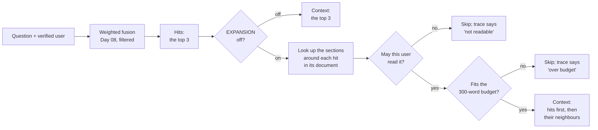

# Day 11 — Advanced Retrieval for Harder Questions

**Read around the hit, with an off-switch and a trace, and measure it against the same amount of context chosen the simple way**

| | |
|---|---|
| **Series** | 15 Days of Modern, Enterprise-Relevant RAG from Scratch · Day 11/15 |
| **Level** | Beginner to intermediate (comfortable reading Python; Days 07 to 10 help but aren't required) |
| **Time** | ~40 min reading · ~20 min running the notebook and exercises |
| **Cost** | Free: no API key, no paid services, **no new packages, no new model** (Day 04's embedding model, downloaded once if you haven't run that day) |
| **Code** | [`notebooks/day_11_advanced_retrieval_section_expansion.ipynb`](../../notebooks/day_11_advanced_retrieval_section_expansion.ipynb) — standard-library Python for the expansion, plus the shared code in [`src/rag_from_scratch/`](../../src/rag_from_scratch/), which gains Day 10's query analysis and vocabulary map today |
| **Data** | [`evals/`](../../evals/): **68 new held-out questions** in [`evals/questions-v3.jsonl`](../../evals/questions-v3.jsonl) (with v2's 122 queries, unchanged); today's rules, committed first, in [`evals/preregistration/day-11.md`](../../evals/preregistration/day-11.md); today's accepted baseline, [`day-11-retrieval-v3.json`](../../evals/baselines/day-11-retrieval-v3.json) |
| **Visuals** | [`assets/day-11/`](../../assets/day-11/) |
| **Verified** | Notebook executed top to bottom on 2026-11-09 on Linux with Python 3.11, 3.12, 3.13 and 3.14, from both the repo root and `notebooks/`. CI runs the same tests on Linux, Windows and macOS on every push. Verified on Windows 11 before publication and in CI on Linux, Windows and macOS on the branch and on `main` (section 19). |

---

## Learning objectives

By the end of today you will be able to:

1. Explain **section expansion** (reading around a hit: its neighbouring sections or its parent document) and the patterns it belongs to: parent-child or small-to-big retrieval, auto-merging, hierarchical chunking.
2. Build it from scratch with three properties every advanced retrieval step needs: an **off-switch**, a **per-query trace**, and a **permission check** on everything it adds.
3. Measure a change that adds context **fairly**: against the no-change baseline *and* against a **control** that adds the same amount of context the simple way.
4. Write a larger held-out set, commit it with the rules before anything scores it, and report a decision whatever it shows.
5. Follow a retrieval change to the answer, and tell evidence *in the context* from an answer that uses it.

## Prerequisites

- Basic Python: lists, dictionaries, dataclasses.
- Day 07's labelled set and metrics (hit@k, the sign test, Wilson intervals, near ties) and Day 08's weighted fusion. Section 1 recaps what you need.
- About 600 MB of free disk space if you haven't run Day 04 yet (its packages and the embedding model).

## Key terms

| Term | Meaning here |
|---|---|
| **Hit** | A chunk the retriever ranked in its top 3 (Day 06 sends the top 3) |
| **Section** | One chunk: Day 03 splits each document at its `## ` headings, so a chunk is a section and knows its position in its document |
| **Section expansion** | After retrieving, also sending sections around each hit: its neighbours, or its whole parent document |
| **Neighbours** | The section just before and the one just after a hit, in the same document |
| **Parent document** | The document a section belongs to; "parent retrieval" sends all of it |
| **Off-switch** | A setting that removes the new step completely, giving back exactly the old behaviour |
| **Trace** | A record, per query, of every section considered, why, and what happened to it |
| **Control** | A comparison that changes only the thing you suspect is doing the work (here: how much is sent), not the idea being tested (here: the documents' structure) |
| **Pre-registration** | Writing the rules, what will be reported and what the decision needs, and committing it before the held-out data is scored |

---

## 1. Why read around the hit

Day 10 ended with a held-out miss that no better word could fix:

> "My phone was stolen on a business trip. Who should I tell?" (d10-a24)

The weighted fusion (Day 08) found the right document. Three of its top four results are sections of the Security Incident Reporting policy. But the question describes an **event**, and the answer is a **procedure**: "Report suspected incidents to security@acme.example or call the Security hotline within one hour" is in *How to report*, which the fusion ranks 6th, behind the sections that describe incidents. Day 06 sends the top 3, so the answer never reaches the reader.

```text
d10-a24 My phone was stolen on a business trip. Who should I tell?
  the answer: security-incident-reporting#how-to-report (section 2 of 4)
  the weighted fusion's top 6:
    1  1.000  travel-policy#safety-while-travelling                    section 5 of 5  sent
    2  0.654  security-incident-reporting#after-you-report             section 4 of 4  sent
    3  0.568  security-incident-reporting#what-not-to-do               section 3 of 4  sent
    4  0.499  security-incident-reporting#what-counts-as-an-incident   section 1 of 4  
    5  0.469  travel-policy#claiming-travel-costs                      section 4 of 5  
    6  0.452  security-incident-reporting#how-to-report                section 2 of 4  <- the answer
  security-incident-reporting, in order: what-counts-as-an-incident | how-to-report | what-not-to-do | after-you-report
```

*How to report* is section 2 of 4: **right before hit 3**. The lockout question (d10-a12, "What happens if I type my password wrong too many times?") has the same shape for a different reason, a vocabulary gap: its answer, *Account lockout*, is the section right after hit 2. Day 03's lost laptop (d03-13) was the first recorded case of this shape; since Day 08 the weighted fusion has had it 3rd.

A ranking scores each section on its own. It doesn't know that sections sit next to each other in a document, or that the section after "what counts as an incident" is "how to report". Day 03's chunker kept that structure: every chunk knows its document and its position. **Section expansion** uses it.

## 2. The architecture



Everything before the hits is Day 10's default retriever, unchanged: BM25 and dense retrieval, each permission-filtered before the ranking, fused with Day 08's weights. Today adds one step after it. The permission check inside that step is new and necessary (section 10). Day 06's pipeline itself doesn't change today; section 13 says what the decision records for later days.

## 3. Rules first, and a larger test set

Day 10 used v2's 41 test questions to make its two decisions, so under `evals/README.md` rules 4 and 8 they count as used. Today's decision needed new questions, and more of them: on 29 answerable questions, a 93% hit rate has a 95% interval of 78% to 98%. The order of work:

1. **Exploration on dev only.** Today all 122 queries of v2 are dev. The exploration scripts loaded `questions-v2.jsonl` and refused to start if a `questions-v3.jsonl` existed.
2. **The rules were frozen** from the dev runs: the settings to choose from, the rule that chooses, the budget, the control, the near-tie definition and the decision's criterion.
3. **Then the new test questions were written**: 68 of them, at least four answerable ones for every document alice may read and two for the managers' guide (asked by maria), about half describing the situation first ("I'm still in my probation period. Can I work remotely?"), labelled by Day 07's evidence rule (no retriever involved).
4. [`evals/preregistration/day-11.md`](../../evals/preregistration/day-11.md) was committed **together with the new questions** as the branch's first commit: the rules and their dev values, **everything that would be reported whatever it showed**, and what the decision needs. Only then did anything score a held-out question. The notebook recomputes the rule on dev and stops if it gets another value. The commit's time is local, and the machine the day was built on can't push to GitHub, so no server witnessed the order before the held-out run; pushing that first commit before running anything would.

The pre-registration also says what the author knew. The rule's choice came from one of the questions the pattern was aimed at (the stolen phone), so every dev number below is **in-sample**. The new questions were written by the same author, who knew the pattern and the documents' section order. By reading, before any code ran on them: 25 of the 68 describe the situation first, 24 have two sentences, two answerable ones have two answer chunks.

**`questions-v3.jsonl`** = v2's 122 queries, text and labels unchanged (the 41 used test questions moved to dev; their notes say so) + the 68 new test questions (52 answerable, 16 not). It has its own manifest, `manifest-v3.json`, on the same document snapshot, so the Day 07–10 notebooks keep using theirs unchanged.

## 4. Section expansion: hits first, then their neighbours

`expand_sections()` keeps the weighted fusion's three hits and then, hit by hit, adds the sections a **setting** names around each one:

| Setting | Adds around each hit |
|---|---|
| `off` | nothing: exactly the top 3 (**the off-switch**) |
| `previous` | the section just before it |
| `next` | the section just after it |
| `neighbours` | the section before it, then the one after it |
| `parent` | the hit's other sections, in document order: its whole parent document |

Three rules keep it honest:

1. **Hits first.** The top 3 is always sent, and it always fits (no chunk has more than 75 words), so an expansion can add to Day 10's context but never lose any of it.
2. **Day 06's budget.** At most 300 words, whole sections; a section that doesn't fit is skipped and the next one tried.
3. **Every added section is permission-checked** (section 10).

The heart of it:

```python
    sent, steps, used = [], [], 0
    for cid, why in candidates:
        words = count_words(records[cid].text)
        if cid in sent:
            decision = "already sent"
        elif not may_read(cid, user, records):    # a lookup isn't a search: the search's filter doesn't cover it
            decision = "not readable"
        elif used + words > budget:
            decision = "over budget"
        else:
            decision = "sent"
            sent.append(cid)
            used += words
```

Every decision becomes a step in the **trace**, so for any answer you can say why each section was in its context. For the stolen phone:

```text
alice: My phone was stolen on a business trip. Who should I tell?   [setting: neighbours, budget 300 words]
  hit 1               travel-policy#safety-while-travelling                     1.000   42 words  sent
  hit 2               security-incident-reporting#after-you-report              0.654   37 words  sent
  hit 3               security-incident-reporting#what-not-to-do                0.568   38 words  sent
  previous of hit 1   travel-policy#claiming-travel-costs                       0.469   38 words  sent
  previous of hit 2   security-incident-reporting#what-not-to-do                0.568   38 words  already sent
  previous of hit 3   security-incident-reporting#how-to-report                 0.452   33 words  sent   <- labelled
  next of hit 3       security-incident-reporting#after-you-report              0.654   37 words  already sent
  sent 5 sections, 188 words
```

With the setting `off`, the same call sends exactly the weighted fusion's top 3, for every query (the notebook checks all 190). In a product, `EXPANSION` would be a configuration flag read on every request, so the pattern can be switched off without a deployment, and the setting would be logged with every answer.

## 5. Which sections to add: the rule, on dev

The rule, committed before anything scored a held-out question: *on dev's 90 answerable queries, the setting whose context holds a labelled chunk for the most queries; then the fewest words sent on average; then the earlier of previous, next, neighbours, parent.*

```text
dev only (90)    labelled chunk in the context   mean words sent
off                                         88             115.6
previous                                    89             182.2
next                                        89             179.1
neighbours                                  90             223.1
parent                                      89             245.6
-> neighbours
```

`neighbours` wins by one query, the stolen phone, and sends about twice the words of the top 3. `parent` sends the most and finds one fewer: whole documents spend the budget on hit 1's document before reaching the others.

## 6. A fair comparison needs a control

Against the top 3, an expansion **can't lose** a question: it sends the top 3 first. And it sends more text, and more text holds more answers whatever it is. So "the expansion beats the top 3" can't tell you whether the *structure* helped or just the *size*.

The **control** answers that. For each query it sends the same number of sections as the expansion did, taken the simple way: the weighted fusion's top *m*. On dev it sends about as many words (207 against 210 on the v1 questions, 254 against 266 on the lookups, 208 against 207 on the v2 questions). If the expansion beats only the top 3 and not the control, its gain came from sending more.

Against the top 3 as recorded in Day 10's accepted baseline, and against the control, query by query (dev, in-sample):

```text
weighted+neighbours vs top 3, v2 questions (used) (29), labelled chunk in the context: both 27 | only weighted+neighbours 2 | only top 3 0 | neither 0 | sign test p = 0.5
    mean words sent: weighted+neighbours 208, top 3 117
    only weighted+neighbours       d10-a12, d10-a24
```

```text
weighted+neighbours vs control, v2 questions (used) (29), labelled chunk in the context: both 28 | only weighted+neighbours 1 | only control 0 | neither 0 | sign test p = 1
    mean words sent: weighted+neighbours 208, control 207
    only weighted+neighbours       d10-a24
```

On v1's 31 questions and 30 lookups nothing differs. On dev the expansion beats the control by one question, the stolen phone: *How to report* is 6th, the expansion sent 5 sections, and it is the section before hit 3. That is the question the rule was chosen on.

A difference is **set apart as a near tie** if the fused scores at the cut-off that decides it are within 0.001: ranks 3 and 4 (which sections are the hits), and *m* and *m* + 1 for the control. No difference today is a near tie.

## 7. The held-out test: 68 new questions

First, Day 10's five retrievers on the new questions, as a description. The weighted fusion has 49 of the 52 answers in its top 3 and all 52 in its top 5:

```text
                                   n  hit@1  hit@3  hit@5 hit@10  MRR@10   hit@3 rate, 95% interval
v3 test questions, BM25           52     36     42     47     48    0.77   81% (68% to 89%)
v3 test questions, dense          52     38     48     52     52    0.84   92% (82% to 97%)
v3 test questions, weighted       52     40     49     52     52    0.86   94% (84% to 98%)
v3 test questions, BM25+map       52     35     42     48     48    0.77   81% (68% to 89%)
v3 test questions, weighted+map   52     40     49     52     52    0.86   94% (84% to 98%)
```

Then the comparison the pre-registration made: is a labelled chunk in the context?

```text
                                          n  in context   rate, 95% interval    mean words
v3 test questions, top 3                 52          49   94% (84% to 98%)           110
v3 test questions, weighted+neighbours   52          51   98% (90% to 100%)          199
v3 test questions, control               52          52   100% (93% to 100%)         199
```

```text
weighted+neighbours vs top 3, v3 test questions (52), labelled chunk in the context: both 49 | only weighted+neighbours 2 | only top 3 0 | neither 1 | sign test p = 0.5
    mean words sent: weighted+neighbours 199, top 3 110
    only weighted+neighbours       d11-a06, d11-a40
weighted+neighbours vs control, v3 test questions (52), labelled chunk in the context: both 51 | only weighted+neighbours 0 | only control 1 | neither 0 | sign test p = 1
    mean words sent: weighted+neighbours 199, control 199
    only control                   d11-a09
```

**The expansion reaches two of the three answers the top 3 misses**: against the top 3 it gains two and loses none (p = 0.5). **The control reaches all three.** Against the control the expansion gains nothing and loses one. Both send about 199 words, against 110 for the top 3.

## 8. Every miss: three answers ranked 5th

```text
v3 test questions with the labelled chunk missing from the context: top 3 3, weighted+neighbours 1, control 0
  top 3                 d11-a06  fused #5   other section   I bought a train ticket for a client visit with my own card. How do I get the money back?
                                             Scope, Travel and the travel policy's Booking travel come first; the procedure, Submitting a claim, is 5th
  top 3                 d11-a09  fused #5   other document  Can I claim a taxi from the airport to my hotel?
                                             three travel-policy sections come first; the expense policy's Travel section, which says ground transport is reimbursed, is 5th
  top 3                 d11-a40  fused #5   other section   I clicked a link in a suspicious email. What should I do now?
                                             the event (What counts as an incident, What not to do) first; the procedure, How to report, 5th
  weighted+neighbours   d11-a09  fused #5   other document  Can I claim a taxi from the airport to my hotel?
                                             all three hits are in the travel policy, so their neighbours are too; the answer is in the expense policy (5th), which the control reaches
```

All three have the stolen phone's shape: the question describes a situation, and the answer is somewhere else. Twice it is **in the same document as a hit**, right after it: the train ticket's *Submitting a claim* follows the expense policy's *Scope*, and the suspicious link's *How to report* follows *What counts as an incident*. Once it is **in another document**: the taxi question's answer is the expense policy's *Travel* section ("Ground transport such as trains, buses and rideshares is reimbursed at cost"), while all three hits are in the travel policy. Neighbours can reach only the first kind. The ranking had put all three answers 5th, so reading a little further down reaches both kinds.

## 9. The decision

```text
D1, section expansion in the default context: on the 52 answerable v3 test questions, weighted+neighbours's context holds a labelled chunk the control's doesn't for none, and the control's one weighted+neighbours's doesn't for d11-a09 -> not adopted: the top 3 stays; the expansion is recorded as measured
```

**Not adopted.** The criterion, committed before the test: at least one question where the expansion beats the control, and none where the control beats it. On questions the pattern wasn't written for, reading around the hit found two answers the top 3 missed; reading further down the ranking, with the same number of sections, found those two and one more. On this corpus the weighted fusion ranks every new question's answer 5th or better, so the documents' structure adds nothing that depth doesn't. The top 3 stays the default context.

Two things the decision is *not*:

- **Not "harmful".** Against the top 3 it can't lose a question. The point is that a simpler change, sending a few more sections from the ranking, does at least as well here for the same number of words.
- **Not a verdict on the pattern everywhere.** Section 14 says when it does earn its place.

The new test split is now used too: it decided D1.

## 10. Permissions: a lookup is not a search

Day 05 showed that a metadata filter is access control only if nothing can skip it. Section expansion is a new way to skip it. The retriever filters what it **searches**; a neighbour or a parent is fetched **by position or by id** from the document's structure, and the search's filter never sees it. Real documents often mix sections with different readers: an internal appendix, a draft section, a managers-only note.

These documents set permissions per file, so on the real data no expansion can add a section its asker may not read; the notebook checks every context (570 of them: 3 strategies × 190 queries) anyway. To show the failure, it restricts one section, *After you report*, to managers in an **in-memory copy** of the records, rebuilds the retrievers with that permission, and runs as alice:

```text
security-incident-reporting#after-you-report restricted to managers (in memory): the search returns it to alice for 0 of her 155 queries; an unchecked lookup of the neighbours hands it to her for 10; the checked expansion for 0
```

The search never returns it: every retriever filters it. But for 10 of alice's queries it sits next to one of her hits, so an unchecked lookup would hand it to her. In the checked expansion's trace it appears as `not readable`. **Any step that fetches by position or id (neighbours, a parent document, a linked document, a cached answer) needs the same permission check as the search, and a test that proves it.** Frameworks that store parents in a separate document store make this easy to miss: the vector store's filter doesn't apply to the second lookup.

## 11. What it costs

```text
                                                   top 3   weighted+neighbours               control
answerable (dev + test), words         mean 114, max 165     mean 214, max 300     mean 217, max 346
answerable (dev + test), tokens        mean 137, max 195     mean 259, max 378     mean 262, max 426
unanswerable questions, words          mean 107, max 142     mean 217, max 297     mean 213, max 308
unanswerable questions, tokens         mean 129, max 164     mean 264, max 369     mean 258, max 363

control contexts over the 300-word budget: 9 of 190 (6 of them lookups)
```

Section expansion sends about twice the words and tokens of the top 3, on every kind of question, unanswerable ones included (tokens counted with the embedding model's own tokenizer). The control sends about as many: that is its point. The expansion step itself takes hundredths of a millisecond, against about 13 to 15 ms to embed the question on the 2-vCPU test machine. The cost is in what the reader reads: about twice the input tokens for a hosted model (Day 13 measures the whole pipeline), and twice as much text for any reader to misuse.

## 12. End to end: evidence in the context isn't an answer

The pre-registration reported this as a description: Day 06's steps with Day 07's measured settings (the dense gate at 0.62 on dense retrieval's top score, the extractive reader at 0.63 with Day 06's names rule, the citation check), fed each of the three contexts.

```text
gate 0.62, reader 0.63            answerable: correct / wrong / refused   not answerable: refused / answered
top 3, dev                        45 / 6 / 9  (of 60)                     21 / 11  (of 32)
top 3, v3 test                    24 / 6 / 22  (of 52)                    8 / 8  (of 16)
weighted+neighbours, dev          45 / 6 / 9  (of 60)                     21 / 11  (of 32)
weighted+neighbours, v3 test      25 / 7 / 20  (of 52)                    8 / 8  (of 16)
control, dev                      45 / 6 / 9  (of 60)                     21 / 11  (of 32)
control, v3 test                  25 / 7 / 20  (of 52)                    8 / 8  (of 16)
```

Where the expansion put the labelled chunk in the context and the top 3 didn't:

```text
where the expansion put the labelled chunk in the context and the top 3 didn't (4):
  d10-a12  What happens if I type my password wrong too many times?
           wrong -> wrong: Passwords must be at least 14 characters long [password-and-mfa-standard#passwords]. Never reuse your Acme password on
  d10-a24  My phone was stolen on a business trip. Who should I tell?
           refused -> refused: I don't know based on the provided documents.
  d11-a06  I bought a train ticket for a client visit with my own card. How do I get the money back?
           refused -> wrong: Book flights and hotels through the travel portal [expense-reimbursement-policy#travel]. Ground transport such as trai
  d11-a40  I clicked a link in a suspicious email. What should I do now?
           wrong -> wrong: Do not try to investigate the incident yourself, delete evidence or forward suspicious emails to colleagues [security-
```

**The four questions where the expansion put the answer in the context don't get it right.** The lockout question still gets the password-length sentence; the suspicious-link question now has *How to report* in its context, and the extractive reader still copies "Do not try to investigate the incident yourself…" from the section next to it (a question that describes an event is closest to the section that describes the event); the stolen phone is still refused for "Who"; the train ticket goes from refused to wrong. **Evidence in the context is necessary, not sufficient**; Day 12 evaluates answers.

**On dev no outcome changes. On the new questions three change, and none because of a section the expansion added** (the train ticket is one of them; the other two are the raise question and the desk allowance). All three were refused under the top 3 by Day 06's names rule, which takes the first word of a question's second sentence ("How", "Can") for a name. A bigger context happens to contain that word somewhere ("This policy explains how…", "Leave can be taken…"), so the rule lets the question through: one becomes correct with the expansion, one correct only with the control's context, and the train ticket wrong with both.

And the names rule is now the biggest single cause of refusals: 18 of the 22 refused answerable new questions, 16 of them for a second sentence's first word, because 24 of the 68 new questions have two sentences. Day 10 measured a fix and didn't adopt it (it let one more unanswerable question through). That is worth revisiting with Day 12's answer evaluation.

## 13. What the decision records for later days

- The default context stays the default retriever's top 3 (the weighted fusion since Day 08; Day 06's own pipeline still retrieves with dense retrieval, and Day 12 decides what an answer evaluation runs on).
- Section expansion is recorded in the baseline with its numbers, its settings and its rule, and `expand_sections()` stays in the Day 11 notebook: it moves to `src/` only if a later day reuses it.
- Two findings carry forward: the names rule's second-sentence refusals (now the largest single cause of refused answers on the new questions), and "the answer is in the context but the reader copies the wrong section", which only an answer evaluation can catch.

## 14. When section expansion earns its place

It isn't a verdict on the pattern everywhere. Today's corpus has two properties that make it hard for the pattern to win: the chunks are **whole sections** (Day 03's structure-aware chunker), and the hybrid already ranks the right section **within the top 5**. It earns its place when:

- **Chunks are smaller than the unit of meaning.** Index sentences or small windows for precise matching, and send the window or section around the best match ("small-to-big"). Day 03's fixed windows cut 29 lines and seven table rows off their headers; reading around a window would have repaired some of that.
- **Answers span neighbouring chunks**, such as a procedure split across several, or a table split from its header.
- **The ranking can't reach the right section but does reach its neighbour**: vocabulary that only the neighbour shares, or a long document whose right section would rank far down.

Managed services and frameworks ship versions of it (checked on 2026-11-09):

| Pattern | What it does | Examples |
|---|---|---|
| **Parent-child (small-to-big)** | Search small child chunks, return their larger parent | Amazon Bedrock Knowledge Bases' hierarchical chunking "initially retrieves child chunks, but replaces them with broader parent chunks", and may then return fewer results than asked for; Azure AI Search keeps a parent key on every chunk (index projections) |
| **Neighbours** | Add the chunks before or after a hit | LlamaIndex's `PrevNextNodePostprocessor` (`mode`: next, previous or both; `num_nodes`) |
| **Auto-merging** | Replace children with their parent when enough of them were retrieved | LlamaIndex's `AutoMergingRetriever` |
| **Context at indexing time** | Add the document's context to every chunk before indexing, instead of reading around at query time | Anthropic's contextual retrieval; Day 03's `Title > Section` header is the simplest form |

And multi-hop or agentic retrieval (a model plans several searches, follows references) is the most flexible of these, and the most expensive. It wasn't built today: it needs a model call per step, can't run in CI, and would have to beat today's control under the same rules. The notebook's exercise 4 follows one explicit reference by hand ("as described in the Security Incident Reporting policy").

**Whichever you use, measure it against a control that sends the same amount of text the simple way**, with an off-switch, a trace and a permission check on everything it fetches.

## 15. The baseline later days compare against

`evals/baselines/day-11-retrieval-v3.json` (190 queries) keeps Day 10's five retrievers, with entries identical to Day 10's v2 file on its 122 queries, and adds `weighted+neighbours`, whose entry per query records the sections sent, the words, whether the control's context held the answer, and both cut-off margins. Every error has a diagnosis: Day 10's 27 first, unchanged, then the new questions' 30 and the two context misses. `tests/test_evals.py` rebuilds every context's structure from the chunk texts without any model: hits first, then only neighbours of a hit, within the budget, nothing the asker may not read, and the rule's dev values as pre-registered.

## 16. Core trade-offs

| | Top 3 (Day 06) | Top 3 + neighbours | Top *m* (the control) |
|---|---|---|---|
| Answers in the context, 52 new questions | 49 | 51 | 52 |
| Words sent, mean (new questions) | 110 | 199 | 199 |
| Uses the documents' structure | no | yes | no |
| Needs a permission check beyond the search | no | **yes** | no |
| Reaches an answer in another document | only if ranked | no | if ranked |
| Moving parts | none | positions, a budget, a trace | one number |

### When to use what

- **Start with the ranking.** If the answer is usually just below your cut-off, send a few more chunks and measure that first: it is the simplest change and today's winner.
- **Use section expansion** when chunks are smaller than the unit of meaning or answers span neighbouring chunks, and when a control at the same budget says it helps.
- **Never add context without a control and a budget**: more text always "finds" more, and costs tokens and attention.
- **Treat every lookup by position or id as a new retrieval path**: permission-check it and log it.

## 17. Setup, step by step

From the repository root:

```bash
python -m venv .venv
source .venv/bin/activate              # Windows: .venv\Scripts\Activate.ps1
python -m pip install -r requirements.txt
jupyter lab notebooks/day_11_advanced_retrieval_section_expansion.ipynb
```

Run all cells. The first run downloads Day 04's embedding model (133 MB) if it isn't in `models/` yet, and checks its SHA-256. No API key and no `.env` are needed. To run the tests: `python -m pytest tests/test_day_11_notebook.py` (about 40 seconds on Linux once the model is on disk), and `python -m pytest tests/test_evals.py` for the labelled set and baselines (no model, under a second).

## 18. Code walkthrough

| Notebook section | What it does |
|---|---|
| 0 | Setup: the settings (hits, budget, the four settings, the off-switch `EXPANSION`), the pre-registered values, checked against `evals/preregistration/day-11.md` |
| 1 | Loads v2, checks the snapshot, rebuilds Day 10's five retrievers and compares them with `day-10-retrieval-v2.json` (no changes) |
| 1.1 | Loads v3, checks it keeps v2's 122 queries exactly, and finds the 68 new test questions |
| 2 | Where the stolen phone's and the lockout's answers are, and what the fusion sent |
| 3 | `around()`, `may_read()`, `expand_sections()` with its `Step` trace, the off-switch check |
| 3.1 | The pre-registered rule on dev |
| 4 | The control, the near-tie definition, the dev comparison against Day 10's baseline and the control |
| 5, 5.1 | The held-out test and every miss, with a diagnosis |
| 6 | Permissions: every context checked; the in-memory restricted section |
| 7 | Words, tokens, and the step's time |
| 8 | End to end with Day 06's reader (a sentence cache, checked against Day 06's reader first) |
| 9 | Decision D1 |
| 10 | The run file and the traces; compared with the accepted baseline |
| 11–12 | Sanity checks, and five exercises |

`src/rag_from_scratch/queries.py` is Day 10's query analysis and vocabulary map (`analyse()`, `expand()`, `VOCABULARY`, `defined_abbreviations()`), moved because today reproduces Day 10's two map retrievers. `expand()` now takes its entries as an argument (the notebook read them from a global built from the chunks). `tests/test_shared_code.py` runs the four Day 10 notebook cells that define them, and checks that the module returns exactly what they return.

## 19. Expected output and what was tested

**Tested** on 2026-11-09:

- The notebook executed top to bottom in a fresh kernel, and `python -m pytest` passed, on Linux (x86_64) with Python 3.11, 3.12, 3.13 and 3.14, from both the repository root and `notebooks/`, each kernel confirmed to run the intended Python version: 96 passed and 1 skipped on 3.11, 3.12 and 3.14 (the slide test, which needs Pillow), and 107 passed on 3.13 with Pillow, about 13 minutes per version, one version at a time. The saved outputs come from the Python 3.13 run. The same counts again from a fresh clone of the public repository with today's two commits applied, where rebuilding every day's slides and checking the sample PDFs left Git clean.
- **Memory and time:** run as one file per process, `tests/test_shared_code.py` (now seven day classes) peaked at 730 MB on Linux (Day 10's six classes: 762 MB; the new class runs four cells of the Day 10 notebook and loads no model) and took about 4 minutes; `tests/test_day_11_notebook.py` took under a minute.
- **Deliberate bugs:** 22 mutations of the notebook's code were tried, and 20 stopped it at an assertion: no permission check on added sections, neighbours as the previous section only, neighbours across documents, expansions before the hits, no budget, stopping at the first section over the budget, duplicates not skipped, an off-switch that adds a section, the rule run on every query (it stops earlier: the new questions aren't ranked until section 5), the rule preferring more words, the control one section deeper or taken from dense retrieval, near ties counted 100 times too broadly, the cut-off gap with the wrong sign, the decision taken against the top 3 instead of the control, the permission demo without the dense filter, the gate on the fused score, a sentence cache returning vectors in another order, the map applied to both retrievers when reproducing Day 10, and `found()` reading only the first three sections. Two ran to the end and are equivalent on this data: reading the top 3 from this run instead of Day 10's accepted file (the two are identical), and a decision that ignores losses (with no gains, it is "not adopted" either way). The unmodified code passed. Drifts of the shared module: 12 changes to `queries.py` (substring matching, replacing instead of appending, a 5-word exact value, only the question's first word skipped, a city typed as a country, no USD amounts, abbreviations one way only, a map entry missing, the last matching phrase reported, values keeping their punctuation, added terms not deduplicated, places matched inside words); all 12 failed a test in `tests/test_shared_code.py`, three of them only after the test was given an edge case it lacked (a 5-word value query, a URL ending in a full stop, two entries adding the same term). The unmodified module passed.
- **Offline:** with `HF_ENDPOINT` pointed at a dead address and every Python-level network attempt logged (socket connections and DNS lookups, in pytest and in the notebook kernels), `tests/test_day_11_notebook.py` passed and made no attempt at all; a deliberate lookup inside a kernel was logged, so the log works.
- The rules were committed before anything scored a held-out question (section 3): the pre-registration and the new questions are the first commit on today's branch, and the notebook asserts that the rule reproduces its committed values. That commit's time is local (section 3).

**In the test environment** Hugging Face wasn't reachable, so the model's files came from a copy whose SHA-256 values and sizes match the pinned ones (as on Days 04–10). CI runs today's notebook on Linux, Windows and macOS with Python 3.11 and 3.14 on every push.

**Verified after publication (recorded on 2026-11-11):**

- **Windows 11** (Python 3.11, one test file per process, on 2026-11-11 before publication): 96 passed and 1 skipped (the slide test, which needs Pillow); offline, with `HF_ENDPOINT` pointed at a dead address, the three test files that load models passed (60 tests) and nothing was downloaded. Peak memory measured inside each pytest process: about 80 MB for the notebook test files (their kernels are separate processes the measurement doesn't include), 308 MB for Day 06's (it loads the model in the test process) and 672 MB for `tests/test_shared_code.py`. Windows' event log shows no sleep or standby during the run (the first run with the PC on mains power and the display kept on: Day 10's run had stalled in Modern Standby), and every file was faster than on Day 10 (the Day 09 notebook test 178 s against 811 s; `tests/test_shared_code.py` 378 s against 603 s).
- **GitHub Actions** on Linux, Windows and macOS with Python 3.11 and 3.14: run [42971538292](https://github.com/shashanksuresh18/15-days-of-rag-from-scratch/actions/runs/42971538292) on the `day-11` branch (18 min) and run [42976008914](https://github.com/shashanksuresh18/15-days-of-rag-from-scratch/actions/runs/42976008914) on `main` (20 min) both succeeded, 6 of 6 jobs each, every job 96 passed and 1 skipped.

**Expected differences on your machine:** timings, and scores in the last decimal places. A few cut-offs are closer than 0.001 (the closest for an answerable query, 0.0002, is between the 8th and 9th sections for "Who approves admin rights?"), but they decide nothing: in each, the labelled chunk is ranked above the cut-off, and a sanity check asserts this for every query. End to end, the closest calls are known ones: the Wi-Fi question's dense top score is 0.6206 against the 0.62 gate (Day 07), and the taxi question's best sentence scores 0.6289 against the 0.63 reader threshold (refused in every context). If a sanity check fails, please open an issue with your OS, CPU and Python version.

## 20. Common errors and mistakes

### Setup and runtime errors

| Symptom | Cause | Fix |
|---|---|---|
| `RuntimeError: Could not download ...` | No network, a proxy, or Hugging Face blocked (first run only) | Set `HTTPS_PROXY` or `HF_ENDPOINT`, or download the file yourself to the path in the message |
| `AssertionError: PREREGISTERED must match evals/preregistration/day-11.md` | The settings in the notebook were edited | Undo the edit, or write a new pre-registration before comparing anything |
| `AssertionError: the rule doesn't give the pre-registered setting or values` | The data, labels, budget or code changed since the rules were committed | Find out why before going on: the held-out results aren't comparable any more |
| Section 1 lists changes against Day 10's baseline | One of Day 10's retrievers changed | Undo it, or record the change: every later number depends on these inputs |
| `AssertionError: every miss needs a diagnosis, and only misses` | You changed the setting, the budget or the retriever (exercises 2 and 5) | Expected: read the new misses, then write their diagnoses |

### Conceptual mistakes (the expensive ones)

- **Comparing an expansion only with the context it extends.** It can't lose, and it sends more. Compare it with the same amount of context chosen the simple way.
- **Fetching neighbours or parents without a permission check.** The search's filter doesn't see a lookup by position or id.
- **Adding context without a budget.** Whole parent documents fill any context; give the step a budget and log what it skipped.
- **Shipping a retrieval step without an off-switch or a trace.** You can't measure it in production, roll it back quickly, or explain an answer.
- **Counting "the answer is in the context" as "the answer is right".** The reader can still copy the wrong section; follow the change to the answer.
- **Judging a pattern on the question it was built for.** The stolen phone chose today's setting; the new questions decided.

## 21. Privacy, licensing and security notes

- **Permissions:** every retriever filters by the user's groups before ranking, as before, and every section the expansion adds is checked again. The notebook checks every context and shows the failure on an in-memory copy; that is a regression check, not access control (Day 05).
- **Traces hold what was retrieved for whom.** A per-query trace is useful for debugging and audits, and it is also a record of who asked what and which documents they were shown. Store it with the same access control and retention as the documents and the questions; the notebook writes it to `outputs/` (git-ignored).
- **No API calls.** Everything runs locally; no question leaves your machine.
- **The questions are synthetic** (`evals/README.md`, rule 7).
- **Licences.** No new dependencies or models. The questions, labels, baselines and the pre-registration are part of this repository (MIT).

## 22. Key takeaways

1. **Read around the hit only if it beats reading further down.** Section expansion reached 2 of the 3 held-out answers the top 3 missed; the same number of sections from further down the ranking reached all 3. A control at the same budget turns "more context found more" into an answer about the method.
2. **Every advanced retrieval step needs an off-switch, a trace and a permission check.** A lookup by position isn't a search: for 10 of alice's queries, an unchecked neighbour lookup would hand her a managers-only section the search never returned.
3. **Evidence in the context isn't an answer.** The suspicious-link question got its answer section in the context and the reader still copied the section that described the event; the three outcomes that changed changed through the names rule, not the new sections.

## 23. Exercise

**Find where structure beats depth.**

1. Rechunk the documents with Day 03's fixed 40-word windows (Method A) instead of sections, and rebuild the weighted fusion on them.
2. Before running anything on the windows, write down a setting for the expansion (for example, one window before and after each hit), a control, and a decision criterion, and commit them.
3. Run the comparison on the dev questions (both test splits are used, so everything here is dev). Does reading around a hit beat the control now? Which questions changed, and why?
4. Optional: try the notebook's exercise 4 (following an explicit reference to another document) on the same questions.

The notebook's section 12 has five shorter exercises (flip the switch, next only or the whole parent, auto-merging, follow a reference, a tighter budget).

## References

Links checked on 2026-11-09.

- AWS, [How content chunking works for knowledge bases](https://docs.aws.amazon.com/bedrock/latest/userguide/kb-chunking.html) (Amazon Bedrock): hierarchical chunking "initially retrieves child chunks, but replaces them with broader parent chunks so as to provide the model with more comprehensive context"; "the returned number of results might be less than the requested amount".
- Microsoft, [Index projections in Azure AI Search](https://learn.microsoft.com/azure/search/index-projections-concept-intro) (last updated 2026-07-28): one-to-many indexing of a parent document into chunks, each with "a field associating each chunk with its parent".
- LlamaIndex, [Node postprocessors](https://developers.llamaindex.ai/python/framework/module_guides/querying/node_postprocessors/node_postprocessors/) (`PrevNextNodePostprocessor`: "fetch either all nodes that come previously, next, or both"; `AutoPrevNextNodePostprocessor` "lets the LLM decide the mode") and [Auto-merging retriever](https://developers.llamaindex.ai/python/framework/integrations/retrievers/auto_merging_retriever/) ("merges" subsets of leaf nodes that reference a parent node beyond a given threshold; example hierarchy 2048 / 512 / 128).
- Anthropic, [Introducing Contextual Retrieval](https://www.anthropic.com/news/contextual-retrieval) (2024-09-19): "prepending chunk-specific explanatory context to each chunk before embedding", and before building the BM25 index.

## Next: Day 12 — End-to-end answer evaluation and regression tests

Today's end-to-end table shows why retrieval metrics aren't enough: an answer section in the context was ignored, and three outcomes changed for a reason unrelated to retrieval. Day 12 evaluates answers (correctness, groundedness, citations, refusals) with a documented rubric, turns this series' recorded failures into regression tests, and decides with evidence what the pipeline should send its reader.
