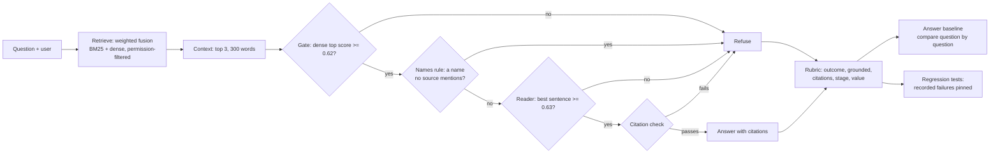

# Day 12 — End-to-End Answer Evaluation and Regression Tests

*Grade the answer, not only the retrieval.*

| | |
|---|---|
| **Series** | 15 Days of Modern, Enterprise-Relevant RAG from Scratch · Day 12/15 |
| **Level** | Beginner to intermediate (comfortable reading Python; Days 06, 07 and 11 help but aren't required) |
| **Time** | ~45 min reading · ~20 min running the notebook and exercises |
| **Cost** | Free: no API key, no paid services, **no new packages, no new model** (Day 04's embedding model, downloaded once if you haven't run that day). An optional live run with a hosted model costs at most about USD 0.02 (section 15) |
| **Code** | [`notebooks/day_12_answer_evaluation_and_regression_tests.ipynb`](../../notebooks/day_12_answer_evaluation_and_regression_tests.ipynb) and [`tests/test_regressions.py`](../../tests/test_regressions.py), with the shared code in [`src/rag_from_scratch/`](../../src/rag_from_scratch/), which gains Day 11's contexts (`contexts.py`), Day 10's revised names rule (`queries.py`) and Day 06's model client (`chat.py`) today |
| **Data** | [`evals/`](../../evals/): **76 new held-out questions** in [`evals/questions-v4.jsonl`](../../evals/questions-v4.jsonl) (with v3's 190 queries, unchanged); today's rules, committed first, in [`evals/preregistration/day-12.md`](../../evals/preregistration/day-12.md); the first **answer** baseline, [`day-12-answers-v4.json`](../../evals/baselines/day-12-answers-v4.json); the author's reading of every answer, [`evals/reviews/day-12-answers.jsonl`](../../evals/reviews/day-12-answers.jsonl); the series' recorded failures as test cases, [`evals/regressions.jsonl`](../../evals/regressions.jsonl) |
| **Visuals** | [`assets/day-12/`](../../assets/day-12/) |
| **Verified** | Notebook executed top to bottom on 2026-11-11 on Linux with Python 3.11, 3.12, 3.13 and 3.14, from both the repo root and `notebooks/`. CI runs the same tests on Linux, Windows and macOS on every push (section 20). |

---

## Learning objectives

By the end of this lesson you can:

1. Explain why a retrieval metric can be nearly perfect while users still get wrong answers or none.
2. Grade a RAG answer with a written rubric: correctness, groundedness, citations, refusals, and **the stage that failed**.
3. Explain why "grounded" (every claim is in the sources) and "correct" (it answers the question) are different, with a real example.
4. Measure an automatic grader against a careful reading, and say where it is wrong.
5. Compare two pipelines question by question with a cost for wrong answers, near ties set apart.
6. Turn recorded failures into regression tests that pin fixed bugs, properties that must hold, and known failures.
7. Describe what an LLM judge adds and what it needs before you trust it.

## Prerequisites

- Day 06's pipeline: retrieve, gate, assemble, an extractive reader, a citation check.
- Day 07's labelled questions (who asks, the evidence, the chunks that hold it, the facts a correct answer contains) and its paired comparison with the sign test.
- Day 11's lesson that more context can "find" more without being better, and its end-to-end table.
- Python 3.11+ and the repository set up as in the [README quick start](../../README.md#quick-start).

## Key terms

| Term | Meaning here |
|---|---|
| **Answer evaluation** | Grading what the user gets (an answer or a refusal), not only what the retriever found |
| **Rubric** | A written list of the parts of a grade and the rule for each, so that anyone grading the same answer gets the same verdict |
| **Correct** | The answer contains every fact a correct answer must contain (Day 07's facts), case-insensitive |
| **Grounded** | Every sentence is supported by the sources it cites. Here a lexical stand-in: at least 0.75 of its content words are in those sources (many tools call this "faithfulness" and use a model to judge it) |
| **Citation precision** | Of the chunks an answer cites, the share that hold the answer |
| **Stage** | The step where an answer was lost: retrieval, the gate, the names rule, the reader, or the citation check |
| **Value of an answer** | What it is worth to the person asking: correct +1, refused 0, wrong −2 (an assumption, stated before the test) |
| **Near tie** | An outcome decided by a gap under 0.001 that another CPU's rounding could flip |
| **Regression test** | A test that fails if a recorded failure comes back, or if a known one changes |
| **LLM judge** | A language model asked to grade answers; useful, and itself in need of grading |

---

## 1. Why grade answers

From Day 07 to Day 11 this series measured retrieval: is a chunk that holds the answer in the top 3, or in the context the reader gets? By that measure the pipeline has nearly arrived. On v4's 76 new questions, the weighted fusion has the answer in its top 3 for **all 52** answerable ones.

The current pipeline answers **30** of those 52 correctly. The other 22 are lost after retrieval: refused by a rule, answered from the wrong sentence, or blocked by the citation check. Day 11 saw the same gap: its expansion put four answer sections into the context, and none of those four answers became correct. A retrieval metric can't see where an answer is lost, because it stops at the context.

So today grades answers. What a user gets is either **an answer**, which can be right or wrong, or **a refusal** ("I don't know based on the provided documents."), which is right for a question the documents don't answer and a loss for one they do. A grade needs to say which happened, and **where** it went wrong, because that tells you which step to fix next.

## 2. The architecture



Every refusal and every answer goes to the rubric, which needs the labels (which chunks hold the answer, for this user) and the facts. The verdicts go into an **answer baseline** that later days compare against, question by question, and the series' recorded failures become **regression tests** that run on every push.

## 3. Rules first, and new held-out questions

Day 11 used v3's 68 test questions to decide, so they are spent (`evals/README.md`, rules 4 and 8). Today needed fresh ones, and, as on Days 09 to 11, the rules came first:

1. **Exploration on dev only.** Everything was tried on v3's 190 queries (160 questions), all dev today; the exploration scripts refused to run if a `questions-v4.jsonl` existed.
2. **Rules frozen** (a scratch file, 2026-11-11 07:53:09 UTC): the current pipeline, the candidate, the rubric, the value of an answer, the near-tie rule, the decision.
3. **New questions written**: 76 (52 answerable, 3 of them asked by maria about the managers' guide; 24 not), about a third with two sentences and about one in seven naming a place, a product or a day, close to v3's shares so that the test set doesn't lean towards the change; a larger unanswerable share than before, because refusals are half of an answer evaluation. Labels from evidence by Day 07's rule, with no system run on them.
4. **Committed together** as the branch's first commit ([`evals/preregistration/day-12.md`](../../evals/preregistration/day-12.md)), before anything scored a v4 test question. The notebook recomputes every dev value in it and stops if one differs.

What the author knew is written in the file: v3's results, every dev answer of both pipelines, how Day 06's names rule fails. So **every dev number today is in-sample**: a description of the questions the change was looked at on, not evidence.

**Two things in the pre-registration came out wrong, and stay as committed.** Its dev line for the candidate counts every changed question, while its own decision rule sets near ties apart; on dev that rule removes one question (Berlin), which changes "15 better, +1 at cost 2" into "14 better, +0". The notebook checks the line as committed and reports both. And its near-tie rule turned out too broad (section 11). Neither is fixed after the fact: a pre-registration is useful only if it isn't edited once the results are known.

## 4. The current pipeline, and three failures retrieval metrics miss

The **current pipeline**, the no-change baseline today, is Day 11's end-to-end path: the weighted fusion's top 3 (Day 11's expansion wasn't adopted), Day 07's measured gate on the **dense** top score (0.62), Day 06's extractive reader at Day 07's measured threshold (0.63) with Day 06's names rule, and Day 06's citation check. Moved to `src/rag_from_scratch/contexts.py` today, it reproduces Day 11's published end-to-end numbers exactly before anything else runs.

Three failures recorded earlier in the series, each with the answer in, or next to, the context:

1. **Right numbers, wrong meaning** (Day 06). Asked "How much time off do new dads get?", gpt-6-luna replied "Secondary caregivers receive 6 weeks of fully paid leave…", citing the leave policy. Every number is in the source and the citation check passes. But the policy is gender-neutral: a dad who is the primary caregiver gets 16 weeks.
2. **The answer is in the context, and the reader copies another sentence** (Day 11). For "How soon must I report a lost laptop?", *How to report* ("within one hour") is the third source sent; the reader copies "Report a lost or stolen laptop or phone straight away" from the travel policy. For "I clicked a link in a suspicious email. What should I do now?", Day 11's expansion added *How to report*; the reader still copied "Do not try to investigate the incident yourself…".
3. **A sentence's first word taken for a name** (Days 07, 10, 11). Day 06's names rule refuses a question that mentions a name no source mentions, and skips only the question's first word. In "It's my first day. Where do I pick up my laptop?", "Where" is an unknown name: refused, with the answer in the first source.

## 5. The rubric

| Part | Rule |
|---|---|
| **Outcome** | Day 07's `outcome()`: refused (abstained or blocked); for an answerable question, correct if every fact is a case-insensitive substring of the answer, else wrong; for an unanswerable one, answered |
| **Refused by** | the step that refused: gate, names rule, reader threshold or citation check (or, with a live model, the model itself) |
| **Context** | whether a labelled chunk was among the sections sent |
| **Citations** | whether the answer cites a labelled chunk; citation precision |
| **Grounded** | the citation check passed and every sentence has at least 0.75 of its content words (lower case, three or more letters or a digit, not a stop word) in the sources it cites |
| **Stage** | where it went wrong (below) |

The stages, in the order they are checked:

| Question | Outcome | Stage |
|---|---|---|
| answerable | correct | *ok* |
| answerable | refused | *gate*, *names rule: a sentence's first word*, *names rule: a name*, *reader threshold* or *citation check* |
| answerable | wrong, no labelled chunk sent | *retrieval: answer not in the context* |
| answerable | wrong, cites no labelled chunk | *reader: answer in the context, not used* |
| answerable | wrong, cites a labelled chunk | *reader: right source, wrong part* |
| unanswerable | refused | *ok* |
| unanswerable | answered | *answered: restricted to others* (the answer is in a chunk this user may not read) or *answered: nothing answers it* |

In the notebook it is one function:

```python
def grade(a, q, sent) -> Grade:
    # The rubric: one verdict per answer, from the answer, the context it was given, the labels and the facts
    out = outcome(a, q)
    refused_by = (why_refused(a) or "the model") if a.status != "answered" else None     # "the model": it abstained
    label_in = found(sent, q) if q.answerable else None
    cites_label = precision = sup = grounded = None
    if a.status == "answered":
        sources = {s.id: s for s in a.context.sources}
        cited = list(dict.fromkeys(i for c in a.check.claims for i in c.cited))
        sup = round(min(support(c.text, [sources[i] for i in c.cited if i in sources]) for c in a.check.claims), 3)
        grounded = a.check.passed and sup >= SUPPORT_MIN
        if q.answerable:
            cites_label = bool(set(cited) & set(q.answer_chunks))
            precision = round(sum(i in q.answer_chunks for i in cited) / len(cited), 3)
    if q.answerable:
        if out == "correct":
            stage = "ok"
        elif out == "refused":
            if refused_by == "names rule":
                names = set(a.reason.removeprefix("no source mentions ").split(", "))
                stage = "names rule: a sentence's first word" if names <= first_words(q.question) else "names rule: a name"
            else:
                stage = refused_by
        elif not label_in:
            stage = "retrieval: answer not in the context"
        elif cites_label:
            stage = "reader: right source, wrong part"
        else:
            stage = "reader: answer in the context, not used"
    else:
        stage = "ok" if out == "refused" else \
            "answered: restricted to others" if q.restricted_chunks else "answered: nothing answers it"
    return Grade(out, refused_by, label_in, cites_label, precision, sup, grounded, stage)
```

### Grounded isn't correct

Four replies to the new-dads question, through today's pipeline and the rubric:

```text
new dads, four replies                      outcome   check    support  grounded  cites label  stage
the extractive reader (today's pipeline)    wrong     passed       1.0      True        False  reader: answer in the context, not used
a faithful paraphrase (hand-written)        correct   passed     0.833      True         True  ok
gpt-6-luna on Day 06 (recorded)             wrong     passed       1.0      True         True  reader: right source, wrong part
a changed number (hand-written)             refused   blocked        -         -            -  citation check
```

Three of the four are fully grounded, and two of those are wrong. The extractive reader cites the wrong section (it never used the answer it was given); gpt-6-luna cites the right one and takes the wrong part of it: **right numbers, wrong meaning** is *right source, wrong part* in rubric terms. A groundedness score alone would pass both. That's why the rubric keeps correctness (which needs labels and facts) separate from groundedness (which doesn't), and why it names the stage.

## 6. Where answers are lost: the rubric on dev

On dev's 112 answerable questions (in-sample), the current pipeline:

```text
Dev, the current pipeline (in-sample) (112 answerable, 48 not):
  correct                   69 of 112   62% (52% to 70%)
  wrong                     12 of 112   11% (6% to 18%)
  refused                   31 of 112   28% (20% to 37%)
  unanswerable refused      29 of 48    60% (46% to 73%)
  unanswerable answered     19 of 48    40% (27% to 54%)
```

A labelled chunk is in the context for 107 of the 112. The stages say where the rest go: **the names rule refuses 25** (19 of them for a sentence's first word), **the reader loses 10** (8 *answer in the context, not used*, 2 *right source, wrong part*), the gate 3, the reader's threshold 2, the citation check 1, and retrieval only 2. Every answer is grounded, since this reader copies sentences, so groundedness can't separate its good answers from its bad ones; citations can (71 of 81 answered answerable questions cite a labelled chunk). Of the 48 unanswerable questions, 19 get an answer: a sentence from a nearby policy presented as if it answered ("How long are job applications kept?" → "Application logs are kept for 13 months").

So the step to fix isn't retrieval any more: it's the names rule first, then the reader.

## 7. Grading the grader

An automatic grade is only as good as its agreement with a careful reading. The author read every answered (question, answer) pair of both pipelines and graded it **correct** (a person asking gets the right answer, nothing misleading), **partly** (true and relevant but incomplete, or the right value among others without saying which applies) or **wrong**, with a note for anything that isn't correct. The reviews are committed, each tied to the exact answer text by a hash: if an answer changes, its review goes stale and has to be redone, as a label does when its document changes (Day 07).

| Split | Answered pairs | Rubric agrees with the reading | Disagreements |
|---|---|---|---|
| dev (read before the held-out run, written down after it) | 122 | 120 | Tokyo and Berlin: the reader copies every row of the hotel table, including the right one (Other cities), without saying which applies; containment calls it correct |
| v4 test (read and written after the run) | 58 | 57 | d12-a49 ("the lowest hotel limit"): all rows, the lowest not picked out |

The agreement is high **because this reader copies the documents' words**, so the facts match verbatim. Its known limits, stated in the pre-registration before any held-out answer was seen:

- **Lists that include the answer** pass containment (the three disagreements).
- **A fact inside a longer one** passes: "6 weeks" is inside "16 weeks" (d12-a24's note says so; it didn't bite today).
- **A correct paraphrase fails**: "two weeks" for "14 days", "5" for "five". A model that paraphrases will be under-credited, so the agreement has to be measured again whenever the generator changes (section 15).
- **Groundedness is lexical**: it can't tell a meaning change ("Secondary caregivers…" for a dad who is the main carer).
- **The reading isn't blind**: the author saw the rubric's verdict while reading. A second, independent reader would give an inter-annotator agreement; one reader can't.

## 8. The candidate: Day 10's names rule, graded by answers

Day 10 fixed the names rule (skip every sentence's first word; a gazetteer place is known if a source mentions its type, "Use the Other cities row for any city not listed") and didn't adopt the fix: it counted refusals and had to lose nothing, and one unanswerable question was let through. Today it is judged by **answers**, with a **value** per answer, stated before the test: correct **+1**, refused **0**, wrong **−2**, an unanswerable question answered **−2**. A wrong answer costs twice what a correct one gains, because Day 06's design already prefers refusing to guessing, and a wrong policy answer can make someone miss a deadline or break a rule, while a refusal sends them to the policy owner. Costs of 1 and 3 are reported beside it, because the cost is a judgement, not a measurement.

On dev (in-sample) the fix turns 22 refusals into answers: 15 correct, 6 wrong and one unanswerable question answered. **Every wrong one fails downstream**: the reader copies the wrong row or section (4), or retrieval never sent the answer (2, the stolen phone and the train ticket). The old rule was hiding those failures by refusing questions for a capitalised word. One change is a near tie (Berlin's correct answer depends on a row the reader copies by a margin of 0.0008); set apart, the candidate is better for 14 questions and worse for 7 (sign test p = 0.19), and the value at cost 2 doesn't move.

## 9. LLM judges, and why today's grader is a rule

Managed evaluation services and open-source libraries grade RAG answers with a language model. Amazon Bedrock's RAG evaluation, for example, offers correctness, completeness, helpfulness, logical coherence, faithfulness, citation precision and citation coverage (with harmfulness, stereotyping and refusal), computed by an evaluator model. Ragas defines faithfulness as the number of claims in a response supported by the retrieved context divided by the total number of claims, with a model breaking the response into claims and checking each.

A model judge reads paraphrases and meaning, which today's rule can't. It also has known biases: Zheng et al. (2023) found LLM judges prefer the first of two answers (position bias), longer answers (verbosity bias) and their own answers (self-enhancement bias), while also reaching over 80% agreement with human preferences on their benchmarks, about the level of agreement between humans. A judge is also a model call per answer, a cost and a dependency, and its prompt is another thing to version.

Today's grader is a rule because it is free, deterministic, runs in CI on every push, and agrees with a careful reading on 177 of 180 answers **for this reader**. The method doesn't change if you swap in a judge: **measure the grader against people before you trust it**, on the answers of the generator you actually use, and measure it again when the generator changes.

## 10. The held-out test: 76 new questions

```text
v4 test (held-out): Day 10's names rule against the current pipeline, 76 questions | outcome changed for 15 | near ties set apart: d12-a01 | better 10, worse 4, sign test p = 0.18 | change in value: cost 1: +6, cost 2: +2, cost 3: -2
  counting the near ties too: better 10, worse 5, change in value: cost 1: +5, cost 2: +0, cost 3: -5
```

| v4 test | Answerable (52): correct / wrong / refused | Unanswerable (24): refused / answered | Value, cost 2 |
|---|---|---|---|
| current pipeline | 30 / 3 / 19 | 14 / 10 | 4 |
| candidate (Day 10's names rule) | 40 / 5 / 7 | 11 / 13 | 4 |

- **Retrieval isn't the problem here**: the weighted fusion has all 52 answers in its top 3 (BM25 49, dense 51), so every lost answer is lost after retrieval.
- **The current pipeline's names rule refuses 17 answerable questions** (12 for a sentence's first word, 5 for a name), the reader loses 3, and the citation check blocks 2: the reader copies a numbered list item ("1. Search the software catalogue…") and `split_claims()` splits off "1." as a sentence without a citation, the bug Day 07 recorded.
- **With Day 10's names rule, 15 outcomes change**: 10 refused → correct; 1 refused → wrong (d12-a40: "Which email address should I report it to?" gets *What not to do*); 3 unanswerable questions now answered (a commute by taxi, an allowance when leaving, a four-day week, all two-sentence questions the old rule refused by accident); and d12-a01, a near tie, refused → wrong.
- The five names-rule refusals left under the candidate are names the sections sent don't mention: Chrome and Slack (in no document), Madrid (not in the stand-in gazetteer), Singapore (the answer is in *Core hours*, which names no city) and Tokyo (a gazetteer city, but no section sent mentions a city).

## 11. The decision

The rule, committed first: later days use Day 10's names rule if, on the v4 test questions, its total value at cost 2 is higher than the current pipeline's, counting only changed outcomes that aren't near ties.

```text
D1, Day 10's names rule in the current pipeline: on the 76 v4 test questions the outcome changed for 15, of which 1 near tie set apart: better for 10, worse for 4; the value at cost 2 changes by +2 -> adopted: later days use Day 10's names rule
sensitivity (a description, not the decision): cost 1: +6 (adopted), cost 2: +2 (adopted), cost 3: -2 (not adopted)
```

**Adopted, by the smallest margin the rule allows, and the margin rests on the near-tie rule.** The rule sets apart any changed question with a deciding gap under 0.001. For d12-a01 that gap only decides whether a second sentence is copied:

```text
near tie set apart (v4 test): d12-a01 names-v2, which sentences are copied decided by 0.0004; the outcome with and without the borderline sentence: wrong and wrong | counting it would change the value at cost 2 by -2, to +0
```

Its answer is wrong either way. Counted, the change would be +0: the two pipelines are worth 4 each, and the candidate would not be adopted. On dev the same rule set apart a near tie that really can flip (Berlin is correct with the borderline row and wrong without it), so the idea is right and the rule was written too broadly: **set a question apart only if flipping its close call changes the outcome**. It isn't changed now. Changing a rule after seeing the held-out results, in the direction that flips the decision, is exactly what pre-registration exists to prevent. The decision stands as pre-registered, with this caveat recorded beside it, and the narrower rule is the notebook's exercise 4 (on dev).

What doesn't depend on the cost or the near tie: **the fix turns refusals into answers that are right about two times in three** (10 of 15 changed on the held-out set, 15 of 22 on dev), and **every wrong one is a downstream failure** the old rule was hiding. That moves the next fix to the reader.

## 12. Regression tests: every recorded failure, as a test

Each day of this series recorded failures in its lesson. Today they become 29 test cases, one line each in [`evals/regressions.jsonl`](../../evals/regressions.jsonl), run by [`tests/test_regressions.py`](../../tests/test_regressions.py) on every push, from the shared code only (no notebook, about 20 seconds):

```json
{"id": "R21", "status": "known", "recorded": "Day 07", "where": "docs/day-07/LEARN.md", "what": "split_claims() splits a copied list number ('1.') into its own uncited sentence, so a correct copied list item is blocked (Day 12: d12-a09, d12-a12)", "check": "list_number_blocked", "args": {"qids": ["d12-a09", "d12-a12"]}}
```


Three kinds:

| Status | Meaning | Count | Examples |
|---|---|---|---|
| **fixed** | a failure a later day fixed: it must stay fixed | 9 | new dads (Day 01 → 08), the locked account, table rows cut from their header (Day 03), exact values for dense retrieval (Day 04 → 08), retired chunks left in an upsert-only index (Day 05) |
| **guard** | a property that must always hold | 13 | no managers-only chunk in any of alice's top 10, filtering before ranking, the atomic save, prompt escaping, the citation check's four blocks, no API key in an error, the off-switch, the checked neighbour lookup, stale labels reported |
| **known** | a failure that isn't fixed, pinned exactly | 7 | the stolen phone outside the top 3, the duplicate-id upsert, right numbers with the wrong meaning passing the citation check, the list-number split, Day 06's names rule and "Should", gazetteer gaps (Madrid), the reader ignoring the answer in its context |

A **known** case passes while the failure still happens, and fails, with a message saying so, when it stops happening or changes shape. That makes a fix visible (move the case to **fixed** on purpose, and update the lesson that recorded it) and an accidental change too. The registry test checks that every case names a check, every check is used, and every lesson it points to exists.

How to add one: when you find a failure, write it down in a lesson, add a line to the registry with the smallest check that reproduces it, and give it the status it has today. A bug that only shows up end to end is still worth a small check: R21 runs two real questions through the pipeline.

## 13. What it costs

```text
retrieve (BM25 + dense + fusion)     median    14.430 ms   p95    19.496 ms
answer (gate, reader, check)         median    99.407 ms   p95   156.142 ms
grade (the rubric)                   median     0.022 ms   p95     0.060 ms
```

(2-vCPU sandbox; timings vary.) Grading with the rubric costs hundredths of a millisecond: cheap enough to grade every question of every change, in CI. The regression suite takes about 10 seconds (it loads the embedding model once). The cost that matters is the reading: 180 answers, each checked against the documents, is real work, so plan for it, and read a sample when the set grows.

## 14. What the decision records for later days

- **Day 10's names rule is adopted** (pre-registered, by +2 at cost 2, with the near-tie caveat). `answering.py` doesn't change today; the next day that changes the pipeline switches it to `NamesReader(unknown_names_v2)` and re-measures it against today's answer baseline.
- **The reader is now where most answerable questions are lost** (the *reader: …* stages, and the list-number split). A better reader, or a model, has to be measured with this rubric, and the rubric re-checked against a reading of its answers.
- **v4's test split is used** (it decided D1): the next held-out decision needs `questions-v5`, with its own manifest, committed with its pre-registration.
- **The first answer baseline**, `evals/baselines/day-12-answers-v4.json`: every question's answer under both pipelines, its verdict and its closest call. `compare_answers()` in the notebook compares a run with it.

## 15. Optional: a live model, graded with the same rubric

Off by default. With `RAG_CHAT_*` filled in `.env` (Day 06's client, now in `chat.py`) and `DAY12_LIVE_MODEL=1`, the current pipeline's contexts go to the model instead of the extractive reader: the gate still refuses without calling it, and its replies pass Day 06's citation check. At most **40 requests**: the six recorded failures (new dads, the lost laptop, the stolen phone, the lockout, the train ticket, the suspicious link), then the first 24 answerable and 10 unanswerable v4 test questions the gate lets through. With `gpt-6-luna` at USD 0.10 / 0.50 per million input / output tokens (OpenAI's pricing page, checked 2026-11-11), the upper bound with every output token used is about USD 0.022.

It's an observation, not a measurement: one run of one model. Its answers paraphrase, so the rubric's containment will under-credit some; read them before trusting its counts. When the model itself declines, the rubric records it as refused by *the model*. Here the live path was run only against a local fake server (40 requests, every reply graded); no real model was called. The outputs go to `outputs/day-12/live-run.jsonl` (git-ignored); never commit a notebook executed with a live model.

## 16. Core trade-offs

| | Fact containment (today) | LLM judge | People reading |
|---|---|---|---|
| Needs labels (facts) | yes | optional (reference-free metrics exist) | no, but a written rubric |
| Reads paraphrase and meaning | no | yes | yes |
| Deterministic, runs in CI | yes | no (a model call, a prompt to version) | no |
| Cost per answer | ~0.02 ms | a model call | a minute or so |
| Known failure modes | lists that include the answer, facts inside longer facts, paraphrases | position, verbosity and self-preference biases | fatigue, one reader's taste; needs a second reader for agreement |
| Use it for | every change, every question | larger or paraphrasing generators, sampled | calibrating the other two; disputed answers |

### When to use what

- **Start with a rule** (facts, citations, refusals, stages). It is free and catches most regressions when the generator copies.
- **Read a sample yourself** every time the generator changes, and record agreement. If agreement drops, the rule is the wrong grader for that generator.
- **Add an LLM judge** when answers are paraphrased or long, and validate it against your reading first, on your own questions.
- **Always keep refusals in the grade**: a pipeline that refuses everything has no wrong answers.

## 17. Setup, step by step

1. Clone and set up as in the [README quick start](../../README.md#quick-start), or `git pull` and `python -m pip install -r requirements.txt` again (nothing new today).
2. Open `notebooks/day_12_answer_evaluation_and_regression_tests.ipynb` and run all cells (about a minute; Day 04's model is downloaded once if missing).
3. Run the regression suite on its own: `python -m pytest tests/test_regressions.py`.
4. Optional, costs money: put `RAG_CHAT_*` in `.env` (see `.env.example`), then run the notebook with `DAY12_LIVE_MODEL=1`. Don't commit the executed notebook.

## 18. Code walkthrough

| Notebook section | What it does |
|---|---|
| 0 | Setup: the gate, the reader's threshold, the support threshold, the cost, the pre-registered values, checked against `evals/preregistration/day-12.md` |
| 1 | Loads v3, checks the snapshot, rebuilds Day 11's six retrievers (the expansion from `contexts.py`) and compares them with `day-11-retrieval-v3.json` (no changes) |
| 1.1 | Loads v4, checks it keeps v3's 190 queries exactly, and finds the 76 new test questions |
| 2 | The current pipeline (`run()`), Day 11's end-to-end numbers reproduced, and the three recorded failures |
| 3 | The rubric: `support()`, `Grade`, `grade()`, `value()`; four replies to the new-dads question |
| 3.1 | The rubric on dev for the current pipeline |
| 4 | The author's reading against the rubric (`agreement()`), stale reviews |
| 5 | The candidate on dev: `closest_call()`, `paired()` with the sign test and the value at three costs |
| 6, 6.1, 6.2 | The held-out test: retrieval, both pipelines, the paired comparison, every question's stage, the reading of the new answers |
| 7 | The regression registry, and three cases computed here |
| 8 | Timings: retrieve, answer, grade |
| 9 | Decision D1, the sensitivity to the cost, and each near tie with and without its borderline sentence |
| 10 | The optional live run (off) |
| 11 | The run file, `compare_answers()` against the accepted answer baseline |
| 12–13 | Sanity checks, and five exercises |

`src/rag_from_scratch/contexts.py` is Day 11's `expand_sections()` (with `Step`, its trace, and `DocumentStructure` for the sections in order), `SentenceCache`, `answer_context()` (Day 11's `answer_with()`: the gate on the dense top score, the permission check, the budget, a reader, the citation check) and `why_refused()`; Day 11's `Context` is called `SectionContext` there, so it can't be confused with Day 06's. `queries.py` gains Day 10's `unknown_names_v2()` and `NamesReader`; `chat.py` is Day 06's prompt and client. `tests/test_shared_code.py` checks each against its notebook: the new Day 11 class and the new Day 10 test run only the **definitions** in the cells they need (imports, functions, classes, constants), not the computations around them, and the Day 10 test uses a stand-in embedder so that class still loads no model.

## 19. Regression suite and answer baseline, in the repository

| File | What it is |
|---|---|
| `evals/regressions.jsonl` | 29 recorded failures: id, status, the day recorded, the lesson, what failed, the check and its arguments |
| `tests/test_regressions.py` | one check function per kind of failure; a known failure must still happen, a fixed one must not come back, a guard must hold |
| `evals/baselines/day-12-answers-v4.json` | the accepted answer run: every v4 question under both pipelines (status, answer, citations, verdict, stage, closest call), the metrics, the paired comparison and D1 |
| `evals/reviews/day-12-answers.jsonl` | the author's reading of each distinct answered (question, answer) pair, tied to the answer by its SHA-256 |
| `tests/test_evals.py` | checks the answer baseline against the labels and itself, and the reviews against the baseline (no model) |

## 20. Expected output and what was tested

**Tested** on 2026-11-11:

- The notebook executed top to bottom in a fresh kernel, and `python -m pytest` passed, on Linux (x86_64) with Python 3.11, 3.12, 3.13 and 3.14, from both the repository root and `notebooks/`, each kernel confirmed to run the intended Python version, one test file per process and one version at a time: 138 passed and 1 skipped on 3.11, 3.12 and 3.14 (the slide test, which needs Pillow), and 150 passed on 3.13 with Pillow, about 15 minutes per version. The saved outputs come from the Python 3.13 run. The same counts again from a fresh clone of the public repository with today's two commits applied, where rebuilding every day's slides and the sample PDFs changed no file.
- `tests/test_regressions.py`: all 29 cases and the registry check passed (about 10 seconds).
- **Memory and time:** `tests/test_shared_code.py` (nine classes now, one per day) peaked at 742–758 MB on Linux (Day 11: 730 MB) and took about 4 minutes; `tests/test_regressions.py` about 300 MB (it loads the embedding model once); `tests/test_day_12_notebook.py` runs the notebook twice in about 80 seconds.
- **Deliberate bugs in the notebook:** 20 mutations of its code were tried. The first round caught 14, and the 6 that got through showed a real gap: nothing pinned the rubric's support, groundedness or citation precision. So `compare_answers()` now compares every field of every verdict with the accepted baseline, and four checks were added (a sentence cited to the wrong section must be ungrounded, a second citation halves the precision, which words count, and which first words the names-rule stage looks at). After that, 19 of 20 are caught: support from every source sent instead of the cited ones, two-letter words counted, grounded at 0.9, precision divided by the labels, first words including the question's own, reader stages swapped, the label always "in the context", a wrong answer costing 1, refusals ranked below wrong answers, the near-tie threshold 10 times smaller, near ties from one pipeline only, the closest call ignoring the copied sentences, "partly" read as correct, the context one section deeper, the gate on the fused score, the decision counting the near tie, any overlap for the names-rule stage, a regression case dropped, the reader threshold at 0.60. The 20th (no three-sentence cap when the near-tie outcomes are recomputed) is equivalent on this data: no borderline set has more than three sentences.
- **Drifts of the shared code:** 18 deliberate changes to the three promoted pieces, each caught by `tests/test_shared_code.py` (8 in `contexts.py`, 6 in `chat.py`, 4 in the revised names rule in `queries.py`; two of the last only after made-up sources with a single type word and a question naming the same app twice were added to the test).
- **Offline:** with `HF_ENDPOINT` pointed at a dead address and every Python-level network attempt logged (socket connections and DNS lookups, in pytest and in the notebook kernels), `tests/test_day_12_notebook.py` made no attempt at all and `tests/test_regressions.py` only reached its own local test server (127.0.0.1, the case that checks a key is never echoed); a deliberate lookup inside a kernel was logged, so the log works.
- **The live run** (section 15) was run end to end against a local fake server that speaks the Chat Completions format: 40 requests, all graded, nothing written to the committed notebook. No real model was called here.
- The rules were committed before anything scored a held-out question (section 3).

**In the test environment** Hugging Face wasn't reachable, so the model's files came from a copy whose SHA-256 values and sizes match the pinned ones (as on Days 04–11). CI runs today's notebook on Linux, Windows and macOS with Python 3.11 and 3.14 on every push.

**Expected differences on your machine:** timings, and scores in the last decimal places. A few answers are decided by gaps under 0.001 (the closest: which sections are sent for "How do I set up my email signature?", 0.0001; which sentences are copied for d12-a01, 0.0004); `compare_answers()` sets such changes apart as CPU rounding, and the sanity checks pin only what doesn't depend on them. If a sanity check fails, please open an issue with your OS, CPU and Python version.

## 21. Common errors and mistakes

### Setup and runtime errors

| Symptom | Cause | Fix |
|---|---|---|
| `RuntimeError: Could not download ...` | No network, a proxy, or Hugging Face blocked (first run only) | Set `HTTPS_PROXY` or `HF_ENDPOINT`, or download the file yourself to the path in the message |
| `AssertionError: PREREGISTERED must match the pre-registration` | The settings in the notebook were edited | Undo the edit, or write a new pre-registration before comparing anything |
| `AssertionError: the dev values don't match the pre-registration` | The data, labels, thresholds or code changed since the rules were committed | Find out why before going on |
| Section 4 lists answers "not reviewed yet" | An answer changed, so its review is stale (exercises 2, 3) | Expected after a change: read the new answers before trusting the agreement |
| A **known** regression case fails | The failure stopped happening, or changed shape | If you fixed it on purpose, set its status to `fixed` in `evals/regressions.jsonl` and update the lesson it points to |
| `ValueError: Set RAG_CHAT_PROVIDER and RAG_CHAT_MODEL in .env` | The live switch is on without a model configured | Fill in `.env` (see `.env.example`), or switch it off |

### Conceptual mistakes (the expensive ones)

- **Stopping at "the answer is in the context".** On v4, every answer was in the top 3 and 30 of 52 were answered correctly.
- **Treating grounded as correct.** Two of the four grounded replies to "new dads" are wrong.
- **Leaving refusals out of the grade.** A pipeline that refuses everything has no wrong answers; grade refusals of answerable questions as losses, and answers to unanswerable ones as errors.
- **Trusting a grader you haven't checked.** Containment is good for a reader that copies, and would under-credit one that paraphrases; an LLM judge has its own biases.
- **Deciding without a cost for wrong answers.** "More correct answers" and "more wrong answers" come together; the decision depends on how much a wrong answer costs, so say it before the test.
- **Editing the rule after the result.** The near-tie rule was too broad; changing it now would flip the decision. Record the caveat and fix the rule next time.
- **Deleting a known failure's test because it's annoying.** Pinned, it tells you when something changes; deleted, it can come back silently.

## 22. Privacy, licensing and security notes

- **The evaluation data is sensitive in real life.** Real questions, answers and reviews say who asked what and what they were told: store them with the same access control and retention as the documents (`evals/README.md`, rule 7). Today's are synthetic.
- **Permissions are checked, not assumed.** The rubric's baseline test checks that no context holds a chunk its asker may not read, and the regression suite pins that no managers-only chunk reaches alice's top 10. That is a regression check, not access control (Day 05).
- **The optional live run sends questions and the retrieved policy text to a hosted provider** if you configure one. Use synthetic data, check the provider's data terms, and never commit `.env` or an executed live notebook. The client never prints or logs the key, and a regression case pins it.
- **Licences.** No new dependencies or models. The questions, labels, reviews, baselines, regression cases and the pre-registration are part of this repository (MIT).

## 23. Key takeaways

1. **Grade the answer, and say where it was lost.** On the held-out questions retrieval found every answer; the stages showed the names rule refusing 17 and the reader and the citation check losing the rest.
2. **Grounded isn't correct, and a grader needs grading.** gpt-6-luna's cited, fully supported answer for new dads was wrong; the rule-based grader agreed with a careful reading on 177 of 180 answers here, because this reader copies, and must be checked again for a reader that paraphrases.
3. **Write the failures down as tests.** 29 recorded failures now run on every push: fixed ones stay fixed, guards hold, and known ones announce when they change.

## 24. Exercise

**Write a regression test for a failure you find.**

1. Run the notebook and pick one wrong answer from section 6.1 whose stage is *reader: answer in the context, not used*.
2. Write down, in one sentence, what the reader did wrong, and add a line to `evals/regressions.jsonl` with status `known` and a check that reproduces it (reuse `reader_ignores_answer`).
3. Run `python -m pytest tests/test_regressions.py`. Then change something that should fix it (for example, score the reader's sentences against the question's last sentence only) and run it again: the case should fail and tell you to move it to `fixed`. Did any other case change?

The notebook's section 13 has five shorter exercises (change the cost, a stricter grader, fix the list-number split, a narrower near-tie rule, grade a paraphrase).

## References

Links checked on 2026-11-11.

- Amazon Web Services, [Review metrics for RAG evaluations that use LLMs](https://docs.aws.amazon.com/bedrock/latest/userguide/knowledge-base-eval-llm-results.html) (Amazon Bedrock): the retrieve-and-generate metrics are correctness, completeness, helpfulness, logical coherence, faithfulness, citation precision, citation coverage, harmfulness, stereotyping and refusal; citation coverage "is approximately citation recall". [Use metrics to understand RAG system performance](https://docs.aws.amazon.com/bedrock/latest/userguide/knowledge-base-eval-retrieve-generate.html): "the evaluator model you select uses a set of metrics". No last-updated date shown.
- Ragas, [Faithfulness](https://docs.ragas.io/en/stable/concepts/metrics/available_metrics/faithfulness/): the number of claims in the response supported by the retrieved context over the total number of claims, with a model (or the HHEM-2.1-Open classifier) checking each claim.
- Zheng et al., [Judging LLM-as-a-Judge with MT-Bench and Chatbot Arena](https://arxiv.org/abs/2306.05685) (NeurIPS 2023 Datasets and Benchmarks): position, verbosity and self-enhancement biases, and over 80% agreement between GPT-4 judges and human preferences, the same level as between humans.
- OpenAI, [API pricing](https://developers.openai.com/api/docs/pricing): `gpt-6-luna` standard tier USD 0.10 input and USD 0.50 output per million tokens (checked 2026-11-11).

## Next: Day 13 — RAG operations: tracing, latency and cost

Today graded what the pipeline returns. Day 13 instruments how it gets there: a trace per request (each step's input, output and time), p50 and p95 latency, token and cost visibility, caching, timeouts and fallbacks, measured on the same questions, with today's answer baseline as the check that an operational change didn't change the answers.
