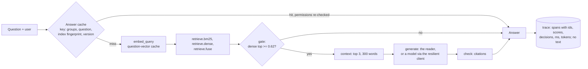
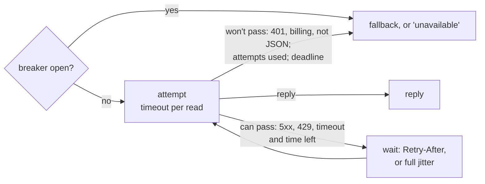

# Day 13 — RAG Operations: Tracing, Latency and Cost

> Know where every request spends its time and money, see which step lost an answer without storing a word of text, and decide what happens when the model fails, without changing a single answer by accident.

| | |
|---|---|
| **Series** | 15 Days of Modern, Enterprise-Relevant RAG from Scratch · Day 13/15 |
| **Level** | Beginner to intermediate (comfortable reading Python; Days 06, 11 and 12 help but aren't required) |
| **Time** | ~45 min reading · ~20 min running the notebook and exercises |
| **Cost** | Free: no API key, no paid services, **no new packages, no new model** (Day 04's embedding model, downloaded once if you haven't run that day). An optional live pass with a hosted model costs at most about USD 0.011 (section 16) |
| **Code** | [`notebooks/day_13_rag_operations_tracing_latency_cost.ipynb`](../../notebooks/day_13_rag_operations_tracing_latency_cost.ipynb), with the shared code in [`src/rag_from_scratch/`](../../src/rag_from_scratch/), which gains Day 12's answer rubric (`rubric.py`) today |
| **Data** | [`evals/`](../../evals/): **51 new held-out questions** in [`evals/questions-v5.jsonl`](../../evals/questions-v5.jsonl) (with v4's 266 queries, unchanged); today's rules, committed first, in [`evals/preregistration/day-13.md`](../../evals/preregistration/day-13.md); the accepted run, [`day-13-answers-v5.json`](../../evals/baselines/day-13-answers-v5.json); Day 12's live replies with the author's reading of each, [`evals/reviews/day-12-live-gpt-6-luna.jsonl`](../../evals/reviews/day-12-live-gpt-6-luna.jsonl); four new cases in [`evals/regressions.jsonl`](../../evals/regressions.jsonl) |
| **Visuals** | [`assets/day-13/`](../../assets/day-13/) |
| **Verified** | Notebook executed top to bottom on 2026-11-12 on Linux; tests passed on 2026-11-13 with Python 3.11, 3.12, 3.13 and 3.14, from both the repo root and `notebooks/`. CI runs the same tests on Linux, Windows and macOS on every push. Before publication: Windows 11 (155 passed, 1 skipped), one live pass with `gpt-6-luna`, and a flaky Windows test fixed (section 21). |

---

## Learning objectives

By the end of today you will be able to:

1. Record a **trace** for every request: each step's timing, the ids and scores it produced and what it decided, with no document text, no question text and no key in it, and read a failure straight from it.
2. Measure **p50 and p95 latency per step**, and explain why the answer depends on which request you measure (cold, warm or repeated) and why percentiles don't add up.
3. Break a model call's **cost** down by part (instructions, sources, question, output), and check a token estimate against the provider's counts.
4. Write **cache keys** that hold everything the result depends on, and show what a missing part does (a permission leak, a stale answer).
5. Test a **semantic cache** with a rule committed in advance, and explain why it wasn't adopted.
6. Wrap a model call in **a timeout per attempt, a deadline, retries with jitter, a circuit breaker and a fallback**, each failure demonstrated against a local fake server, and choose the fallback by its value, not by habit.

## Prerequisites

- Python 3.11 or newer and the repository set up as in the [README quick start](../../README.md#quick-start) (nothing new to install today).
- Helpful: Day 06 (the pipeline and its model client), Day 11 (the sentence cache and the permission re-check) and Day 12 (the rubric and the value of an answer). Each idea is re-introduced where it is used.

## Key terms

| Term | Meaning here |
|---|---|
| **Trace** | The record of one request: a list of **spans**, one per step, each with a start time, a duration and what the step produced or decided |
| **Span attribute** | A named value on a span (`gen_ai.request.model`, `decision`); names follow OpenTelemetry's GenAI conventions where one exists |
| **p50 / p95** | The time half / 95% of requests stay under (nearest-rank method). p95 is the tail users notice |
| **Cold / warm / repeated** | Nothing cached / per-document work done once at index time / the same user asks the same question again |
| **Token** | The unit a hosted model is billed in: input (instructions, sources, question) and output (the reply, and the model's reasoning) |
| **Cache key** | What a cache looks a result up by. Safe when it holds everything the result depends on |
| **Index fingerprint** | A hash of the index's contents; it changes whenever a chunk is added, changed or removed |
| **Semantic cache** | A cache that serves the answer to an earlier *similar* question (cosine of the query vectors ≥ **θ**) |
| **Timeout** | A limit on one blocking step (connecting, or each read) |
| **Deadline** | A limit on the whole model step, retries and waits included |
| **Backoff with full jitter** | Waiting a random time between 0 and a growing cap before retrying, so clients that failed together don't retry together |
| **Retry-After** | An HTTP response header in which the server says how long to wait before retrying |
| **Circuit breaker** | After repeated failures, stop calling the dependency for a while (open), then let a trial request through (half-open) |
| **Fallback** | What answers when the model can't: here either the API-free reader or Day 06's "unavailable" message |

---

## 1. Why operations, and why answers mustn't change

Day 12 graded what the pipeline answers. A team running it also needs to know **how long** each answer takes, **what it costs**, **which step** to look at when an answer is wrong, and **what users see when the model fails**. Those are operations questions, and the tools for them (traces, timings, caches, retries) sit inside the pipeline, where a careless change can alter an answer as easily as any retrieval experiment.

So today has one rule above the others: **an operational change must not change an answer unless it is measured like any other change.** The notebook checks it three ways: Day 12's whole answer baseline (236 questions, two pipelines) rebuilt and compared field by field before anything else runs; every one of 287 questions answered by the traced pipeline and by the untraced one, identically; and every question answered with and without the exact caches, identically. Only two things today *can* change an answer, and each is a decision with rules committed before the test: **D1**, a semantic answer cache, and **D2**, what to answer when the model fails.

## 2. The architecture



Each box is a span in the trace. The pipeline is Day 12's adopted one (the weighted fusion's top 3, Day 07's gate on the dense top score, Day 06's extractive reader at 0.63 with Day 10's names rule, Day 06's citation check); today adds the trace around it, two exact caches, and a resilient client for the optional model:



## 3. Rules first, and new held-out questions

Day 12 used v4's 76 test questions to decide, so they are dev from today (`evals/README.md`, rules 4 and 8). As on Days 09 to 12, the rules came first:

1. **Exploration on dev only.** The exploration scripts loaded v4 and Day 12's accepted answers and refused to run if a `questions-v5.jsonl` existed.
2. **Rules frozen** (a scratch file, 2026-11-12 21:11:27 UTC): the semantic cache's key, scope and threshold rule, the fallback's candidate, the client's settings, the decisions and what would be reported whatever it showed.
3. **New questions written by a fixed rule**: take v4's questions in file order; for every 8th **answerable** one (21 sources) write a **paraphrase** (same answer, reworded) and a **near neighbour** (one detail changed, so the documents give another answer or none); for every 8th **unanswerable** one (9 sources) a paraphrase. By reading: **51 questions, 33 answerable and 18 not**. Labels from evidence by Day 07's rule, with no system run on them.
4. **Committed together** as the branch's first commit ([`evals/preregistration/day-13.md`](../../evals/preregistration/day-13.md)), before anything scored a v5 test question. The notebook recomputes every dev value in it and stops if one differs.

**This test set is a stress test, not a sample of traffic.** Half of the questions built from answerable sources are written to look like a question the cache has seen and to need another answer. It can show that a semantic cache serves a wrong answer; it can't say how often that would happen with real users, where nobody knows the share of near neighbours. And dev had no paraphrase pairs at all (earlier protocols forbade them), so dev could show what a semantic cache gets wrong but hardly what it gets right. Both limits are written in the pre-registration, before the result.

## 4. Day 12 reproduced, with the rubric moved to `src/`

Day 12's rubric (`grade()`, `value()`, `closest_call()`, `compare_answers()`) moves to [`src/rag_from_scratch/rubric.py`](../../src/rag_from_scratch/rubric.py), because today grades with it and later days will too. `tests/test_shared_code.py` gains one class, `TestDay12Rubric`, which runs the Day 12 notebook's own definitions next to the promoted module and checks they agree on handmade replies, mis-cited replies, values, comparisons and closest calls. Then the notebook rebuilds Day 12's whole answer baseline with it:

```text
236 v4 questions x 2 pipelines compared with evals/baselines/day-12-answers-v4.json: no changes (status, answer text, citations, every field of the verdict, metrics; contexts sent identical)
33 regression cases in evals/regressions.jsonl (tests/test_regressions.py runs every one): 13 guard, 11 known, 9 fixed
```

"No changes" covers every field: status, answer text, citations, each part of the verdict, the metrics, and the exact sections each context sent. Sixteen deliberate drifts of the promoted rubric (a threshold, a stop word, support counted over every source instead of the cited ones, two-letter words counted, …) were each caught by the new test class.

## 5. A trace for every request

A **trace** is the record of one request. Here it is a plain dictionary with a list of spans, written as one JSON line per request; a production system would hand the same spans to the OpenTelemetry SDK and export them to a tracing backend, which changes the plumbing, not what goes in. What goes in, and what never does:

| In the trace | Never in the trace |
|---|---|
| the user id and groups, the question's SHA-256 (16 hex characters) and word count, the index fingerprint, the pipeline version | the question's text: it may hold personal data |
| per step: ids and scores (each retriever's top 3, the sections sent and dropped), decisions (gate, names rule, reader, check), token counts or estimates, start and duration | any document text: retrieved chunks are as sensitive as the documents |
| for a model call: provider, model, attempt, outcome, error type, tokens | the key, the prompt, the reply |

Attribute names follow OpenTelemetry's **GenAI semantic conventions** where one exists (`gen_ai.operation.name`, `gen_ai.provider.name`, `gen_ai.request.model`, `gen_ai.usage.input_tokens`, `gen_ai.usage.output_tokens`, `gen_ai.retrieval.top_k`, `error.type`); the span names are this pipeline's own. Those conventions are still marked *Development* (they can change), and they too leave prompts, replies and retrieved documents out unless you opt in.

`traced_answer()` is the current pipeline written step by step, calling the same shared functions as `answer_context()` in the same order, each step inside a span. One request, with nothing cached yet:

```text
req-0001  user alice ['all-employees']  question sha256 e5a84cae394b1030 (8 words)  index 3f8344d00b8b4878  pipeline day-13.1
  embed_query           0.0    15.0 ms ###                      cache_hit False
  retrieve.bm25        15.0     0.1 ms #                        candidates 11; top travel-policy#safety-while-travelling 7.2761 (+2)
  retrieve.dense       15.1     0.2 ms #                        candidates 43; top security-incident-reporting#what-not-to-do 0.6758 (+2)
  retrieve.fuse        15.3     0.1 ms #                        gen_ai.operation.name retrieval; gen_ai.retrieval.top_k 3; documents travel-policy#safety-while-travelling 0.9485 (+2); gap_after_last 0.0453
  gate                 15.4     0.0 ms #                        threshold 0.62; dense_top 0.6758; decision pass
  context              15.4     0.1 ms #                        budget_words 300; sent travel-policy#safety-while-travelling, security-incident-reporting#what-not-to-do, security-incident-reporting#how-to-report; dropped -; words 113; prompt_tokens_estimate 497
  generate             15.4   102.7 ms #####################    generator extractive reader (API-free); decision answer; best 0.76
  check               118.2     0.1 ms #                        claims 1; problems -; decision answered
  total 118.3 ms -> answered, served by extractive reader (API-free), cites travel-policy#safety-while-travelling
labelled answer chunk: security-incident-reporting#how-to-report | outcome: wrong
```

The bars are each span's duration on the request's timeline. Two things show without a word of text:

- **Where the time went:** the reader (`generate`) took 103 of 118 ms, because a cold reader embeds every sentence it reads, and the question a second time.
- **Which step lost the answer:** *How to report*, the labelled section, was **sent** (third in the context), and the answer **cites** *Safety while travelling*. That is Day 12's stage "reader: answer in the context, not used", read straight from ids.

## 6. Every request traced, and checked for leaks

```text
287 questions traced: every answer identical to the untraced pipeline's | spans per trace: 5 to 8 | document text, question text or keys found: 0 | written to outputs/day-13/traces.jsonl (1779 bytes per request)
traced outcomes: answered 219, abstained 63, blocked 5 | refused at the gate (no reader called): 39
answerable questions whose trace shows the labelled section sent and another one cited: 18 (d03-13, d01-01, d07-a08, d10-a27, d11-a08, d11-a29, ...)
```

Every traced answer is identical to the untraced pipeline's (asserted for all 287). Each trace is checked for **leaks** before it is written: no run of six words from any chunk, no four words in a row from the question, none of the question's names (its capitalised words after the first: a single "Madrid" can identify a request) and no key. The same check runs on the fake-server traces with the fake key, and on the live pass's traces before they are saved.

The last line is the kind of question traces answer at scale: across all requests, how often was the labelled section **sent but not cited**? Eighteen answerable questions; for them, a better reader, not better retrieval, is what would help.

## 7. Latency: p50 and p95 per step

**p50** (the median) is a typical request; **p95** is the time 95% of requests stay under, the slow tail that users notice. Percentiles here use the nearest-rank method on one machine's timings; timings vary between runs and machines, so no test pins them (the sanity checks pin only their shape: a cold reader slower than a warm one).

```text
on this machine: 2 CPUs, Linux, Python 3.13.18 (timings vary between runs and machines: a description, not pinned by any test)

Cold (nothing cached: each request embeds its question twice and every sentence it reads): 59 requests | whole request p50 119.56 ms, p95 167.05 ms
  embed_query       59 spans   p50   14.550 ms   p95   18.614 ms    14% of all the time
  retrieve.bm25     59 spans   p50    0.102 ms   p95    0.158 ms     0% of all the time
  retrieve.dense    59 spans   p50    0.183 ms   p95    0.255 ms     0% of all the time
  retrieve.fuse     59 spans   p50    0.054 ms   p95    0.096 ms     0% of all the time
  gate              59 spans   p50    0.002 ms   p95    0.002 ms     0% of all the time
  context           50 spans   p50    0.067 ms   p95    0.113 ms     0% of all the time
  generate          50 spans   p50  107.953 ms   p95  151.995 ms    86% of all the time
  check             50 spans   p50    0.057 ms   p95    0.092 ms     0% of all the time
  the steps' p95s add up to 171.33 ms; the requests' p95 is 167.05 ms (percentiles don't add up)

precomputed at index time: 102 sentence and table-row vectors in 1.57 s (once)
Warm (sentence vectors precomputed; the question embedded once per request; first time each question is asked): 236 requests | whole request p50 12.10 ms, p95 16.77 ms
  cache.answers    236 spans   p50    0.002 ms   p95    0.003 ms     0% of all the time
  embed_query      236 spans   p50   11.597 ms   p95   15.992 ms    96% of all the time
  retrieve.bm25    236 spans   p50    0.074 ms   p95    0.123 ms     1% of all the time
  retrieve.dense   236 spans   p50    0.124 ms   p95    0.196 ms     1% of all the time
  retrieve.fuse    236 spans   p50    0.044 ms   p95    0.081 ms     0% of all the time
  gate             236 spans   p50    0.001 ms   p95    0.002 ms     0% of all the time
  context          207 spans   p50    0.052 ms   p95    0.090 ms     0% of all the time
  generate         207 spans   p50    0.103 ms   p95    0.169 ms     1% of all the time
  check            207 spans   p50    0.033 ms   p95    0.066 ms     0% of all the time
  the steps' p95s add up to 16.72 ms; the requests' p95 is 16.77 ms (percentiles don't add up)

Repeated (the same user asks the same question again: the answer cache): 236 requests | whole request p50 0.01 ms, p95 0.01 ms
  cache.answers    236 spans   p50    0.002 ms   p95    0.005 ms    36% of all the time
  the steps' p95s add up to 0.01 ms; the requests' p95 is 0.01 ms (percentiles don't add up)

The model call, recorded by Day 12's live pass (40 requests to gpt-6-luna from the user's PC, 2026-11-12; context, model and check): p50 1.10 s, p95 1.64 s, slowest 2.63 s: about 91 times the warm API-free request's p50
```

Three readings of the same pipeline:

- **Cold** (59 requests, nothing cached): the reader is 86% of the time, because it embeds sentences that never change between requests.
- **Warm**: those **102 sentence and table-row vectors are computed once, at index time** (1.57 s), and the question's vector is shared between retrieval and the reader. The p50 drops from about 120 ms to about 12 ms, and embedding the question becomes 96% of the request.
- **Repeated**: the same user asks the same question again, and the answer cache serves it in about 10 microseconds.

So "the slowest step" depends on which request you measure. Optimise against the wrong one and you speed up a step that a running service never pays for.

**Percentiles don't add up.** The steps' p95s sum to 171.33 ms; the requests' p95 is 167.05 ms. The slowest requests aren't slow at every step. They are close here only because one step dominates each request; in general, add the timings per request first, then take the percentile.

**And the model makes all of this small.** Day 12's live pass (40 requests to `gpt-6-luna` from the user's PC on 2026-11-12, context, model call and check) took 1.10 s at the median and 1.64 s at p95: about 91 times the warm API-free request. With a hosted model, the model's latency and its tail decide the user's wait and the client's timeouts (section 12).

## 8. Cost: where the tokens go

A hosted model is billed per token: input (the instructions, the sources, the question) and output (the reply, plus any reasoning, which is billed as output). Day 12's live pass recorded the provider's own count for 40 requests, so the usual estimate (about four characters per token) can be checked:

```text
Day 12's live pass: 40 requests, 18075 input and 1133 output tokens counted by the provider (mean 452 in, 28.3 out; output from 12 for 'I don't know' to 72, reasoning included)
estimate (characters / 4) against the provider's count of input tokens: actual / estimate 0.91 on average (0.87 to 0.97)
where the input tokens go (estimated): instructions 38%, sources 58%, question 4% | the longest prompt: about 543 tokens, under the 1024 the provider's prompt cache needs

gpt-6-luna   USD 0.10 / 0.50 per million: USD 0.000059 per request (input 76%) = USD 0.059 per 1,000 requests that reach the model
gpt-6.1-sol  USD 2.00 / 10.00 per million: USD 0.001187 per request (input 76%) = USD 1.187 per 1,000 requests that reach the model
Day 12's 40 requests at these prices: USD 0.00237

of the 236 dev questions, the gate refuses 29 without calling a generator, so 207 would reach a model: USD 0.0123 with gpt-6-luna, USD 0.2457 with gpt-6.1-sol for all of them; asked again, 236 of 236 come from the answer cache and cost nothing
the API-free path instead: about 12 ms of this machine's CPU per request (warm), 2.9 s for all 236
```

What this shows:

- **The estimate over-counts by about a tenth** on these prompts (actual / estimate 0.91, from 0.87 to 0.97): a safe direction for a budget, and good enough to plan with; for billing, use the provider's counts.
- **Input is about three quarters of the cost** at these prices, and the **sources** are 58% of the input. A tighter context budget is the biggest lever on cost, and Day 06's 300 words already keep it small.
- **The same instructions open every prompt** (38% of the input). Providers' prompt caches bill a repeated beginning of a prompt at a fraction of the input price (OpenAI: a tenth for `gpt-6-luna`, a twentieth for `gpt-6.1-sol`), but only from **1,024 input tokens**, and the longest prompt here is about 543. Keep fixed instructions first anyway: a cache can only reuse a prompt's beginning.
- **The gate is a cost control too**: 29 of the 236 dev questions are refused before any model is called.
- **Per 1,000 requests that reach the model**: about USD 0.06 with `gpt-6-luna`, about USD 1.19 with `gpt-6.1-sol`. At this size the model choice matters twenty times more than any prompt trimming. (Prices from OpenAI's pricing page, checked 2026-11-12; they change, so check before you budget.)

## 9. Caching: keys that hold everything the result depends on

A cache reuses a result instead of computing it again. It is safe only when its **key holds everything the result depends on**: change any of it, and the key changes.

| Cache | Key | What the result depends on |
|---|---|---|
| question vectors | the model revision, the query instruction, the exact question | nothing else: the same text gives the same vector |
| sentence vectors (Day 11's) | the model revision, the exact sentence | nothing else |
| answers | the asker's **groups**, the exact question, the **index fingerprint**, the pipeline's **version** | who may read what, which documents, which code and settings |

And before a cached answer is served, every chunk it cites is checked against the asker's groups again (Day 11's rule: a lookup by key isn't a search, so it gets its own permission check).

```text
exact caches: 287 questions answered with and without them: identical answers | the first time, 287 answers computed (51 questions embedded; every other question vector, 469 times, came from the query-vector cache); the second time, 287 answers from the cache

QuestionOnlyCache: maria asks, then alice asks the same question -> alice gets [answered] Every March, managers propose pay changes for their team in the compen... (served by answer cache)
  LEAK: it cites manager-pay-review-guide#overview, which only managers may read
AnswerCache: maria asks, then alice asks the same question -> alice gets [abstained] I don't know based on the provided documents.... (served by gate)
  and maria, asking again, gets her own answer from the cache: Every March, managers propose pay changes for their team in ...
an entry citing manager-pay-review-guide#overview planted under alice's key: served to alice: False

the password policy changes from 14 to 16 characters: sync embeds 1 chunk again; index fingerprint 3f8344d00b8b4878 -> 0acb028038cb1292
NoFingerprintCache: before the update: Passwords must be at least 14 characters long [password-and-mfa-standard#passwords].
  after the update: Passwords must be at least 14 characters long [password-and-mfa-standard#passwords]. (served by answer cache)
AnswerCache: before the update: Passwords must be at least 14 characters long [password-and-mfa-standard#passwords].
  after the update: Passwords must be at least 16 characters long [password-and-mfa-standard#passwords]. (served by extractive reader (API-free))
```

The exact caches changed no answer. The two broken keys show why each part of the answer key is there:

- **Without the asker's groups**, alice is served maria's answer, and its citation of a guide only managers may read. The permission re-check at serving time would have caught it too; the key and the re-check are two locks on the same door, because either can be got wrong.
- **Without the index fingerprint**, the cache keeps serving "14 characters" after the policy says 16. A cache keyed on **content** (a sentence vector) can't go stale; one keyed on a **name** (a question) can.

The fingerprint is deliberately coarse: any change to any document invalidates every cached answer. A finer key (only the chunks an answer used) would miss the case where a *new* chunk should have been retrieved. Coarse and correct beats clever and stale; with documents that change hourly, measure the hit rate before deciding that coarse is too expensive.

## 10. A semantic cache, decided in advance (D1)

A **semantic cache** goes further: it serves the answer to an earlier, *similar* question. Here the key is the dense retriever's query vector (which the pipeline computes anyway), the scope is the asker's groups and the index fingerprint, only answered answers are cached, and a cached answer is served when the cosine is at least **θ**. It saves the whole pipeline, and with a hosted model, the model call. It can also serve the right answer to the wrong question.

The pre-registered rule: θ is the **lowest** value from 0.80 to 1.00 at which, leaving each dev question out, **no dev question's outcome gets worse**. Then each held-out question is looked up against the dev answers. D1 needs at least one answer served from the cache **and none made worse**.

```text
Dev, leave one out (236 questions, 180 answered ones cached; in-sample): highest cosine between a dev question and another in its scope: 0.8890
 theta  hits  better  worse   value change at cost 1 / 2 / 3
  0.80    53       2     14   -24 / -38 / -52   worse: d03-01, d03-07, d03-08, d01-03, d07-a01
  0.85    16       0      4   -8 / -12 / -16   worse: d07-a06, d11-a32, d12-a16, d12-a25
  0.88     6       0      1   -2 / -3 / -4   worse: d12-a25
  0.89     0       0      0   +0 / +0 / +0
theta = 0.89 (the rule's value) | at 0.88 the one change: d12-a25 'Does being the primary or the secondary caregiver change how much parental leave I get?' would be served d12-a24's answer: 'Secondary caregivers receive 6 weeks of fully paid leave [parental-leave-policy#leave-entitlement].' -> wrong
[...]
v5 test (51 questions; the nearest dev question is the one it was written from for 34): served from the cache at theta 0.89: 10
[...]
  HIT  d13-u13 paraphrase     0.9436 nearest d10-u05 own refused  served answered If I give money to a charity, will Acme match it?
[...]
near neighbours (written to need another answer) served a dev question's answer: 5 (d13-a07, d13-u03, d13-a22, d13-a28, d13-a30); the pipeline's own answer to them: d13-a07 correct, d13-u03 answered, d13-a22 wrong, d13-a28 wrong, d13-a30 wrong
hits by type: paraphrase 5 of 30, near-neighbour 5 of 21
d13-u13: the pipeline's own answer is refused (best sentence scores 0.62 < 0.63); its closest call: gate, 0.0011; the reader's threshold, which decides it, by 0.0061
better 0, worse 1 (d13-u13), near ties set apart 0, sign test p = 1 | value change at cost 1 / 2 / 3: -1 / -2 / -3
D1, the semantic cache at theta 0.89: not adopted: it made 1 outcome(s) worse; answers are cached exactly only
```

**Not adopted.** On dev the rule lands on θ = 0.89, a value no pair of dev questions reaches (the closest pair, 0.8890, are two parental-leave questions with *different* answers). On the held-out questions the cache served 10 answers:

- **5 paraphrases** (of 30) got the answer of the question they reword: 4 correct, as the pipeline's own would have been, and **one worse**: d13-u13 ("If I give money to a charity, will Acme match it?") isn't answered by the documents, and the pipeline refuses it; its dev twin (d10-u05) had been answered, wrongly, and the cache spread that wrong answer to the paraphrase. The pipeline's own refusal isn't a near tie: the reader's threshold decides it by 0.006.
- **5 near neighbours** (of 21), each written to need a *different* answer, were served another question's answer. The counts call 4 of them "no change" only because the pipeline gets those 4 wrong too, and the fifth ("Who approves a browser extension?") was served the right answer because a dev question had asked nearly the same thing.

As a description (never used to decide), every threshold on the test questions:

```text
as a description (never used to decide): every threshold on the test questions
 theta  0.80  0.82  0.84  0.86  0.88  0.90  0.92  0.94  0.96  0.98  1.00
  hits    36    30    23    21    12     9     7     3     0     0     0
better     3     2     0     0     0     0     0     0     0     0     0
 worse     6     5     4     3     1     1     1     1     0     0     0
```

Lower thresholds serve more and get more wrong; from 0.95 up, nothing is served. **On these documents, a similarity high enough to be safe is too high to be useful.** One detail ("3 hours" instead of "13 hours", "secondary" instead of "primary") changes the answer and barely moves the embedding. Answers are cached **exactly** only.

## 11. Timeouts, retries, a circuit breaker and a fallback

Day 06's client sends one request and waits up to 60 seconds for each read. `ResilientChatModel` is the same client (the same request, the same key handling) with five additions, set before any test question existed:

| | Real settings | Why |
|---|---|---|
| **Timeout per attempt** | 10 s for connecting and for each read | about 4× the slowest of Day 12's 40 live requests (2.63 s); 40 requests are too few to estimate a far tail |
| **Deadline** | 30 s for the whole model step, retries and waits included | a timeout on each read isn't a deadline: a server that sends a few bytes now and then never trips it |
| **Retries** | up to 3 attempts; only connection errors, timeouts, HTTP 408, 409, 429 and 5xx | as OpenAI's Python library retries |
| **Not retried** | 401, 403, other 4xx, a 429 with a billing or quota code (`insufficient_quota`, `credit_balance_exhausted`, spend limits), a reply that isn't JSON, `x-should-retry: false` | retrying can't fix them: OpenAI's error-code guide says retrying billing or quota errors won't restore access |
| **Waiting** | `Retry-After` (or `retry-after-ms`) if the server sends it and it fits in the deadline; otherwise **full jitter**: a random wait between 0 and min(8 s, 0.5 s × 2^retry) | jitter spreads retries out, so clients that failed together don't retry together |
| **Circuit breaker** | after 3 failed requests in a row, every request goes straight to the fallback for 30 s; then one trial request | during an outage, users get an answer at once instead of waiting for timeouts |

The notebook demonstrates each failure against a **local fake server** that misbehaves on purpose, with every time divided by 20 so it runs in seconds (0.5 s per attempt, a 1.5 s deadline):

```text
server                       HTTP calls   waited    took   answered by      attempts
healthy                               1    0.00s   0.03s   the model        ok
one 503, then fine                    2    0.01s   0.03s   the model        HTTP 503, ok
429 with Retry-After 0.2 s            2    0.20s   0.27s   the model        HTTP 429, ok
429 with Retry-After 5 s              1    0.00s   0.02s   fallback reader  HTTP 429
429, no credit left                   1    0.00s   0.02s   fallback reader  HTTP 429
401, wrong key                        1    0.00s   0.02s   fallback reader  HTTP 401
500 three times                       3    0.04s   0.08s   fallback reader  HTTP 500, HTTP 500, HTTP 500
slow (2 s per reply)                  3    0.04s   1.52s   fallback reader  timeout, timeout, timeout
trickle (2.5 s per reply)             1    0.00s   1.55s   fallback reader  deadline
not JSON (a proxy page)               1    0.00s   0.02s   fallback reader  not JSON
[...]
no fallback, 401: GeneratorError('gpt-6-luna via openai: HTTP 401, authentication failed: check RAG_CHAT_API_KEY in .env') -> the pipeline shows Day 06's 'unavailable' message
Day 06's ChatModel with a 0.5 s timeout, same trickling server: waited 2.44 s and returned "This is the fake model's answer [tra"...; the resilient client gave up at its 1.5 s deadline (1.55 s)

an outage, 8 requests, retries only          : 24 calls to the failing server, 0.55 s, answered by fallback 8
an outage, 8 requests, retries and a breaker :  9 calls to the failing server, 0.34 s, answered by fallback 8
breaker during the outage: open; 1.5 s later one trial request (1 call) is answered by gpt-6-luna via openai -> breaker closed
```

Each failure gets the treatment it needs. A 503 and a rate limit are retried (after exactly the 0.2 s the server asked for); a `Retry-After` longer than the deadline isn't waited for at all; an exhausted balance and a wrong key aren't retried, because no retry can fix them; a slow server costs three timeouts, and a trickling one costs the deadline, where **Day 06's client, with a 0.5 s timeout, waited 2.44 s**: its timeout restarted at every byte. In an outage, retries alone send **24 calls** to a server that is already failing; with the breaker, **9**, and the requests after the third go straight to the fallback until a trial request finds the server healthy again. With no fallback, the 401 becomes Day 06's "unavailable" message, and the error names the setting to check, never the key.

Every attempt, wait and fallback is a span, nested under `generate`:

```text
demo-02  user alice ['all-employees']  question sha256 e5a84cae394b1030 (8 words)  index 3f8344d00b8b4878  pipeline day-13.1
  embed_query           0.0    15.6 ms ###########              cache_hit False
  retrieve.bm25        15.6     0.1 ms #                        candidates 11; top travel-policy#safety-while-travelling 7.2761 (+2)
  retrieve.dense       15.7     0.2 ms #                        candidates 43; top security-incident-reporting#what-not-to-do 0.6758 (+2)
  retrieve.fuse        15.9     0.1 ms #                        gen_ai.operation.name retrieval; gen_ai.retrieval.top_k 3; documents travel-policy#safety-while-travelling 0.9485 (+2); gap_after_last 0.0453
  gate                 15.9     0.0 ms #                        threshold 0.62; dense_top 0.6758; decision pass
  context              16.0     0.1 ms #                        budget_words 300; sent travel-policy#safety-while-travelling, security-incident-reporting#what-not-to-do, security-incident-reporting#how-to-report; dropped -; words 113; prompt_tokens_estimate 497
  generate             16.0    17.8 ms #############            generator gpt-6-luna via openai; decision model; gen_ai.usage.input_tokens 400; gen_ai.usage.output_tokens 12
    chat gpt-6-luna    16.0     6.0 ms ####                     attempt 1; gen_ai.operation.name chat; gen_ai.provider.name openai; gen_ai.request.model gpt-6-luna; outcome HTTP 503; error.type HTTP 503; retryable True
    backoff            22.1     6.6 ms #####                    wait_ms 6.5; reason jitter
    chat gpt-6-luna    28.7     5.1 ms ####                     attempt 2; gen_ai.operation.name chat; gen_ai.provider.name openai; gen_ai.request.model gpt-6-luna; outcome ok; gen_ai.usage.input_tokens 400; gen_ai.usage.output_tokens 12
  check                33.8     0.1 ms #                        claims 1; problems -; decision answered
  total 33.9 ms -> answered, served by gpt-6-luna via openai, cites travel-policy#safety-while-travelling
```

Limits of this client, so you know what a production one adds:

- **The deadline is checked between reads**, so one blocking read can overrun it by up to the per-attempt timeout: the worst case is deadline + timeout (the notebook checks exactly that bound).
- **The breaker is per process and sequential.** In its half-open state it lets requests through until one result is recorded; with concurrent requests, a production breaker admits exactly one trial, and several workers each need their own (or a shared one).
- **Retry at one layer only.** Retries are "selfish": each layer that retries multiplies the load on the one below (AWS's Builders' Library works an example where three retries at each of five layers reach 243 times the load). This client is the only layer that retries; if you use a provider's SDK, which retries by default, don't wrap it in a second retry loop.
- **A retried call can be a billed call.** A request that timed out on your side may have finished on the provider's; retries can cost money, which is one more reason to cap them.

## 12. What to answer when the model fails (D2)

When the model can't answer, the pipeline can still answer with the API-free reader on the same context (checked by the same citation check, marked as the fallback's answer), or show "unavailable". Under Day 12's value of an answer (correct +1, refused 0, wrong −2), "unavailable" is worth 0 for every question, so the reader is worth serving only if its total value is above 0. The pre-registered rule: adopt it if the current pipeline's value on the 51 held-out questions is above 0 at cost 2.

```text
Dev (in-sample, 236 questions): answerable 124 correct / 23 wrong / 17 refused, unanswerable 39 refused / 33 answered | value at cost 1 / 2 / 3: +68 / +12 / -44
v5 test, the current pipeline (what the fallback would answer) (33 answerable, 18 not):
  correct                   20 of 33    61% (44% to 75%)
  wrong                      7 of 33    21% (11% to 38%)
  refused                    6 of 33    18% (9% to 34%)
  unanswerable refused       6 of 18    33% (16% to 56%)
  unanswerable answered     12 of 18    67% (44% to 84%)
  not ok: answered: nothing answers it 12, gate 5, reader: answer in the context, not used 3, reader: right source, wrong part 3, names rule: a name 1, retrieval: answer not in the context 1
value of answering with it instead of 'unavailable' (worth 0), at cost 1 / 2 / 3: +1 / -18 / -37
answers decided by a gap under 0.001: 7 (d13-a05 correct, which sections are sent, d13-a06 wrong, which source is copied, d13-a08 wrong, which sentences are copied, d13-a11 refused, gate, d13-u06 answered, which sections are sent, d13-a32 correct, which sentences are copied, d13-u12 refused, which sections are sent); even if every one of them went the best way, the value would be -9 at cost 2
D2, the API-free reader as the fallback when the model fails: not adopted (value -18 at cost 2): later days show the 'unavailable' message

paraphrases with the same outcome as the dev question they reword: 20 of 30; different: d13-a03 correct->refused, d13-a04 correct->refused, d13-a06 correct->wrong, d13-a16 refused->correct, d13-a18 wrong->correct, d13-a23 wrong->refused, d13-a26 correct->refused, d13-u13 answered->refused, d13-u15 refused->answered, d13-u18 refused->answered
```

**Not adopted: −18 at cost 2.** In-sample on dev the reader is worth +12; on the held-out questions it answers 12 of the 18 unanswerable ones. Even if each of the seven answers decided by a gap under 0.001 went the best way, the value would be −9. The held-out set leans this way by construction (its unanswerable questions are near neighbours, written to look answerable), so this says less about real traffic than about the reader: **it can't tell a near neighbour from the question it resembles**. Day 12's live pass showed a model doing much better at exactly that: it refused all 10 unanswerable questions it was sent. Later days show "unavailable" when the model fails.

The paraphrase line is a second lesson: a third of the paraphrases get a different outcome from the question they reword. The reader is sensitive to wording; any cache, test or claim that treats a paraphrase as "the same question" should be checked.

## 13. Four new regression cases

Every failure a lesson records becomes a case in [`evals/regressions.jsonl`](../../evals/regressions.jsonl), run by `tests/test_regressions.py` from `src/` only. Day 12's live pass recorded three (its replies are in [`evals/reviews/day-12-live-gpt-6-luna.jsonl`](../../evals/reviews/day-12-live-gpt-6-luna.jsonl), with the author's reading of each, tied to each reply by its SHA-256), and section 11 one more:

```text
d12-a05: gpt-6-luna's correct reply 'No, the policy requires an itemised receipt for expenses over USD 25, so a USD 12 coffee does not require one. [expense-reimbursement-policy#submitting-a-claim]'
  -> blocked: 12 is not in the cited source (the question's own number: the citation check fails a correct reply closed)
d12-a20: gpt-6-luna's correct reply 'Yes. You can contact the IT Service Desk through the #it-help chat channel. [new-starter-it-checklist#getting-help]'
  -> blocked: no citation (a one-word 'Yes.': the citation check fails a correct reply closed)
d03-13: gpt-6-luna's reply 'Report a lost laptop straight away. [travel-policy#safety-while-travelling]'
  -> answered, wrong: reader: answer in the context, not used (the model, like the reader, used the travel policy's sentence; 'within one hour' was in its context)
Day 06's ChatModel and a trickling server: 2.44 s with a 0.5 s timeout (a timeout per read isn't a deadline)
in evals/regressions.jsonl: R30 known (citation_check_false_block), R31 known (citation_check_false_block), R32 known (model_ignores_answer), R33 known (timeout_is_not_a_deadline)
```

All four are **known** failures, pinned as they behave now, so a fix shows up as a failing test someone has to look at. The two citation-check cases are the cost of failing closed: a check strict enough to stop a changed number also stops a number the question itself contains, and a one-word "Yes." without a citation. Fixing them belongs to a day that changes `answering.py`, measured like any other change. The registry now has 33 cases: 13 guard, 11 known, 9 fixed.

## 14. What today records for later days

- **D1 not adopted:** answers are cached exactly (groups, question, index fingerprint, pipeline version, with the permission re-check). A semantic cache would need a different signal than a single embedding's cosine, and a test with real paraphrases and near neighbours, to be reconsidered.
- **D2 not adopted:** when a configured model fails, later days show Day 06's "unavailable" message, now after the retries, deadline and breaker above.
- **The pipeline doesn't change** (`answering.py` is untouched). `ResilientChatModel`, the trace and the caches stay in today's notebook; the first later day that uses them moves them to `src/` with an equivalence test, as the rubric moved today.
- **v5's test split is used** (it decided D1 and D2): the next held-out decision needs `questions-v6`, with its own manifest, committed with its pre-registration.
- **The accepted run** is [`evals/baselines/day-13-answers-v5.json`](../../evals/baselines/day-13-answers-v5.json): every held-out question's answer and verdict, what the semantic cache found for it, the cache's curves, the fallback's values and both decisions. No timing is stored in it: timings belong to a machine, not to a baseline.

```text
this run: outputs/day-13/day-13-answers-v5.json (51 test questions: answers, verdicts, the semantic cache's lookups; the cache's dev curve; both decisions)
compared with evals/baselines/day-13-answers-v5.json: no changes (51 questions: status, answer text, citations, verdict, cache lookups; metrics, the cache's curves, the fallback's values and the decisions)
closest calls: d13-a08 0.0001, d13-a05 0.0002, d13-a06 0.0002 | closest cache decisions: d13-a07 0.0033, d13-a13 0.0035, d13-u16 0.0070
```

## 15. Day 12's follow-ups

Day 12's lesson now records what was verified after it was published (its section 20): the Windows 11 run (138 passed, 1 skipped; offline 99), GitHub Actions on the branch and on `main`, and the live pass with `gpt-6-luna` (+8 at cost 2 on 40 questions, against −12 and −17 for the extractive reader on the same contexts). The live replies and the author's reading of each are now committed as [`evals/reviews/day-12-live-gpt-6-luna.jsonl`](../../evals/reviews/day-12-live-gpt-6-luna.jsonl) (40 rows: 23 correct, 5 partly, 12 abstained in the reading; 18,075 input and 1,133 output tokens), and `tests/test_evals.py` checks that each review row is tied to its reply. Today's latency and cost sections use those 40 recorded requests.

## 16. Optional: a live pass through the resilient client

Off by default. With `RAG_CHAT_*` in `.env` (see `.env.example`) and `DAY13_LIVE_MODEL=1`, **20 questions Day 12's live pass asked** go through the resilient client with the real settings (the breaker on, the API-free reader as the fallback), traced: its 6 recorded failures, then 9 answerable and 5 unanswerable ones, in its order, so each reply can be compared with the one the same model gave on 2026-11-12.

```text
live pass: 20 questions Day 12's live pass asked (its 6 recorded failures, then 9 answerable and 5 unanswerable ones); gpt-6-luna at most USD 0.0110 (USD 0.1 / 0.5 per million tokens, checked 2026-11-12) | client: attempts 3, timeout 10, deadline 30, backoff_base 0.5, backoff_cap 8, breaker after 3 failed requests for 30 s, fallback: the API-free reader
Live model: off. Fill in RAG_CHAT_* in .env (see .env.example), then set LIVE_MODEL = True.
```

The bound assumes one billed call per request with up to 1,000 output tokens and the longest prompt; failed attempts (5xx, 429) aren't billed, but a timed-out one might be. Each trace is checked for text and the key before it is written; the replies go to `outputs/day-13/live-run.jsonl` and the traces to `outputs/day-13/live-traces.jsonl` (both git-ignored). It reports each request's steps, the model call's p50 and p95, tokens and cost, and how many replies are identical to Day 12's. One run of one model: an observation, not a measurement. Here it was run only against a local fake server that speaks the Chat Completions format (20 requests, 21 calls, no key in any trace or output); no real model was called. Never commit a notebook executed with a live model.

## 17. Core trade-offs

| | No cache | Exact cache (adopted) | Semantic cache (tested, not adopted) |
|---|---|---|---|
| Can change an answer | no | no, if the key is complete | **yes**: serves a similar question's answer |
| Hits | none | the same question, same groups, same documents | also paraphrases, and near neighbours |
| Key mistakes cost | nothing | a permission leak or a stale answer | the same, plus wrong answers to look-alike questions |
| Needs | nothing | a complete key, a permission re-check, invalidation | all of that, plus a threshold measured on real paraphrases and near neighbours |

| When the model fails | Users see | Risk |
|---|---|---|
| retry (bounded, jittered, with a deadline) | a slower answer | more load on a struggling provider; a retried call can be billed |
| fallback to the API-free reader | an answer at once | wrong answers where the reader is weak (here: −18 at cost 2) |
| "unavailable" (adopted) | no answer | none beyond the missing answer; worth 0 |

### When to use what

- **Trace from the first request**, with ids and scores, not text. It costs microseconds and about 1.8 KB per request here, and it is the only way to answer "which step?" after the fact.
- **Measure the request you will run**: cold, warm and repeated give different "slowest steps". Report p50 and p95, per step and per request.
- **Cache exactly first.** Put everything the result depends on in the key, re-check permissions on the way out, and invalidate on any document change.
- **A semantic cache needs its own evaluation**, on paraphrases *and* near neighbours, with a cost for a wrong answer stated first. Here it failed.
- **Every remote call gets a timeout, a deadline, bounded retries for what can pass, and a fallback chosen by value.** "Unavailable" is a legitimate answer.

## 18. Setup, step by step

1. Clone and set up as in the [README quick start](../../README.md#quick-start), or `git pull` and `python -m pip install -r requirements.txt` again (nothing new today).
2. Open `notebooks/day_13_rag_operations_tracing_latency_cost.ipynb` and run all cells (well under a minute on a laptop after the model is downloaded; a few seconds are the fake servers' deliberate delays).
3. Run the tests that changed today, one file at a time: `python -m pytest tests/test_day_13_notebook.py`, then `tests/test_regressions.py`, `tests/test_evals.py` and `tests/test_shared_code.py`.
4. Optional, costs money: put `RAG_CHAT_*` in `.env` (see `.env.example`), then run the notebook with `DAY13_LIVE_MODEL=1` set in the environment. Don't commit the executed notebook.

## 19. Code walkthrough

| Notebook section | What it does |
|---|---|
| 0 | Setup: the pipeline's settings, the client's settings (real and demo), the pre-registered values, checked against `evals/preregistration/day-13.md` |
| 1 | Loads v5, checks it keeps v4's 266 queries exactly, finds the 51 new questions; rebuilds Day 12's answer baseline with `rubric.py` and compares it (no changes) |
| 2 | `Trace`, `span()`, `traced_answer()`: the current pipeline step by step; one request shown; every question traced, each checked against the untraced answer and for leaks (`leaks()`) |
| 3 | Latency: cold, warm (`precompute()` at index time) and repeated; `nearest_rank()`; Day 12's live timings |
| 4 | Cost: the recorded token counts, the estimate, the parts of a prompt, prices, what the gate saves |
| 5 | Exact caches (`QueryVectorCache`, `AnswerCache`); two broken keys in memory (`QuestionOnlyCache`, `NoFingerprintCache`) |
| 5.3 | D1: `SemanticCache`, the dev curve and θ, the held-out lookups, the decision |
| 6 | `CircuitBreaker`, `ResilientChatModel`, `FakeModel` (a local server with a script of failures), the scenarios and the outage |
| 7 | D2: the reader's value as the fallback, Wilson intervals, near ties, the decision |
| 8 | The four new regression cases |
| 9 | The optional live pass (off) |
| 10 | The run file, compared with the accepted baseline |
| 11–12 | Sanity checks, and five exercises |

`src/rag_from_scratch/rubric.py` is Day 12's rubric as the notebook defined it: `content_words()`, `support()`, `Grade`, `grade()`, `value()`, `better_or_worse()`, `closest_call()`, `answer_entry()` and `compare_answers()`. `tests/test_shared_code.py` checks it against the Day 12 notebook by running only the **definitions** in that notebook's cells (one class per day, as before).

## 20. In the repository

| File | What it is |
|---|---|
| `evals/questions-v5.jsonl`, `evals/manifest-v5.json` | v4's 266 queries unchanged, plus 51 new test questions (`origin: day13-new`; each note names its source and whether it is a paraphrase or a near neighbour) |
| `evals/preregistration/day-13.md` | today's rules, committed first |
| `evals/baselines/day-13-answers-v5.json` | the accepted run: answers, verdicts, cache lookups, curves, the fallback's values, both decisions |
| `evals/reviews/day-12-live-gpt-6-luna.jsonl` | Day 12's 40 live replies, with the author's reading of each and the reply's SHA-256 |
| `evals/regressions.jsonl` | 33 recorded failures (R30–R33 new) |
| `src/rag_from_scratch/rubric.py` | Day 12's rubric, now shared |
| `tests/test_day_13_notebook.py` | runs the notebook from the repository root and from `notebooks/`, and checks it never calls a live model in tests |
| `tests/test_evals.py` | checks v5 against its protocol, the Day 13 baseline against itself, and the live reviews against their replies |

## 21. Expected output and what was tested

**Tested** on 2026-11-12 and 2026-11-13:

- The notebook executed top to bottom in a fresh kernel on Linux (x86_64) with Python 3.13 (about 35 seconds); the saved outputs come from that run. `python -m pytest` passed on Python 3.11, 3.12, 3.13 and 3.14, one test file per process and one version at a time, each kernel confirmed to run the intended version: **155 passed and 1 skipped** on 3.11, 3.12 and 3.14 (the slide test, which needs Pillow) and **168 passed** on 3.13 with Pillow, 16 to 17 minutes per version. The same counts again from a fresh clone of the public repository with today's two commits applied from the bundle (Python 3.11 and 3.14), where rebuilding every day's slides and the sample PDFs changed no file.
- **Two fixes found by those runs:** Day 12's notebook pinned the regression registry at exactly 29 cases, so today's four new cases broke its test (round one), and Day 12's slide builder recounted the registry the same way and refused to rebuild (round two). Both now count the cases recorded up to Day 12 (R01–R29); the notebook's printed output is unchanged (checked by executing it) and the slides rebuild byte for byte. `CLAUDE.md` now says every notebook and slide builder counts only the cases up to its own day.
- `tests/test_regressions.py`: all 33 cases and the registry check passed (about 10 seconds). `tests/test_evals.py`: 21 checks, including v5 against its protocol and each live review against its reply.
- **Memory and time (Linux, the largest process of each test run, kernels included):** `tests/test_day_13_notebook.py` about 335 MB and 75 to 80 seconds (the notebook runs twice); `tests/test_regressions.py` about 310–320 MB; `tests/test_shared_code.py` (ten classes now, one per day) 751–762 MB and about 4.5 minutes (Day 12: 742–758 MB).
- **Deliberate bugs in the notebook:** 26 mutations of its code were tried. The first round caught 22; of the four that got through, two showed real gaps: a trace that held one of the question's names (`leaks()` now checks the question's capitalised words) and a client that retried without jitter (a check now pins both waits under their caps). A third (a context budget of 250 words instead of 300) changes nothing here, because no context is longer than 159 words; at 120 words it is caught. After that, 25 of 26 are caught: question or document text in a trace, a traced pipeline with another fusion weight, gate or context budget, tokens estimated as characters / 3, the answer cache keyed without groups or without the fingerprint, the permission re-check skipped, a cold reader that shares the warm cache, the semantic cache's scope without groups, refusals kept as entries, θ chosen as the highest safe value, D1 decided on "better", D2 at cost 1, a 401 or a billing 429 retried, `Retry-After` ignored, a wait past the deadline, no deadline while reading, a breaker that never opens, an error that carries the response headers, a fallback not marked as one. The 26th (the question-vector cache keyed without the query instruction) is equivalent here: the instruction never changes.
- **Drifts of the shared code:** 16 deliberate changes to the promoted rubric, each caught by `tests/test_shared_code.py` (two only after a reply with a two-letter answer and two mis-cited replies were added to the test).
- **Offline:** with `HF_ENDPOINT` pointed at a dead address and every Python-level network attempt logged (socket connections and DNS lookups, in pytest and in the notebook kernels), `tests/test_day_13_notebook.py` and `tests/test_regressions.py` reached only their own local servers (127.0.0.1).
- **The live pass** (section 16) was run end to end against a local fake server that speaks the Chat Completions format: 20 requests, 21 calls (one retried), every trace checked for text and the key, nothing written to the committed notebook. No real model was called here.
- **The slides** are rebuilt byte for byte from `scripts/slides/day13.py`, which checks every number on them against the notebook's saved outputs and the accepted run before writing.
- The rules were committed before anything scored a held-out question (section 3).

**In the test environment** Hugging Face wasn't reachable, so the model's files came from a copy whose SHA-256 values and sizes match the pinned ones (as on Days 04–12). CI runs today's notebook on Linux, Windows and macOS with Python 3.11 and 3.14 on every push. **Not tested here:** Windows and macOS by hand (CI covers them on every push), a real hosted model through the new client, and timings on any other machine.

**Before publication (Windows and CI, 2026-11-13):**

- **Windows 11, Python 3.11.9, one test file per process:** 155 passed and 1 skipped in 22 min 10 s; offline 113 passed, nothing downloaded. Every file's peak memory was below Day 12's on the same counter (`tests/test_shared_code.py` 676 MB, against 1,099–1,141 MB), and Day 12's `WinError 10053` tracebacks were gone. The PC went into Modern Standby once while idle, during `tests/test_shared_code.py`; that file took about as long as in the offline run, so the tests weren't paused. (The Day 13 test helper didn't block sleep the way Day 12's did; Claude Code kept the PC awake instead.)
- **The live pass through the resilient client** (section 16): 20 requests to `gpt-6-luna`, no retries, no fallbacks, about USD 0.0012 (the bound was USD 0.011), no key in any output. One outcome differs from the same model's on 2026-11-12: d12-a04, correct then, was refused by the citation check this time. One run of one model: an observation.
- **GitHub Actions run 43446003140** on the branch failed one test on one of six jobs (windows-latest, Python 3.14): `test_chat_client_matches_day_06_notebook` gave both chat clients 2 seconds to reach a closed port, and Windows takes about that long to report a refused local connection, so one client timed out while the other was refused. Nothing in either client differed. The test now waits 10 seconds, so the refusal arrives first everywhere, and `CLAUDE.md` says why. The fix was tested on Linux with Python 3.11–3.14 from a fresh clone; its Windows and CI runs are recorded after publication.

**Expected differences on your machine:** every timing, and scores in the last decimal places. A few answers are decided by gaps under 0.001 (the closest: d13-a08, 0.0001); `compare_answers()` sets such changes apart as CPU rounding, and the cache's closest decision is d13-a07, 0.0033 from θ. If a sanity check fails, please open an issue with your OS, CPU and Python version.

## 22. Common errors and mistakes

### Setup and runtime errors

| Symptom | Cause | Fix |
|---|---|---|
| `RuntimeError: Could not download ...` | No network, a proxy, or Hugging Face blocked (first run only) | Set `HTTPS_PROXY` or `HF_ENDPOINT`, or download the file yourself to the path in the message |
| `AssertionError: the dev values don't match the pre-registration` | The data, labels, thresholds or code changed since the rules were committed | Find out why before going on |
| `AssertionError: tracing changed the answer to ...` | The traced pipeline no longer does what `answer_context()` does | Make `traced_answer()` call the same functions with the same settings |
| A timing looks very different from the lesson's | Another machine, another load, a cold disk cache | Expected: compare shapes (which step dominates), not values |
| A `ResourceWarning` or "port in use" from the fake servers | A previous run was interrupted | Restart the kernel; each server picks a free port on 127.0.0.1 |
| A **known** regression case fails | The failure stopped happening, or changed shape | If you fixed it on purpose, set its status to `fixed` in `evals/regressions.jsonl` and update the lesson it points to |
| `ValueError: Set RAG_CHAT_PROVIDER and RAG_CHAT_MODEL in .env` | The live switch is on without a model configured | Fill in `.env` (see `.env.example`), or switch it off |

### Conceptual mistakes (the expensive ones)

- **Logging prompts and documents "to debug later".** The trace above diagnoses a lost answer from ids alone; a log full of policy text is a second copy of the documents with weaker access control.
- **Calling a hash anonymous.** A plain SHA-256 of a short question can be reversed by hashing likely questions. In production use a keyed hash (an HMAC with a secret) or no question identifier at all, and treat traces as personal data: they hold user ids and groups.
- **Measuring the cold path and optimising it.** A running service pays the warm path; the repeated path is nearly free.
- **Adding up p95s.** Add the timings per request, then take the percentile.
- **A cache key without who and which version.** One leaks answers across permission groups; the other serves yesterday's policy.
- **Trusting cosine for "the same question".** One changed detail changes the answer and barely moves the embedding.
- **A timeout without a deadline, retries without jitter, retries at every layer.** Each one looks fine alone and turns a slow provider into an outage.
- **Retrying a billing error or a wrong key.** It can't succeed, and it can count against a rate limit.
- **Choosing the fallback by habit.** "Some answer is better than none" was −18 here; state the cost of a wrong answer, then measure.

## 23. Privacy, licensing and security notes

- **Traces are personal data in real life.** They hold user ids and groups and say who asked when; store them with access control and a retention period, like the documents. Today's users and questions are synthetic.
- **Keep content out of traces by default.** The conventions used here, and most tracing backends, make prompt and reply capture opt-in; leave it off, and if you switch it on to debug, do it for a short window with the same protections as the documents.
- **A cached answer is a copy of document text.** The answer cache needs the documents' access control, the permission re-check on every hit, and deletion: when a document is deleted (Day 05's sync), the fingerprint changes so old entries are never served, but they still sit in memory or on disk until evicted. A persistent cache needs an eviction step in the deletion workflow (Day 14).
- **Errors never echo the key or the provider's message.** The client builds its error from the status code and the provider's error code only; a regression case and the fake server's echo check pin it.
- **The optional live pass sends questions and retrieved policy text to a hosted provider** if you configure one. Use synthetic data, check the provider's data terms, and never commit `.env` or an executed live notebook.
- **Licences.** No new dependencies or models. The questions, labels, reviews, baselines, regression cases and the pre-registration are part of this repository (MIT). Six more Lucide icons (ISC) are bundled for the slides.

## 24. Key takeaways

1. **Trace ids, scores, decisions and times, not text.** One trace said that the lost-laptop answer was sent and not cited; 287 traces held no document text, no question text and no key.
2. **A cache key is everything the answer depends on.** Leaving out the asker's groups leaked a managers-only answer; leaving out the index fingerprint served a stale policy; a semantic cache served a look-alike question's wrong answer and wasn't adopted.
3. **Plan for the model to fail, and decide the fallback by value.** A timeout per read isn't a deadline, retries need jitter and a breaker, and here "unavailable" beat a weaker generator (−18 at cost 2).

## 25. Exercise

**Turn traces into an alert.**

1. Run the notebook. From `TRACES` (section 2), count for each step that can refuse (`gate`, the reader's names rule and threshold, `check`) the share of requests it refused.
2. Write a check that compares those shares between two runs and flags any step whose share moves by more than 5 percentage points.
3. Change the gate in a copy of the settings from 0.62 to 0.64, trace all questions again, and run your check. Does it fire on the right step, and only on that one? What would you want it to say in an on-call message, given that the trace holds no question text?

The notebook's section 12 has five shorter exercises (find the duplicate embedding, a tighter deadline, retry a billing error, break the semantic cache's scope, a cheaper prompt).

## References

Links checked on 2026-11-12.

- OpenTelemetry, [Semantic conventions for generative AI systems](https://github.com/open-telemetry/semantic-conventions-genai) (now in their own repository; status *Development*): the `gen_ai.*` attribute names used in the trace, the retrieval span's `gen_ai.retrieval.top_k`, and content capture as opt-in.
- OpenAI, [Error codes](https://developers.openai.com/api/docs/guides/error-codes): follow `Retry-After` when present, otherwise exponential backoff with jitter and a capped number of retries; retrying billing, spend or quota errors won't restore access.
- OpenAI, [Prompt caching](https://developers.openai.com/api/docs/guides/prompt-caching): automatic; a prefix needs at least 1,024 input tokens; cached reads at 0.1× the input price (0.05× for GPT-6.1 Sol and Terra).
- OpenAI, [API pricing](https://developers.openai.com/api/docs/pricing): `gpt-6-luna` USD 0.10 input and USD 0.50 output per million tokens; `gpt-6.1-sol` USD 2.00 and USD 10.00 (standard tier).
- OpenAI, [openai-python](https://github.com/openai/openai-python): retries connection errors, 408, 409, 429 and 5xx twice by default, with an initial delay of 0.5 s and a maximum of 8 s.
- Marc Brooker, [Timeouts, retries, and backoff with jitter](https://aws.amazon.com/builders-library/timeouts-retries-and-backoff-with-jitter/) (Amazon Builders' Library, 2019; the link now redirects to AWS Builder Center): timeouts from latency percentiles, retries as "selfish", retrying at one layer, and jitter.
- Martin Fowler, [CircuitBreaker](https://martinfowler.com/bliki/CircuitBreaker.html) (2014): closed, open and half-open states, and the trial call.
- IETF, [RFC 9110, HTTP Semantics](https://www.rfc-editor.org/rfc/rfc9110) (2022), section 10.2.3: the `Retry-After` header, which may carry seconds or a date (this client reads seconds only).
- Python, [`socket` timeouts](https://docs.python.org/3/library/socket.html#socket-timeouts): a timeout applies to each blocking operation, which is why a per-read timeout isn't a deadline.

## Next: Day 14 — Enterprise security, governance and freshness

Today kept text out of traces and permissions in cache keys. Day 14 makes permissions the system's job end to end: identity-aware access checks **before generation**, tenant boundaries, a malicious document that tries to instruct the model, personal data, retention, and updates and deletes that reach every copy, the index, the caches and the traces included.
